# How to SAML federate your AWS account with G Suite

# The SAML Federation
Isn't a bother always to remember or securely store access data to log into your AWS console or run some local command from the CLI?

AWS has many means to authenticate to their accounts, and they range from federating users with identity providers to give direct access through credentials.

This blog post will run you through all the steps to federate your G Suite account with an AWS account so that you will be able to access the AWS console and generate security credentials with your G Suite identity.

**You will never have to remember your access credentials again!**

## Why not use AWS Single Sign-on?
AWS Single Sign-on (AWS SSO from now on) is a great way to achieve the same results, but it comes with some prerequisites that not always can be met;

- Have set up AWS Organizations.
- Have enabled **all features** in the AWS Organizations (this should always be true!).
- **Sign-in with the AWS Organizations master account.** You cannot set up AWS SSO while signed in with credentials from an Organization’s member account.
- It only works with AWS CLI v2.

Long story short... to set-up AWS SSO, you need **a lot** of permissions.

This is actually a good thing if coupled with all security best practices that come with AWS SSO, but it can't be implemented in some cases.

Mind that, while in the context of AWS and G Suite, **this is a generic approach that leverages SAML**. It will be different for other Identity Providers and Service Providers, but the overall process is the same. **Know one to master them all.**

## Bonus
As a bonus track, I'll show you how to configure our open-source tool Leapp to leverage SAML Federation to generate with SSO AWS credentials to use in your local development environment.

[https://github.com/noovolari/leapp](https://github.com/noovolari/leapp)
**Spoiler:** we'll be adding **AWS SSO support** to Leapp very soon.

# Summary
Here's the rundown of the actions needed to get your federation up and running

## Overview
1. Create a custom user attribute category
2. Create a SAML application
    1. IdP Metadata
    2. Service provider details
    3. Attribute mapping
3. Create an AWS SAML IdP in AWS IAM
4. Create an IAM federated role
5. Fill custom SAML attributes for a user
6. Enable the SAML app 

### Bonus

1. Get SSO link
2. Configure [Leapp](https://github.com/Noovolari/leapp)

## Requirements

- A G Suite subscription with an admin account
- An AWS account with IAM permissions

# Tutorial

So let's dive into the tutorial to set everything in place and get your shiny new federation on.

For the sake of simplicity, we will consider that you already have a suitable user on your G Suite subscription on which to enable the federation.

This schema simplifies the flow of the authentication process. You will federate AWS with G Suite to call the *AssumeRoleWithSAML* call and retrieve a set of credentials associated with the IAM role that we set up during the process.

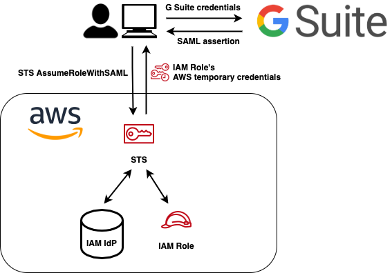

### Legend

You will find some callout to highlight some aspects better; here is the meaning behind them:

> **ACTION REQUIRED** — Act for later use.

> **INFO** — Further insights or customization for experienced people.

> **WARNING** — Be aware of the security implications.

## 1. Create a custom user attribute category

First of all, we have to add custom attributes to our users. When our Identity Provider (Google) will communicate the user's identity during login, it will transmit additional information to the Service Provider (AWS) in the form of custom attributes.

The custom attributes are **FederationRole** and **SessionDuration**. After everything is set up, we can fill in each user a set of these attributes. These will be passed to enable AWS to automatically generate a set of credentials with an [AssumeRoleWithSAML](https://docs.aws.amazon.com/cli/latest/reference/sts/assume-role-with-saml.html) API call of the duration of the **SessionDuration** parameter.

So from the admin dashboard, head to the user directory by choosing **Users**. From the top right corner in the user dashboard, choose **Manage User Attributes** and **Add Custom Category**.

Type **AWS SAML** in the category name with and proceed to fill the attributes data with:

- **Attribute name** — FederationRole, Text, Visible to users and admin, Multi-Value
- **Attribute name** — SessionDuration, Whole number, Visible to users and admin, Single-Value

> **INFO** — You can use any name you want for the category and attribute names. When we later map each attribute name to an attribute recognized by AWS to enable the federation, so feel free to use the names that better suits you and your environment.

> **INFO** — We are using a multi-value field for FederationRole to federate multiple accounts simultaneously. If you choose a single-value, you will need to create a new category of custom attributes for each AWS account that you want to federate. Feel free to do it if you know what you are doing.

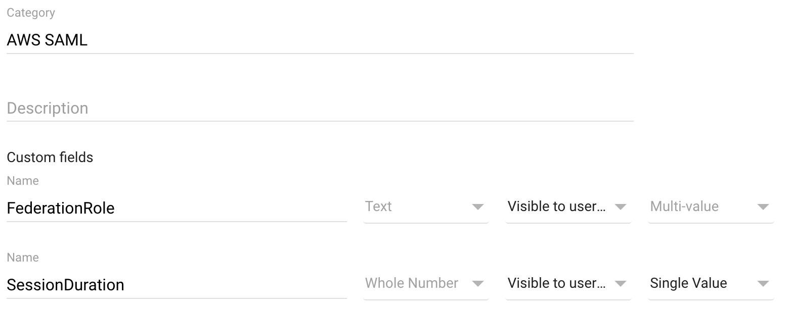

## 2. Create a SAML application

Now, to set up your SAML SSO, we need to create a custom application in the G Suite management console. The application will represent your AWS accounts in the G Suite environment and will hold all security data to make AWS and G Suite establish a secure connection. We will obtain this by sharing the secret generated during the creation of the custom application with the AWS account.

Again, from your G Suite admin dashboard, choose **Apps, SAML Apps**. From here, choose the big yellow plus icon (**+**) and select **SETUP MY OWN CUSTOM APP**.

### 2.a. IdP Metadata

This will present you with the google identity provider information and some download options. Download the **IDP Metadata (option 2)**  and keep it close; we will need this file soon.

This file contains an XML that contains some configuration parameters and the most important **X.509 certificate**. The certificate is the entity on which the trust relationship between IdP and SP is based on.

> **WARNING** — Keep your X.509 certificate in a secure place and don't disclose it's contents for any reason. **The security of the entire solution relies on keeping the content of this file confidential.**

### 2.b. Service provider details

We continue the configuration by mapping the SAML entity known as  (that is, the user will be presented to the AWS console with their email address as their unique identifier).

- **ACS URL** — https://signin.aws.amazon.com/saml
- **Entity ID** — https://signin.aws.amazon.com/saml
- **Signed Response  —** leave unchecked
- **Name ID —** Primary Email
- **Name ID Format —** Email

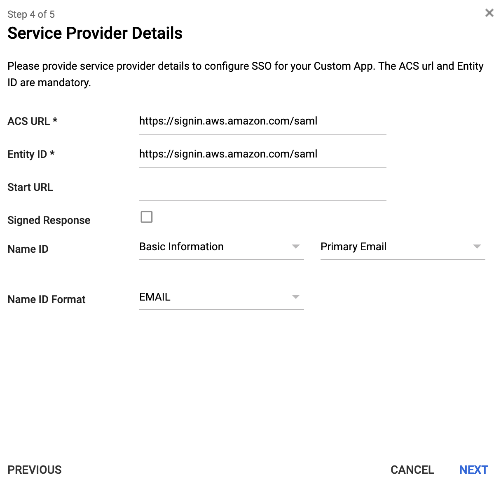

### 2.c. Attribute mapping

Now it's time to make AWS understand our custom attributes. This is done by mapping our G Suite custom attributes with specifically designed parameters on AWS:

- **Application attribute** — **[https://aws.amazon.com/SAML/Attributes/RoleSessionName](https://aws.amazon.com/SAML/Attributes/RoleSessionName)**, Basic Information, Primary Email
- **Application attribute** — **[https://aws.amazon.com/SAML/Attributes/Role](https://aws.amazon.com/SAML/Attributes/Role)**, AWS SAML, FederationRole
- **Application attribute** — **[https://aws.amazon.com/SAML/Attributes/SessionDuration](https://aws.amazon.com/SAML/Attributes/SessionDuration)**, AWS SAML, SessionDuration

> **INFO** — If you used another name for the custom category, choose accordingly.

> **INFO** — You can still change the mapping after creating the SAML application. From the admin dashboard, go to the **Apps,** **SAML Apps**, and choose the application that wants to modify. Here select **Choose Attribute Mapping** to edit.

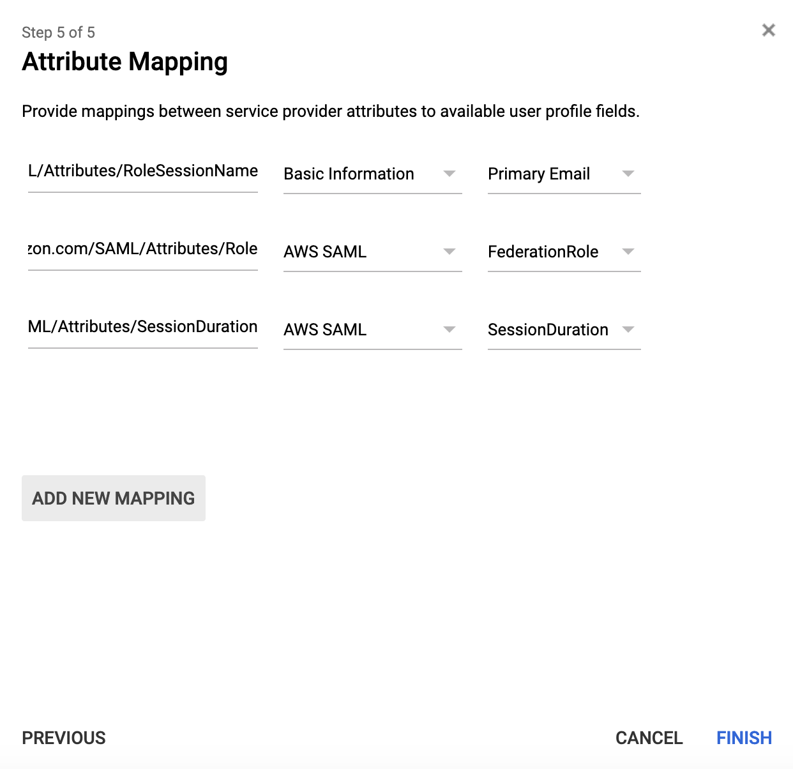

## 3. Create an AWS SAML IdP in AWS IAM

We need to create some way to make AWS aware that we are using G Suite as an identity provider. This is pretty simple, but it needs the **X.509 certificate** that we saved earlier.

Log in to the AWS console, open the **IAM** section, and from the left-side column, select **Identity Providers**. Here click on **Create Provider.**

- **Provider Type** — SAML
- **Name** — GSuiteSAML (if you don't like it, change as you wish)
- **Metadata Document** — choose the file downloaded when creating the SAML app

> **ACTION REQUIRED** — Select your newly created identity provider ARN, copy it, and set it aside.

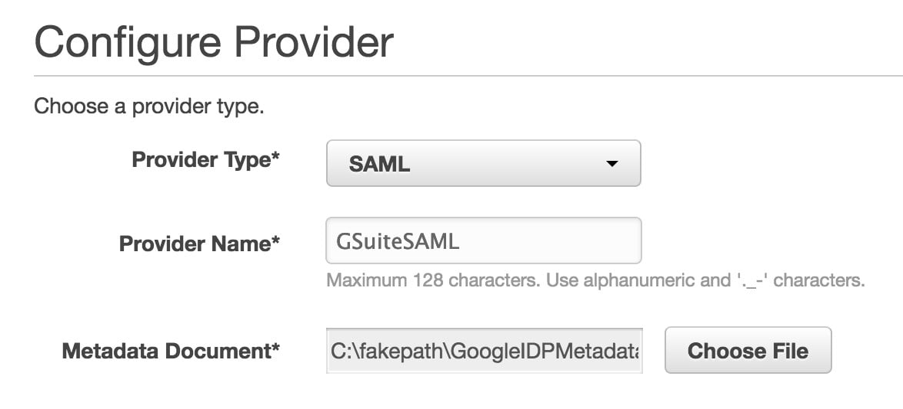

## 4. Create an IAM federated role

We need to create a role that will be automatically assumed when our corporate user will access the console. In IAM, go to **Roles, Creare role**. Here choose the SAML 2.0 federation and select from the dropdown the SAML provider created earlier; the other fields will be automatically selected. Next, assign the correct set of permission, and you're good to go!

> **ACTION REQUIRED** — Select your newly created user ARN, copy it, and set it aside.

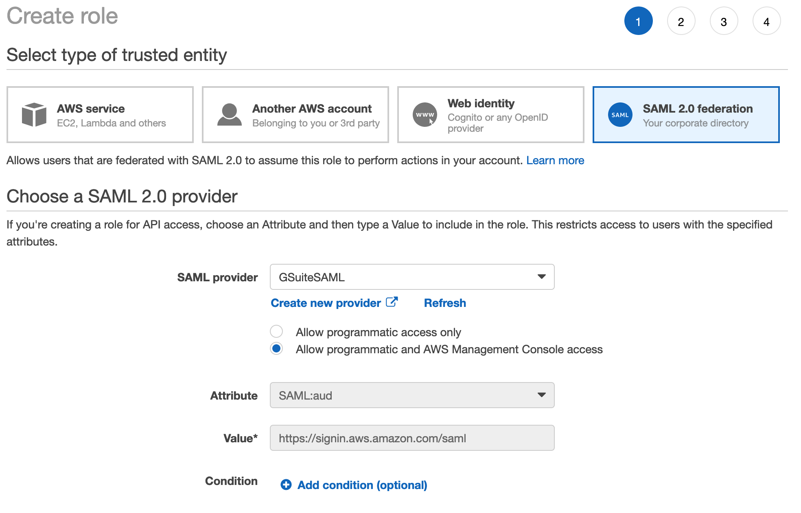

This procedure will create a **trust-relationship** with a **condition**. This basically means "If someone is authenticated through the G Suite Identity Provider, and G Suite says that they can assume this role, then they are allowed to do so".

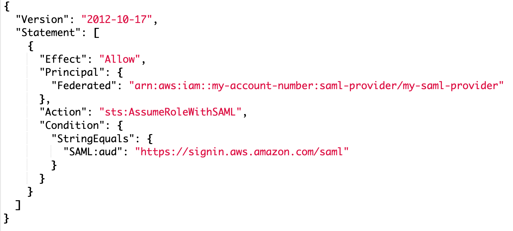

This policy can be further tweaked to let **only specific users access the role**. We can add more conditions to reach our goal; for example, this role will be accessed only by this user. You can mix and match all conditions to achieve your desired logic.

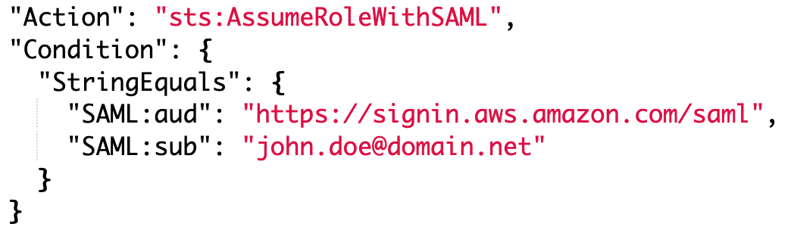

## 5. Fill custom SAML attributes for a user

Now, remember the custom attribute category that we created at the very start of the tutorial? Now it's time to fill in the info for our users. From your G Suite dashboard, choose **Users**, select the user you want to federate, and choose ** User Information** in the **User details** page.

Scroll down until you see the category with **AWS SAML** (or whatever name you used) and click on it. You will see the two values of the custom category and fill them with: ****

- **FederationRole** — This is a comma-separated string with the IAM role ARN and IdP ARN in the following format: `<Role-ARN>,<IDP-ARN>`.
- **SessionDuration** — This is the maximum time in seconds that the session will be active. Fill in **28800**.

> **WARNING** — As we have enabled MFA for all our users, we usually choose to have 1 working day-long sessions (8 hours) or 28800 seconds. Feel free to reduce the time or increase it, but mind that it cannot be longer than 12 hours and shorter than 1 hour.

> **WARNING** — As we have used a multi-part value for the **FederationRole**, we can add more values for roles and Identity Providers in different accounts so that you can manage everything from your G Suite user. Mind that you need to use the same IdP metadata to create the IAM Identity Provider in AWS. **This is a tradeoff between security and ease of management**.

> **INFO** — Alternatively, you can create multiple SAML apps, one for each account you want to federate. Like this, the metadata file will be different for each federation process. In case of a security breach and disclosure of the metadata file, the only account affected will be the one that gets disclosed. **While this process is more secure, it also increases the management overhead and needs to keep track of everything**.

## 6. Enable the SAML app

We need to enable the SAML app to make everything work and leverage our G Suite SSO to the AWS console. Choose the SAML application from the **Apps** dashboard. On the details page, choose the one that fits you best:

- **ON for everyone** to turn on the app for every user in your G Suite account
- **On for some** to turn on the app for a selective organization under your G Suite account

## 7. Test the SAML app

Now you can test the federation by choosing the SAML apps from the Google Apps menu and clicking on it. You may have to choose **More** to see the SAML app.

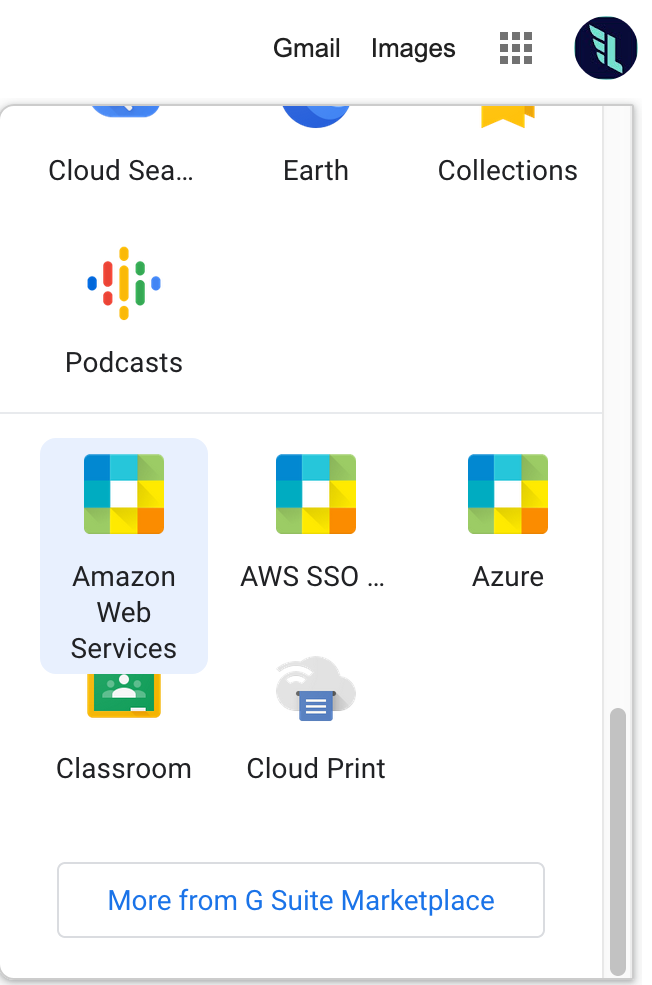

> **INFO** — We named our SAML app **Amazon Web Services**, but here you will see the apps with the names you have chosen earlier. Select accordingly.

# Bonus

We use the same configuration at our company, and during the years, we developed an internal tool that we open-sourced under the name of [Leapp](https://github.com/Noovolari/leapp). As we have many accounts from different cloud providers, we collect all our cloud access data and switch between accounts. It supports both federated and simpler access credentials.

I'll show you how to configure Leapp for this use-case.

## 1. Get SSO link

Right-click on the SAML all on your Google Apps menu and **Copy Link Location**.

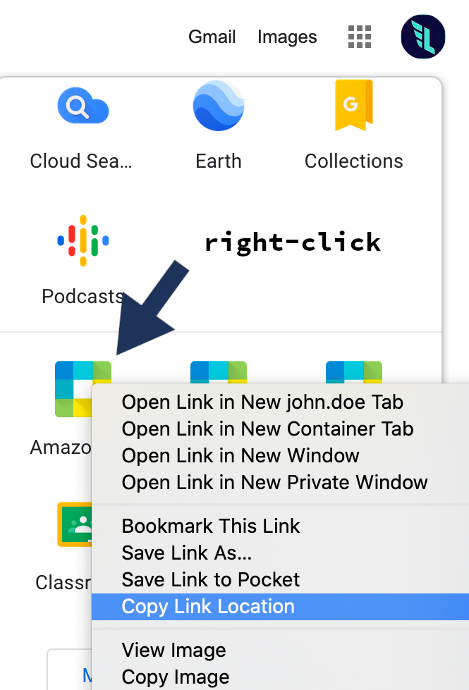

## 2. Configure Leapp

Open Leapp. [Here's the link to the latest release](https://github.com/Noovolari/leapp/releases/latest).

Click on the **top-left menu**, select **Options**, and fill in the **URL** you just copied.

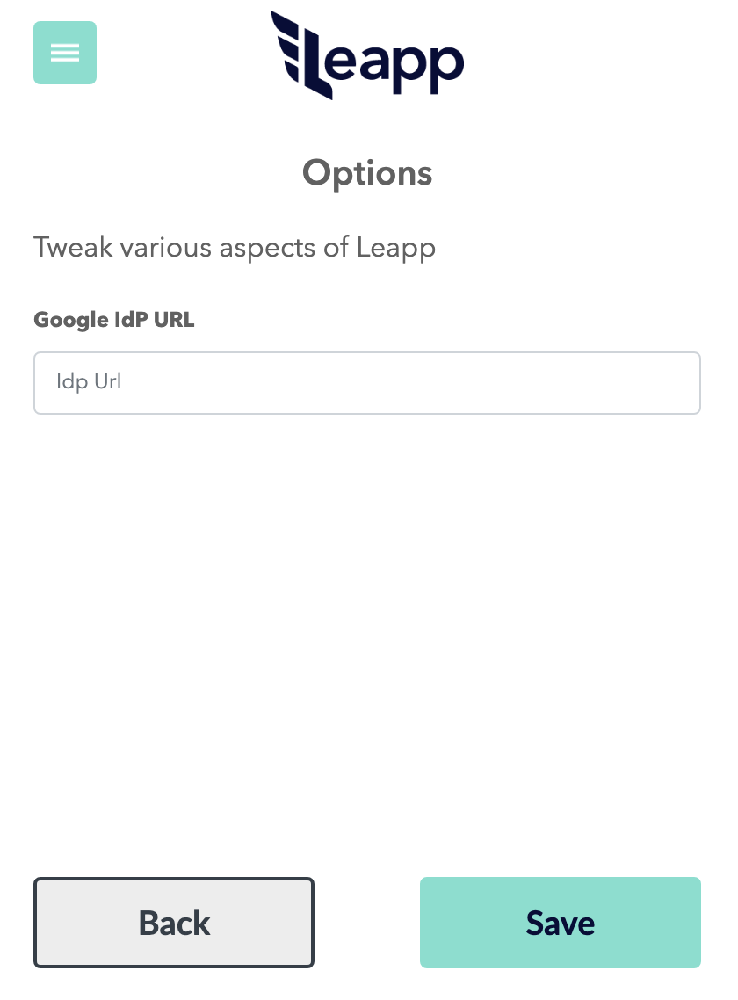

## 3. Create a Federated Account

On the home page, click on the big green (+) icon and select **AWS** and **Federated**.

Here you will fill in the information you got before:

- **Account Alias** — A name to recognize this set of accounts and roles.
- **Account Number** — The account number of your federated role AWS account.
You can get it from the role ARN or log in to the AWS console and click on your name.
- **Role** — Your role name. Not the ARN, just the last part after the backslash.
- **IdP ARN** — Your AWS IAM Identity Provider ARN.

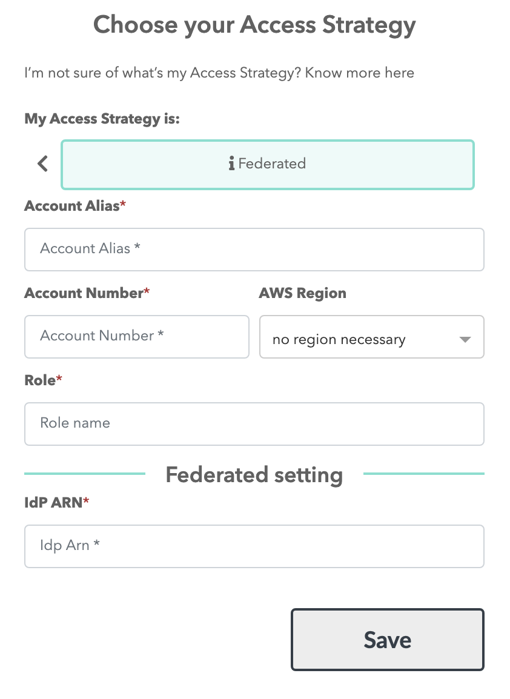

## 4. Start your session

Now you can click on the newly created entry and start your session so you can use both programmatic and console access through SSO.

[https://youtu.be/BKAD7OYIvWI](https://youtu.be/BKAD7OYIvWI)
# Two Cents on Security

There are still a couple of things that you can do to ensure the highest level of security.

You may want to consider enforcing MFA on your Identity Provider (G Suite). This lowers the risk of someone’s account being compromised and an attacker gaining access to multiple systems.

The other thing is that AWS has a neat service called [CloudTrail](https://aws.amazon.com/cloudtrail/), where you can log, monitor, and retain account activity related to actions and events across your AWS infrastructure. While we are using roles for gaining access to our AWS account, the user identity is brought along with every API call, meaning that you can still monitor what actions the federated user is performing on the account.

# Final Notes

In this blog post, we covered all the steps necessary to SAML federate your G Suite and AWS accounts and shared some technical insights. It may seem like a lot to get going, and it is a fair amount of work to get set up, but if you don't want to commit to AWS SSO or want to understand better what is involved in the process of SAML federation, it's totally worth your time.

If you are interested in those topics, follow us on our [medium publication](https://medium.com/leapp-cloud) for the third article of this series, coming next week. 
