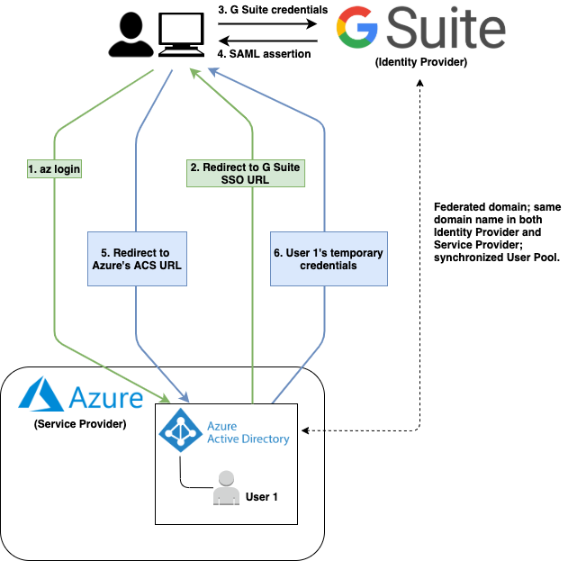
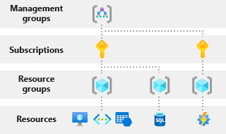
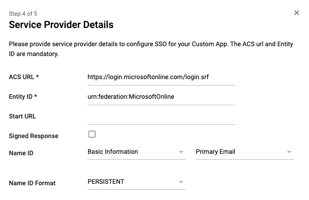
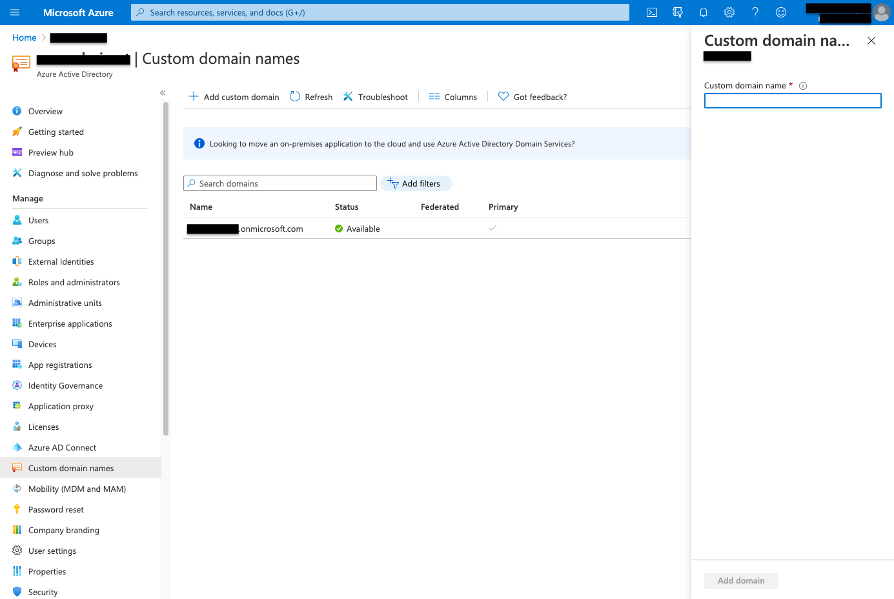
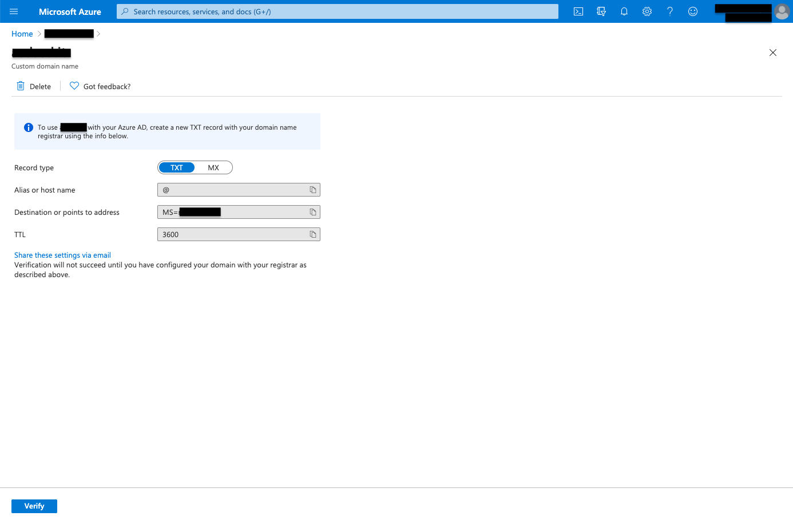
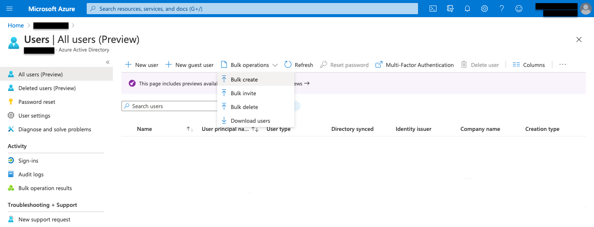
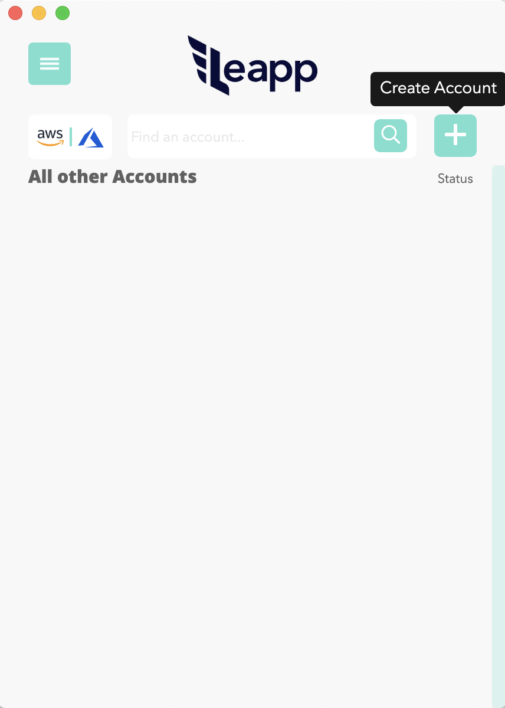
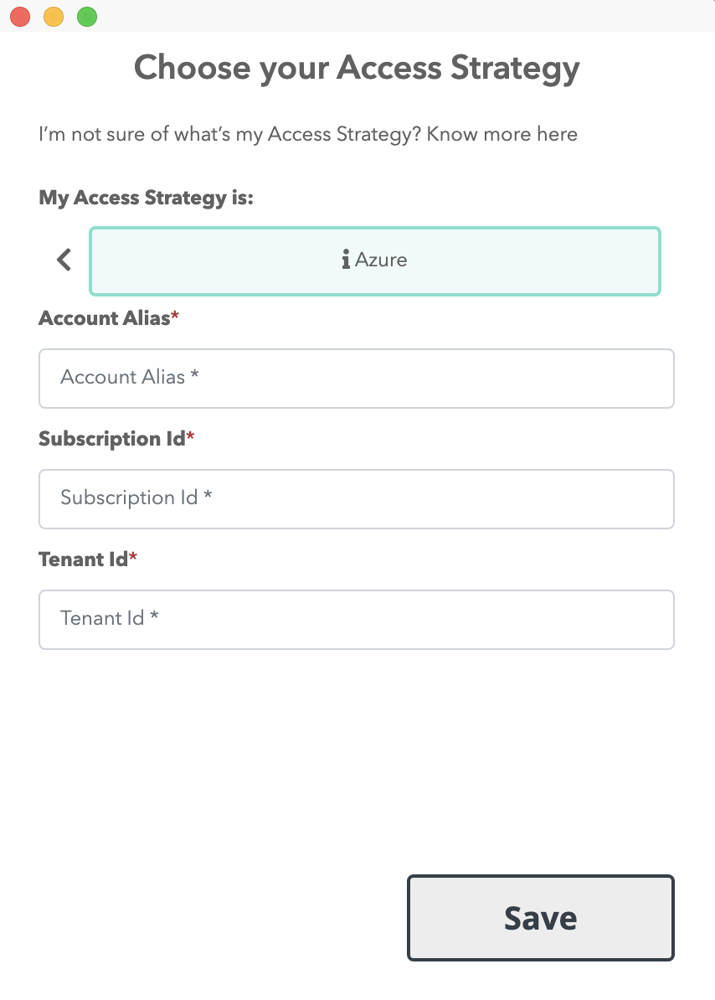
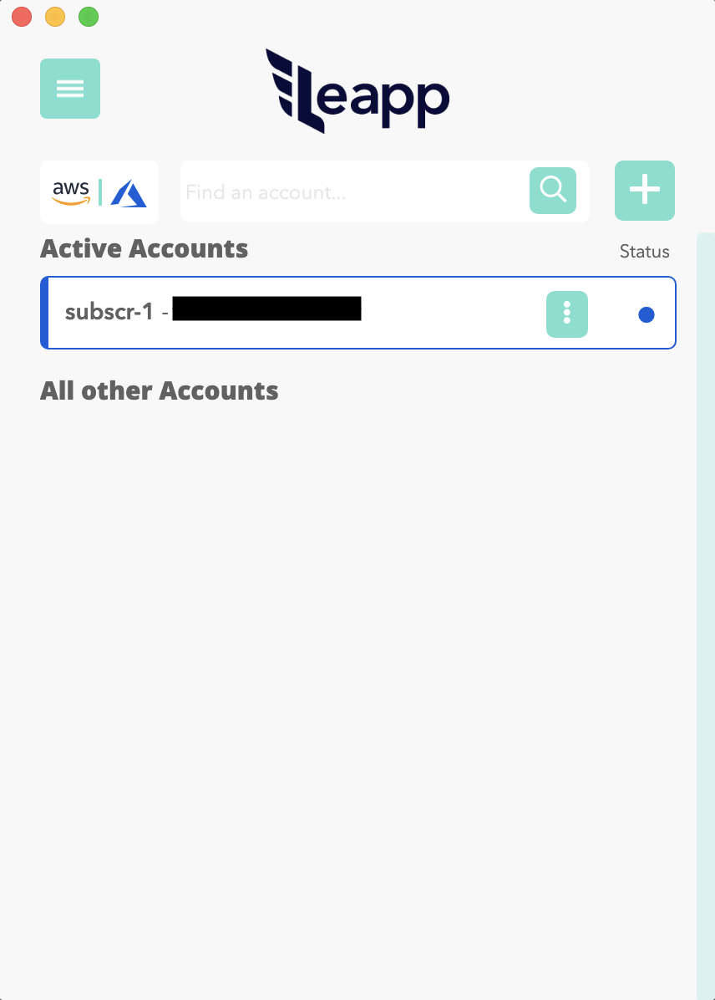

# How to SAML federate your Azure account with G Suite

# Why should I use an external Identity Provider?

One of the most seen patterns in talking about Cloud Access Management consists of adopting an external Identity Provider to store, manage, and authenticate your corporate identities that need to access resources in multiple Cloud Providers.

Enabling Access to those resources involves setting up a federation between your Cloud Accounts and your Identity Provider.

In the previous blog post, we described how to set up a federation between G Suite, as the Identity Provider, and AWS, as the Service Provider. Here we will shift the focus on the federation process between G Suite and Azure.

If you come from the Azure world, you have probably used - or at least seen - Azure AD as your Identity Provider to access resources contained in your Azure accounts; it is relatively straightforward.

But what if you are new to Azure and want to make it accessible by your G Suite users without migrating them to Azure AD or another Identity Provider?

Read on, you're in the right place!

We are showing you the path to a convenient and maintainable solution for delegating corporate identity management and authentication to an already set up Identity Provider.

# Use case: Access Azure accounts through the Azure CLI

Let's assume a real-world use case:



**Figure 1:** Federated Single Sign-On that involves G Suite ad IdP and Azure as SP.

This scenario shows a G Suite user - or identity - logging into Azure through the Azure CLI's `az login` command.

As you can see, to allow G Suite identities to access Azure, it is necessary to Federate the G Suite [Organisational Unit](https://support.google.com/a/answer/4352075?hl=en) with the Azure AD Domain; we will see later in this article how to implement it.

Keep in mind that Azure AD remains Azure's entry point even if it doesn't act as Identity Provider. Azure AD delegates the authentication process to G Suite.

# **Role-Based Access Control for Azure resources**

Once a user has authenticated against the Identity Provider, he can access resources in different Azure Subscriptions based on his assigned roles. This kind of Access is called Role-Based Access Control or RBAC.

To better understand how RBAC works, we start presenting the main actors involved.

The first one we will focus on is the **Tenant**. It represents "the organization that owns and manages a specific instance of Microsoft Cloud Services," i.e. a specific Tenant manages one or many Microsoft Cloud Services subscriptions, from Microsoft Office 365 to Microsoft Azure.

Each Tenant is associated with one and only one **Directory**, which represents the Azure AD service.

In its default configuration, the Azure AD Directory is responsible for managing and authenticating a user pool. As stated before, in this configuration, the Identity Provider is an external one, i.e. G Suite.

We can associate a directory to one or many Subscriptions; users' Role-Based Access to these Subscriptions is controlled through Azure Identity and Access Management (IAM) service.

We can control Role-Based Access at four different levels:

* **Management Groups** - help you manage your Azure subscriptions by grouping them;
    
* **Subscriptions** - help you organize access to Azure resources and determine how resource usage is reported, billed, and paid for;
    
* **Resource Groups** - containers that hold related resources for an Azure solution;
    
* **Resources** - Cloud Resources, e.g., Virtual Machines, Databases.
    



**Figure 2:** Different levels of scope at which RBAC can be configured.

This system allows you to define granular access to your resources by your corporate users.

# Federation Tutorial

Now that you know how RBAC works and the idea behind the federation between an Azure AD Custom Domain and an external IdP, let's focus on the Federation Tutorial steps.

## 1) G Suite SAML Application setup

The first step of this tutorial is about creating a **Custom SAML Application** inside the G Suite Admin Console. This application represents your Service Provider, i.e. Microsoft Azure, in the G Suite side.

The Custom SAML Application contains all the information needed to send a digitally signed XML document containing the identity provider's authenticated identity to the Service Provider.

This XML document is called **SAML Assertion** and will be signed by the Identity Provider using an **X.509 Certificate** shared with the Service Provider.

The Service Provider uses the shared Certificate to retrieve and validate the SAML Assertion.

Once logged into the Admin Console, navigate to **Apps** from the Dashboard. From the Apps menu, select **SAML apps**. The SAML apps section provides you a list of the existing SAML Applications and allows you to create a new one by clicking the plus yellow button on the page's bottom right.

A new 5-steps wizard will be opened;

in the wizard's first step, select **SETUP MY OWN CUSTOM APP**.

Go on and choose **Option 2** to download the IdP information in the form of **IdP metadata**. IdP metadata is an XML file that contains the X.509 Certificate, too; that's why I suggest you store it in a secure place. Moreover, it will be used in the last step of this tutorial to configure Azure AD Custom Domain's authentication method as federated.

At this point, you need to configure the Custom SAML Application's name, description, and logo; the last two properties are optional.

In the wizard's fourth step, provide the following SSO details to configure your Custom SAML Application:

* **ACS URL**
    
    **Description:** The Service Provider's URL to which the SAML Assertion will be forwarded once the user has authenticated himself successfully.
    
    **Value:** `https://login.microsoftonline.com/login.srf`
    
* **Entity ID**
    
    **Description:** indicates the audience the SAML Assertion is intended.
    
    **Value:** *urn:federation:MicrosoftOnline*
    
* **Name ID**
    
    **Description:** SAML assertion attribute indicating who the user is.
    
    **Value:** *Basic Information &gt; Primary email*
    
* **Name ID Format**
    
    **Description:** defines Name ID's format.
    
    **Value:** *PERSISTENT*
    



**Figure 3:** SAML Application's Service Provider Details definition.

The last step consists of the attribute mapping definition, which is used to determine a mapping between attributes defined inside the SAML Assertion and attributes used inside the Service Provider. In this case, it is not necessary to define them, while it is fundamental if you want to federate a G Suite Organisational Unit with an AWS Account, but this is not the case.

Once created, you should be able to see the SAML Application in the SAML apps section.

## 2) Azure AD Custom Domain Name setup

In this step, we will configure a new Azure AD Custom Domain Name; you can skip it if you've already created one that suits your needs.

Move to Azure Active Directory service in the Azure management console, and select **Custom domain names** in the left sidebar to open the relative section.

If you've never created a custom domain before, you should see only one domain, i.e. the default primary domain which name ends with `.onmicrosoft.com`. If this is your case, please leave it as your primary domain.

Now click on **\+ Add custom domain** to create a new custom domain. A right sidebar will appear; here, you have to specify the new custom domain's name.



**Figure 4:** Add custom domain.

Once the custom domain name is specified, you can move to the domain verification step by clicking the **Add domain** button.



**Figure 5:** Custom domain verification.

As illustrated in Figure 5, you need to verify the newly created custom domain name by creating a TXT record with your domain name registrar using the provided information. As your custom domain has been verified, its **Status** attribute should appear as **Verified**.

**DON'T** set the new custom domain as the primary one; otherwise, you will not be able to federate it to the external Identity Provider.

## 3) Users import

To enable corporate users to access your Azure Subscriptions, you have to add them to your Azure Active Directory before federating the custom domain to G Suite.

You can do that from Azure Active Directory's **Users** section, which is reachable by clicking Users in the left sidebar.

You can add new users to your Azure Active Directory in the Users section by clicking **\+ New user**. You can even upload a CSV file containing your corporate users by clicking **Bulk operations &gt; Bulk create**.



**Figure 6:** Azure Active Directory users creation.

Before proceeding with the federation setup, remember to set users' **ImmutableId**. You may wonder what ImmutableId is? Well, it is an attribute that uniquely identifies a user in Azure Active Directory's context. To make federated Access work fine, ImmutableId should correspond to the user's email address.

You can configure Users' ImmutableId using the **Set-MsolUser** command from the PowerShell's **MSOnline** module.

To install the MSOnline module through PowerShell, use the following command:

```plaintext
Install-Module MSOnline
```

Once installed, you can connect to your Azure Tenant through Connect-MsolService and set the user's ImmutableId through Set-MsolUser. Connect-MsolService requires you to authenticate with your Azure credentials.

Be sure you are authenticating as a Member User and have sufficient privileges to run the Connect-MsolService command.

```plaintext
Connect-MsolService
Set-MsolUser -UserPrincipalName <user-email> -ImmutableId <user-email>
```

If your necessity is to import many users to Azure AD, it would be easier to set their ImmutableId automatically. e.g., using a PowerShell script that iterates over the list of imported users and runs the Set-MsolUser command for each of them.

At this point, imported Azure AD users, which belong to the newly created Custom Domain, can still not sign in using G Suite credentials since the Custom Domain has not yet been federated to the G Suite Organisational Unit.

To make a practical example, you will be able to access Azure resources using the `az login` command, but you can't do that providing your G Suite User credentials.

So, let's move to the step that could appear innocent at first glance, but I guarantee a real pain when it's the first time you're dealing with it, causing you to struggle to find the right documentation setup to make it work fine.

## 4) Federation setup through PowerShell script

Here we will see how to federate your Azure AD Custom Domain with your G Suite Organisational Unit using a PowerShell script cause it seems the only way to do that, at least in my experience.

Here is the PowerShell script we used to set up the federation:

```plaintext
Install-Module MSOnline

Connect-MsolService

$domainName = "<your-custom-domain-name>"
[xml]$idp = Get-Content <metadata-xml-file-path>
$activeLogonUri = "https://login.microsoftonline.com/login.srf"
$signingCertificate = ($idp.EntityDescriptor.IDPSSODescriptor.KeyDescriptor.KeyInfo.X509Data.X509Certificate | Out-String).Trim()
$issuerUri = $idp.EntityDescriptor.entityID
$logOffUri = $idp.EntityDescriptor.IDPSSODescriptor.SingleSignOnService.Location[0]
$passiveLogOnUri = $idp.EntityDescriptor.IDPSSODescriptor.SingleSignOnService.Location[0]

Set-MsolDomainAuthentication `
  -DomainName $domainName `
  -FederationBrandName $domainName `
  -Authentication Federated `
  -PassiveLogOnUri $passiveLogOnUri `
  -ActiveLogOnUri $activeLogonUri `
  -SigningCertificate $signingCertificate `
  -IssuerUri $issuerUri `
  -LogOffUri $logOffUri `
  -PreferredAuthenticationProtocol "SAMLP"
```

This script invokes three cmdlets:

* **Install-Module**, to install the MSOnline module, which contains the other cmdlets necessary to set up the federation between Azure AD and G Suite;
    
* **Connect-MsolService**, already described before, and used to connect to your Azure Tenant;
    
* **Set-MsolDomainAuthentication**, to set up the Custom Domain's authentication method to federated.
    

I suggest looking at the [documentation](https://docs.microsoft.com/en-us/powershell/module/msonline/set-msoldomainauthentication?view=azureadps-1.0) page for a complete description of the Set-MsolDomainAuthentication cmdlet and its parameters.

Let's focus on three parameters, except the **DomainName** one, which corresponds to the Azure AD's Custom Domain Name you should already have set up.

* **Authentication** - These parameters make Azure AD manage authentication autonomously or delegate authentication to an external IdP, in this case, G Suite. To complete Azure AD delegate authentication, we set Authentication to **Federated**.
    
* **SigningCertificate** - The value associated with this parameter corresponds to the **X.509 certificate** included in the **metadata XML file** downloaded during the G Suite SAML Application creation phase. It is necessary for the Service Provider, i.e. Azure AD, as the gateway to Azure Subscriptions, to retrieve the **signed** authentication response. As you can see from the script, the metadata XML file is loaded from the local path in which you placed it.
    
* **PreferredAuthenticationProtocol** - It is crucial to specify **SAMLP** as the protocol used to authenticate users against the Identity Provider, as we set up a SAML Application on the G Suite.
    

Keep your fingers crossed and run the script... Hopefully, a check in the **Federated** column should appear!

Finally, you've successfully federated your Azure AD Custom Domain with your G Suite Organisational Unit.

# Now, log in! 🚀

At this point, we have all the instruments set up to log into your Azure Tenant with your G Suite credentials; it's needless to say that, to test the federated single sign-on, you should have a G Suite User's credentials in your hands. The same User should be present in the Azure Active Directory, as explained before.

Now let's demonstrate the flow described in **Figure 1**, gaining Azure access tokens through [**Leapp**](https://github.com/Noovolari/leapp), our Open Source credentials management tool.

I've already federated my test G Suite Organisational Unit with my test Azure Tenant, which contains a Subscription accessible by my User as **Reader**. The reader is the role of my User, on the Azure side, for the Subscription I want to access. This role assignment follows RBAC rules.

Inside [**Leapp**](https://github.com/Noovolari/leapp), to add a new Azure Subscription, click the **+** square button on the top-right side of the accounts list, which is empty as you run [**Leapp**](https://github.com/Noovolari/leapp) for the first time.



**Figure 7a:** Add an Azure Subscription using [**Leapp**](https://github.com/Noovolari/leapp).

Then, click on the Azure icon to open the Azure Subscription creation form.



**Figure 7b:** Add an Azure Subscription using [**Leapp**](https://github.com/Noovolari/leapp).

You've to provide the alias and the ID of your Azure Subscription; moreover, you've to supply the ID of the Tenant that contains the Subscription.

Once saved, you should see the new Azure Subscription in the accounts list.



**Figure 8:** Newly created Azure Subscription shows up in the accounts list.

By clicking the card associated with the Subscription, [**Leapp**](https://github.com/Noovolari/leapp) will initiate the federated single sign-on flow, assuming that you've set up federation correctly.

What do I mean with the federated single sign-on flow? I mean prompting for a G Suite User's credentials since Azure AD delegates the authentication to G Suite.

Under the hood, [**Leapp**](https://github.com/Noovolari/leapp) invokes the `az login` command, opens a new tab in your default browser, and redirects you to the G Suite login page. If we provided the right credentials, we'd be authenticated and issue Azure CLI's commands from the terminal. In this case, as we've associated a Reader role to the Azure AD User, we can issue the `az vm list` command to retrieve the list of VMs in the Subscription. The Azure CLI relies on the temporary credentials generated by [**Leapp**](https://github.com/Noovolari/leapp) and stored in the **~/.azure/accessTokens.json** file.

# Final considerations

In this article we learned how to set up a federation between G Suite and Azure and the reason that drives the adoption of this access pattern.

We applied this access pattern to a real use case in which we gained access to an Azure Subscription quickly and easily using [**Leapp**](https://github.com/Noovolari/leapp).

We control User's privileges inside our Azure Tenant through the Role-Based Access Control concept, which we will deepen in one of the next publications.

For what concerns security, RBAC plays a key role in this scenario. In addition to assign proper roles to specific Users inside our Tenant, it may be necessary to add MFA on the IdP side, i.e. G Suite, to protect our Cloud Environment following best-practices.

# That's all, folks!

I hope you enjoyed this blog post, and that it gave a clear understanding of how SAML federated access to Azure from G Suite can be set up and controlled, from a security point of view.

Of course, this is only one of the possible configurations enabling access to Azure; have you ever find yourself to deal with this, or similar use cases? Are there any other related aspects you'd like to explore?

Give us your feedback! It is always welcome and appreciated, and allows us to provide better content, aligned to real world applications.

[https://github.com/Noovolari/leapp](https://github.com/Noovolari/leapp)