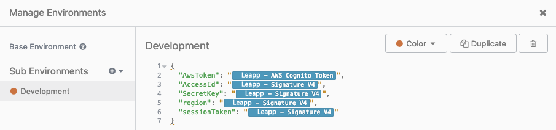
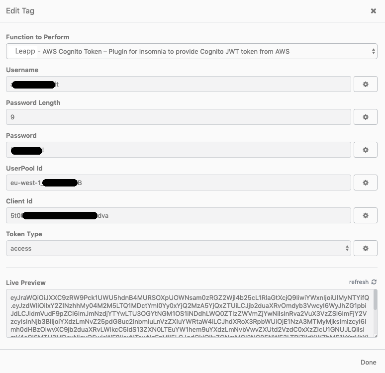
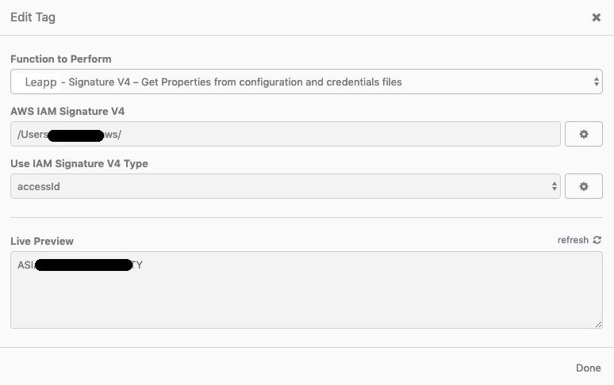
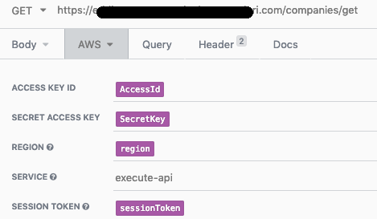
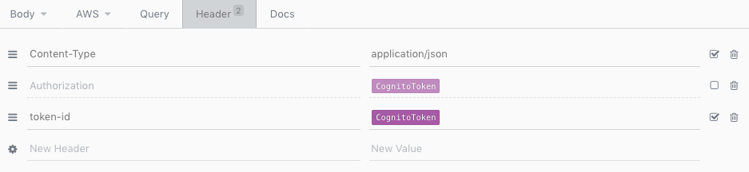
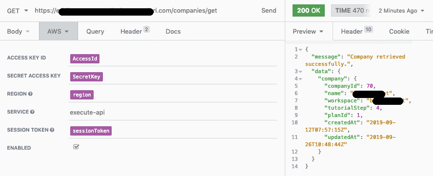

# Testing your Signature v4 Cognito authenticated API: an Insomnia Plugin

## Introduction

Nowadays, applications are made more and more with a serverless approach in mind. Developers strive to separate as much as possible front-end tasks and structures from back-end and vice-versa.

With this approach, the testing phase still remains extremely important, but sometimes due to several reasons, it becomes inconvenient for front-end and back-end teams to rely on each other for retrieving information useful for asserting their code.

There are several reasons for that: time constraints, different speed in development, working on several branches, etc. Also, in our case, two extra motivations contribute to making this task more tedious than what it should have been.

1. As said, we were transitioning to a Serverless approach, so no more View and Logic tied together in the same codebase.
2. We used and still use Cognito as a means of authenticating our user pools for different applications, and many APIs are protected and need user's authentication for that.

**AWS** **Cognito** is handy when it comes to creating authentication flows both for users and for APIs (especially with API Gateway), nonetheless without installing a library, **mocking authentication with Signature V4 is no easy** task for sure.

In the early stages of Leapp development, we, as a team, faced the same situation.

Part of a side-project involving a Serverless architecture, filled with AWS Lambda functions as the back-end, required constant testing, being its logic complex and touching several areas of the software.

Of course, this meant testing authenticated calls!

We **needed access to the API** (made with Lambdas) **through API Gateway** to make different integration tests: this would make the REST ajax API from a mocked front-end using Signature V4 for authenticating the calls themselves.

Usually, this is done quickly by regular Javascript/Typescript calls given you are using the suggested AWS SDK, but how you can do that when you need to mock your front-end in back-end tests besides calling it directly? We got a solution by exploiting [Insomnia](https://insomnia.rest/) plugin feature and developing a system to integrate Cognito Authentication to Insomnia to allow back-end developers to test their logic by making API calls directly from the tool.

This enhancement allowed us to decouple our testing phases and reduce the urge to keep the two teams always aligned. This is especially important because, as stated before, usually back-end can develop faster than the front-end as it doesn't have to deal with UI composing.

Insomnia is a free cross-platform desktop application for making REST and GraphQL interacting with HTTP-based APIs. Insomnia combines an easy-to-use interface with advanced functionality like authentication helpers, code generation, and environment variables. It allows team collaboration, and it's a tool of choice by many big companies, including Netflix and Cisco.

Moreover, Insomnia is an Open-Source project, acquired by [Kong](https://konghq.com/), and this was a motivator for us in choosing it because of the same very nature that drives our application [Leapp](https://www.leapp.cloud/).

By using our integration, it is possible to do authenticated calls to APIs behind Amazon API Gateway with an authenticator enabled.

## Plugin structure

Insomnia gives some pretty neat instructions on how they want a plugin project to be structured.

By following the reference on this page: [https://support.insomnia.rest/article/26-plugins](https://support.insomnia.rest/article/26-plugins), we have created a **new node.js project.**

We took extra attention to having a **package.json** similar to the one provided below, and that points the key "main" to "./src/plugin.js" and have "insomnia" as one of the keys (this last part is essential to make Insomnia recognize the code as a plugin):

```json
{
  "name": "insomnia-plugin-aws-cognito-token",
  "version": "0.11.0",
  "description": "Plugin for Insomnia to provide Cognito JWT token from AWS",
  "main": "./src/plugin.js",
  "scripts": {
    "test": "echo \"Error: no test specified\" && exit 1"
  },
  "author": "Leapp Team",
  "license": "MIT",
  "repository": {
    "type": "git",
    "url": "https://github.com/Noovolari/insomnia-plugin-aws-cognito-token.git"
  },
  "keywords": [
    "insomnia",
    "plugin",
    "AWS",
    "Cognito",
    "AppSync"
  ],
  "insomnia": {
    "name": "awscognitotoken",
    "description": "Plugin for Insomnia to provide Cognito JWT token from AWS"
  },
  "dependencies": {
    "amazon-cognito-identity-js": "^3.0.5",
    "aws-sdk": "^2.373.0",
    "crypto-js": "^3.1.9-1",
    "jwt-decode": "^2.2.0"
  }
}
```

Then create a directory **src** in the **root** folder and add a new **plugin.js file**. Inside the file we want a structure similar to this one:

```tsx
/**
 * Example template tag that generates a random number 
 * between a user-provided MIN and MAX
 */
module.exports.templateTags = [{
    name: 'random',
    displayName: 'Random Integer',
    description: 'Generate random things',
    args: [
        {
            displayName: 'Minimum',
            description: 'Minimum potential value',
            type: 'number',
            defaultValue: 0
        }, 
        {
            displayName: 'Maximum',
            description: 'Maximum potential value',
            type: 'number',
            defaultValue: 100
        }
    ],
    async run (context, min, max) {
        return Math.round(min + Math.random() * (max - min));
    }
}];
```

Template tags in the "args" section are used to define input variables, and "async run" uses positional variables to get them and run some logic for the plugin. This is, of course, a simplification, and you can undoubtedly call another method external to the **module exports** to keep the code more maintainable, extensible, and clean.

## How to install the Insomnia plugin

Installing plugins in Insomnia is so easy. You just have to go on the Preferences and select the plugin tab. Then type `insomnia-plugin-aws-cognito-token` in the field that shows up and select "Install plugin." You have correctly installed the plugin!

## Plugin Setup

To make it works to your needs, go into Insomnia → Preferences: click on **development** in the top-left corner, and choose "**Manage Environments**"; a new window will open up to show your current environments. Following directives from the figure below, click in the right corner as shown to create a new **JSON structure**:



For each parameter, we need a **key** in the JSON file, representing one of the possible dynamic variables used by the Insomnia plugin. Create the necessary permits like in figure — keeping in mind that we needed all the parameters to exploit V4 signature, but this is not necessarily true for everyone; thus you can keep only **AwsToken**—.

To have access to our plugin's functionalities to insert the correct value for a variable, just start typing "Leapp", and by pressing **cmd + space** (mac users) or **ctrl + space** (Windows and Linux users), you'll have access to **two** features to choose from:

- **Leapp - AWS Cognito Token**
- **Leapp - Signature V4**

Once selected the plugin's name, this should become highlighted as shown in the figure, and, at that point, it's possible to click on it to have access to configuration parameters. Let's see those of **Aws Cognito Token**:



You'll be asked to insert parameters like "email" (or username), "password length" (needed to avoid Insomnia making a request for every password character), and another set of parameters retrievable from **Cognito's** **UserPool**.

If everything is set up correctly in Live preview, you'll see the token pre-calculated like in the figure.

Let's now see IAM's V4 signature parameters. Following again the previous steps, for the same environment, generate a new **JSON object**, create the **keys**, and **associate** the signature feature, then click on it and go to the following screen:



On this page, you'll have to set your AWS **config** and **credentials'** file path — our plugin defaults it to your home directory —.

Then we proceed in selecting the Signature V4 property we want to assign to our variable for Insomnia; this procedure **must** be repeated for Access Id, Secret Key, Session Token, and Region.

Once the setup is completed, it will be possible to do authenticated API calls by following this procedure:

1. First thing first, select **AWS** as a property for "Auth" as shown below:


2. Insert parameters as described below:



3. As a final step, we need to complete Cognito Authentication setting this parameter like in figure:



You'll have to add **Content-Type** property with value **application/json** and our **CognitoToken** parameter as a **token-id,** set in an environment with the previous steps.

## Final testing

We are ready to test the call: if all parameters are defined correctly, and your session token is still valid, you can use "Send" to launch your request as we did in the image below to see the response object in the right part of the Insomnia screen.



## Security Considerations

One significant consideration we made was being sure to get sensitive information like credentials from the AWS Credentials' file and not to add them directly from the plugin.

Moreover, we wanted the credentials' file to persist on the developer's machine only for the time strictly necessary to work with it.

That's why this plugin is not only a helpful tool for our Leapp software, but it also obtains advantages by using it in combination.

[Leapp](https://www.leapp.cloud/) is our Open-Source software for managing credentials in a multi-cloud environment with a keen eye on security as it can create and delete sensitive information on the fly, avoiding having credentials stored on a user's machine when not needed.

## Conclusions

In this article, we found the occasion to share with all the readers how an internal need can be the drive to create something useful not only for a particular team but also for the Developer community.

The topic of splitting as much as possible dependencies between front-end and back-end to increase efficiency and parallelism is always an important one, especially when it comes to testing and/or debugging complex functions.

As things evolved in times, the front-end is now more complicated than before, and sometimes it requires more coding time than the back-end, mostly if the back-end is done with a **serverless** approach; this difference can cause the inability of the front-end to serve back-end REST calls when needed.

Keeping that in mind, we developed this plugin to help us realize Leapp with more ease, and we sincerely hope that our experience can help anyone reading this article and maybe willing to participate in evolving the project even more being it Open-Source.

Until our next article, stay safe and try Leapp! 🙂

[https://github.com/Noovolari/leapp](https://github.com/Noovolari/leapp)