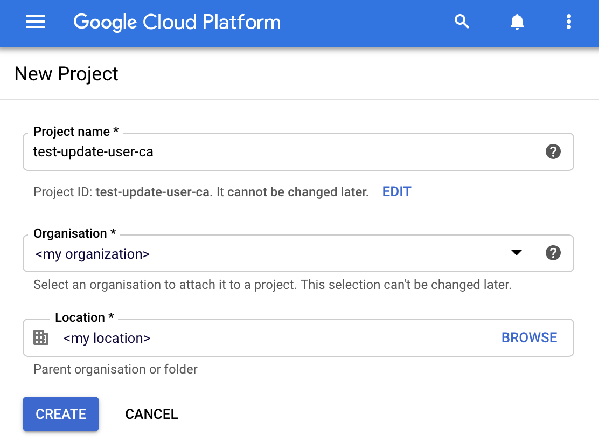
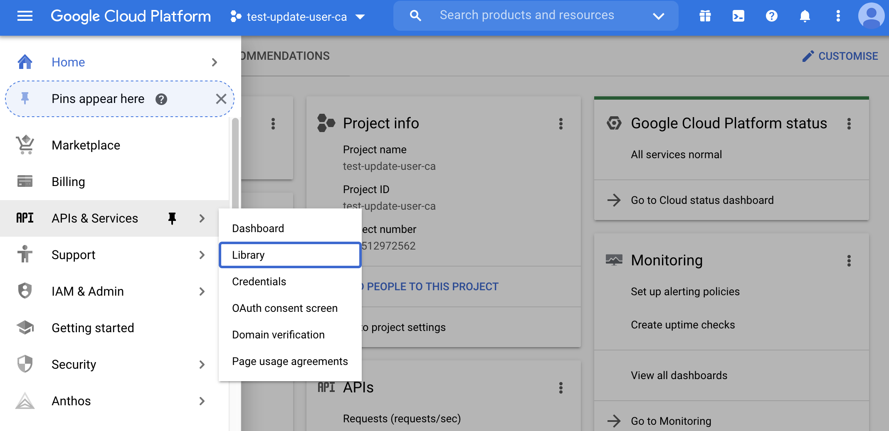
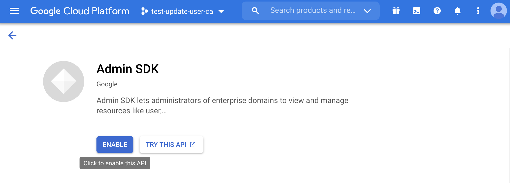
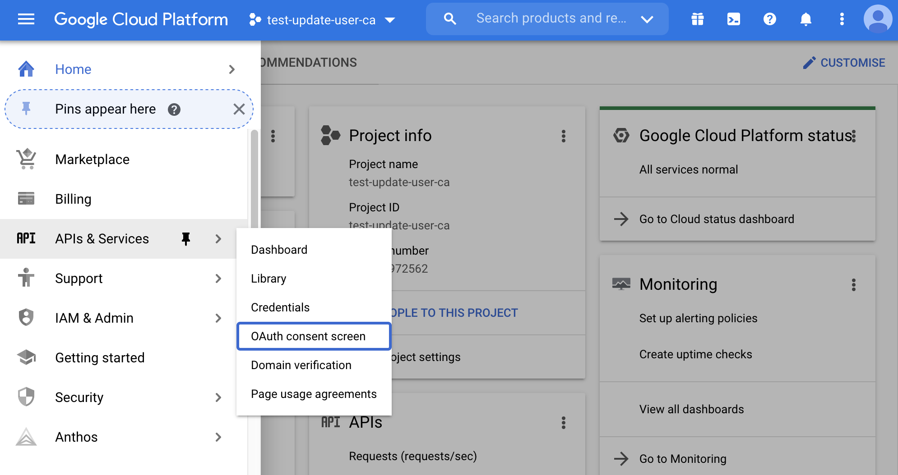
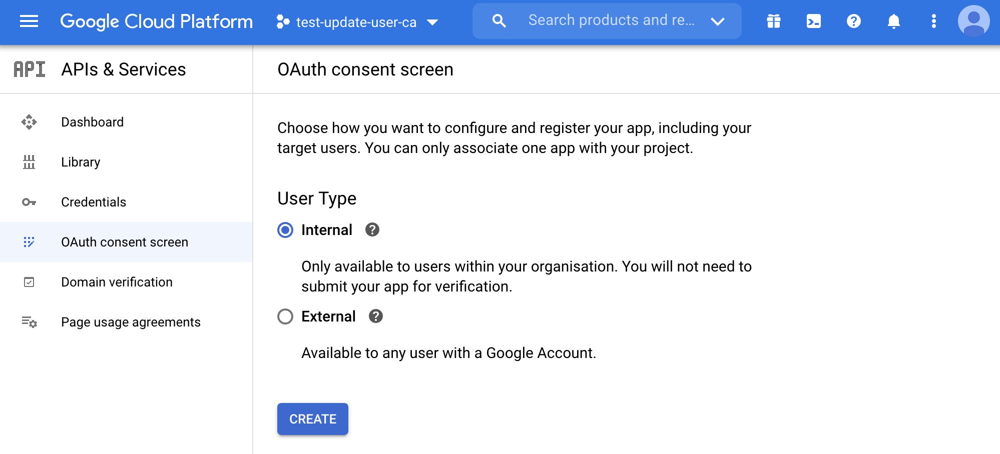
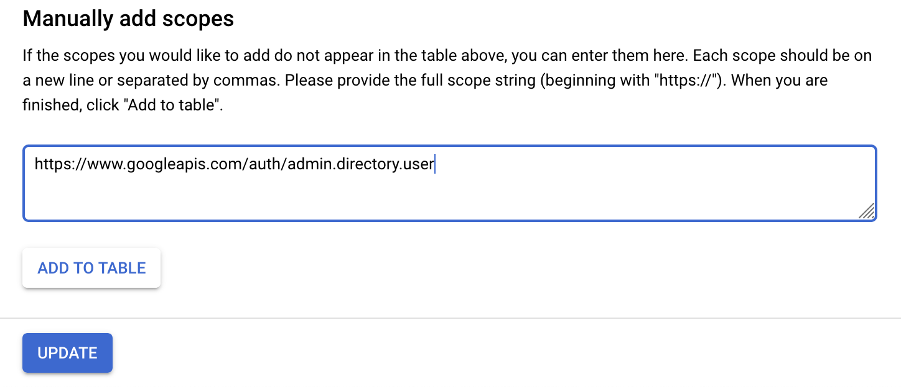
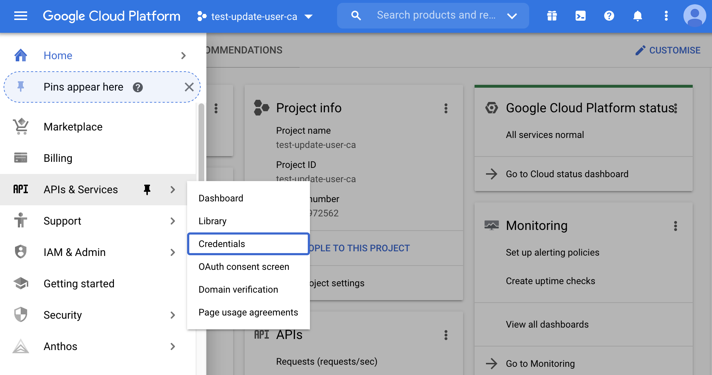
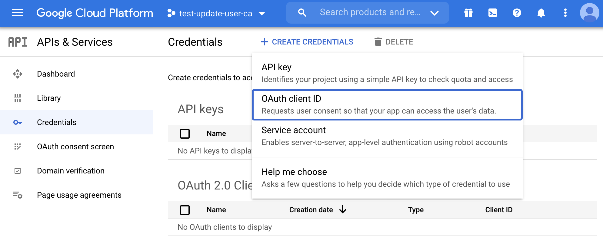
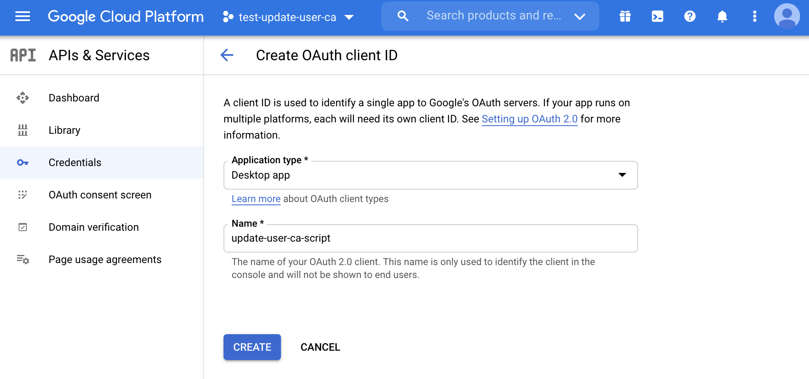
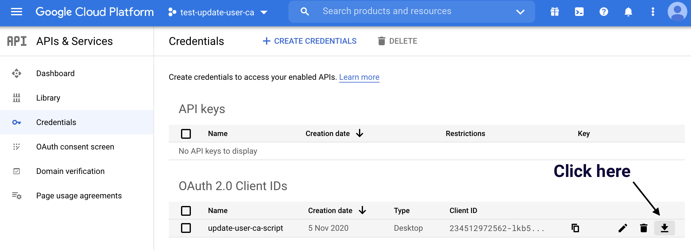

# How to update in bulk G Suite users' custom attributes with Google Admin SDK


In my  [previous blog post](https://blog.leapp.cloud/how-to-saml-federate-your-aws-account-with-g-suite), we discussed in-depth how to set-up a federation between AWS and G Suite to enable developers to log-in to the AWS Console through single sign-on (SSO) and generate short-lived local credentials with [Leapp](https://github.com/Noovolari/leapp).

While discussing in the Reddit forum, one exciting question came out:

> What if I add a new AWS IAM role that I want lots of users to assume from G Suite – would I have to add them to each user manually, or is there a better way?

Thing is... there is! And I'll show you how to do that.

### Attention please!

You can **scroll down to the TL;DR section** for the busiest people who don't need to dive deep into how the script works and prerequisites. I suggest you at least take a look at the configuration part.

Be aware that we will programmatically change data with extensive permissions, but there is no other way to accomplish the same thing so be careful. I suggest you try this on a test environment before changing anything on your real users.

**Don't make the sysadmin team angry!**

## Overview

1. Create a Google Cloud Platform Project
2. Enable the Admin SDK
3. Create the OAuth Consent Screen
4. Create the OAuth Client
5. Configure the script
6. Run the script

## Requirements

- A G Suite subscription with an admin account
- A Google Cloud Platform account
- The custom schema definition
- A list of users we want to update
- Account number, role names and provide names to give access to

> ⚠️ — if you don't have already, you can follow [this guide](https://blog.pethron.me/how-to-saml-federate-your-aws-account-with-g-suite) to set up the federation between AWS and G Suite

# 1. Create a Google Cloud Platform Project

First of all, you need to create a GCP Project, so head to [https://console.cloud.google.com/projectcreate](https://console.cloud.google.com/projectcreate) and:

- **Give a name to the project** — use a meaningful name. For example **test-update-user-ca**
- **Select the organization** —  choose the one on which your users resides



Just wait a few seconds for GCP to provision your project and once it's ready, select it from the drop-down menu and proceed to the next step.

# 2. Enable the Admin SDK

G Suite offers in the [Google Admin User Console](https://admin.google.com/ac/users) a way to bulk update the users, but unfortunately, it **does not allow to change their custom SAML attribute values**.

For this, you have to use the Google Admin SDK and programmatically update users. But in order to do so you first need to enable the Admin APIs for this project. From the menu, select **API & Services, Library.**



From here, type in the search box **admin** and click on the first search result: **Admin SDK**. Just click on the ENABLE button, and you're good to go.



# 3. Create the OAuth consent screen

For the next steps, we will use the OAuth client authentication and authorization method. For security purposes, service accounts and credentials can't be used to access the Admin SDK, so we are forced to use the OAuth client flow.

But before we can create the OAuth client, we need to set up the OAuth consent screen. From the menu, select **API & Services, OAuth consent screen.**



Google will prompt you to select the application type since we use it only for internal purposes (we don't intend to make available the application to everyone). Select **internal** and click **create**.



Give any name you want to the consent screen, fill in the email needed for contact information, and then set the **scopes**.

To correctly set up the application and don't get some warnings during the script execution, we have to tell the application the scope we are requesting. Basically our script will require access to the Admin APIs, and here we will set that we are granting that access.

Click on **add or remove scopes** and, at the end of the page, manually add a scope to [https://www.googleapis.com/auth/admin.directory.user](https://www.googleapis.com/auth/admin.directory.user)




Click on **add to table** and **update** to commit your changes.

Review your work and proceed to the next step.

# 4. Create the OAuth client

Before we can dive into the code, the last step is to enable our code to interact with the Google Admin APIs. For this, we need to create an OAuth client with secrets shared between our script and Google.

From the menu, select **API & Services, Credentials.**



Click on **create credentials** and select **OAuth client ID**.



Fill in the information about the client and click on **create**.



After you have created the client, you will be shown the client secret and client id. We don't need to copy them from here but download the .json file from the credentials dashboard. So close the pop-up and click on the download button.



After you have downloaded the file, rename it **credentials.json**.

# 5. Configure the script

Let's review the most important part of the script and how do they work, but before going deep, let's quickly review how the script is set up and works:

- Uses poetry ([https://python-poetry.org/](https://python-poetry.org/)) as package and project management
- **credentials.json** — place the file we downloaded before at the root of the project
- **custom-schema.yaml** — contains how you configured the custom schema, change it accordingly to your settings
- **federation.yaml** — contains the list of users, together with a list of federations to apply to the custom schema fields

> ⚠️ — the script supports only a multi-value field for the federated role; check the [previous guide](https://blog.pethron.me/how-to-saml-federate-your-aws-account-with-g-suite) for more info about it

## a. Clone the repository

I have already set up the whole project on a Github repo:

[https://github.com/pethron/gsuite-custom-schema-update](https://github.com/pethron/gsuite-custom-schema-update)
You need to clone or head to the repository and download and unzip the archive:

```bash
git clone https://github.com/pethron/gsuite-custom-schema-update
```

## b. Install dependencies

I use poetry ([https://python-poetry.org/](https://python-poetry.org/)) as package and project management, so you will be able to install all dependencies in a managed virtual environment by just running:

```bash
poetry install
```

If you prefer other methods, the **requirements.txt** file is present, so you can still run:

```bash
pip install
```

## c. The custom schema file

The **custom-schema.yaml** file tells the script how to correctly create the custom attribute structure to be pushed on the user; the default attributes are the same used in the previous guide, so change it according to your environment:

- **name** — the name you give to the custom schema
- **session** — the name you give to the attribute representing the **session duration**
- **role** — the name you give to the attribute representing the **federated role**

```yaml
name: AWS SAML
session: SessionDuration
role: FederationRole
```

## d. The federation file

The **federation.yaml** file tells the script the values that need to be pushed on the user (I choose to use the YAML notation as I think it's a lot more readable than JSON).

At the document root, we have a list of users with their emails. For each user, there is a **federations** field containing a list of the data used to create the string to update the custom schema:

- **email** — the email of the user to change the custom schema attributes
- **account** — the account number where the IAM Identity Provider and IAM Role resides
- **role** — the federated role name (the script will derive the ARN)
- **provider** — the provider name (again, the script will derive the ARN)

```yaml
- email: john.doe@mydomain.net
  federations:
    - account: 123456789123
      role: fooRole
      provider: fooProvider
    - account: 123456789123
      role: barRole
      provider: fooProvider
    - account: 345678912345
      role: foobarRole
      provider: barProvider
```

# 6. Run the script

To run the script, change directory to the project root folder and type:

```bash
python cli.py
```

## a. Get Credentials

This is the first thing that will run in our script (after loading the custom-schema and federations files). It will obtain a set of credentials to call the Google Admin Directory APIs.

On the first run, the browser will pop-up asking you to authenticate and accept the consent screen we configured before. Next, it will store the token needed to authenticate the API calls in a file named **token.pickle**, and every time the token expires, the browser will pop-up to let you authenticate again. 

Notice that we are requesting exactly access to the same API we configured earlier in the consent screen: [https://www.googleapis.com/auth/admin.directory.user](https://www.googleapis.com/auth/admin.directory.user).

```python
def get_credentials():
    creds = None
    
    if os.path.exists('token.pickle'):
        with open('token.pickle', 'rb') as token:
            creds = pickle.load(token)
    
    if not creds or not creds.valid:
        if creds and creds.expired and creds.refresh_token:
            creds.refresh(Request())
        else:
            flow = InstalledAppFlow.from_client_secrets_file(
                'credentials.json', 
		['https://www.googleapis.com/auth/admin.directory.user'])
            creds = flow.run_local_server(port=0)

        # Save the credentials for the next run
        with open('token.pickle', 'wb') as token:
            pickle.dump(creds, token)

    return creds
```

## b. Build the service client and retrieve users

Here is the first step of our main script. It builds the service client and fires a query to list the users in our organization. We can further filter the users using our Organizational Units through the query parameter in case.

> ⚠️ — the maximum number of user retrieved is 5, and the API can retrieve at most 500 users. Change the number to your needs once tested.

```python
def main():
    creds = get_credentials()
    service = build('admin', 'directory_v1', credentials=creds)
    
    # Call the Admin SDK Directory API
    # If need change like "orgUnitPath='/<my organizational unit>'"
    orgPath = "orgUnitPath='/'"
    results = service.users().list(customer='my_customer',
                                   projection="full",
                                   query=orgPath,
                                   maxResults=5, # max value is 500
                                   orderBy='email').execute()
    users = results.get('users', [])
```

## c. Iterate and find users to change

This small snippet of code is just a quick and dirty way to compare the users we retrieved with the ones defined in the **federation.yaml** file, and **apply changes only to them**.

```python
for user in users:
    # A user can have multiple defined emails 
    for email in user['emails']:
        # Let's iterate over all users defined in federation.yaml
        for federation in federations:
            # Apply changes only if current user is found in federation.yaml
            if federation['email'] == email['address']:
                print('Update user {0} with the following custom schemas'
                    .format(email['address'])
                userUpdated = update_saml_attributes(
                    service, user, schema_config, federation['federations'])
                print(u'{0} {1} {2}'.format(
                    user['primaryEmail'], user['id'], userUpdated))
```

## d. Update the SAML attributes and preserve the others

And finally to the function that generates the new custom schema. As you can see, we will generate an array of custom schema roles, so **it will work only if you choose a multi-value field for the federated role field**.

The neat thing is that by copying the current version of all the custom schemas, we can preserve all other custom schemas we defined and apply changes only to the one defined in the **custom-schema.yaml** file.

```python
def update_saml_attributes(service, user, schema_config, federations, session_duration=28800):
    custom_schema_roles = []
    for federation in federations:
        custom_schema_roles.append(
            {
                'type': 'work',
                'value': "arn:aws:iam::{0}:role/{1},arn:aws:iam::{0}:saml-provider/{2}".format(
                    federation['account'], federation['role'], federation['provider'])
            }
        )

    current_schemas = user['customSchemas']
    user['customSchemas'][schema_config['name']] = {
        schema_config['session']: session_duration,
        schema_config['role']: custom_schema_roles
    }

    user.update({'customSchemas': current_schemas})
    ret = service.users().update(userKey=user['id'], body=user).execute()

    return ret['customSchemas']
```

I set a default value for session duration of 28800; which means that the session will expire after 8 hours. Change to fit your use-case if needed.

## e. Manually update the roles on the AWS accounts

After you made changes, you need to add the IAM roles' trust relationship to allow the user to assume the role after logging in with G Suite. Again you can find extensive information on how to do that in my previous blog post.

# [PRO TIP] Configure Leapp

After those two tutorials, you have deepened your knowledge on how to set up SSO federation for your G Suite users to AWS accounts role, and update more easily the cloud accounts on which your developers, sysadmins, and DevOps can access.

A good next step is to ease the process of accessing your cloud accounts.

We have developed an open-source tool for easily storing your cloud accounts access data and generating temporary credentials to access your cloud accounts from the local environment.

Head to the repository to find everything on how to configure and use it.

[https://github.com/Noovolari/leapp](https://github.com/Noovolari/leapp)
# TL;DR

1. Configure Google Project
2. Clone the repository and install dependencies
3. Change the **custom-schema.yaml** according to the template:
    - **name** — the name you give to the custom schema
    - **session** — the name you give to the attribute representing the **session duration**
    - **role** — the name you give to the attribute representing the **federated role**
4. Change the **federation.yaml** according to the template:
    - **email** — the email of the user to change the custom schema attributes
    - **account** — the account number where the IAM Identity Provider and IAM Role resides
    - **role** — the federated role name (the script will derive the ARN)
    - **provider** — the provider name (the script will derive the ARN)
5. Run the script

# Wrap-up

At this point, you will be able to change the federation between your AWS accounts and G Suite users through this script by just changing the **federation.yaml** file. While it's convenient, it somewhat limited to some scenarios:

**The script works for only one custom schema at a time.** If you need to federate multiple accounts and go with the multiple custom schema route because you won't compromise about security, you need to modify the script accordingly.

**It will not take into account the complete removal of the custom schema from a user.** Means that if you leave the user in the federation.yaml file but remove everything in the federations field; the script will break. That's because Google will not understand an empty custom schema.

**You still have to add the trust relationship to the role**. So after you made changes, you need to log in to your AWS account and manually change the role trust relationship to allow the user to assume the role after logging in through SSO.

**The user list call can retrieve 500 users at max**. You need to modify the source code and make a recursive method to retrieve all the users if you want to apply to more than 500 users.

Many improvements can be made, like adding the CLI configuration or make-up for the non-supported scenarios. But apart from that, I think it's a great foundation to work upon, and you will surely find it handy.

I hope you found this guide useful, and as always, let me know what you think about it, and feel free to ask anything. Cheers!
