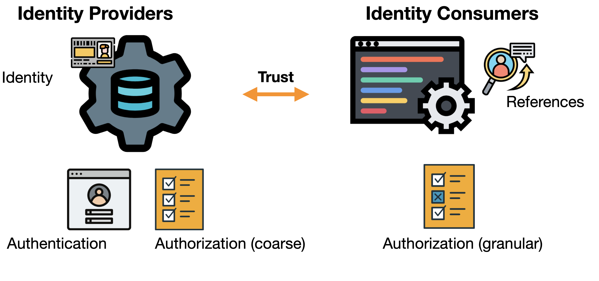
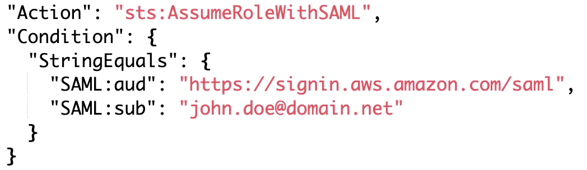

# How to access your AWS account

Hey there. You just created your first AWS account, and you can't wait to dive into all the exciting services and technologies that AWS has to offer you to start to build the next big thing. But, wait for a second... are you going to log-in with your root account credentials? Or it's better to generate a new user? Or maybe use a role?

Slow down a minute, and by the end of the blog post, I promise you will be able to choose the **best way to access your AWS account securely**.

Beware, though, we will consider access to a single aws account as we will cover multi-account strategies the next time. We need to walk before we can run, right?

# Accounts and Resources

Each incredible journey with AWS starts with accounts and resources, and an account is just like an empty box.

The things you can put inside your account can be anything related to AWS's services, for example, networks, virtual machines, containers, and so on.

But the most crucial part is that by default, no account shares any resource so that nothing can go in or out between two different AWS account. And this is great to divide your workloads and be sure that only the right people access everything.

# IAM — Identity & Access Management

Within each account, IAM is there to protect the resources inside your account by managing which entities can perform some actions on those resources:

- **WHO — which identities**
- **WHAT — can do some actions**
- **WHERE — on some resources**
- **HOW — and met some conditions**

I define these as the **4W**, and for now, we will need to focus only on the first 3.

## In the beginning — the root user

When you logged-in after you created the AWS account, you used that account **root user**.

That is different from the other ones you can create because:

- Created on the account registration
- You can sign in using the email address and password that you used to create the account
- **You can access the billing information**
- **It has unrestricted access to all resources in your account**

This user is super important, and you should protect it in the best way you can. It's a super-administrator on steroids since it's able to view the billing information along with being able to do everything with all your resources.

So, the first thing to do should be:

- Enable multi-factor authentication (MFA) and save the QR code in a secure place
- Delete all access keys related to this user to disable programmatic access (you wouldn't need this anyway!)

**And the very next thing should be to decide how you will access this account from now on.**

# From inside AWS

Let's focus for now on what AWS gives us without relying on 3rd parties. This is especially useful if we focus on this single account because we need to master the three IAM building blocks: user, groups, and roles.

## Users

Remember the root user? IAM users are the same type of entity but differently from the root user. They don't have default billing permissions and administrator access (unless you give them... which you shouldn't).

With a user, we can create an entity that can log-in to the AWS web console or with programmatic access through a set of credentials (an access key and a secret access key) that are fixed and will not change over time. Along with SSH/HTTPS keys for AWS CodeCommit, or Credentials for Amazon Keyspaces (for Apache Cassandra)

- Sign-in credentials for the web console
- Access and secret key credentials for programmatic access for APIs, CLI, and SDK
- SSH/HTTPS keys for AWS CodeCommit
- Credentials for Amazon Keyspaces (for Apache Cassandra)

### Granular access

It's entirely possible with an IAM user to enable one or more access keys depending on how you want that user to behave. For example:

- A data-analyst that needs to check only the analytics on the web console but without needing programmatic access
- A serverless DevOps which need to perform actions on the console and use the CLI to provide some resources will need both of these access
- A developer working on a single repository and doesn't need to interact with AWS resources will have SSH/HTTPS keys for AWS CodeCommit.

Be aware that **sharing** IAM user credentials **is a big no-no,** as it's the first step to lose credentials and governance and lay yourself open to security threats.

You don't want your production account completely erased in favor of a full set of bitcoin miners, do you?

### Enforce security

Another cool feature of AWS IAM users is to be able to enforce password complexity (which is by default pretty high with a length between 8-128 characters, a minimum of 3 special characters, and to not be identical to your AWS account name or email address) and password expiration time to ensure that after a certain time your users will change the password.

On top of that, you can enable MFA with various devices:

- A virtual MFA device with an authenticator app installed on your mobile device or computer
- A U2F security key like a YubiKey or any other compliant U2F device
- Another hardware MFA device like the Gemalto token

In general, there is a granular approach as you can have specific means for each IAM user.

### When to use

If you have **very few users** (between 1-5) with precise permissions tied to each one, IAM users can save some time on the initial configuration and console access. **Beware of static credentials** because they are substantial security issues, so handle with extreme care. Or use the AWS CLI get-session-token to generate temporary credentials out of static ones.

## Groups

Not an entity per se, but IAM Groups are there to bundle IAM users together and give the same set of permissions to a group of users. This smooth a little the rough edges of IAM users, but overall the same things we have seen for IAM users apply.

A nice thing to keep in mind is that an IAM user can still have personal policies while associated with a group, with the resulting permission equals the merge of the group and personal ones.

This should be more the exception than the typical workflow. With too many individual permissions, we create many unmaintainable policies and lose the overall overview of the permissions in the account.

### When to use

If you have **few users** (between 5-15), IAM Groups can save some of the hassles of managing and configuring each IAM user. But the same consideration as IAM users applies, so if possible, avoid them unless you are just working on a single account.

## Roles

And here we are to AWS roles. IAM roles can have permissions (just like users) and log to the console (again like users...). Instead of being uniquely associated with one person, anyone who needs it can **assume** a role.

So a person **wears the cap** of the role which he wants to assume, and

The IAM role logo just gained a lot more sense, right?

### Temporary Credentials

Another key difference from IAM users is that IAM roles don't have static credentials. When someone assumes the roles, a set of **temporary credentials** is generated and given. It's possible to customize how long those credentials will last and further restrict access if needed.

Time can be set from 900 seconds (15 minutes) up to 12 hours, but in my opinion, setting one-hour-long expiration is the best tradeoff between security and performance.

### CloudTrail monitoring

I'll mention this because some people don't use roles because they think that they can't audit what roles can do. The truth is that you can, and you should. By enabling Cloudtrail monitoring, you can see all actions performed inside your account, so you can always know what's going on.

### Cross Account

This will be discussed in more detail in another blog post, as we are focusing on single accounts, but for now, be aware that IAM roles can be used to give access to other IAM roles or IAM users.

And that's incredibly useful.

### Entry-point required

And now for the downsides. Unfortunately, you can't give direct access to the console and temporary credentials to an IAM role. First, you need to have set up a user or a federated role (more on this in a few paragraphs) to give access to an IAM role.

### When to use

**Always.** The sole fact that IAM roles are not tied with static credentials makes them the best way to access your cloud. Combine them with the ability to monitor IAM roles actions and enforce security even with MFA. The only downside is that it a little more configuration, but it's a low price to pay in my opinion.

# From outside AWS

And now, let's see what we can do when we go into the field of corporate identities. I'm referring to use an Identity Provider as an Identities source and log-in in with our corporate email and password.

## Federation

But what do we mean by federation? On one side, we have the identity provider. These systems contain a directory of users and some software that can communicate through specific federation protocols. All the data of our users reside as **Identities**.

On the other side, there is your AWS Account as an **Identity Consumer**. It maintains a reference to the identities without saving them. On this side, we generally have much more granular authorization levels (thanks, IAM!).

So the **federation** is the relationship of trust that makes the Identity Consumer able to reference the Identities in the Identity Provider.

## SAML Federation

The most common definition for Security Assertion Markup Language (SAML) is an open standard for exchanging authentication and authorization data between parties. This means that we can use our Identities to log in to AWS and even get temporary credentials by assuming roles. It's a generalistic approach you can apply to nearly all Identity Providers.

### The trust relationship

To set up the federation between the two parties, we need to create and manage an **IAM Identity Provider**. This is necessary because it represents the real Identity Provider and holds the shared secret that lets the two parties communicate. Moreover, inside each role that we want our users to assume, we will define a **trust policy** to allows entities related to the IAM Identity Provider to assume the role:

### Custom management

The thing is that managing the federation by yourself can be challenging and time-consuming at first. There are some concepts to understand well, and you need to create a bunch of entities, relations, and custom things to make this happen. To get an idea, you can find a complete tutorial example [here](https://blog.pethron.me/how-to-saml-federate-your-aws-account-with-g-suite).

### When to use

In general, this is an excellent and battle-tested approach that will work in nearly all cases. Still, the custom management of identities can be difficult and time consuming for inexperienced people.

Typical use-cases are if you want to manage this yourself for security or compliance purposes. You don't have access to your AWS Organization, or AWS SSO does not yet support your Identity Provider.

## AWS SSO

This is the cloud-based and managed SSO service that lets you connect your Identity Provider with your AWS account.

### AWS Organization

To set up AWS SSO, you will need to configure AWS Organizations, and for now, you can think of it to manage multiple AWS accounts. To keep things brief, you need to know that setting up an AWS Organization needs extensive permissions (namely the root user).

### Internal Identity Storage

By default, AWS SSO provides a directory to store your user information and credentials to serve as Identity Provider directly. It's great if you don't already have an Identity Provider or don't want to go to the trouble of setup one.

### External Identity Storage

But suppose your organization already uses some User directory, like Microsoft Active Directory. In that case, you can connect it to AWS SSO, eliminating the need to maintain two distinct directories with **automatic provisioning**.

Beware, though, that this feature is supported only on a limited set of Identity Providers:

- [Azure AD](https://docs.aws.amazon.com/singlesignon/latest/userguide/azure-ad-idp.html)
- [Okta](https://docs.aws.amazon.com/singlesignon/latest/userguide/okta-idp.html)
- [OneLogin](https://docs.aws.amazon.com/singlesignon/latest/userguide/onelogin-idp.html)
- [Ping Identity](https://docs.aws.amazon.com/singlesignon/latest/userguide/pingidentity.html)

### Multi-factor authentication

With AWS SSO, you can configure an MFA device for your users inside the service. Right now, it supports Authenticator apps like Google Authenticator and security keys like the Yubikey. The internal solution is exciting, but it lacks MFA support if set up on an external Identity Provider side.

### When to use

It's the standard suggested by AWS, and it can be the default way to go if unsure how to proceed. Still, there are at least a couple of requirements that you need to tick make the most out of this solution:

you've already set up your AWS Organization, **and** you have access to the root account. You want to keep your Identities within AWS SSO or use an identity provider supported by automatic provisioning.

# Final Notes

So, we have laid out the foundations to access a single AWS account, and now you should have the elements to choose the best method for your specific use-case. We will use this to cover the ground to multi-account management and AWS Organizations in the next blog post.

## Leapp

I advise developers to use some tool that helps them store all the data needed to connect to their AWS account. My team and I are developing an open-source tool that supports all these use-cases, so feel free to check out:

[https://github.com/Noovolari/leapp](https://github.com/Noovolari/leapp)