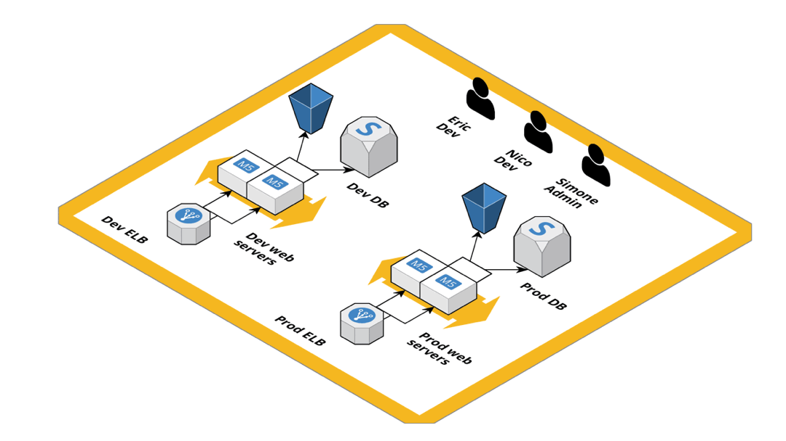
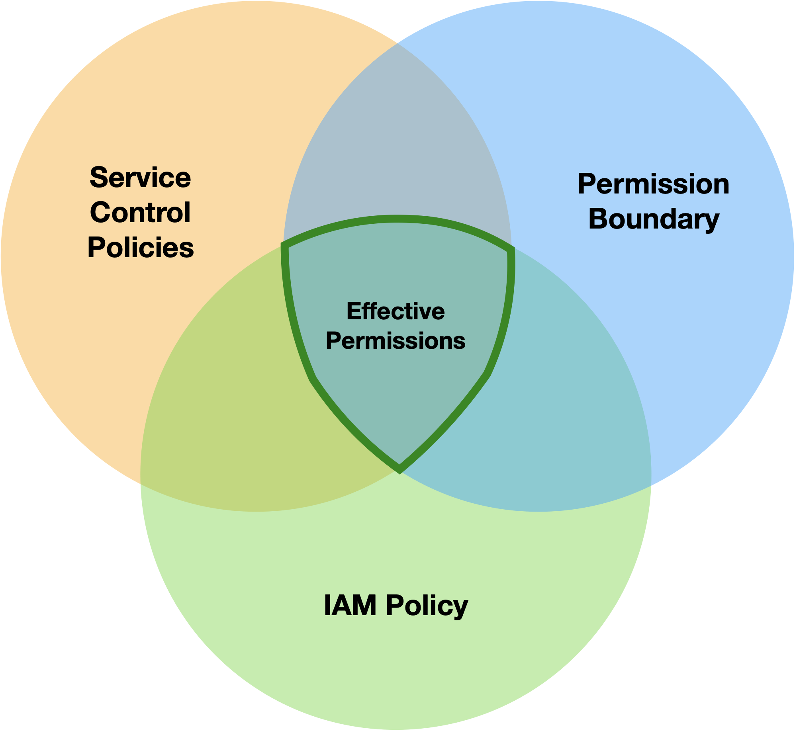
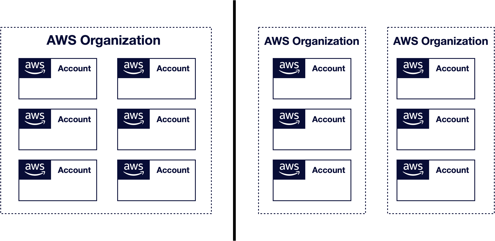

# AWS multi-account structure with AWS Organization

Welcome back to the second part of **how to access your AWS accounts**. Noticed the final "s" on accounts? Yeah, today I will write about multi-account strategies. We laid the foundations with the previous article on [how to access your AWS account](https://blog.pethron.me/how-to-access-your-aws-account) by seeing the various strategies at our disposal and when they're a good fit. The good thing is that everything still applies, but we must look at this from the perspective of multiple accounts and organizations.

Because sooner or later, one AWS account will not be enough to contain all your resources in an organized manner, and nowadays, that moment will come pretty fast too!

# The evolution of an AWS account

**Looks familiar?** This is more or less the evolution of the AWS account when I started using AWS. The thing is that when you begin extensively using a public cloud provider for development and production workloads, everything will escalate pretty quickly. There are just too many services and resources to keep track of while proceeding at a fast pace. More than ever, if you cramp them in a single AWS account.

## Multi-account and consolidated billing

By the time I started working with AWS in 2014, there was already the well-established pattern of using consolidated billing to group multiple AWS accounts under a single credit card. That solved a slightly annoying process of keeping track in your AWS bill's central place, but there wasn't any way to centralize the governance.

We did solve this kind of problem by creating a **root account** with billing information where only a few people had privileged access. In the root account, only one person had permission to view billing, and few other ones could create roles and manage permissions for everyone else.

But we still needed a way to tie the corporate identities to the roles to enable single sign-on to the web console and APIs for our developers. We set up the federation process between the root account roles and the users in our user directory. On which, by the way, I've published another thorough tutorial here on [how to SAML federate your AWS account with G Suite](https://blog.pethron.me/how-to-saml-federate-your-aws-account-with-g-suite). Check it out if you're curious about the process.

The nice thing was that we solved the governance problem at the first step. We could define who could access what. The "downside" was that we had to set up a trust relationship with the root account to let people assume the other account's role from the role in the root one. And there wasn't a way to centrally restrict permissions.

## AWS Organization to the rescue

In 2017 AWS announced **AWS Organization**, which was a big step in standardizing how to govern your AWS accounts. With AWS Organization, we can create and manage AWS accounts via Console and APIs and restrict AWS services with Service Control Policies (SCP).

It even enabled further organizing the accounts under the organization in Organizational Units (OU) that can share different configurations. On the account management notice, it still lacks the account deletion API, so the process of creating and deleting an account can't be entirely automated.

The other main feature of the AWS Organization is **Service Control Policies**. With these, you can enable or disable APIs on an account or OU basis, and I think it's the most underused and essential feature of the whole AWS Organization. Coupled with Permission Boundaries let other people than super-admins manage IAM, which is by definition the most sensitive service in an entire AWS account, without worrying too much that they can cause problems.

With this graph, you have a quick summary of how much you can restrict your AWS account access. Correctly identifying the permissions that it's safe to give by default and the ones that need some governance escalation to get can increase teams' velocity.

# Multi-account access

Once you have gone to the length of set up your AWS Organization, you need to let other people access the accounts. And at this point, it's usually tough to only rely on IAM users and roles.

With an AWS Organization, you should **prefer a federated access method**, and that leaves us with AWS SSO or a SAML based approach. Which one to pick largely depends on how you usually set up accounts and organizational units, so let's take an overview of the two with this perspective.

## AWS SSO

This is the default way suggested by AWS, and it comes with a lot of outstanding features like auditing SSO activity across applications and AWS accounts and multi-factor authentication.

For AWS SSO to work, you need to enable it with your AWS Organization's root account. Once enabled, you can manage all directory users from the AWS SSO portal and give access to single persons or groups through roles. You can both use the internal user directory of AWS SSO or link an external directory with some third-party identity provider.

If you have "relatively" few accounts and users, AWS SSO can be the most straightforward way to access your multi-account environment. It's easy to use, it's managed, takes minutes to set up, and has a neat integration with the AWS CLI v2 to impersonate your roles directly from your local environment.

But it's when you reach hundreds of users and accounts that begin to have some difficulties in management, and it becomes more and more difficult can't keep up with that amount of resources. In my opinion, there's a point at which AWS SSO can't keep up with everything and need a dedicated external solution.

## SAML Approach

The SAML approach is the manual way of doing AWS SSO. This approach's downside is that you need to set up the federation process and sync between your user directory and roles. You have strict control over your identity provider and AWS accounts and less *magic on the* advantage side*.* And you **don't need access to your AWS Organization root account** because all setup can be done in IAM.

But you can still divide your whole organization, as I've previously explained: into multiple federated root accounts where you can govern the other chaining directly from IAM. You lose the single-centralized place for user and permission management of AWS SSO, but in fact, you gain multiple areas better to segregate your users, roles, and permission. It's just a matter of getting the segregation right.

# And if we change the organization?

Right now, we have two strategies at our disposal with our AWS Organization:

- Centralize everything in AWS SSO
- Split into multiple root accounts

But there is some variable that we can change? We are keeping fixed just one thing, and that is using a single AWS Organization. What happens if we start adding more AWS Organizations instead of relying on only one?

### Consolidated billing

Off we go with the first **apparent** downside. We will no longer have a single place to check how much our AWS bill amounts, and instead, we are again on tracking on multiple places.

But is it a downside? Indeed, we have now split our bills in multiple places. Still, if we segregated the numerous AWS Organizations with some sense (e.g., business units that span across the company or entire departments), we now can have a better view of the single organization's spending. It depends on the use case, but I think it's both a downside and an improvement depending on the perspective.

### Multiple AWS SSO

Remember we had to have access to the AWS Organization root account to set up AWS SSO? It's a shame not to leverage its features because we have too many accounts and users. But wait, having multiple AWS Organizations should mean having fewer accounts and resources to manage from a single root account and having an overall better management experience on AWS SSO. To me, this is a significant improvement.

### SAML federation

It doesn't change much on this aspect since it's a manual approach to accessing your accounts. You still need to manually configure your identity provider and account, only with fewer people. I think it's safe to say that it's a draw on this.

### SCPs

Like having multiple AWS SSO, we can now better tailor our SCPs to the need of that single AWS Organization without having to worry about making some disruptive changes to workloads not related to them. This can lead to some inconsistencies and replication on governance policies if not managed correctly, but overall I think it is an improvement!

### Reduced blast-radius

In the scenario where some malicious person takes over an AWS Organization root account, if everything is inside just one organization, the blast-radius will be merely devastating. Being in control of the AWS Organization root account lets you access all accounts linked to it and delete resources and backups, not something I'd like to see even in my worst nightmares.

Having multiple AWS Organizations increases the surface attack, but it shouldn't change much if we're following security best-practices. What is changing is that our other AWS Organizations are safe in the unlikely event of a security breach. It's a bit of a tradeoff, but I think it's again an improvement.

# To sum up

We covered a little more ground and presented a few ways to handle things at the organization level with multiple AWS Organizations.

Using a single Organization is the default way to go, but I think it will need dedicated solutions to manage a vast amount of resources in the long run.

As an alternative, we can shift to a multi-organization environment where each AWS Organization has extensive power and works in very segregated silos. This is a good thing but needs some aggregation tool to view and manage everything centralized.

Only remember there is no right or wrong since you decide based on your use-case and how your company is structured.

