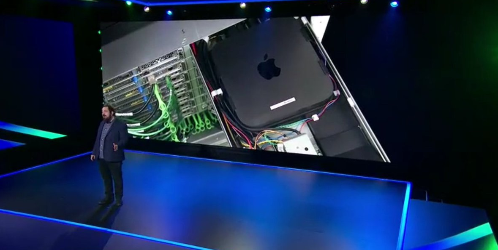
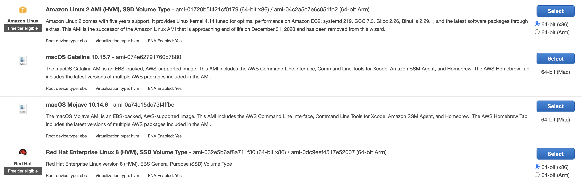
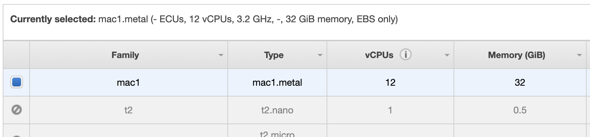
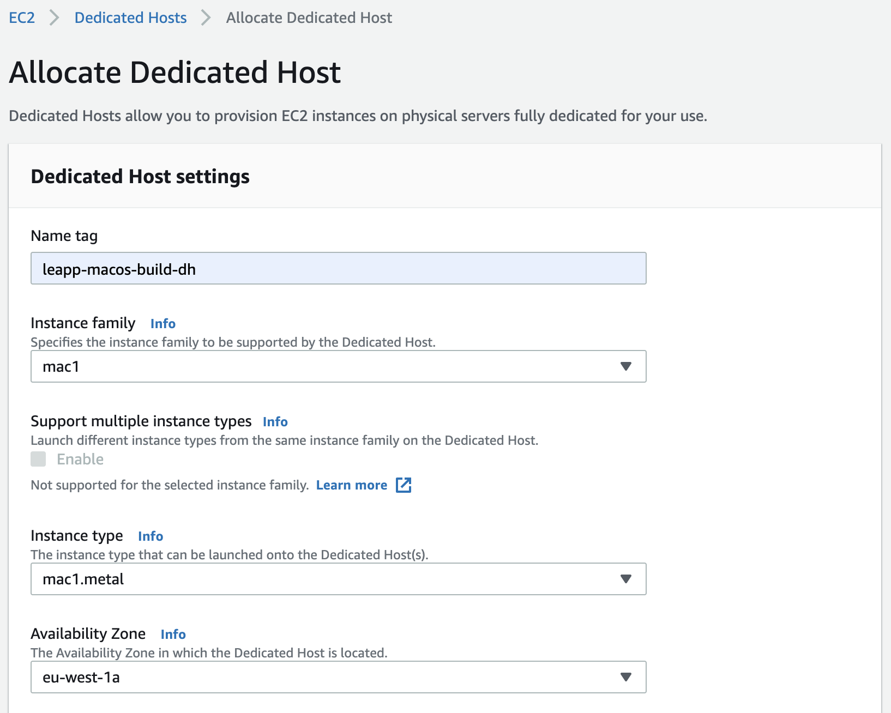
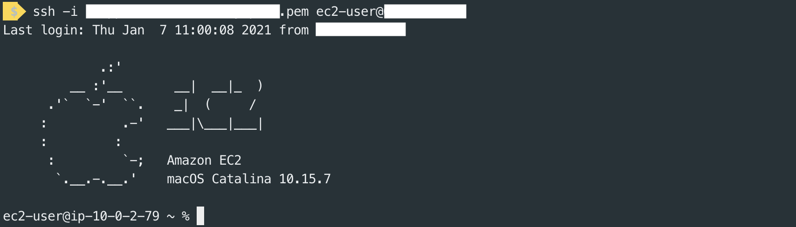
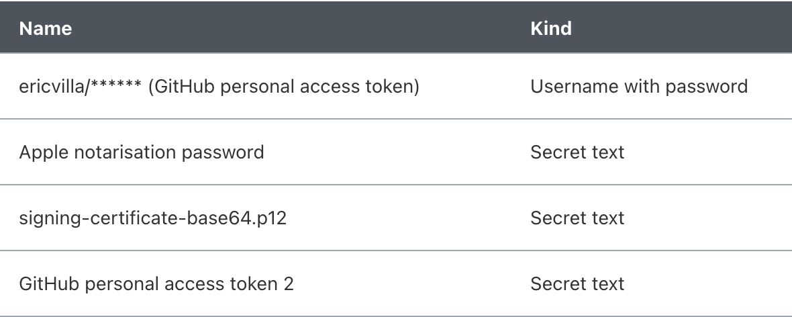
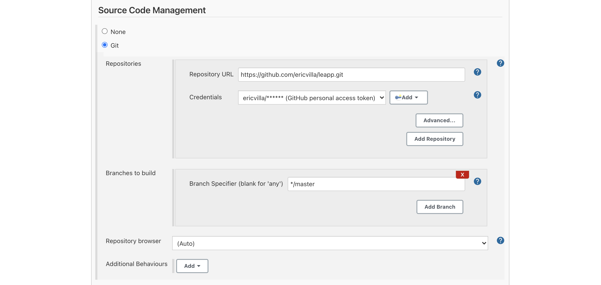
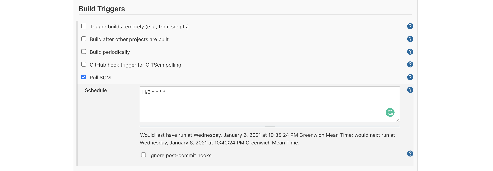
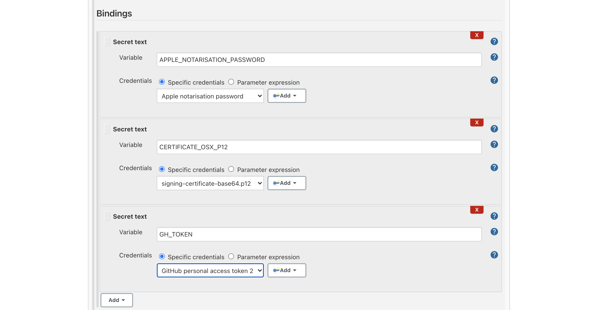
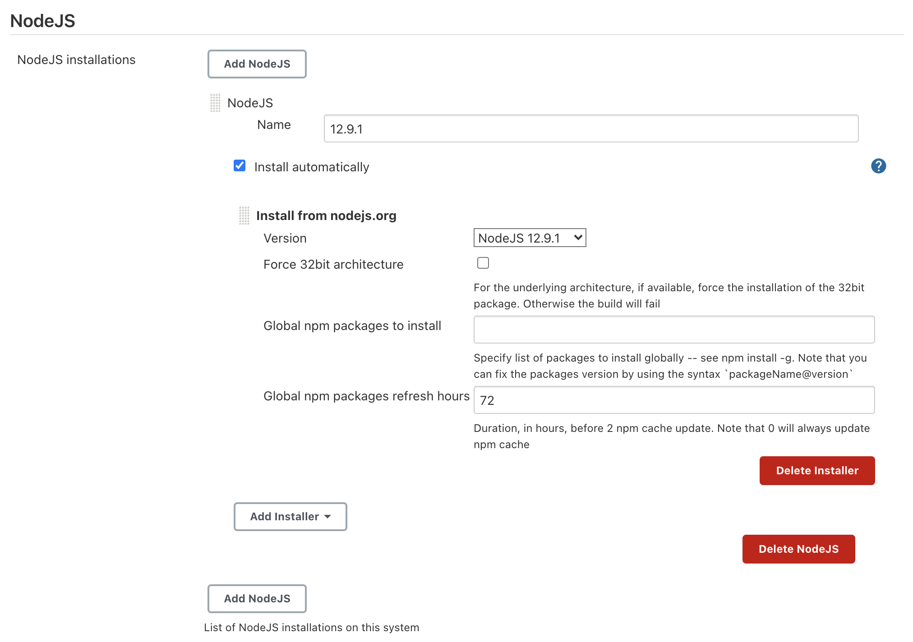

# New AWS EC2 Mac Instances: a CI/CD test bench

During the last AWS re:Invent, AWS made one of the most discussed announcement, that — on paper —  opens a lot of new scenarios: AWS EC2 Mac Instances! 

Don't worry, we will deepen one of these scenarios later on in this blog post, but let's first introduce this new instance type.

Amazon EC2 Mac Instances come with an 80s name, which makes them more attractive to those of you who are a little bit older than me 🙂. They're called mac1.metal instances.

Talking about hardware, Amazon EC2 Mac Instances are backed by Mac mini hosts, that rely on AWS Nitro controllers to connect with AWS network infrastructure and services. The interesting point is that Mac Instances are connected to the Nitro System through the Thunderbolt 3 interface. I used the term "host" to highlight the fact that we're not dealing with Virtual Machines, but with Dedicated Hosts; whenever I decide to run an Amazon EC2 Mac Instance, AWS provisions a concrete Mac mini host for my purposes.



*Peter Desantis, Senior Vice President of AWS Infrastructure and Support, presenting new Amazon EC2 Mac Instances at AWS re:Invent 2020 Infrastructure Keynote.*

# mac1.metal — the specs

At this point — assuming that you never heard about Amazon EC2 Mac Instances hardware specifications — you may wonder what are the supported sizes. Well, as far as now, you can forget the word "choice": AWS allows you to run only one size of Mac Instances. mac1.metal instances' hardware specifications tell us that they're powered by an Intel Coffee Lake processor running at 3.2 GHz — that can burst up to 4.6 GHz — and 32 GiB of memory. As explained by Jeff Barr in the AWS News Blog, instances run in a VPC, include ENA networking, and are natively Optimized for communication with EBS volumes, supporting I/O intensive workloads.

In my daily routine, my working partner is a macOS laptop that I had to update to the new macOS Big Sur operating system. So far it didn't bring me tangible enhancements, but it's quite a best-practice to keep your system up to date, at least on your workstation. AWS EC2 Mac Instances come with a limitation in that sense: only Mojave or Catalina macOS versions can be selected. Mojave and Catalina AMIs come with the AWS CLI, Command Line Tools for Xcode, Homebrew, and SSM Agent already installed. AWS is working to add support for Big Sur, and for Apple M1 Chip.

# A practical Use Case

Now, let's focus on what I like the most: practical use cases!

I started my career as a developer, and I guess every developer's mind made — at least — an association between this announcement and the possibility to automate building, testing, and signing of macOS and iOS applications.

During the last year, my team has been developing an [Open-Source Desktop Application](https://github.com/Noovolari/leapp) that manages local credentials to access complex Cloud Environments. Our application is written in TypeScript, interpreted by Node.js. We used Angular as our development framework, which runs on top of an Electron engine for cross-platform compatibility.

Electron comes with a native application builder, called electron-builder, that we used to write custom build scripts in our package.json file, which contains dependencies specifications too. We wrote custom scripts to build Linux, Windows, and macOS binaries.

In order to build the macOS binary, the script needs to have access to the Signing Certificate and to the Apple Notarisation Password. They allow, respectively, to sign and notarize the macOS binary. We usually store these secrets in our macOS Keychain, run the build scripts on our local environments, and manually upload the artifacts on our GitHub repository as a new release. This is a common practice adopted by many developers when building macOS or iOS applications.

This process is slow, cumbersome, and may lead to human errors. But hey, there seems to be a new opportunity out there for us. What better Use Case for the new Amazon EC2 Mac Instances than building our application's macOS binary?

It's time to focus on how I set up the test bench. We will go through the following steps:

- launch of a blend new mac1.metal instance;
- access to the instance;
- installation of packages and tools needed during the build process;
- configuration of the build pipeline with the dear old Jenkins.

# Launch a mac1.metal instance

The first thing we've to do to get our pipeline set up consists of the creation of the Amazon EC2 Mac Instance on which we're going to install and configure Jenkins.

Let's jump into the AWS console!

As for any other EC2 instance, the launch wizard of a mac1.metal kicks off from EC2 console, in the "Instances" section. As many of you already know, here you can find the list of EC2 instances available and — among the others — the menu needed to launch a new instance.

Since the 30 November 2020, the AMI list is richer: indeed, it shows both Mojave and Catalina AMIs; for our purposes, I choose Catalina.



When it comes to choosing the instance type, there is only one available, called mac1.metal. As we already know, it is characterized by 12 vCPUs running at 3.2GHz and 32GiB of memory. If you think of it as your workstation it does not sound that weird!



In the rest of the wizard, we can treat our Mac Instance like any other instance type; the only thing that we should take particular attention to is the tenancy. We're going to launch the instance on a Dedicated Host that we can request — on a separate tab — during the instance creation process. Even for the Dedicated Host, we've to specify mac1.metal as the type of instances that can be launched on it.



For the sake of this proof of concept, I decided to run the instance in a public subnet, and enable Public IP auto-assignment.

To allow the installation of the heavy-weight Xcode — which provides some critical build tools — attach an EBS root volume with an appropriate size to the instance; in my case, I choose to attach a 100GiB-sized EBS volume.

# What about access types?

Before diving into Mac Instance access types, remember to setup Security Group rules that allow you to reach it through SSH and VNC. Moreover, I configured a rule to allow access through my browser to port 8080 of the instance, i.e. the one associated with the Jenkins service. Since I decided to run the instance in a public subnet, I restricted access to the instance only to my IP address.

**DISCLAIMER:** it works, but please note that the setup I used — in terms of networking — cannot be considered production-ready! To make it more secure, it is enough to move the Mac Instance inside a private subnet, and place an OpenVPN server in the public subnet; that way, the mac1.metal instance is no more exposed directly to the internet and we can access it by the means of the OpenVPN server.

In the last step of the instance creation wizard, we've to choose whether to select an existing .pem key or to create a new one to access the instance via SSH. That's the first access type available, and it's no different from SSH access to an Amazon Linux instance; indeed, the username for Mac Instances is ec2-user.



If you need graphical access to the instance — which will be needed while installing packages and tools — you can use VNC; if you're a macOS user, you can rely on VNC Viewer software to set up the connection to your mac1.metal instance.

But wait — as AWS Technical Evangelist [Sébastien Stormacq](https://twitter.com/sebsto) explains in [this](https://www.youtube.com/watch?v=FtU2_bBfSgM&ab_channel=freeCodeCamp.org) video — there is something you've to configure on the instance before having the possibility to access it. In particular, you've to set a password for the ec2-user, and enable the VNC server. Here is the GitHub Gist I've followed, and that is very precious to me:

[https://gist.github.com/sebsto/6af5bf3acaf25c00dd938c3bbe722cc1#file-gistfile1-txt](https://gist.github.com/sebsto/6af5bf3acaf25c00dd938c3bbe722cc1#file-gistfile1-txt)
**NOTE:** 45-49 lines are critical in the sense that, without them, you'll not be able to install Xcode; the initial APFS container size is not large enough to accommodate Xcode.

And that's all for what concerns access types.

# Let's install some packages and tools

The build pipeline that we are going to configure comes with some prerequisites that we've to satisfy. So, what are these prerequisites?

- A Java installation
- Xcode Application, because default Command Line Tools do not provide altool, which is needed to notarise the app.
- The actual Jenkins service

Where possible, I relied on brew to install packages. In particular, I've used it to install Java and Jenkins; then, I've installed Xcode from the App Store, providing my Apple Credentials.

Install Xcode first, the process is straightforward: open the App Store, search for Xcode, and install it.

Now, let's focus on Java. I choose Java AdoptOpenJDK 11 version, which can be installed using brew in this way:

```bash
# Update brew first of all
brew update

# Add adoptopenjdk/openjdk repository
brew tap adoptopenjdk/openjdk

# Install Java AdoptOpenJDK 11
brew install --cask adoptopenjdk11
```

To install Jenkins, I've used the following command:

```bash
brew install jenkins-lts
```

Once installed, we've to make Jenkins accessible from outside by modifying the /usr/local/opt/jenkins-lts/homebrew.mxcl.jenkins-lts.plist file. In particular, we've to change the --httpListenAddress option from 127.0.0.1 to 0.0.0.0. Then, simply start the service using the following command:

```bash
brew services start jenkins-lts
```

# Jenkins initial configuration

Jenkins's initial configuration involves three steps:

- unlock Jenkins — in this step, we've to retrieve the password that was written inside the /Users/ec2-user/.jenkins/secrets/initialAdminPassword file;
- install plugins — in addition to the pre-selected ones, check NodeJS, Git Parameter, and GitHub plugins;
- create admin user — finally, create the admin user, providing credentials, full name, and email address.

## Credentials & Secrets

Before focusing on the build job, let's create all the credentials and secrets needed to pull the code from the repo, sign the binary, notarize it, and finally push the artifacts back to the GitHub repo as a new release draft.

So, what are the credentials and secrets needed by the build job?

- GitHub personal access token
- Apple signing certificate (in base64 format)
- Apple notarisation password

I set them as global secrets from jenkins-url/credentials/store/system/. Here, add credentials and secrets respecting these types:



The GitHub personal access token 2 secret is different from the first one, in the sense that it is used to push the artifacts back to the GitHub repo, while the first one is used to pull the code from the repo.

# Build Job configuration

We can start the Build Job configuration wizard by clicking "New Item" from the sidebar on the left of the Dashboard. For what concerns this wizard, we'll go into the details of Source Code Management, Build Triggers, Build Environment Bindings, and Build sections.

In the Source Code Management section, we've to specify the coordinates of our GitHub repository, providing access credentials, repo URL, and the branch from which Jenkins will pull the code from.



I've decided to make Jenkins check for newly available commits every 5 minutes, in a polling fashion; the alternative consists of setting up a Jenkins webhook invoked directly by GitHub, in a push fashion.



Next step: Environment Variables, which I referred to as Build Environment Bindings. Here we have simply to assign the previously configured credentials and secrets to environment variables used in the Build Job's steps.



And finally, let's add the build steps! I divided the build in five steps, i.e. five Execute shell commands, which I want to illustrate down here.

```bash
# Step 1
chmod +x ./scripts/add-osx-cert.sh

# Step 2
./scripts/add-osx-cert.sh

# Step 3
npm install

# Step 4
npm run rebuild-keytar

# Step 5
npm run dist-mac-prod
```

Apart from step 3 and step 4, you may wonder what add-osx-cert.sh and dist-mac-prod scripts consist of. Therefore, I want to provide you their implementation.

- project-root-folder/scripts/add-osx-cert.sh

    ```bash
    #!/usr/bin/env sh

    KEY_CHAIN=build.keychain
    CERTIFICATE_P12=certificate.p12

    echo "Recreate the certificate from the secure environment variable"
    echo $CERTIFICATE_OSX_P12 | base64 --decode > $CERTIFICATE_P12

    echo "security create-keychain"
    security create-keychain -p jenkins $KEY_CHAIN
    echo "security list-keychains"
    security list-keychains -s login.keychain build.keychain
    echo "security default-keychain"
    security default-keychain -s $KEY_CHAIN
    echo "security unlock-keychain"
    security unlock-keychain -p jenkins $KEY_CHAIN
    echo "security import"
    security import $CERTIFICATE_P12 -k $KEY_CHAIN -P "" -T /usr/bin/codesign;
    echo "security find-identity"
    security find-identity -v
    echo "security set-key-partition-list"
    security set-key-partition-list -S apple-tool:,apple:,codesign:, -s -k jenkins $KEY_CHAIN

    # Remove certs
    rm -fr *.p12
    ```

- dist-mac-prod — custom script which has to be added in the script section of the package.json file

    ```bash
    "dist-mac-prod": "rm -rf electron/dist && rm -rf release && rm -rf dist && tsc --p electron && ng build --aot --configuration production --base-href ./ && mkdir -p electron/dist/electron/assets/images && cp -a electron/assets/images/* electron/dist/electron/assets/images/ && electron-builder build --publish=onTag",
    ```

    For the sake of this article, the important part of the dist-mac-prod script is

    ```bash
    electron-builder build --publish=onTag
    ```

    which triggers the build of the binary.

Inside the package.json file, there is another important part that we've to specify, and that is included in the "build" section; let's show that down here.

```bash
# ...
"build": {
        "publish": [
            {
                "provider": "github",
                "owner": "ericvilla",
                "repo": "leapp",
                "releaseType": "draft"
            }
        ],
        "afterSign": "scripts/notarize.js",
# ...
```

As you can see, I'm requesting to push the artifact to the ericvilla/leapp repo — which is a fork of [https://github.com/Noovolari/leapp](https://github.com/Noovolari/leapp) — as a new DRAFT release.

Moreover, I specified to run the script/notarize.js script after signing. This script is responsible for macOS application notarisation, and is implemented as follows:

```jsx
const { notarize } = require('electron-notarize');

exports.default = async function notarizing(context) {
  const { electronPlatformName, appOutDir } = context;
  if (electronPlatformName !== 'darwin') {
    return;
  }

  const appName = context.packager.appInfo.productFilename;

  return await notarize({
    appBundleId: 'com.noovolari.leapp',
    appPath: `${appOutDir}/${appName}.app`,
    appleId: "mobile@besharp.it",
    appleIdPassword: process.env.APPLE_NOTARISATION_PASSWORD ? process.env.APPLE_NOTARISATION_PASSWORD :
      "@keychain:Leapp",
  });
};
```

It relies on electron-notarize package and looks for APPLE_NOTARISATION_PASSWORD environment variable; if it is not available, it assumes you're running the build in your local environment. Therefore, it looks for appleIdPassword inside the System's Keychain.

Last but not least, I had to install a Node.js version from inside Jenkins in order to build the solution correctly. To do that, move to the "Manage Jenkins" section, accessible from the left sidebar. Once inside it, click "Global Tool Configuration"; there you can install the Node.js version you need. In my case, I've installed Node.js 12.9.1 version.



Here we are, at the end of the Build Job configuration!

If Jenkins service is running and the Build Job is set up, it checks for new pushes on the GitHub repo, and triggers the build process.

If everything worked fine, you'll be able to find the newly created Release Draft under https://github.com/username/repository-name/releases path.

# Let's Sum Up

And now, it's time to make some considerations!


When reading this blog post everything seems to be clear and straightforward (well, I hope that to be so 🙂), but during my first set up I got in trouble many times, and I want to highlight that here.

First of all, do you know that in order to run a Mac Instance you've to allocate a Dedicated Host for at least 24 hours? Maybe yes. But, in the context of this use case, it is critical to have the possibility to run build jobs only when needed; you may argue "ok, but you set up Jenkins to check for new commits in a polling fashion", and I would say you're right. Indeed, we usually rely on container-based services like AWS CodeBuild to run build environments, let's say, on-demand. It may be more convenient to run the build manually in your local environment, or automatically by setting up Jenkins as we did, but on your local machine.

Why I'm saying that?

Simple. A Mac Instance Dedicated Host is not cheap: it costs $1.083 per hour, which means almost $26 fixed costs whenever I decide to run a new one (Dedicated Host allocated for at least 24 hours). Due to the Dedicated Host minimum allocation time limitation, IMO it is not possible — at least very difficult — to set up cost savings strategies, like running the CI/CD instance only during working hours, e.g. 8 hours per day.

That's not all.

If you decide to run a Mac Instance, you've to take into account the fact that sometimes EC2 instance Health Checks do not pass; that means — for EBS-backed AMIs — that you need to stop the instance, wait until the Dedicated Host exits the pending status, and finally restart the instance. What does it mean? A lot of wasted time.

I'm using what may sound like a polemic tone, but constructively. I think that's a great announcement, and that this service has a lot of potentials. Yes, potential, because I felt it is a little bit immature yet.

Apart from these considerations, the process of setting up a pipeline with Jenkins is exactly the same as in my local environment, and the different ways we have to access the Mac Instance grants us a complete experience.

# That's all folks!

Here we are.

My thanks go to every member of my team, in particular to [Alessandro Gaggia](https://twitter.com/Balubor), who helped me getting out of troubles, and who gave me moral and technical support during Jenkins setup.

 I hope you find this blog post useful, and that lots of questions and ideas raised in your minds. In that case, please do not hesitate to contact me; it will be a pleasure to share considerations about this or other use-cases.

Stay tuned for new articles!
