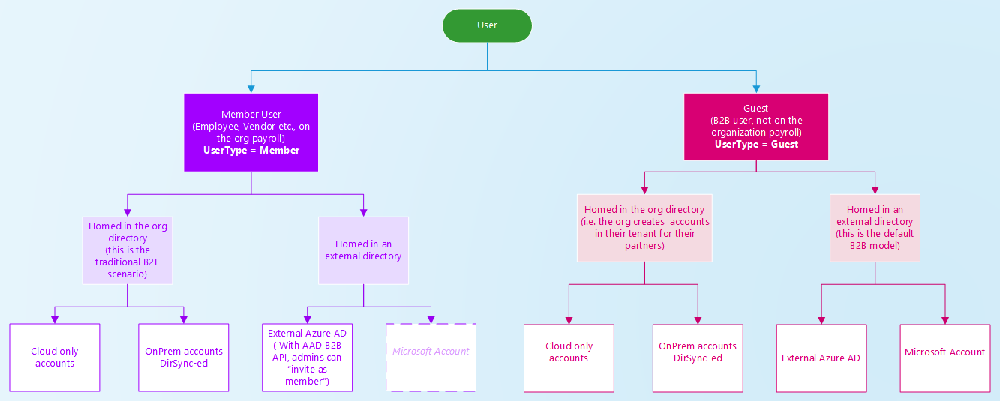
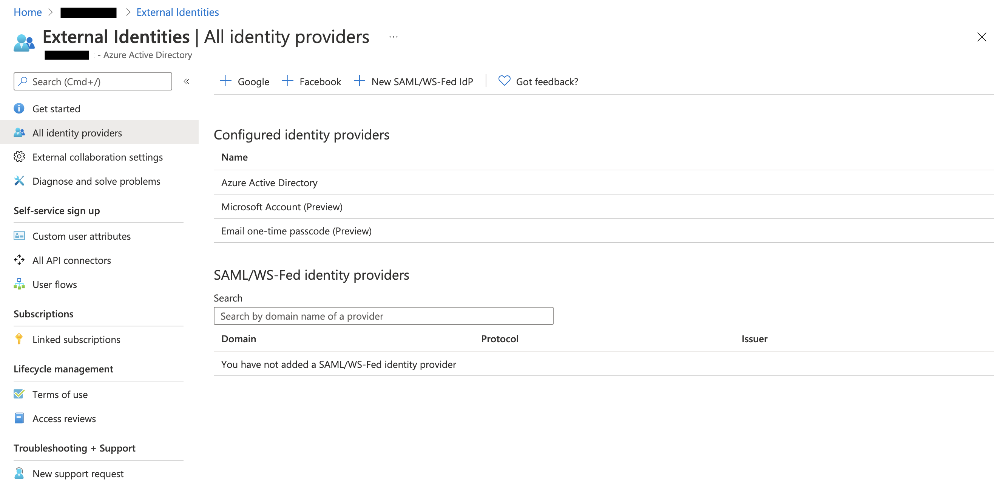
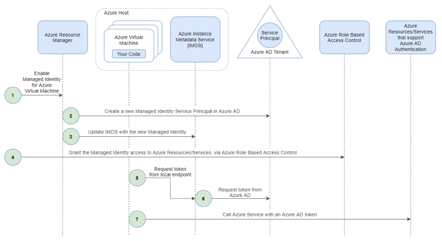
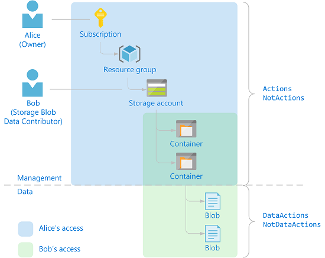

# Azure access scenarios

At a first glance, you may wonder what the "DevOps point of view" in the subtitle actually means.

I used this term to describe the idea behind this article, i.e. giving you an overview of some punctual access strategies that need to be put in place to allow DevOps to access resources and services hosted inside an Azure organization.

The way we design access strategies depends on different factors, e.g. the kind of operation that has to be fulfilled or the user type, whether it is internal or external to the organization.

I will focus the attention on two main types of tasks: operational and development ones.

By operational, I mean tasks that can be completed through the usage of the Command Line Interface or by accessing the Azure Console through a browser.

On the other hand, by development tasks, I mean running scripts or testing applications locally. In this scenario, we will see that the way an application accesses Azure resources may change from development to production environment.

Before describing these access scenarios, I'll take the opportunity to organize a little bit of the concepts around a complex service like Azure AD, by separating the notion of authentication from the one of authorization.

In particular, we'll cover mechanisms that represent the foundation of identities authentication, regardless they're internal or external to the resource hosting Azure organization.

For what concerns authorization, we'll go in-depth about Azure Role-Based Access Control, which governs who can access what resource, under what condition.

# Summary

- Azure authentication
    - Azure Tenant and Azure AD Directory
    - Is the User a Member or a Guest?
    - Federation
        - Custom Domain Name federation
        - Direct Federation
    - Service Principal and Managed Service Identities
- Azure authorization: Role-Based Access Control
- The "DevOps point of view": different access scenarios

# Azure authentication

Azure Active Directory is Azure's cloud-based access management service that stores and manages identities, enabling access to Azure resources inside a single Azure organization or across multiple ones.

## Azure Tenant and Azure AD Directory

When we refer to an organization, a company, or - in general terms - a domain, we use the notion of Tenant. As described in [my previous blog post](https://www.herrvilla.com/how-to-saml-federate-your-azure-account-with-g-suite), a Tenant represents "the organization that owns and manages a specific instance of Microsoft Cloud Services", i.e. a specific Tenant manages one or many Microsoft Cloud Services subscriptions, from Microsoft Office 365 to Microsoft Azure; for the sake of this article, we will focus on Azure ones.

Each Tenant is associated with one and only one Directory, which represents the Azure AD service. An Azure AD Directory can manage and authenticate a pool of users that can access resources hosted in the same Tenant where the Directory lives.

## Is the User a Member or a Guest?

Users stored in an Azure AD Directory can fall into one of the following categories: Member or Guest.

A Member User is an identity internal to the organization, while a Guest User is an identity that has been invited to collaborate into the organisation, i.e. a partner or a collaborator.

The Type is simply a property attached to a User but allows the definition and enforcement of type-based policies. 



**Figure 1.**

As illustrated in Figure 1 - which is taken from Azure's Documentation - both Member and Guest Users may be homed in the organization's directory, in an external one, or even on-premise.

Guest Users is the synonym of B2B User. The default B2B collaborative model expects the B2B User to be invited into the organization's directory, while it is homed in an external one. This model allows guest users to authenticate using their own organization's credentials.

You can invite a User, homed in an external Azure AD Directory, as Guest User in your organization's Directory by sending an invitation email. This is not the only way to invite guest users, but it provides contextual information that allows them to accept the invite or not. To start accessing resources in your organization, a guest user needs to redeem the invitation email.

If you've to import multiple guest users in your organization's directory, you can exploit the bulk invite feature, but remember that it is in preview, so don't use it in full confidence!

So far, we talked about users that are internal or external to your organization, but always inside the scope of Azure AD. What if an external user belongs to an IdP that is out of Azure AD's scope? This is the situation in which federation with external identity providers comes to the rescue.

## Federation

Federation is the process of setting up a trust relationship between an Identity Provider and a Service Provider. In the scenario that I'm describing, Azure is the Service Provider that has to be federated with an external Identity Provider, e.g. G Suite.

For what concerns Azure AD, federation with external IdPs can be established using different approaches and protocols.

IMO, the two approaches that are worth exploring are Custom Domain Name federation and Direct Federation, even if the latter is still in preview.

### Custom Domain Name federation

This approach involves the creation of a Custom Domain Name inside your organization's Azure AD Directory. Once created and verified, you can proceed with setting up the federation between Azure AD and the external Identity Provider. This federation can rely on one of two different federation protocols: SAML 2.0 or WS-Federation. 

In my previous blog post I've described how to set up a SAML-based federation between Azure AD and G Suite; if you are interested in the implementation details, please refer to it.

I would say this is a robust solution that allows identities, homed in an external Identity Provider, to authenticate themselves through Single Sign-On, without the necessity to create an Azure AD User or to redeem an invitation to your Azure Organization.

### Direct Federation

Direct Federation is another approach that enables external users to collaborate in your Azure Organization in a B2B fashion. You can set up Direct Federation only if the IdP - that external users belong to - supports SAML 2.0 or WS-Federation protocol.

As for Custom Domain Name federation, you have to configure the federation both on the IdP and Azure side, as described ([here](https://docs.microsoft.com/en-us/azure/active-directory/external-identities/direct-federation)).

On the Azure side, you have to complete the federation set up through Azure AD's External Identities console, as illustrated in the following picture.



**Figure 2.**

In this configuration, you still have to invite the external user, who has to redeem the invitation to collaborate in your Azure Organization.

## Service Principal and Managed Service Identities

When it comes to talking about programmatic access, Service Principal and Managed Service Identities play a crucial role. Service Principal is tight to the concept of Application in the context of Azure.

Based on Azure's documentation, an Application is a template that defines "how the service can issue tokens in order to access the application, resources that the application might need to access, and the actions that the application can take". This template is used to instantiate one or more Service Principals, which are the concretization of the Application across different Tenants. When you create an Application, it comes with a default Service Principal, the "home" one.

A Service Principal defines what an Application can access inside a specific Tenant.

You can authenticate your automation script or software as a Service Principal through password-based or certification-based authentication. Password-based authentication requires you to provide the password that was specified during Service Principal creation. Certification-based authentication requires you to specify a certificate thumbprint that enables information retrieval from a local certificate store. Certificate-based authentication is considered a more secure solution but requires more effort to be maintained.

A natural evolution of Service Principals, when running software inside an Azure Tenant, is represented by Managed Service Identities. 

Managed Identities avoid applications, that run on a specific virtual machine, to handle secrets. In particular, Managed Identities rely on the Azure Instance Metadata Service to retrieve temporary access tokens that are automatically rotated by Azure AD, without the need to write a logic responsible for that. Under the hood, a Managed Identity relies on a Service Principal, managed by Azure AD. A Service Principal is automatically created when we enable a Managed Identity for a virtual machine.

IMO, the way Azure Managed Identities work is pretty much similar to the way AWS's Instance Profiles generate temporary credentials through the AWS Instance Metadata Service.

The following picture gives a clear and complete overview of how Managed Identities mechanism works.



**Figure 3.**

# Azure authorization: Role-Based Access Control

At this point, we've explored different Security Principals: Azure AD Users, Service Principals, and Managed Identities.

We didn't talk about User Groups, as it is a concept strictly related to RBAC. Azure AD helps you assign a set of access permissions to all the members of a group, instead of having to provide the rights one-by-one. Users inherit rights defined in the Group they belong to.

The Security Principal is one of the three actors involved in the Azure RBAC role assignment mechanism. The other two components involved are Role and Scope.

The Security Principal is the entity that, through role assignment, receives permissions to perform actions against resources in a specific Scope. Permissions are defined inside a Role.

## The Scope

The Scope is basically a resource container, that allows specifying the group of resources the Security Principal has access to.

There are three types of Scopes or resources containers: Management Groups, Subscriptions, and Resource Groups.

As the name suggests, Resource Groups are groups of resources that belong to the same application, workload, or project. Resource Groups are used to manage related resources' lifecycle and settings in a homogeneous way.

Moving to a higher abstraction level, we find Subscriptions, which represents a way to organize and group resources that have the same billing model. You may have different Subscriptions under the same Azure Tenant.

A Subscription may be the leaf of a tree called Management Group. A Management Group is used by large organizations to manage and enforce policies - even RBAC ones - to Subscriptions. A Management Group may contain other Management Groups, creating a hierarchical structure up to six levels of depth.

## The Role

While the Scope represents the group of resources a Security Principal can access, the Role specifies Security Principal's access rights.

A Role is a definition of the subset of actions a Security Principal can perform on a Resource Provider.

You may wonder what actually a Resource Provider is! Well, you can think of it as a resource supplier, which defines what management and data actions can be performed on its specific resources.



**Figure 4.**

The above picture illustrates two different kinds of Resources, Container and Blob, that are supplied by the same Resource Provider, i.e. Storage account. As you can see, there is a neat separation between Management and Data actions.

Management actions allow a Security Principal to manage access to Resources and their lifecycle. On the other hand, Data actions involve the access, manipulation, and deletion of data hosted in the Resources.

To give you a clear understanding of how Management and Data actions work, let me show you an example of role definition, i.e. the Storage Blob Data Reader built-in Role:

```json
{
  "Name": "Storage Blob Data Reader",
  "Id": "2a2b9908-6ea1-4ae2-8e65-a410df84e7d1",
  "IsCustom": false,
  "Description": "Allows for read access to Azure Storage blob containers and data",
  "Actions": [
    "Microsoft.Storage/storageAccounts/blobServices/containers/read",
    "Microsoft.Storage/storageAccounts/blobServices/generateUserDelegationKey/action"
  ],
  "NotActions": [],
  "DataActions": [
    "Microsoft.Storage/storageAccounts/blobServices/containers/blobs/read"
  ],
  "NotDataActions": [],
  "AssignableScopes": [
    "/"
  ]
}
```

As specified in the description, this Role "Allows for read access to Azure Storage blob containers and data". In particular, Management actions - defined under "Actions" - allows a Security Principal to read and list Azure Storage containers; Data actions - defined under "DataActions" - allow to read and list Azure Storage blobs, that contain data.

When defining actions, you can use wildcard to cover a larger subset of operations the Role allows the Security Principal to perform on Resources.

NotActions and NotDataActions are arrays of strings that specify, respectively, the management and data operations that are excluded from the allowed Actions and DataActions.

In this case, both Management and Data actions can be applied to all scopes: management groups, subscriptions, or resource groups. This is possible only for built-in roles that make use of the root scope "/". When you define a custom role, you can make the role available for assignment in only the management groups, subscriptions, or resource groups that require it. You must use at least one management group, subscription, or resource group.

Last but not least, once you've defined the role, you can assign it to Security Principals at one of the AssignableScopes. For example, you can assign the Storage Blob Data Reader built-in Role to a Security Principal at a specific Resource Group's Scope, by creating a new role assignment from the Resource Group's IAM blade. That way, the Security Principal is allowed to perform actions based on the access rights defined in the Role definition, limited to the Resource Group's Scope.

# The "DevOps point of view": different access scenarios

I focused the article on access strategies that are crucial from a DevOps point of view. 

As I already said, access strategies have to be implemented based on the kind of task the person, or - using Azure terminology - the Security Principal, has to do.

Let's go back to the distinction between Operational and Development tasks.

Now that we have a better knowledge of different access strategies and approaches, it should be clear that Guest User invitation and Federation with external Identity Providers enables DevOps to perform tasks that fall into the Operational category. For what concerns Federation, there are plenty of different Identity Providers that you can federate with your Organization's Azure AD Directory, even on-premises ones. Please, refer to online guides - giving priority to the ones provided by Azure - to get more details about your IdP-specific federation setup.

As I said before, when it comes to enable programmatic access by your automation scripts and/or applications, Service Principals and Managed Identities are fundamental. We have already covered differences between these two actors, but let me make some considerations about the environment in which code is executed.

If I - as a developer - need to run my application or automation scripts locally, one of the possible ways to let them access Azure Resources is by using Service Principals. If I'm developing the application using the Azure SDK, the Service Principal should be created with the following command.

```bash
az ad sp create-for-rbac --sdk-auth
```

The newly created Service Principal information follows a standard JSON format, which contains a ClientId and a ClientSecret, among other properties. You can use this JSON to authenticate with token credentials or perform file-based authentication.

That said, this is not the best practice for production applications to retrieve temporary credentials. The de facto standard in that sense is represented by Managed Identities that, as I explained before, rely on the Azure Instance Metadata Service to generate and auto-rotate short-term credentials associated with a managed Service Principal.

The following Python code snippet gives you an idea of how it is simple to instantiate Managed Identity credentials using Azure SDK.

```python
from msrestazure.azure_active_directory import MSIAuthentication

credentials = MSIAuthentication()
```

# That's all, folks!

I hope you find this blog post interesting and useful. We covered many different Azure AD authentication and authorization aspects, tailored to a DevOps point of view. I've shared some of my knowledge with you. Now it's your turn! I'll really appreciate your feedback and, most of all, real-world examples that allow me to improve the article's quality.
