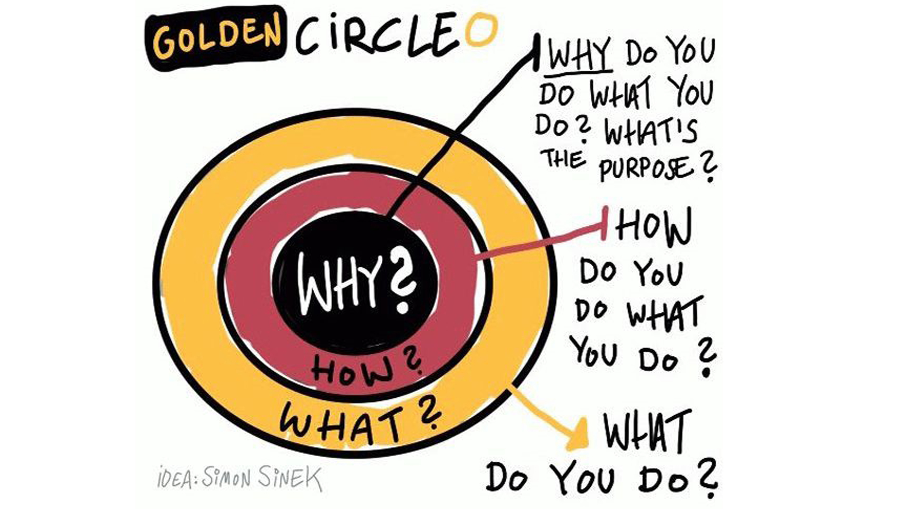

# Road to Noovolari

## The journey to tech startup

What drives a person, team, or company to reach its potential? How do you discover the right approach to achieve it? And why it's critical to find motivation and define aspiration? Those are questions that our team, Noovolari, asked several times in the wandering of finding our path.

I bet that many of you will think that they are abstract, convoluted, and probably meaningless, only useful in some third-rate marketing strategy. Trust me; they are not. Taking the time to understand who you are and why you are doing what you are doing is central to achieve complete fulfillment, both personal and in business.

Don't get me wrong; it's an incredibly challenging ride with many blurred answers. Still, it's a trail we've been following for the last seven years, and today we will shed some light on what we did to achieve this formidable goal (spoiler: yes, we did it!); from how everything started and how we changed along the way up to discovering and embracing our true vision.

## The first steps

It's impossible to talk about *Noovolari* without starting from *beSharp*, one of the first companies in Italy to focus and train in cloud computing expertise.

BeSharp started as a university spinoff. Everyone shared the passion for solving problems with a deep technical approach, expanding and polishing the skills needed in every technology aspect involving the cloud.

Since day one, most people in beSharp were focused on becoming advanced AWS consulting partners for business, architecting and developing cloud infrastructures, and hand-crafted solutions for customers.

Instead, my team focused on research and development to learn and bring innovation to the whole company. We always had freedom in aiding our consulting associates and their customers as we saw fit; that's why we never focused on a single cloud provider. Instead, we explored the whole cloud landscape to create new and more broad solutions. Our projects ranged in vastly different cloud areas, from adaptive pipelines for genomic high-performance computing to application consistent backup and disaster recovery. Our team's name, *Noovolari*, was a pun involving the word "cloud" in Italian (*e.d. nuvola*), and the famous racing driver Tazio Nuvolari; meant that we wanted to go fast in the cloud.

We explored a little bit of everything, but we soon realized that the best results came from improving our internal processes. Our knowledge and understanding of the underlying platforms gave us an unfair advantage in creating new developer tools. Despite our small team and endless stream of work, we were able to free many of our colleagues' burdens to make them focus on what really mattered to them.

**Our mission was to put to good use our skills at scale.**

## Growing together

It was by chance that we started showing our work to people on the outside. In our chase to give our colleagues the best tools they could have, we started putting a bit more effort into the user experience. As a result, they started using our product during meetings in front of customers... and the feedback was astounding. People started asking to use our software, and we realized that we weren't solving problems just for us but also for many people. That was a perfect opportunity to put our expertise to good use.

One of the most crucial moments was our first database rollback in production. One of our customers had a major disruption on their workloads. Since they were using our software to manage their entire backup lifecycle, it felt natural to support them. It was our first test drive, and we couldn't stop thinking about what would happen if something went wrong. And in a few minutes, the application was working as if no problem ever came up.

**We were able to solve a real problem for a real customer.**

## Keep calm and stop

Things were going well at that moment. We were getting acknowledged and building more and more awesome features. We started making arrangements to offer the software as a service, subscribed our software to several marketplaces, and plan our commercial offering. So we felt on the edge of starting our journey as a product company. But we never took off.

Aside from few customers directed to us by our colleagues, very few people came after our solution through other channels. As this situation persisted until the beginning of 2020, we started wondering what was wrong with our project despite all our work. We were confident about our solution, but still, customers didn't flock at us as we expected. Why?

We thought the best way was to gather the courage and contact someone who already walked the path we were trailing on. We asked more successful entrepreneurs to give us some feedback on our strategy, but it was painstaking. We were scared of what they could tell us and how that could affect our morale. After some weeks of attempts, we finally found a person willing to help. And just a few minutes into the meeting, he said:

> Let me guess... are you all engineers?

That was it.

At that moment, it flashed the idea that our situation was more common than we thought. The problem with engineers is that we think only in terms of features and development cycles. We thought that making the best technical product was enough for people to come by themselves, and we just had confirmation that this wasn't the case. We were really naive.

This brief call opened pandora's box, and we started to see the fallacies in our process. From focusing all our efforts on the next big feature to the grave lack of communications with our potential customers and the small and biased customer feedback we collected. We just weren't aware of the several things needed to make a successful product. And diving deeper into the hole just popped out more and more questions... it seems as if there was no end to it.

That was one of our hardest moments. We felt overwhelmed by the things we took for granted, but we couldn't go on without a plan or answers. 

**We decided to stop everything and go back to the fundamentals.**

## Time for questions

The first thing on the agenda was a retrospective of the last year of development. We focused on the creative process and feature proposal up to the customer feedback because we felt that something was off in the decision-making and feature selection. So we first examined the backlog and roadmap to find out why we chose to develop some specific features.

Up to that point, we used a scoring system based on reach, impact, confidence, and effort to value all our potential features. Each element of the scoring system had some internal weights that could tweak the overall score in favor of our current goal. For example, lower technical debt, catch up to competitors or develop new features in the market. So far, so good, we even thought that we did a pretty good job!

But the most affected phases were *validation, feedback,* and *custom development*. We assumed that our choices were objective because of the multiple steps involved, but we missed the point in disregarding the work at the top or the bottom of the process. We prioritized things based on what our colleagues doing consultancy needed at that moment, and their necessities swayed their feedback. Moreover, we offered to integrate custom features for our current customers. Trying to fit those features as generally available increased the technical debt. In the long run, it slowed us down to the point where new features required complete code refactoring.

After focusing inside, we shifted the perspective on the outside. We already had a market and competitor analysis, but after a review, we found out its main goal was to *find features to bridge the gap* or *find features that could set us apart* from the competition. We didn't make a broader analysis to find out what was setting us apart from the competition. So we started from scratch and tried to build a clear understanding of the whole market and, more importantly, where we could belong. 

First, we drew a *competitive landscape*, a visual representation of each market segment, and where all our competitors belonged in that space. Next, we went into an in-depth analysis of each competitor's features to determine the gap between us and discover their strengths and weaknesses. It was a lengthy process that needed few iterations, and it proved invaluable to have a visual aid for discussion since the amount of data to deal with was huge, and not everyone was focused on this task. Putting everything together required a lot of effort and brainstorming, but we emerged with some answers, and most of our fears and doubts materialized. 

We always thought we could manage to find our niche by creating the best possible technical solution, but we had difficulty explaining how exactly that could find its place in the landscape. It seemed that we lacked a proper area that set us aside from the competition. Moreover, the gap with our competitors was too wide. As a team of barely four people, there was no way we could catch up to their latest features.

Last but not least, we went into a thorough analysis of our marketing strategy, and we realized that we needed to take the matter into our hands. We relied too much on internal feedback and word of mouth; we needed to build an online presence. But based on what? We still didn't have a unique identity. Things were looking pretty grim, but still, we didn't want to give in.

**We just needed to tackle the problem from a different perspective.**

## Back to why

Despite all the analysis and work we did, we were still far from finding our place. Again the help came in the unexpected form of a simple yet powerful phrase that's been my guiding principle since then:

> When in doubt, be yourself

It may seem trivial, but it's easy to wander and lose focus when you're trying to do something very complex. What works really well is to have somewhere to return to, so you don't need to waste precious resources thinking about what's wrong. We focused on the process, analytics, markets, and business development, but we weren't sure what were the reasons that brought us together and why. We lacked a safe haven.

What helped us get going was the famous golden circle:

The method is super inspiring and challenges the status quo at its core for identifying your purpose for what you want to do in business and life. So many people think about this only in marketing terms, but we've relied on it as a framework to find our deepest meaning, and it has really served us well.

We had many brainstorming sessions filling on post-it notes what were the reasons we started, what we wanted to achieve, and what was driving us forward. In other words, the reasons we were doing what we were doing.

As you can guess, the "what" and "how" were pretty straightforward and slightly deviated from the average answer. Still, it was important to start with setting some common ground. Unfortunately, the "why" part was countless times more difficult. Although I know this sounds like an easy task, we got a different answer to every question, and they started piling up pretty fast.

It was important to use physical support to have a quick overview, so we put every note on a wall. We then started clustering our notes and give a general meaning to each cluster. Finally, each reason was put in a thorough examination and distilled into something we all agreed upon. I'll spare you the details about this, but it required a lot of meetings and talking.

In the end, this is what emerged:

> Imagine a future where the public cloud will be the key to opening the doors of innovation to your business. What could we do if the complexity of the workloads in multi-cloud environments did not allow our users to focus on their core business? And how extraordinary would it be to accomplish all of this day after day, thanks to a work that inspires us, makes us happy, and makes us feel fulfilled?

> We create products that revolutionize the way we work in complex multi-cloud environments, allowing our customers to achieve their business goals through the unification, centralization, and facilitation of cloud processes following best practices. We want to be a beacon for companies seeking a standard for complex processes in multi-cloud environments.

> We believe in a world where everyone can contribute to evolve and innovate faster; we believe that all digital products should be open to contributions. We want to grow as people and be aware of the extraordinary goals that we can achieve, thanks to mutual trust and teamwork.

## Get to the how and what

We had done it. 3 months had passed, but we finally had our compass.

Now it was about fitting our vision into the market... and it came unexpectedly easy. One of the few things that came up during brainstorming was that *we believe in a world where everyone can contribute to evolve and innovate faster.* Of course, that ringed a bell with **open-source**.

As software engineers, we had previous experience in that area, but we never really thought about it in business terms. So we were again back at square one, but with a viable option in mind, that could really set us apart. So in the next few weeks, we dedicated ourselves to learning everything we could about making open-source products and make them sustainable through commercial offerings. And we loved what we saw.

**It was the perfect union of our beliefs and how to reach them.**

## Nowadays

This brings us more or less to one year ago, so now you're probably wondering what we've been up to since today? We've stopped the projects that didn't perfectly align with our vision; the effort to change them on the run was too high to be reasonable. But the good news is that we are not short of ideas.

We had a developer's tool to grant easy and secure access to our large numbers of accounts during all this time. We created it out of the necessity of increasing the number of our cloud accounts to comply with the best practice to segregate cloud workloads. It was nothing fancy, but we realized that it became a standard for our whole company in no time. Also, like before, a few of our consultancy associates' customers are starting to ask about it in detail.

But now we are prepared... well... at least more prepared than before!

We spent the rest of last year making it an open-source tool, built for cloud developers like us. And now it goes by the name of [Leapp](https://www.leapp.cloud/).

I'd really like to delve into the full details about how we did it, including how we structured our internal process, how we built the product roadmap, the development methodology, the go-to market strategy, how we have structured the commercial offering, and so on... but this will require at least a couple more articles.

We're still early on our journey, but things are moving as never seen before. We're about to reach 450 stars on [Github repository](https://github.com/Noovolari/leapp), about 750 stable downloads at each release, and offer [our first commercial support plan](https://www.leapp.cloud/support.html). We have even a few surprises waiting for you in the next months. As a little spoiler, we are planning another software specifically built for teams on top of Leapp. But we'll make a big reveal in due time!

Meanwhile, if you'd like to join us to have a chat, discuss some new features, or keep up with the news, join our community on Slack and Github.

**We are Noovolari and we'll do wonderful things together.**
