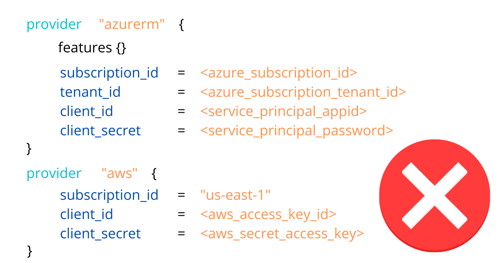
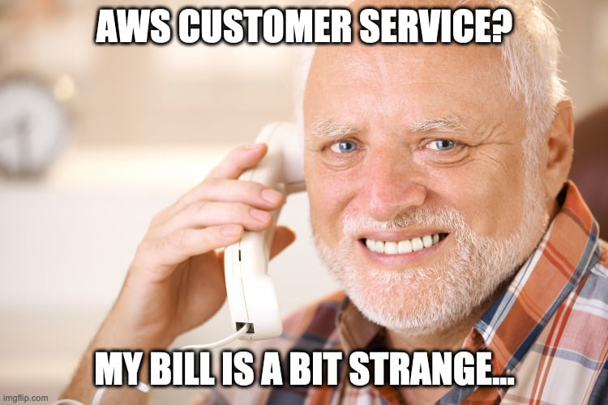

# How to access AWS and Azure in Terraform

## Intro

Being a cloud developer can be hard but there are tons of tools and resources to help smooth the hard edges. One of the tools at our disposal is Terraform, an open-source infrastructure as a code software tool that provides a consistent CLI workflow to manage hundreds of cloud services. But how exactly Terraform is able to connect to those services and create our infrastructure? And can we find the best way to manage our resources? Let's see it.

## What you shouldn't do!

### Specifying credentials in provider's block

For the love of everything that is good, please don't ever do this if you don't want to quickly find out a new world of grief and pain:



In AWS and Azure documentation, you will find some warning with mild words and a funny little warning block saying *this is not recommended*; this doesn't even start to convey how much bad practice is hardcoding credentials, so I'll tell you more bluntly:

> 🔥 DON'T. NEVER. EVER. HARDCODE. CREDENTIALS! 🔥

The internet is full of horror stories of people lazy or careless enough to find themselves with big surprises in their next cloud provider bill. In the most recent one, [a guy found out a 65k bill because he "*handled source code with hardcoded credentials to other devs*"](https://www.reddit.com/r/aws/comments/qgr9jh/was_billed_60k_with_a_free_tier/). 

Do you want to become part of this group? There are better ways to connect your Terraform with your cloud accounts, so let's follow best practices, shall we?



## What you should handle with care

### Putting credentials in environment variables

The first thing you can do to connect Terraform with your providers is to leverage environment variables. You need to export all the data needed to connect into the default environment variables and you're good to go. Just declare an empty provider and Terraform will automatically pick them up and run.

```jsx
export ARM_SUBSCRIPTION_ID="00000000-0000-0000-0000-000000000000"
export ARM_TENANT_ID="00000000-0000-0000-0000-000000000000"
export ARM_CLIENT_ID="00000000-0000-0000-0000-000000000000"
export ARM_CLIENT_SECRET="00000000-0000-0000-0000-000000000000"

export AWS_ACCESS_KEY_ID="0000000000000"
export AWS_SECRET_ACCESS_KEY="0000000000000000000000000000000"
export AWS_DEFAULT_REGION="us-east-1"
```

```jsx
provider "azurerm" {
  features {}
}

provider "aws" {}
```

Only downside of this approach is that managing this environment variables manually is a real pain. How cool would be to have an automated way to handling this? ;)

> 🔥 Refrain from exporting directly in your *.bash_rc*, *.profile* or any other automatically sourced configuration files. Those file are not encrypted you it's a very similar situation as the hardcoded credentials. **Forewarned is forearmed.**

## What you should do! (finally)

Here things will split a bit for AWS and Azure, but I'll try to keep them as consistent as possible. We'll mostly look at interactive ways so keep that in mind.

## On Azure

### Logging through the CLI

This is the default and most secure method for interactively working with Terraform. By running the az login command on the Azure CLI it will export the parameters needed to work into environment variables. The only problem you can incur is by having multiple tenants; in this case, you need to specify in the Terraform Azure provider the one you will use.

```jsx
provider "azuread" {
  tenant_id = "00000000-0000-1111-1111-111111111111"
}
```

### Using service principals

Service Principal authentication is usually more suitable for automated workflows like for CI/CD or running application scenarios. This type of authentication decouples the authentication process from any specific user login and allows for managed access control.

We can see them as the Azure counterpart of IAM Roles in AWS, and one trivial advantage would be that it can be shared between people without having to resort to groups or tie directly to an identity. In essence, by using a Service Principal, you avoid creating fake users in Azure AD to manage authentication when you need to access resources.

## On AWS

### Assuming Roles

Assuming a role is the single most simple and secure way to interact with your cloud resources through Terraform. It comes easy as defining the assume_role parameter in the provider and filling out the role you want to assume, the name of the session (it will be handy if you need to trace calls through monitoring systems such as CloudTrail), and an optional external_id that serves as a secret.

```jsx
provider "aws" {
  assume_role {
    role_arn     = "arn:aws:iam::ACCOUNT_ID:role/ROLE_NAME"
    session_name = "SESSION_NAME"
    external_id  = "EXTERNAL_ID"
  }
}
```

Overall is a good method but it suffers the same problem as the hardcoded credentials in the sense that when you commit it into your repository anyone can put their hands on this and manage your account.

### Shared Credentials file

You can also make all those information external by telling terraform to look up a shared credential file. The default location is `$HOME/.aws/credentials` on Linux and macOS, or `"%USERPROFILE%\.aws\credentials"` on Windows. This way the only information you need to exchange with Terraform is the name of the named profile and the CLI will automatically perform the assume role for you.

```jsx
provider "aws" {
  region                  = "us-west-1"
  shared_credentials_file = "/Users/tf_user/.aws/creds"
  profile                 = "customprofile"
}
```

This can be further enhanced by using multiple named profiles. 

### No MFA support, Leapp to the rescue!

Currently, Terraform doesn't support the `mfa_serial` while assuming roles according to this issue:

[https://github.com/hashicorp/terraform-provider-aws/issues/2420](https://github.com/hashicorp/terraform-provider-aws/issues/2420)
Leapp can work around this specific scenario by performing the assume role, prompting for the MFA token, and injecting into the credentials file the temporary credentials and tokens to let you use Terraform without further interaction. Nice, isn't it?

## Conclusions

[https://github.com/noovolari/leapp](https://github.com/noovolari/leapp)
As we've seen there are a lot of ways to interact with Terraform for both AWS and Azure. When choosing our access methods we should always think about the security concerns and avoid at all costs manual interactions with the configurations file. For all of this, **Leapp is the best tool to achieve both security and automation**, abstracting away all underlying interactions and letting cloud developers focus on their tasks.

If you found this interesting, have any questions or you just want to drop a DM and connect you can [find me on twitter](https://twitter.com/NicoloMarchesi) or [join our slack community](https://join.slack.com/t/noovolari/shared_invite/zt-opn8q98k-HDZfpJ2_2U3RdTnN~u_B~Q). See you soon!
