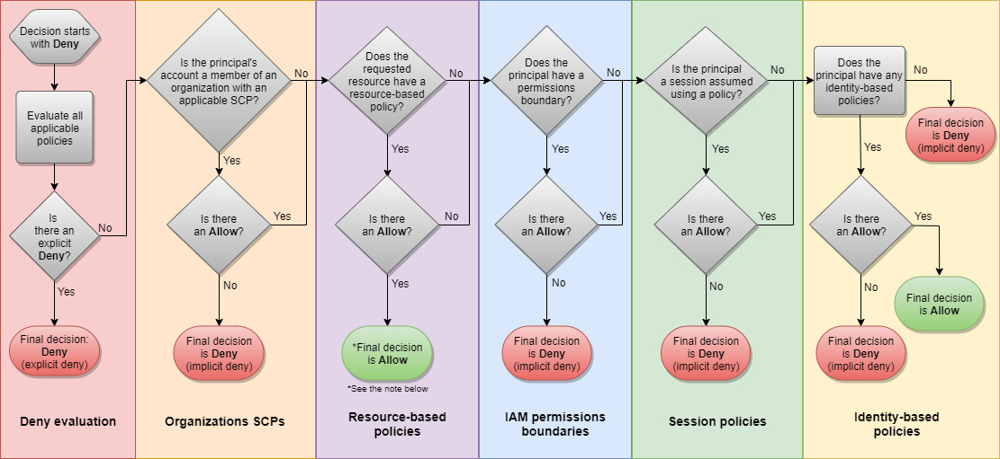

# AWS is only as safe as the weakest credentials setup for your developers.

If you’re reading this article, you’re probably concerned about protecting your AWS assets from attackers, whether they’re human or machines. We will focus on how to prevent or, at least, reduce the opportunity of damage if the local cloud credentials are compromised.

AWS is a public cloud provider whose services are scriptable. This means you can easily provision resources, decommission them, or perform any other action with side effects on your AWS account.

## Requests authentication

I refer to the action as an HTTP API call. HTTP API calls need to be signed through a process called [Signature Version 4](https://docs.aws.amazon.com/general/latest/gr/signature-version-4.html), which adds a signature to the HTTP request in a header or as a query string parameter; this allows requests to be authenticated. 

You can implement the Signature Version 4 process by yourself, but it is a common best practice to use existing and validated solutions, like AWS SDKs, regardless of the programming language you’re using (as long as it is supported). If you’re not implementing an application and you need access to AWS API from the command line, the AWS CLI is the way to go.

AWS SDKs and AWS CLI are two examples of dev tools used to access AWS services through its authenticated API, but you can find more of them, like the AWS Toolkit for Visual Studio. All these dev tools encapsulate the SigV4 signing process described before. The signing key used to create SigV4’s signature is derived from an access key, i.e. your security credentials. If you’re dealing with short-lived security credentials, the API request contains the session token that you received from AWS STS.

I’m quite sure most of you are already aware of how dev tools seek AWS Credentials locally, in your machine, but I don’t want to take it for granted.

## The Credentials Provider Chain

Both AWS CLI and SDKs look for security credentials following a [Credentials Provider Chain](https://docs.aws.amazon.com/sdk-for-java/v1/developer-guide/credentials.html).

From a local point of view, the main links of this chain are environment variables and shared configuration files. Basically, environment variables take precedence over the shared configuration files. If environment variables are not set, dev tools search for credentials in the $HOME/.aws/credentials file; lastly, they seek credentials in the $HOME/.aws/config file. The last one is not thought to be used as a container of sensitive information, but you can use it for this purpose. You can even use a third-party tool to generate credentials on demand by specifying the credentials_process key in the $HOME/.aws/config file.

## Where can AWS credentials be found LOCALLY?

It should be clear that, if someone wants to get access to our cloud assets from a compromised machine, the main targets are the environment variables and the shared configuration files, but they’re not the only ones. 

Based on the tools you’re using on your machine, there could be other places where an attacker can find sensitive information. For example, the attacker could find AWS credentials in one of your application’s codebases, regardless if they’re ignored by your version control tool (if you rely on git, using .gitignore file).

An unnoticed yet noteworthy place where credentials could be found in the command history, accessible from both Linux and macOS machines. Imagine you exported long-term credentials as environment variables using the export command; well, this sensitive information will be kept in the history until you clear the command history.

Another place where the attacker can find sensitive information that can damage not only tour AWS accounts is your password manager, whether you’re using it as a browser extension or desktop app. If the login is not expired, the malicious person (or software), can steal critical AWS credentials. For example, as a security best practice suggested by AWS, you may have stored your root account credentials in your password manager. If root account credentials are stolen, you have only one option left: contact AWS to close your account.

Some local AWS credentials managers use the System Vault, e.g. macOS Keychain, to store long-term AWS credentials that are used as a baseline to generate short-term ones. The System Vault is another local asset that can be compromised by an attacker to grab AWS credentials that can be exploited to damage your AWS accounts.

The ones described above are examples of the common places where an attacker can find sensitive information. You can still find them in custom places; for example, for what concerns AWS shared configuration files, you can set a custom location for both credentials and config file exporting, respectively, AWS_CONFIG_FILE and AWS_SHARED_CREDENTIALS_FILE environment variables.

## How can your machine be compromised?

Be careful when configuring access to your personal or work laptop. It is always recommended to use a strong password to protect it from being compromised. In the best scenario, some of your nice colleagues can introduce some funny jokes in your development environment (not that funny for you)!

Another important point that is sometimes neglected consists in your disk encryption. By encrypting it, you avoid anyone to access its content unless it is unblocked with your login password.

And what if I have full control of my laptop? Can something still happen? Well, as stated before, the attacker can be either a human or software. If I’m not aware of malicious software installed on my laptop, it could exploit vulnerabilities exposed by unpatched legit software. An interesting case of malicious software that is deployed with the purpose of stealing AWS Credentials is the [TeamTNT Script](https://www.trendmicro.com/en_us/research/21/c/teamtnt-continues-attack-on-the-cloud--targets-aws-credentials.html). In this case the malicious scripts are not thought to run on developer’s laptops but on AWS EC2 instances and AWS ECS containers. It steals AWS credentials via their meta-data URLs (169.254.169.254 for AWS EC2 and 169.254.170.2 for AWS ECS), as well as environment variables from Docker systems.

## Shared Responsibility Model

Before diving into some strategies to mitigate AWS credentials theft, let’s make a small digression on the [Shared Responsibility Model](https://docs.aws.amazon.com/whitepapers/latest/introduction-devops-aws/shared-responsibility.html). 

In a nutshell, AWS is responsible for the security of the cloud, not the security in the cloud. This means that AWS operates the security of hardware, software, networking, and facilities that run AWS Cloud services. On the other hand, the AWS user is responsible for selecting and configuring services and resources in the cloud, in his AWS accounts. This includes configuring Identity and Access Management following best practices. Identity and Access Management configuration affects what an IAM principal can do on what resource and under what condition. I find it useful to have a detailed overview of IAM Policy Evaluation logic because it gives an idea of the authorization flow of an authenticated HTTP API call.

*Policy Evaluation flow chart*

## AWS credentials theft mitigation strategies

Let's go through some of the best practices to reduce the opportunity of damage if the local AWS credentials are compromised.

### 1 - Do not use root account credentials

Root account credentials should be used only during the initial AWS account set up to create an AWS IAM User with administrator privileges. Then, root account credentials should be kept safe in your password manager, e.g. LastPass or Bitwarden. Distributing root credentials is extremely dangerous as you cannot invalidate them once stolen.

### 2 - Enable MFA, everywhere!

Whether you’re logging into AWS through a SAML federation or through IAM User credentials, enabling Multi-Factor Authentication adds a layer of security to the login process. Basically, it requires the user to specify a code in addition to the basic login information. The code can be generated either by a virtual device (e.g. Google Authenticator application) or a physical one (e.g. YubiKeys). Remember that, when using AWS role chaining feature, MFA information is carried only in case of a MFA-enabled IAM User that assumes a role that requires MFA information to be forwarded in the assumeRole API call.

Passing MFA information from the AWS CLI could be cumbersome, but you can use Dev Tools like Leapp to simplify the flow.

I suggest not to use MFA authenticator plugins for the browser. If you’re logged into a password manager, having an MFA authenticator plugin installed in the browser basically broke the knowledge + possession mechanism, as the second factor (the MFA code) can be retrieved from your laptop, together with the basic authentication info gained through the password manager.

### 3 - Prefer short-term credentials

As you know, AWS allows you to sign HTTP API requests with both short-term and long-term credentials. 

When using long-term credentials you must be aware of the fact that, to be used by dev tools, they should be placed in one of the unencrypted locations that are part of the Credential Provider Chain. If someone stoles these credentials, they’re not limited by credentials expiration time. An example of long-term credentials is the AWS IAM User access key.

On the other hand, using short-term credentials reduces the blast radius of a credentials theft. Remember that short-term credentials’ duration range varies from one access strategy to another: short-term credentials generated from an IAM User access key have a duration that ranges from 15 minutes to a maximum of 36 hours; short-term credentials generated through the assumeRoleWithSAML and assumeRole APIs have a duration that ranges from 15 minutes to a maximum of 12 hours.

### 4 - Rotate credentials

It is a best practice to rotate credentials regularly, even if they’re short-lived ones. In this context, having a background process that refreshes them periodically makes the difference, as you don’t have to do it manually every time they expire.

### 5 - Apply the Principle of Least Privilege

I want to point it out, even if this is not something you can do locally without accessing your AWS accounts. 

Credentials that are managed in your local machine always refer to an IAM Principal that has some kind of access privileges in your AWS accounts. 

What you can do inside these accounts depends on - at least - how access policies, resource policies, and service control policies were set (probably by someone who’s responsible for the security of your organization). That’s critical for the security of your cloud assets that every IAM Principal has a set of permissions tailored to its role inside one or more workloads. Following this best practice mitigates the damage in case of credentials theft and, in general, provides guardrails for human error-prone tasks.

### 6 - Use of the external id

> In abstract terms, the external ID allows the user that is assuming the role to assert the circumstances in which they are operating. It also provides a way for the account owner to permit the role to be assumed only under specific circumstances. The primary function of the external ID is to address and prevent [The confused deputy problem](https://docs.aws.amazon.com/IAM/latest/UserGuide/confused-deputy.html).
> 

external id is something that must be provided by those who want to access a specific IAM Role. The only requisite is that the role has a trust policy that contains a condition with the **sts:ExternalId** key. It becomes critical when trusting a third-party application as a "deputy" that can act on your behalf.

### 7 - Don’t store secrets in your source control

When working on a project is fairly common to have one or more secrets in your project’s folder, typically for running your application locally, digitally signing your executable, launching a pipeline, connecting to your Cloud Provider, and so on.

These secrets are a possible source for an attack, and there are many malevolent bots on the Internet that regularly scan public repositories like those on GitHub (they are public and accessible by everyone), or even incorrectly configured S3 buckets (wrong permissions, public access) to find secrets for exploiting accounts or services.

Point is, **always ignore secrets in your .gitignore files**, or even better, try to store and retrieve them programmatically from secure vaults, like your System Vault or services like AWS Secret Manager.

### 8 - Patch and upgrade your OS regularly

It’s very important to understand that every day new exploits or vulnerabilities are found for many software or even inside OS code that can be potentially exploited to gain access to your System, retrieve sensible information, and maliciously act on your behalf. This is especially true when you are a Developer and have tools like npm installed.

The more an application contains heavily used third-party libraries, the highest are the chances to be exposed to a vulnerability.

To avoid being exposed to vulnerabilities, **always strive to keep your software and OS patched and upgraded**.

Keep an eye on building warnings when compiling your solution, and check your npm messages when installing a new library. Upgrade them when needed.

If you are storing your project on **GitHub verify your** **DependaBot messages**, they usually contain precious information about vulnerabilities found in your codebase.

### Raise the security culture of your organization

As described in [this](https://aws.amazon.com/blogs/security/top-10-security-items-to-improve-in-your-aws-account/) blog post by Nathan Case, it is critical to be involved in the dev cycle, raise your organization’s awareness of security issue, best practices, and credentials theft prevention and mitigation strategies. Moreover, it’s important to encourage the usage of standard tools to uniform and facilitate the Developer’s processes. For what concerns the local AWS credentials management, [Leapp](https://www.leapp.cloud/index.html) comes to the rescue with its Desktop App and Command Line Interface. It defines a consistent way to manage your access configuration, keep sensitive information encrypted, and generate temporary credentials that can be used by Dev Tools, like the AWS CLI, to perform operations in the cloud.

### That’s all Folks!

I hope you find this article useful to integrate some best practices into your daily workflow, and that it has provided an opportunity to reflect on some security issues that may affect your organization. Feedback and comments are always welcome, so don’t be shy and feel free to direct message me or reach out to our [Leapp Slack channel](https://join.slack.com/t/noovolari/shared_invite/zt-opn8q98k-HDZfpJ2_2U3RdTnN~u_B~Q).

Keep in mind that AWS is only as safe as the weakest credentials setup for your developers.
