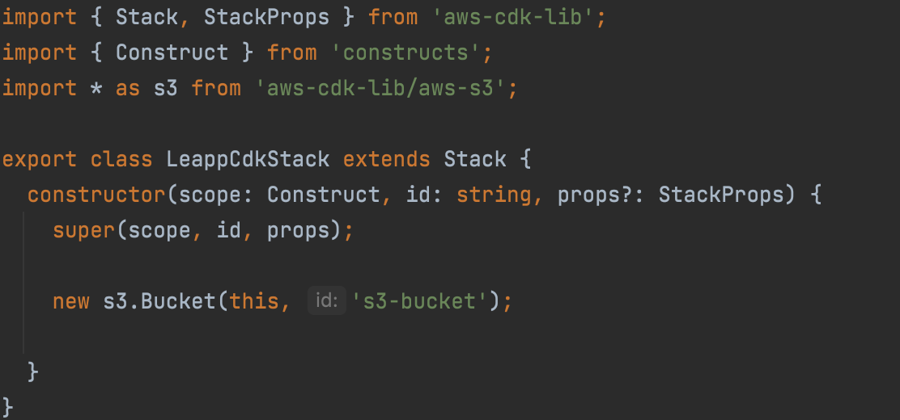
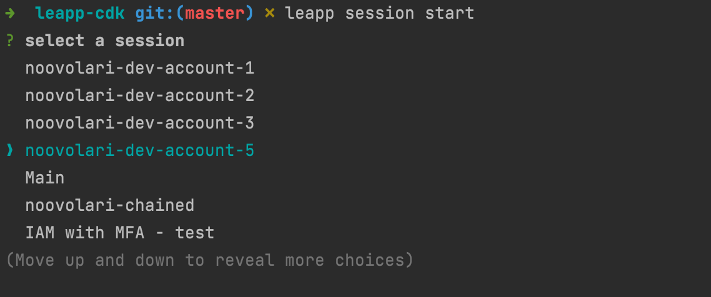
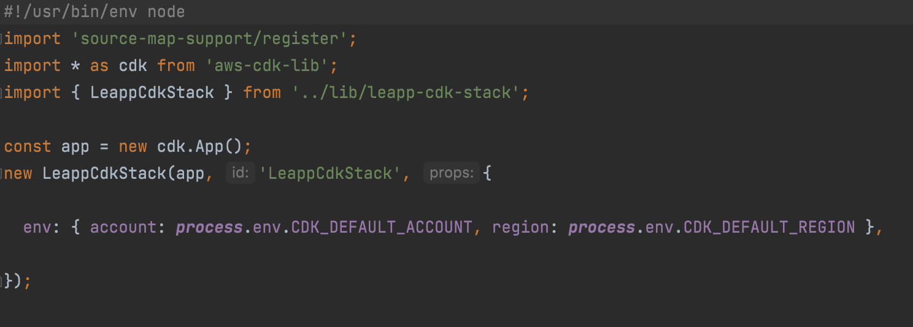
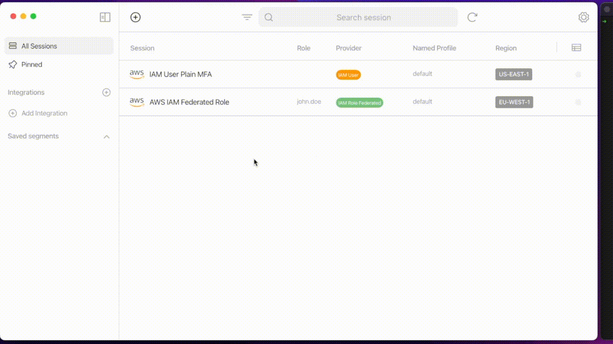

# Shortcut for AWS CDK credentials

# Introduction

We all love CDK! Don’t we all? Since its introduction, we’ve finally got a Typescript tool to write IaC on AWS precisely and structured for serverless applications.

But there is a crucial point that is not as agile as it could be: local credentials management.

There is no simple way to re-use the same template in different environments without writing complex scripts and extensively using environment variables.

Another point is that you are usually bound to long-term credentials most of the time, and that is a possible security threat.

Lastly, according to the documentation, [CDK partially supports Single Sign-on credentials](https://docs.aws.amazon.com/cdk/v2/guide/getting_started.html#getting_started_prerequisites). See [this](https://github.com/aws/aws-cdk/issues/5455) issue.

Not only for SSO but currently, there are still some open issues that can potentially be addressed using Leapp.

For example, [this](https://github.com/aws/aws-cdk/issues/10867) issue requests MFA caching. Currently, CDK prompts the user for MFA code every time a request is issued. Leapp can avoid this as it correctly caches credentials until the session token is expired.

Furthermore, inconsistency issues like this [one](https://github.com/aws/aws-cdk/issues/13792) are easily avoided as Leapp manages the credentials file for you.

But fear not! This article will show you how you can improve your CDK templates by making wise use of our [open-source tool](https://github.com/Noovolari/leapp).

You’ll see that it is possible to automate credentials generation **outside** the template *–* keeping it drier and more straightforward *–* use SSO and having more than one credential set active simultaneously. This reduces the possibility to deploy to the wrong environment to zero by using named profiles.

We have prepared a simple test case that you can follow along to understand what are the possibilities and what you can do in your own project. Let’s begin!

# It all starts with a simple example

To better understand what advantages our tool can give to a developer, we want to show you snippets of CDK code and terminal commands without and **with Leapp**.

Our example consists of a CDK template to deploy the same S3 bucket in two different accounts. Even if very trivial, its purpose is to demonstrate how you can simplify your code by introducing Leapp into your developer routine.



### Bootstrap

When using CDK you **first have to bootstrap the AWS environments** that you want to deploy your infrastructure in, if you haven’t already. Without Leapp, you would normally use this cdk bootstrap command, as suggested by [official AWS documentation](https://docs.aws.amazon.com/cdk/v2/guide/bootstrapping.html): 

```tsx
cdk bootstrap aws://ACCOUNT-NUMBER-1/REGION-1 aws://ACCOUNT-NUMBER-2/REGION-2
```

In this example, we bootstrapped both the accounts you’ll need in a single command. The workload is error-prone, not safe, and can become very difficult to manage if you need to bootstrap lots of them.

With Leapp, you need one or more sessions already set up (don’t know how to? Check it [here](https://docs.leapp.cloud/latest/configuration/)!). Go to the desktop app, select your session and double click it.

You can also change the region and named profile for that session. Left-click on it and select Change → Region/Named Profile

Now you can type `cdk bootstrap` and CDK will automatically bootstrap the session with the *default* named profile in the region that you selected. When bootstrapping multiple accounts, or if you’re not using the default named profile, add the flag `cdk bootstrap --profile NAMED_PROFILE` 

If you don’t want to leave your terminal, you can use the newly released [Leapp CLI](https://docs.leapp.cloud/0.12.0/cli/)! 

Use the command `leapp session start` to select which session to start, change its region and named profile if you need to with `leapp session change-region` and `leapp session change-profile` and then you’re set!



### Synth and Deploy

First thing first! For our example to deploy properly, when you instantiate your CDK stack, make sure to set `env` in your props to the following value:

```tsx
{ 
	account: ***process.***env.CDK_DEFAULT_ACCOUNT, 
	region: ***process***.env.CDK_DEFAULT_REGION
}
```



In a default CDK project created using `cdk init,` you can find this file inside the **bin folder**, and it’s also referenced in the `cdk.json` file.

Once everything’s ready and the accounts are properly bootstrapped, start your sessions in Leapp as you did for the bootstrap step. Remember to change region and named profile accordingly. If you want to reduce the possibility of error to the minimum, you can programmatically do that in a script using custom flags. Check the Bonus section!

`cdk deploy` will deploy in the default named profile session you set in Leapp.

`cdk deploy --profile NAMED_PROFILE` will deploy in a different named profile instead.

### Use Single Sign-on with CDK

As we said before, CDK only partially supports credentials generated by AWS Single Sign-on, BUT with Leapp it is possible to overcome this limitation. And without changing anything in your scripts too!

You have to [create an *integration](https://docs.leapp.cloud/latest/configuring-integration/configure-aws-single-sign-on-integration/) *****in Leapp,  like you would for an AWS session. See the video below:



By doing so, you’ll recover all your Organization accounts and roles; now you just have to start one of your SSO sessions and Leapp will create short-lived credentials **completely compatible with CDK**! 

Boom! Now you’re using SSO with CDK without hassle!

### Credential Process

All the examples shown until now are based on short-lived credentials, which is awesome, but even if temporary, you are still leaving an open door to potential attackers: credentials in AWS files are still in plain text and therefore exploitable.

To overcome this issue AWS also gives the ability to generate credentials on the fly, right before issuing an SDK or CLI command. This feature is called **[credential process](https://docs.aws.amazon.com/cli/latest/userguide/cli-configure-sourcing-external.html)**!

```bash
[profile default]
credential_process = leapp session generate SESSIONID
```

Leapp overwrites the AWS config file command by adding the correct session ID for you and using its CLI to generate credentials in place of AWS.

By doing this, **every time CDK needs to access one or more SDK commands**, Leapp **will automatically issue valid credentials, without writing anything in your files**!

And of course, it works with named profiles too!

### Bonus: How to use Leapp CLI to automate CDK deploy

Leapp comes with a CLI, which allows to automate all the actions you can do with the Desktop App via flags. 

In this simple snippet we want to show you how to create a named profile, associate it with a new [AWS IAM User session](https://docs.leapp.cloud/0.11.1/configuring-session/configure-aws-iam-user/), start that session and deploy your infrastructure, by setting a profile name beforehand.

```bash
PROFILE_NAME=my-profile-name
&& leapp profile create --profileName $PROFILE_NAME 
&& PROFILE_ID=$(leapp profile list -x | grep $PROFILE_NAME | awk '{print $1}') 
&& leapp session add 
	--providerType aws 
	--sessionType awsIamUser 
	--profileId $PROFILE_ID 
	--sessionName MY-SESSION-NAME 
	--region eu-west-1 
	--accessKey ACCESSKEY 
	--secretKey SECRETKEY 
&& SESSION_ID=$(leapp session list -x | grep 'MY-SESSION-NAME' | awk '{print $1}') 
&& leapp session start --sessionId $SESSION_ID 
&& cdk deploy --profile $PROFILE_NAME
```

# To conclude

In this article, we’ve seen how you can improve the security of your CDK templates by leveraging Leapp as your credential management system. 

By using Leapp, you don’t need to write any long or short-lived credential neither in your credential (or config) file nor environment variables. And by using the credential process feature you don’t need credentials at all!

We have shown how CDK supports named profiles which is a feature also managed by Leapp, so you can keep all your credentials active simultaneously, reducing the context switch between your IDE and Leapp.

We have showcased some scripts that let you integrate your CDK work routine with Leapp CLI to simplify your daily operations even further.

Thanks to Leapp generating temporary credentials from AWS SSO sessions, we have seen that you are also indirectly enabling Single Sign-on.

We hope that these slight improvements will make your day-by-day work easier.  So, what are you planning to do with CDK? Do you have any suggestions on how we can improve Leapp? Come say “hi” in our [community](https://join.slack.com/t/noovolari/shared_invite/zt-opn8q98k-HDZfpJ2_2U3RdTnN~u_B~Q)!

Until next time, goodbye and stay safe 😷
