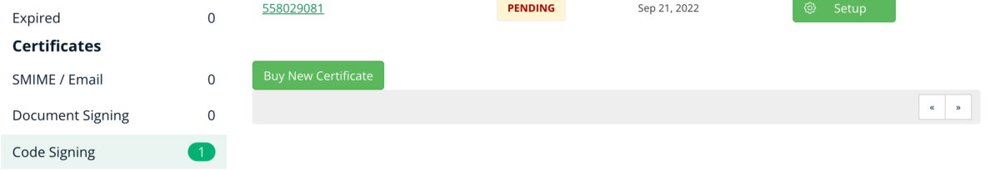

# Leapp and the Windows Certificate expiry

In the last two weeks, we had a few problems with the Windows certificate of our open-source project [Leapp](https://www.leapp.cloud/). In the spirit of complete transparency, I'll try to highlight what went wrong and why.

Many thanks to [Alessandro Gaggia](https://twitter.com/Balubor) for the support in writing this.

### Introduction

As many of you are aware, Windows implements a security system named User Account Controls (UAC) that requires the administrator access token must prompt for consent. To pass UAC on Windows and results as a verified application, one must sign its executables with a .p12 (.pfx) code signing certificate. This goes for the installer, app, and uninstaller as well.

These certificates are issued by specific companies that have the authority to validate your company and your Brand from a legal perspective, ensuring that you are what you declare to be and that the software is not malevolent.

In our case, we used Sectigo, formerly Comodo, as our certification authority. But, as you may guess, the journey was a bit bumpy.

### Phase 1: Generating .p12 certificate

Every year we renew our code signing certificate, typically in **May.** What are the steps to acquire a new certificate? Let's start by obtaining a new .crt certificate:

1. We register and log in to our certificate authority website (sectigo in our case)
2. Inside your dashboard is a voice called certificates: Go to the "code signing" sub-item.
3. Here you'll eventually find the old certificates and a green button to buy a new one
4. On the new page, we need the first type of certificate, also known as the "legacy type certificate" or OV (organization validated) certificate. Currently, we are not using [EV (Extended Validation) certificates](https://en.wikipedia.org/wiki/Extended_Validation_Certificate), but we're opting to change the next time we'll have to renew.
5. After completing the order, you'll find the new certificate requested in your account's certificate section. And now the fun part begins.
6. You must also **generate a CSR ([certificate signing request](https://it.wikipedia.org/wiki/Certificate_Signing_Request)) on your machine when requesting the certificate.** When asked, use "Generate CSR" under the personal info form (which will do via your default browser). This is very important as it contains the certificate's public key and your organization information and is used to request your new certificate.
7. After "generate CRT", we waited for validation. And here started the delays.

### Phase 2: Speeding up validation

When we requested our certificate, we didn't do anything particular the first days, believing that the process would have gone by itself; however, after a few days, we saw that the process was stuck. What did we miss?

- We had to verify our organization's identity by passing two critical things to the form that comes with the receipt email and that tracks the validation process:
- the organization DUNS' number
- A document that demonstrates the existence of the company. We chose the **Chamber of Commerce registration document. However**, we needed to contact the support team 2 times to make them accept this document. For reference, in many countries with a good volume of imports/exports with Italy, some places can validate this document, even abroad.

After wasting six days of back and forth, we managed to make them accept our document but still, we needed a photo of the face of one of us with our ID card near us for validation. So we needed to take the picture, upload it and wait another day for it to be accepted. And this was another silly problem: the first time, the ID card was not near enough to our colleague's face, which was invalidated. We had to retake a picture, and we wasted another day.

After another call with the support team, we obtained the certificate, which was already in .p12 format and could be renamed to .pfx (they are the same except for the extension name). Finally, we had a certificate to be used to sign the window executable.

### Side thoughts on what happened

During this process, we felt primarily pressured by the delays of the supplier but also by our user base. The sudden problems with the application meant that we were flooded with reports and requests to fix this problem for about two weeks.

Mind me; I try to see this in the brightest light: people were so much in pain not being able to use Leapp that they forgot that the project is entirely free and open-source (and they can build and fully utilize the application themselves). Luckily, when we arrived at the thought of buying another certificate, we resolved the issue. But what pained me the most was that few requests weren't exceptionally polite.

We have a [company support program](https://www.leapp.cloud/support) that can take care of like-wise situations. We strongly suggest adhering to it if organizations and companies rely heavily on Leapp to manage their access. The support program is designed to take into account situations like this and gives us the margin to continue providing for the community and free users. Everybody wins.

Also, you get to have a privileged interaction with the development team along with ours and the community's gratitude :)
