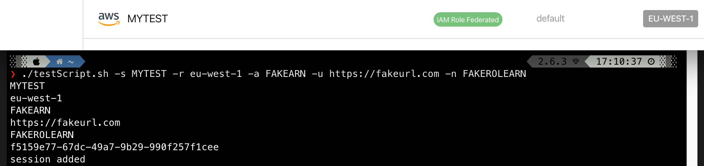
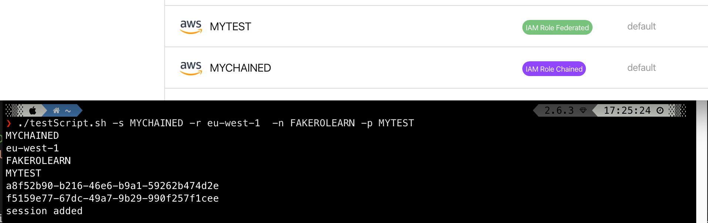
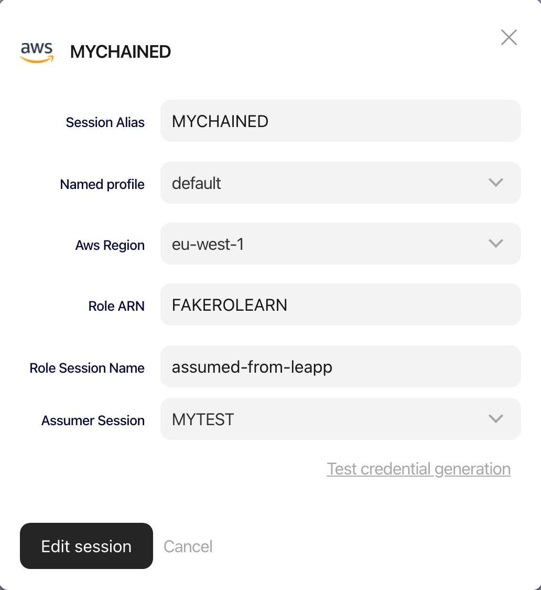

# How to quickly automate AWS Federated Session generation with Leapp CLI

## Introduction

Ever wanted to create and use your personal AWS Federation with Google as an IdP in a programmatic way? 

This short article will surely come to the rescue, introducing some of the features of Leapp CLI.

Let’s start!

## Prerequisites

- AWS Account access with adeguate IAM privileges
- Google Suite access with Admin privileges

Before creating a Federated session using Leapp CLI, we must set up our Google IdP in AWS. 

We can refer to our [guide](https://docs.aws.amazon.com/IAM/latest/UserGuide/id_roles_create_for-idp_saml.html) as a guideline, but for this article, let’s review some important key values here.

The AWS IAM Federation gives the ability to assume a role with permissions to do actions on AWS resources to an external user. This operation can generate temporary credentials for both programmatic access (CLI or SDKs) and for console access.

We will focus on programmatic access.

Trust between Google and AWS depends on 2 metadata files, one from AWS that must be passed to Google and one from Google that also contains keys that AWS can use to validate authentication responses (assertions) from your organization.

Another useful guide to set up things on your side is [this](https://docs.aws.amazon.com/IAM/latest/UserGuide/id_roles_providers_saml.html) one from AWS, which shows how the Federation mechanism works, and [this](https://faun.pub/how-to-configure-google-saml-for-aws-account-5eb89e2d3008) one from ****[Krishna Modi](https://krish512.medium.com/?source=post_page-----5eb89e2d3008--------------------------------),** which clearly shows the setup on Google’s side.

## Federated access via Leapp CLI

You can download Leapp CLI by following the instructions in our official [documentation](https://docs.leapp.cloud/0.13.1/installation/install-leapp/).

<aside>
💡 *Note that you also need the Leapp Desktop App in order to use the CLI*
</aside>

After that, we can create a script that allows creating a new Federated Session:

```bash
#!/bin/bash
# Make a new Federated Session

# Get Parameters
while getopts ":s:r:a:u:n:" flag;
do
    case "${flag}" in
        s) name=${OPTARG};;
        r) awsregion=${OPTARG};;
        a) idparn=${OPTARG};;
        u) idpurl=${OPTARG};;
        n) rolearn=${OPTARG};;
    esac
done

echo $name
echo $awsregion
echo $idparn
echo $idpurl
echo $rolearn

# Find Default Profile ID
profile=$(leapp profile list -x --filter "Profile Name"=default | grep default | cut -d " " -f2)
echo $profile

# Create Session
leapp session add --providerType aws --sessionType awsIamRoleFederated --sessionName $name --region $awsregion --idpArn $idparn --idpUrl $idpurl --profileId $profile --roleArn $rolearn
```

You can remove the echo command, which is there to show you that all the arguments are passed correctly.

You can invoke the command like this:

```bash
./testScript.sh -s MYTEST -r eu-west-1 -a FAKEARN -u https://fakeurl.com -n FAKEROLEARN
```

<aside>
💡 *Note: remember that all arguments are mandatory. You can also modify the script to give the session a different profile; here, we use the default one.*
</aside>

This is the output, taken directly from my console and my Leapp Desktop App, to show synchronization is working correctly.



## Bonus: create a chained session from the Federated one

Usually, Federation is used to Access a Landing Zone, but most of the time, you want to access another account (i.e. one of your clients to work on a project).

Here I’ll show how to create a chained session from a federated one:

```bash
#!/bin/bash
# Make a chained from a Federated session

# Get Parameters
while getopts ":s:r:n:p:" flag;
do
    case "${flag}" in
        s) name=${OPTARG};;
        r) awsregion=${OPTARG};;
        n) rolearn=${OPTARG};;
        p) parentname=${OPTARG};;
    esac
done

echo $name
echo $awsregion
echo $rolearn
echo $parentname

# Find Parent Session ID
parentid=$(leapp session list -x --filter "Session Name"="$parentname" | grep $parentname | cut -d " " -f2)
echo $parentid

# Find Default Profile ID
profile=$(leapp profile list -x --filter "Profile Name"=default | grep default | cut -d " " -f2)
echo $profile

# Create Session
leapp session add --providerType aws --sessionType awsIamRoleChained --sessionName $name --region $awsregion --profileId $profile --roleArn $rolearn --parentSessionId $parentid
```

And this is the result:



As you can see, the properties are correctly imported from the CLI:



## Conclusion

In this small tutorial, I’ve shown how it is possible to create a Federated Session directly from your terminal using Leapp CLI! 

Also, we have seen that scripts leveraging the Leapp CLI can be combined together to achieve even more interesting results (i.e., creating a Chained Session from a Federated one).

This is just the first of a series of small tutorials we, as the Noovolari team, will propose to you all to show how you can automate some of your credential processes using Leapp CLI.

As always, if you have suggestions or questions, feel free to come and have a chat with us on our [community slack](https://join.slack.com/t/noovolari/shared_invite/zt-opn8q98k-HDZfpJ2_2U3RdTnN~u_B~Q).

Until next time, see ya and stay safe! 🙂
