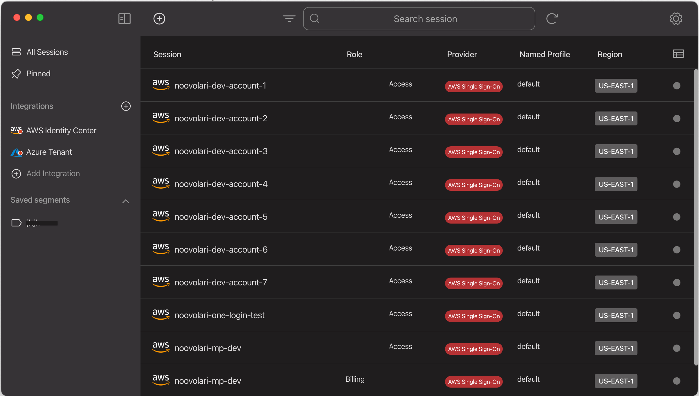
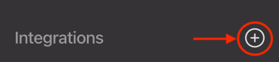
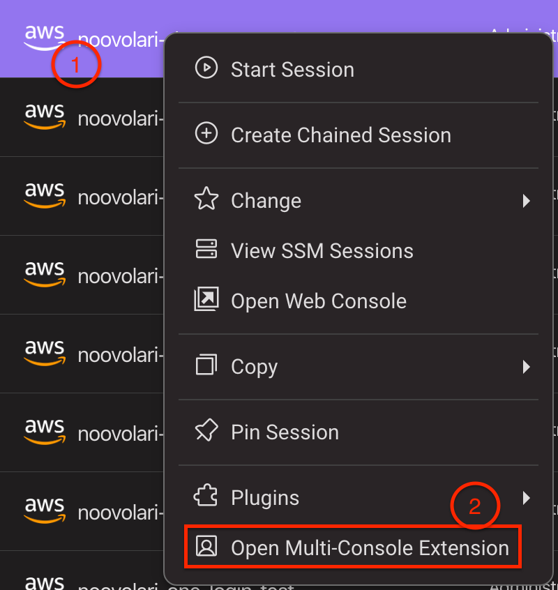
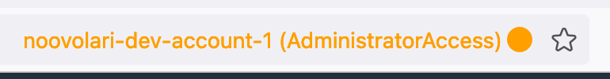
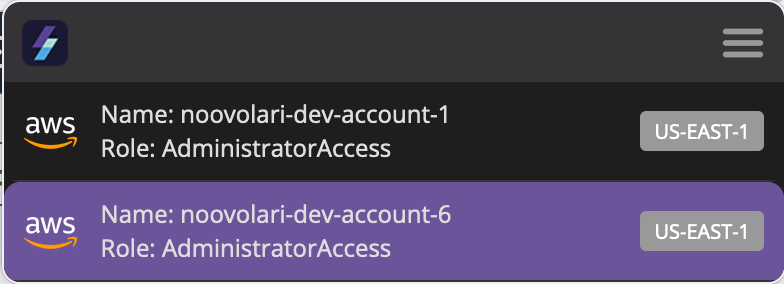
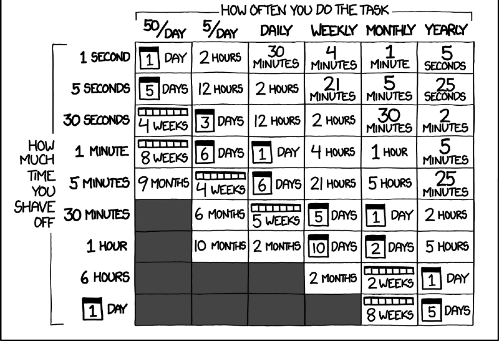

# AWS Console login to multiple accounts at the same time

# Cloud environment is fragmented. We know it; AWS makes no exception!

While the AWS CLI already allows managing multiple accounts, the console experience is still far behind: it allows **one connected session per browser instance by default**. 

This is a great downfall when one frequently changes between accounts, which is normally part of the daily routine of CloudOps.

So you may ask: “How can I have multiple AWS console sessions active at the same time and be able to distinguish between them easily”?

The answer could be using different anonymous browser windows or opening different browsers simultaneously. Even more, I can use one of the many extensions on Firefox. 
Are those the best options? Frankly, I don’t think so…

## One Web extension to access multiple consoles

[https://www.youtube.com/watch?v=SqLub3uW5QU](https://www.youtube.com/watch?v=SqLub3uW5QU)
We are developers, we love to automate everything, and we get bored doing repetitive tasks. That’s why we managed to open different AWS consoles in a single browser window with a click. finally, we integrated it into our daily routine, [Leapp](https://leapp.cloud).

Today, I want to share our [Leapp extension](https://docs.leapp.cloud/0.16.1/built-in-features/multi-console/), available for all the major browsers: Firefox, Chrome, Brave, and Edge.

No more need to manage different browsers at the same time. 

No need to access it every time. 

No need to input by yourself all the information required to log in to the different accounts.

You can [create all the AWS sessions](https://docs.leapp.cloud/0.16.1/configuration/) you need on Leapp; all these sessions are, by construction, related to a specific AWS Account/Role couple (if you need an introduction to AWS IAM, check this [post](https://medium.com/leapp-cloud/how-to-access-your-aws-account-e79352e8a7ba)). 

With the extension [installed](https://docs.leapp.cloud/0.16.1/built-in-features/multi-console#install-the-extension), you’ll be able to open it from Leapp on one or more AWS Console on a specific Account with a specific role. 

All in your default Browser window, without losing your preferences.

It works on isolated containers on Firefox and cookies for Chromium-based browsers. 

Leapp extension keeps track of all the cookies in a tab labeled with a specific metatag and listens to all the requests and responses, storing and retrieving them as needed. This is done for all the tabs currently opened in the browser.

Let’s see how to install and start using the extension!

## Install your Leapp browser extension

**Install Leapp**

*(Skip this step if you already have Leapp installed on your machine)*

First, you need to [install Leapp Desktop App](https://docs.leapp.cloud/0.16.0/installation/install-leapp/) because the extension needs it to communicate what AWS Console it has to open.

**Add a session**

You can add a session individually or using the AWS Identity Center integration (ex AWS Single Sign-on). To add a [Federated](https://docs.leapp.cloud/0.16.1/configuring-session/configure-aws-iam-role-federated/), [Chained](https://docs.leapp.cloud/0.16.1/configuring-session/configure-aws-iam-role-chained/), or [IAM User](https://docs.leapp.cloud/0.16.1/configuring-session/configure-aws-iam-user/) session, use the plus button in the top bar. 

To [add sessions via AWS Identity Center integration](https://docs.leapp.cloud/0.16.1/configuring-integration/configure-aws-single-sign-on-integration/), use the plus button near the integration sidebar.

In both cases, fill the required parameters.

(Note: at the moment, IAM User sessions can’t use the extension, but all others do)

**Install the extension**

The extension is available for all major browsers:

- If you’re on Firefox, you can [download it directly from the store](https://addons.mozilla.org/it/firefox/addon/leapp-multi-console-extension/).
- If you’re on Chrome, Edge, or any other Chromium-based browser that accepts extensions, you must install the .zip file manually. You can find [here](https://d3o59asa8udcq9.cloudfront.net/extension/leapp-extension-chromium-latest.zip).

**How to use the extension**

With your preferred browser opened and the extension installed, return to Leapp and select one session you wish to access via AWS Console.

The Session will be launched in your default browser in a new tab. From there on, you can open new child tabs from the initial one, and all of them will retain the same cookies. On Firefox, you can verify this by looking at the session's color, which will be the same.

The extension also comes with a small user interface that lets you focus the tab you need based on the AWS account and role currently set in that tab.

## Final Thoughts

After reading this article you may wonder why you would use the Leapp extension instead of one of the many others available.

Here are my top 3 good reasons:

**Programmatic meets Console access** 

Many tools scattered on the Internet are useful for Programmatic access (i.e. CLI tools) to AWS. In contrast, many others (typically most of the extensions for Firefox) are only used for Console access.

You can have both. In the same tool. Behaving the same way.

**Secure Access**

Are you managing your credentials securely? The fact is that most tools only act as a way to access AWS, but the security posture of those credentials is a burden on the shoulders of the final user.

Leapp uses and rotates temporary short-lived credentials generated from your sensitive infos (encrypted in your local system) for use with any AWS-compatible tools (i.e. AWS CLI, Terraform, CDK, etc.), and for accessing your AWS console too.

**Extensibility**

Leapp comes with a [plugin system](https://docs.leapp.cloud/0.16.1/plugins/plugins-introduction/) that lets you enhance your experience by automating your everyday operations on AWS.

This also reflects on the extension, as it communicates via WebSocket with Leapp.

Finally, I suggest [this article](https://medium.com/leapp-cloud/stop-putting-aws-credentials-in-the-credentials-file-fb7dfed29b05) on how to manage AWS credentials.

## Conclusions

If you’re here reading this article, is thanks to the time I saved in opening and closing AWS sessions. Maybe it may seem exaggerated, in a way, but think about all the minutes combined every day doing repetitive tasks, and you’ll see how much time it is!

I strongly believe that many of you have the same issue. That’s why we open-sourced this solution to everyone,  

We have seen what problems it could solve, mainly for managing multiple AWS account consoles simultaneously, but also because being part of a more structured tool, it does it with secure credentials and without having the user remember passwords, profile names, roles, and so on.

We have seen where to retrieve it and how to install it.

Is Automating processes also your thing? Do you like to find solutions to your everyday problems and like to share them with others? Then join [our community](https://join.slack.com/t/noovolari/shared_invite/zt-opn8q98k-HDZfpJ2_2U3RdTnN~u_B~Q).

Until next time thanks for reading, and stay safe!
