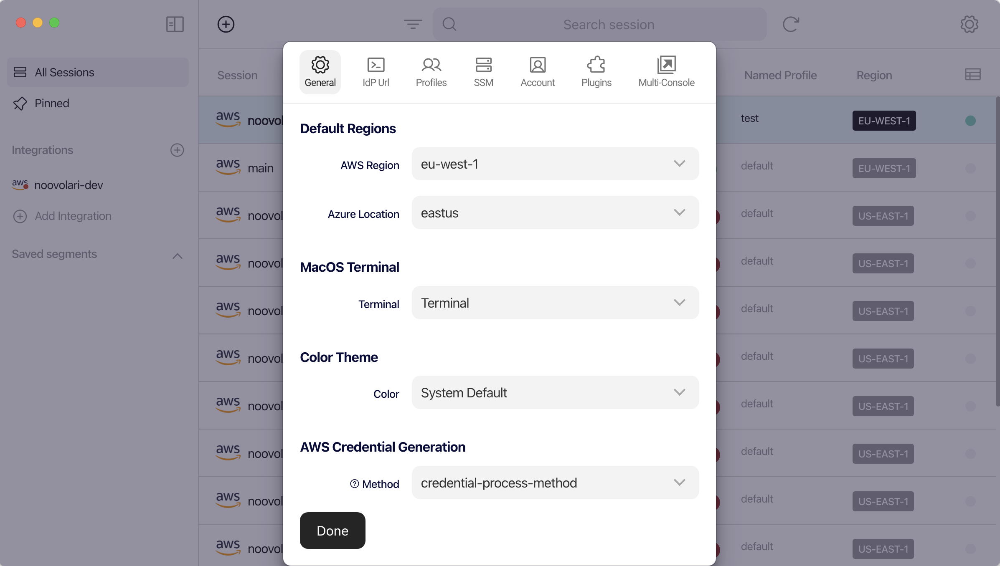
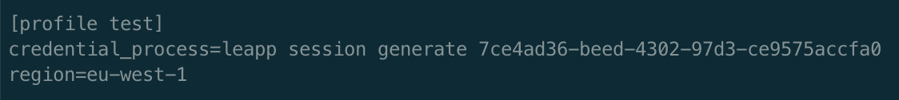

# AWS Credentials: from Environment Variables to credentials_process

If you need to clarify what are the different kinds of AWS Credentials available, how they’re generated, what they’re used for, and what are the best practices to manage them in a proper way, I think you landed in the right spot!

Spoiler: we’re going to focus on programmatic access to AWS resources and/or services. Programmatic access means making programmatic calls to AWS via one of the available SDKs or by using the AWS Command Line Interface.

First of all, let’s start from a term: Principal. For those who never heard it, let me quote the AWS Docs for you:

> A *principal* is a person or application that can make a request for an action or operation on an AWS resource.

Every time you try to call an AWS API, you’ll meet a guardian on your way: the AWS IAM authentication, which authenticates AWS API requests.

The Principal authenticates himself as a root user or as an IAM entity, i.e. an IAM User or an IAM Role. A common best practice is to avoid using root user credentials; Instead, prefer IAM entities. 

AWS IAM is able to authenticate API requests only if the required authentication information is present in the payload. This authentication information is represented by a signature that is added to the API request in one of the following forms: HTTP Authorization header or Query string parameters. The signature is calculated through a mechanism called AWS Signature Version 4 (SigV4), which uses the Access Keys associated with an IAM entity.

So, what are Access Keys? Access keys are IAM entity-bound credentials used by clients to sign API requests for programmatic access. 

A client can be either the AWS CLI, AWS Tools for Windows Powershell, AWS SDKs, or an application that implements the SigV4 logic needed to add authentication information to the API requests. If you are implementing an application that interfaces with AWS resources, my suggestion is to avoid reinventing the wheel and rely on the SigV4 logic already encapsulated in the AWS SDKs, unless you have to satisfy particular needs.

## The Credential Provider Chain

As I stated before, SigV4 uses Access Keys to compute the signature of an API request. Therefore, the previously described clients need to gather these credentials from somewhere, before the API request is actually signed and sent. In particular, clients follow a systematic approach to search credentials in a pre-defined set of sources. This approach is called [Credential Provider Chain](https://docs.aws.amazon.com/sdkref/latest/guide/standardized-credentials.html). The list of sources may vary depending on the specific AWS SDK, so let’s focus on the main ones:

- environment variables;
- [Web Identity Token credentials](https://docs.aws.amazon.com/cli/latest/reference/sts/assume-role-with-web-identity.html);
- the shared config and credentials files;
- [Amazon ECS container credentials](https://docs.aws.amazon.com/sdkref/latest/guide/feature-container-credentials.html);
- [instance profile credentials](https://docs.aws.amazon.com/sdkref/latest/guide/feature-imds-credentials.html).

It is a chain in the sense that, starting from the first source in the list, the client checks for the presence of credentials; the search stops as soon as a valid set of credentials was found.

## Long-term and temporary credentials

Before diving into the different sources available in the Credentials Provider Chain, it is important for you to know that there are two different kinds of credentials for programmatic access: long-term and short-term (or temporary) ones. 

Long-term credentials consist of an access key id and a secret access key, also called access keys. You can think of the access key id as the username and the secret access key as the password. Long-term credentials allow you to access and authenticate yourself as a root user of an IAM User inside an AWS account.

Short-term credentials come with two additional members: a session token together with an expiration time. Yes, because short-term credentials expire after a while, as specified in the expiration member. The main actions used to retrieve short-term credentials are the following:

- [sts:assumeRole](https://docs.aws.amazon.com/cli/latest/reference/sts/assume-role.html);
- [sts:assumeRoleWithSAML](https://docs.aws.amazon.com/cli/latest/reference/sts/assume-role-with-saml.html);
- [sts:assumeRoleWithWebIdentity](https://docs.aws.amazon.com/cli/latest/reference/sts/assume-role-with-web-identity.html);
- [sts:getFederationToken](https://docs.aws.amazon.com/cli/latest/reference/sts/get-federation-token.html);
- [sts:getSessionToken](https://docs.aws.amazon.com/cli/latest/reference/sts/get-session-token.html);
- [sso:getRoleCredentials](https://docs.aws.amazon.com/singlesignon/latest/PortalAPIReference/API_GetRoleCredentials.html).

Each of these actions is associated with a different access method, i.e. the pattern followed to perform a specific AWS action, in a specific AWS account, as a specific AWS IAM Entity (AWS IAM User or AWS IAM Role). We’ll focus on access methods when talking about shared config and credentials files, as these two topics are tangent.

In the meanwhile, let me point out that it’s a best practice to prefer short-term credentials to long-term ones, as they limit the time window available to an attacker - who stole them - to perform malicious actions against your AWS resources.

Both types of credentials can be rotated: for what concerns long-term access keys, rotating them means creating a new key pair (access key id + secret access key) associated with an IAM User and deleting the old one. On the other hand, rotating short-term credentials means creating new ones and exporting them to one of the available Credentials Provider Chain sources. To be precise, there is an exception: you don’t have to take charge of generating and rotating Amazon ECS container and instance profile credentials, as they’re sourced from an HTTP endpoint.

Now that you’ve an idea of what long and short-term credentials are and what are the main differences between them, let’s dive into Credentials Provider Chain sources, starting from the environment variables, as they’re the first place clients look for credentials.

## Credentials source - environment variables

Simply put, to make a client aware of credentials as environment variables, you have to set the following ones:

- AWS_ACCESS_KEY_ID;
- AWS_SECRET_ACCESS_KEY;
- AWS_SESSION_TOKEN.

The AWS_SESSION_TOKEN environment variable should be set only for temporary credentials.

## Credentials source - shared config and credentials file

If the client does not find valid credentials in the previously cited environment variables, it shifts the focus to the shared config and credentials file.

The shared *config* and *credentials* are .yml files located under the *~/.aws* folder.

Each of these files has its own purpose, even if it is not always respected. In particular, the config file is designed to keep configuration data, which is not sensitive; on the other hand, the credentials file is designed to keep secrets. These responsibilities are not respected when we find secrets in the config file and configuration data in the credentials file.

When you run a command from the CLI, it is executed under the scope of a specific Named Profile. A Named Profile is a container for a specific set of configuration data and secrets. Following the best practice cited before, a Named Profile could span both config and credentials files.

In the *credentials* file, a Named Profile can wrap the following secrets:

- *aws_access_key_id*;
- *aws_secret_access_key*;
- *aws_session_token* (only for temporary credentials).

In the *config* file, for each Named Profile, you can specify configuration data that allows you to describe the access method or, in simple terms, the pattern used to access services and resources in an AWS account. The AWS account the request is forwarded to depends on the IAM entity (IAM User or IAM Role) you are authenticating as.

### The IAM User access method

The first access method that comes through my - and maybe your - mind is the IAM User. Accessing an AWS account as an IAM User means providing at least *aws_access_key_id* and *aws_secret_access_key* to the *~/.aws/credentials* file. I said “at least” because you can get temporary credentials from an IAM User too, using the *sts:getSessionToken* action. In this case, the Named Profile - associated with the IAM User - should contain the *aws_session_token* secret too. In this scenario, in the config file, I would put only the *region* and *output* fields. Please, remember to put them under the same Named Profile as the one used in the credentials file.

### The Assume Role access method

The second access method I want to describe is the one that expects an IAM Role to be assumed by another IAM entity. You can describe this access pattern in the shared config file using the following two Named Profile fields: *source_profile* and *role_arn*. 

The *source_profile* corresponds to the Named Profile that wraps the configuration data and secrets associated with the *assumer* IAM entity.

The *role_arn* corresponds to the ARN of the IAM Role that is going to be assumed. You’ve to remember to set up a trust relationship between the assumer and the assumed IAM entities, but that’s another story.

Using this access method, when you run an AWS CLI command using the Named Profile associated with the assumed IAM entity, the CLI generates temporary credentials using the sts:assumeRole action and caches them for future uses under the *~/.aws/cli/cache* folder. These cached credentials are refreshed as soon as a new AWS CLI command is run after the temporary credentials expiration time.

You can even chain multiple Named Profiles using this access method.

When it comes to assuming a role, it is possible to provide an additional authentication info, called external ID. The external ID is a token, shared between the AWS IAM entity and the client that wants to assume it. This token is designed to overcome the Confused Deputy problem ([https://docs.aws.amazon.com/IAM/latest/UserGuide/confused-deputy.html](https://docs.aws.amazon.com/IAM/latest/UserGuide/confused-deputy.html)). You can specify the external ID in the Named Profile *external_id* field under the config file.

Another important configuration data that you can add to your Named Profile is the *mfa_serial*, if associated with the IAM User that is going to assume the IAM Role.

When you have to configure access to multiple AWS accounts using the Assume Role access pattern, it becomes difficult to get rid of all the Named Profiles configuration data and relationships. When you’ve to deal with a complex access scenario, tools like Leapp (https://www.leapp.cloud) come to the rescue! Leapp avoids you to specify relationships between Named Profiles in the config file, as the access methods are stored in the tool-specific configuration file.

Let’s now move to AWS SSO!

### AWS SSO access method

To configure access to a specific IAM Role in an AWS account by the means of AWS SSO, you’ve to provide the following configuration data in the Named Profile.

- *sso_start_url*: the portal URL used to authenticate your client against AWS SSO (uses OIDC authentication)
- *sso_region*: the region in which AWS SSO was configured
- *sso_account_id*: the ID of the AWS account that I want to access
- *sso_role_name*: the name of the role that is going to be assumed in the AWS account
- *region*: the region used by API requests

AWS CLI v2 supports AWS SSO and allows you to log into it through the following command:

```bash
aws sso login --profile <named-profile>
```

This command starts an OIDC authentication flow that requires the user to interact with the browser by providing an authorisation code and granting credentials for the AWS CLI. At this point, the CLI will receive an AWS SSO access token that is cached under the *~/.aws/sso/cache* folder. This access token is then used by the CLI to invoke the *sso:getRoleCredentials* action. The new set of temporary credentials is then cached under the *~/.aws/cli/cache* folder, as for the Assume Role access method, described before.

Instead of manually configuring a multitude of Named Profiles associated with different AWS SSO assumable IAM Roles, you can specify your AWS SSO configuration data in Leapp; once logged into AWS SSO, it allows you to automatically provision all the IAM Roles that you can access (you as the AWS SSO authenticated user).

### Last but not least: the credentials_process

*credentials_process* is a cool feature that allows clients to generate temporary credentials by the means of a third-party CLI or command. The *credentials_process* is a configuration data field that should be defined in the shared config file, under a specific Named Profile. Using this mechanism, you don’t have to specify credentials in other places, as the *credentials_process* command becomes the credentials source.

It is important to make the credentials_process command return the temporary credentials in the following format.

```json
{
  "Version": 1,
  "AccessKeyId": "an AWS access key”,
  "SecretAccessKey": "your AWS secret access key”,
  "SessionToken": "the AWS session token for temporary credentials”,
  "Expiration": "ISO8601 timestamp when the credentials expire"
}
```

*credentials_process* comes in handy in particular situations that are not supported out of the box by the shared configuration and credentials files. An example is the *sts:assumeRoleWithSAML* action, which requires the user to authenticate against an external SAML IdP; once the user is authenticated, the custom script should intercept the SAML Assertion returned at the end of the SAML 2.0 authentication. Then, this SAML Assertion will be included in the *sts:assumeRoleWithSAML* API request.

Leapp allows you to configure how you want to generate credentials. By specifying “credential-process-method” in its “AWS Credential Generation” setting, you’re able to make Leapp generate temporary credentials by the means of its CLI through the *credentials_process* field.





## That’s all Folks!

I hope you enjoyed this article and that you found interesting tips to improve your AWS CLI configuration and credentials file management.

If you want to share your thoughts about this article or, more in general, about AWS Credentials management, please reach out to me through my [Twitter profile](https://twitter.com/herr_villa).

We didn’t cover every aspect of the Credentials Provider Chain, so stay tuned for new articles about credentials generation in a local or remote environment!

Cheers
