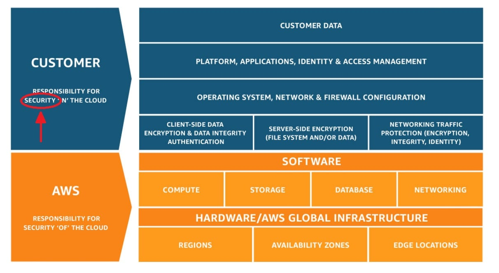
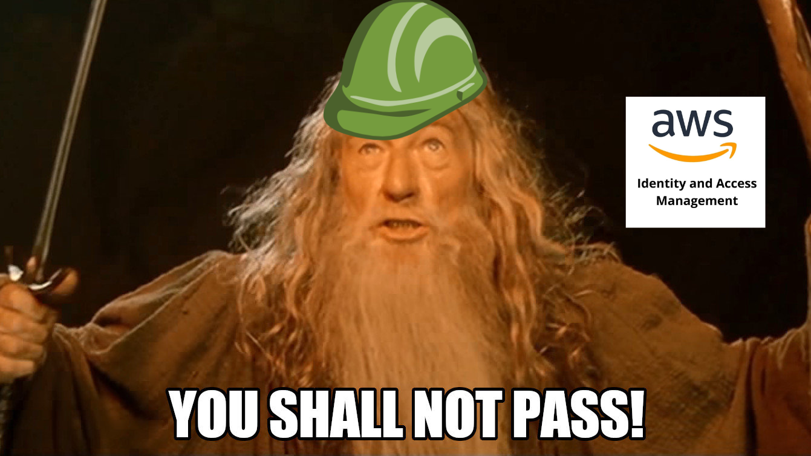
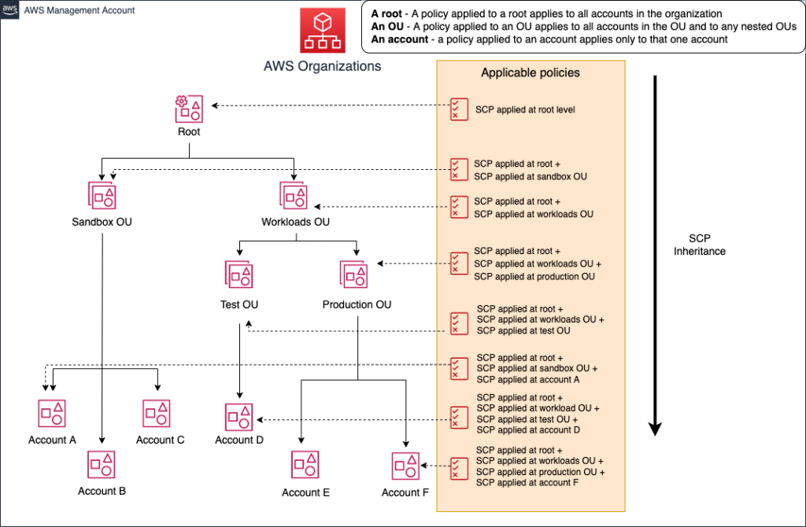

# AWS multi-account strategy explained

If you ever wanted to understand how an AWS multi-account strategy works, you’re in the right place! In this blog post, we’ll explore a bottom-up approach where we’ll see how to secure your single AWS account and then move to a multi-account organization with a fun take.

### One box to rule them all

So, first of all, we need to understand what is an AWS account and let’s deep dive into the topic with a definition:

<aside>
💡 An AWS account acts as a resource container and resource isolation boundary.
</aside>

The two essential keywords here are **container** and **isolation** **boundary,** and I don’t know about you, but to me, they both contribute to forming a pretty clear image:

Disappointed? You were thinking of something more sturdy, right? Don’t you worry now; we’ll get there eventually. So, what can you do with this box? You can put things inside, and… that’s it.

The container, by itself, acts like any other container: to keep things from being scattered around. It can still be wet by a sudden flood, gnawed by rodents, or stolen by someone else!

We must make a little effort to make it more **robust** and **secure**.

And everything because of the **shared responsibility model**.

### The shared responsibility model

As you may already know, when moving to the cloud, you stop thinking about things like managing the low-level components, such as the host operating system and virtualization layer, and down to the physical security of the facilities where the service operates. But not everything goes away.

You are responsible for the **security** of your workloads, and where does our brittle cardboard box we just discussed fit in? Precisely! That’s your job to keep it safe.

### Making the box sturdy: let’s secure it

So let’s start by making your AWS account more secure. The magic happens in the AWS Identity and Access Management (IAM) service, where you can tell anyone in your organization what they can access.

Given that we’re talking about a single account structure, there is a high chance of a **root user** in your account, the one identity with complete access to all AWS services and resources. The very first thing you should do is to [activate multi-factor authentication (MFA) on the AWS account root user](https://docs.aws.amazon.com/IAM/latest/UserGuide/id_root-user.html#id_root-user_manage_mfa).

Aside from that, the actions you should always take are:

*   Activate MFA to any users with interactive access to AWS IAM
    
*   Limit AWS account root user access to your resources
    
*   Use AWS IAM roles and learn about granular permissions
    
*   Enable CloudTrail monitoring for your account and its resources
    

But this is just the starting point; from there on, you’re embarking on a **journey** where it’s up to you to understand how to define your security policies. The essential takeaway is that there will always be new things to look out for, so integrate them into your cloud operations process.

At least the box looks more like this now!

## More boxes! Scaling out your accounts

Now that we’ve learned how to safeguard a single account, why should we ever move away? Let’s continue with the boxes example to know how. So right now, we have made our box sturdy and safe, but a few things could happen:

*   **I need more space!** Yeah, the box could virtually expand indefinitely (we’re still talking Cloud here, remember?), or I could purchase a giant box, but at some point, it will become a mess to organize. Ever tried moving to a new house and using just one box for all your belongings? Yeah, that’s not pretty.
    
*   **I need to share** the box's content with someone else; I trust myself since I know well how I manage my secret code, but what about others? A burglar could steal everything from the box if he knew the code, regardless of who got it from.
    

I think you’re starting to get the point. The isolation of our single AWS account can let us leverage the two essential concepts of **organization** and **privilege.**

And AWS Organization is the thing that ties everything together. You don’t have to implement this, but you can leverage it for the best benefits with the least friction.

To sum up what you can do:

*   Create new AWS accounts using a hierarchy pattern;
    
*   Put out-of-order AWS accounts that aren’t used anymore;
    
*   Cluster accounts with your logic and apply the same set of rules to them;
    
*   Manage fine-grained permission and access to single accounts or collections;
    
*   View all your accounts billing in one place.
    

### Let’s get organized

If you try to fit everything in one AWS account, you could have problems differentiating your workloads, while the AWS account itself poses boundaries on the content you decide to put in. Want to distinguish between development and production? Sure! Have you a machine learning division? Give them their account! Want to deploy some microservices? Here you are!

But how should you get organized? That’s one of the most common questions I hear in this field, and for sure, there isn’t a single true answer because it depends on what you’re trying to achieve.

What AWS suggest in their best practices is to organize based on function. This means that instead of trying to mirror the actual organization that you have, you should group based on **security** and **operational needs**. With [AWS Organization](https://aws.amazon.com/organizations/), you can cluster accounts into Organizational Units (OUs) and make them follow the same rules. Also, it’s possible to use a hierarchy to make child accounts inherit the same rules with the same Service Control Policies (SCPs) as their parent. Like this, securing things down the line is more manageable if you allow specific services from the top.

### Let’s share access

After getting organized into a beautiful pattern we choose, we still need a way to get our colleagues in. We don’t want to do all the work by ourselves, no?

When managing access, AWS best practices tell us that you should always **prefer a federated access method**, leaving us with [**AWS Identity Center (former AWS SSO)**](https://aws.amazon.com/iam/identity-center/) or a **SAML-based** approach. Which one to pick largely depends on how you usually set up accounts and organizational units, so let's overview the two.

For **AWS Identity Center** to work, you need to enable it with your AWS Organization's root account. Once enabled, you can manage all directory users from the AWS SSO portal and give access to single persons or groups through roles. You can use the internal user directory of AWS SSO or link an external guide with some third-party identity provider.

AWS SSO can be the most straightforward way to access your multi-account environment if you have relatively few accounts and users. It's easy to use, takes minutes to set up, and has a neat integration with the AWS CLI to impersonate your roles directly from your local environment.

But it's when you reach a certain amount of users and accounts you start to have some problems in management, and it becomes increasingly hard to keep up with that amount of resources. In my opinion, that threshold is reached at 20-30 accounts and users, at which point AWS SSO can't keep up with everything, and you need another solution.

On the opposite side, the **SAML-based** approach is the manual way of doing AWS SSO. This approach's downside is setting up the federation process and syncing between your user directory and roles. You have strict control over your identity provider and AWS accounts and less *magic on the* advantage side. And you **don't need access to your AWS Organization root account** because all setup can be done in IAM.

## And now, starting operations in AWS

Still, there is an elementary problem that we need to address, and it’s more on the operational side of things. Once we secured and implemented a tremendous multi-account strategy, how do people access AWS accounts? It turns out there is a fantastic open-source tool that lets you handle that with no effort, and its name is [Leapp](https://github.com/Noovolari/leapp).

Since there wasn’t a tool that solved the full spectrum of the complexity of this problem, my team and I implemented it. Leapp is designed to rotate temporary, short-lived credentials generated from sensitive data encrypted in your local system vault; and for you to use with any AWS-compatible tools (i.e., AWS CLI, Terraform, CDK, etc.) and access your AWS console too.

## Conclusions

Now that we’ve started implementing our multi-account structure with AWS Organizations, our situation looks more like this. Seems a lot better now.

So, to recap everything we’ve seen today: we’ve used the AWS account definition to navigate the critical concepts of isolation and security; the first for organizing your account structure and the second to understand who is responsible for its security. Then we have seen a few best practices and learned that **account security is a journey rather than a few spot actions.**

Then we scaled out to apply the same model to multiple AWS accounts and saw an implementation for organizing and sharing through AWS Organizations. We’ve learned about Service Control Policies to define boundaries and Organizational Units to structure the accounts hierarchy, reaching our ultimate goal of implementing a great multi-account strategy.

I hope this was interesting to read; we can go more in-depth next time.

Is automating processes also your thing? Do you like to find solutions to your everyday problems and want to share them with others? Then join [our community](https://join.slack.com/t/noovolari/shared_invite/zt-opn8q98k-HDZfpJ2_2U3RdTnN~u_B~Q).

Until next time! Thanks for reading, and have a great day!
