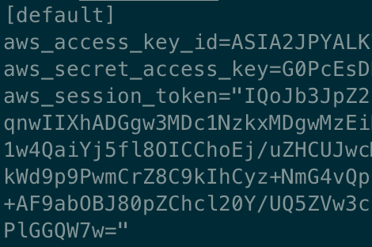

# What are AWS credentials?

John: “Hey Eric, I need to access project-xyz dev account! Can you help me in some way?”

Me: “Sure, but what kind of access do you need?”

John:

Dear John, there are two kinds of access to AWS:

* via Web Console;
    
* programmatic.
    

## Web Console access

This type of access requires you to log into your AWS account using your preferred browser.

When I set up my first AWS account, I logged into it as a **root user** using my browser. The first thing I did was create a brand new **admin IAM User** and enable Web Console access for it.

Why? Because managing root user credentials is too dangerous, as you can’t disable them once stolen… get it? So, use them to create an **admin IAM User**, store them in your password manager, and simply forget about them.

Let me share with you two docs:

* [creating an IAM User in your AWS account](https://docs.aws.amazon.com/IAM/latest/UserGuide/id_users_create.html);
    
* [signing into the AWS Web Console as an IAM User or root user](https://docs.aws.amazon.com/IAM/latest/UserGuide/console.html#user-sign-in-page).
    

In 2018 AWS introduced AWS Organizations, a service that lets you consolidate and centrally manage multiple AWS Accounts. It is a best practice to govern access to these accounts through AWS Organizations’ preferred buddy: AWS SSO.

AWS SSO lets you create and manage a dedicated pool of users unless you want to federate it with an external Identity Provider.

Users can access the AWS Management Console via the so-called Portal URL, which looks similar to the following one:

*d-012345dee0.awsapps.com/start*

For sake of completeness, let me add SAML 2.0 federated access to the previously described ways of accessing an AWS account from the Web Console.

If you want to dig into SAML 2.0 federated access to AWS, give a look at [this](https://medium.com/leapp-cloud/how-to-saml-federate-your-aws-account-with-g-suite-6619f6b35507) blog post by my fellow colleague [Nicolò Marchesi](https://twitter.com/NicoloMarchesi).

And now… Ladies & Gentlement, programmatic access!

## Programmatic access

When you talk about AWS credentials, you probably refer to this kind of access, not the Web Console-based one.

Well, as you might guess, AWS credentials are included in the browser too when accessing an AWS account via Web Console; yes, through dedicated HTTP cookies.

What does programmatic access actually mean?

Programmatic access refers to accessing an AWS account by the means of a client, i.e. an AWS SDK or the AWS CLI.

These clients rely on AWS credentials to add authentication information to the HTTP calls sent to AWS APIs. Without this information, AWS won’t allow you to access your account. In particular, the AWS credentials we’re referring to are called Access Keys.

## Access Keys

So, Access Keys are AWS credentials used by AWS SDKs or by the AWS CLI to add authentication information to **programmatic** HTTP calls sent to AWS APIs.

There are two types of Access Keys out there: **long-term** and **temporary** ones.

Long-term credentials are the ones that are bound to a specific IAM User. Long-term credentials do not expire; therefore, as a best practice, it is warmly recommended to rotate them regularly.

On the other hand, temporary (or short-term) credentials are time-limited; therefore, if they’re associated with an IAM permission that is designed with Least Privilege in mind, they reduce your AWS account/s exposure to attackers.

Be careful: sometimes applying these best practices is not enough to prevent [privilege escalation](https://rhinosecuritylabs.com/aws/aws-privilege-escalation-methods-mitigation/).

### Where can Access Keys be found?

The answer to this question is quite simple. Access Keys can be found in all those places where the clients are programmed to look credentials for. These places (or sources) are mapped into the Credentials Provider Chain, as explained in [this](https://medium.com/leapp-cloud/aws-credentials-from-environment-variables-to-credentials-process-1df3abb33de3) blog post.

In your local environment, Access Keys are commonly stored in the **~/.aws/credentials file** or exported as **Environment Variables**.

As a best practice, **~/.aws/credentials** should be used to contain only Access Keys, while configuration information should be specified in the **~/.aws/config** file.

If you’re using Environment Variables as the source of the credentials, Access Keys are exposed using the following Environment Variables: **AWS\_ACCESS\_KEY\_ID**, **AWS\_SECRET\_ACCESS\_KEY**, and - for temporary credentials - **AWS\_SESSION\_TOKEN**.

### What do they look like? A glance into ~/.aws/credentials file

If you already had the opportunity to peek at the ~/.aws/credentials file, I’m quite sure you found content similar to the one illustrated in the screenshot above.

Well, there is no need to explain what the **aws\_access\_key\_id**, **aws\_secret\_access\_key**, and **aws\_session\_token** keys refer to… but there are some interesting considerations we can make about aws\_access\_key\_id value (*ASIA2JPYALK…*).

The first four letters of the aws\_access\_key\_id key identify the credentials type. The ASIA prefix, which you can see in the screenshot, tells us that the credentials are temporary ones, i.e. an aws\_session\_token is involved. These temporary credentials are generated through the AWS Security Token Service.

If the aws\_access\_key\_id starts with AKIA, it means that we’re dealing with long-term credentials; in this case, the aws\_session\_token is not needed.

~/.aws/credentials is a *.ini* file. In the screenshot, you can notice a **\[default\]** header before the aws\_access\_key\_id key. The string contained in the square brackets defines the Named Profile the Access Keys are wrapped into. The Named Profile is a container that groups *secrets and configuration information* associated with a set of AWS credentials. As we said before, the credentials file is designed to contain only credentials; configuration information, associated with the *default* Named Profile, should be specified in the ~/.aws/config file, under the **\[default\]** header, as for the credentials file.

**Note**: you can use multiple Named Profiles at the same time. The default Named Profile is the one used by clients if you don’t provide them with the Name Profile you want to use. For example, the AWS CLI will use the default Named Profile if you don’t specify the `--profile` flag or if its value corresponds to default.

## Stop wrestling with AWS credentials

If you’re wondering if there is a tool that allows you to stop thinking about AWS credentials and where to store them in the right way, give a look at [Leapp](http://www.leapp.cloud)! It takes the responsibility of storing long-term credentials in the system vault, generating/refreshing short-term credentials, and placing them in the right place for the clients to use them.

## That’s all Folks!

If you’re new to AWS credentials, I hope you find this blog post a smooth introduction to them. If your curiosity is not yet satisfied, you can unwrap the [next gift](https://medium.com/leapp-cloud/aws-credentials-from-environment-variables-to-credentials-process-1df3abb33de3).

Don’t hesitate to share your feedback in a comment or by reaching out to me through my [Twitter profile](https://twitter.com/herr_villa).

Merry Christmas to everyone!
