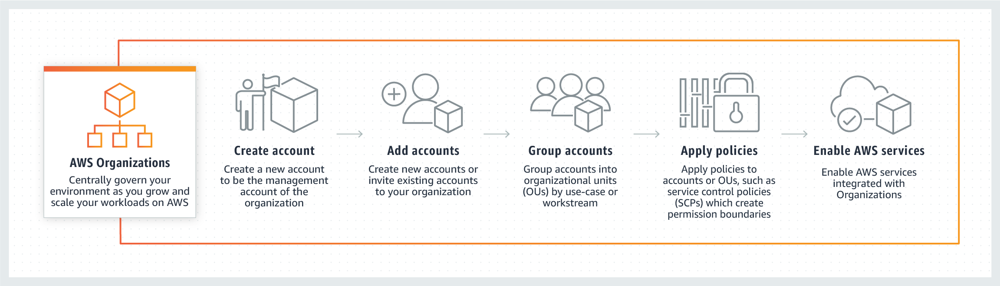

# Stop putting AWS credentials in the aws folder

To me, Everything started with this Twitter thread and from that [article](https://ben11kehoe.medium.com/never-put-aws-temporary-credentials-in-env-vars-or-credentials-files-theres-a-better-way-25ec45b4d73e), by Ben Kehoe:

[https://twitter.com/ben11kehoe/status/1444391820583002114?ref_src=twsrc%5Etfw%7Ctwcamp%5Etweetembed%7Ctwterm%5E1444391820583002114%7Ctwgr%5E%7Ctwcon%5Es1_&ref_url=https%3A%2F%2Fcdn.embedly.com%2Fwidgets%2Fmedia.html%3Ftype%3Dtext2Fhtmlkey%3Da19fcc184b9711e1b4764040d3dc5c07schema%3Dtwitterurl%3Dhttps3A%2F%2Ftwitter.com%2Fben11kehoe%2Fstatus%2F1444391820583002114image%3Dhttps3A%2F%2Fi.embed.ly%2F1%2Fimage3Furl3Dhttps253A252F252Fabs.twimg.com252Ferrors252Flogo46x38.png26key3Da19fcc184b9711e1b4764040d3dc5c07](https://twitter.com/ben11kehoe/status/1444391820583002114?ref_src=twsrc%5Etfw%7Ctwcamp%5Etweetembed%7Ctwterm%5E1444391820583002114%7Ctwgr%5E%7Ctwcon%5Es1_&ref_url=https%3A%2F%2Fcdn.embedly.com%2Fwidgets%2Fmedia.html%3Ftype%3Dtext2Fhtmlkey%3Da19fcc184b9711e1b4764040d3dc5c07schema%3Dtwitterurl%3Dhttps3A%2F%2Ftwitter.com%2Fben11kehoe%2Fstatus%2F1444391820583002114image%3Dhttps3A%2F%2Fi.embed.ly%2F1%2Fimage3Furl3Dhttps253A252F252Fabs.twimg.com252Ferrors252Flogo46x38.png26key3Da19fcc184b9711e1b4764040d3dc5c07)
When dealing with CLI or SDKs, we are already used to putting IAM credentials in the `.aws/credentials` file.

However, as correctly stated cluttering the credentials file with many credentials is **not** the right move to make.

This article aims to overview what IAM Principals are and the better ways to manage your programmatic access to AWS.

Moreover, we'll focus on the Credential Process. We'll see that we can polish our local usage of AWS Principals with it.

Let's dig into this journey through AWS authorization systems.

### Let's start with some basics: IAM Principals!

Stating the official [documentation](https://docs.aws.amazon.com/IAM/latest/UserGuide/intro-structure.html): *"A principal is a person or application that can request an action or operation on an AWS account or resource."*

IAM Principals can either be the **User Root Account** or an **IAM entity** (User or Role).

Because **Root Account,** following [best practices](https://docs.aws.amazon.com/accounts/latest/reference/best-practices-root-user.html), **should not be used for programmatic access,** and **IAM Users** are not a dynamic way to manage AWS identities, the provider is pushing users to use **IAM Roles.**

AWS Roles can be used to **grant permissions to external Identity providers** (Okta, OneLogin, AzureAd, and more..) to assign them to SSO Identities.

By using AWS Roles, an entity can also obtain permission in another existing AWS account via [the assumeRole technique](https://aws.amazon.com/premiumsupport/knowledge-center/iam-assume-role-cli/?nc1=h_ls).

### You obtained your Principal. Now what? Gain access to other Accounts!

One of the best things about IAM Roles is that they can be "assumed" by letting other entities (Users, Services, Applications) act **on behalf of that role**.

Here is a [comprehensive article](https://medium.com/leapp-cloud/aws-sso-vs-cross-account-role-based-iam-access-why-and-how-to-use-roles-2521517d28e1) that explains how you can gain access to other AWS accounts!

### AWS SSO: it's an authentication process, not a Principal!

Ok, we have seen how to use Principals in the most common scenarios.

We also know that it is common for companies to divide their tenants or simply their workloads into different accounts to maintain isolation and simplify governance and management.

In a modern AWS environment, AWS advice is to use [AWS Organizations](https://aws.amazon.com/it/organizations/).




AWS Organizations allows for AWS Single Sign-On, which is the ability to authenticate a valid external Identity, into the AWS ecosystem, through a [Federation Process](https://aws.amazon.com/identity/federation/).

One important thing to understand clearly is that **AWS SSO is not a Principal!** AWS SSO allows for **authentication** inside AWS by external meanings, but it **does not handle authorization against AWS services**.

AWS associates [one or more IAM Roles to an authenticated user via AWS SSO to manage authorization.](https://medium.com/leapp-cloud/aws-sso-vs-cross-account-role-based-iam-access-why-and-how-to-use-roles-2521517d28e1)

### Signing API requests to AWS

You can put AWS credentials inside credentials or config files. But do you know how AWS effectively authorizes requesters made with those credentials? With a process called [Signature V4](https://docs.aws.amazon.com/general/latest/gr/signature-version-4.html).

Access key id, secret access key, and session token are used to sign the HTTP requests you make to AWS services, verifying the principal accessing the service.

They never get included in the request. Instead, you use it to create a cryptographic signature for the request.

While SigV4 is embedded in all the AWS SDKs, it is not exposed to being used independently (e.g., [API Gateway requires SigV4 signatures on requests](https://github.com/aws/aws-sdk-net/issues/958) that can't be made through the SDK).

### AWS Credentials file and temporary credentials

A credentials file is a plain text file, located typically in the `~/.aws/` folder. They can be long-lived (AWS IAM User) or short-lived (AWS IAM Role). 

The credentials format is the following:

```bash
[default]
aws_access_key_id = <YOUR_ACCESS_KEY_ID>
aws_secret_access_key =<YOUR_SECRET_ACCESS_KEY>
aws_session_token=<AWS_SESSION_TOKEN> #short-lived only
```

They are used directly ([with a specific profile or with a default one](https://medium.com/leapp-cloud/how-to-use-aws-named-profiles-86f3abe7547a)) by AWS CLI and SDKs.

They are directly associated with an IAM Principal.

What are the caveats of such an approach? Let's describe some:

**AWS SSO**

It can be a pain to manage as we now know that AWS SSO is not a principal, so it cannot be used directly and needs a way to obtain its role to generate temporary credentials.

While this is not a problem per se, AWS CLI currently does not give an easy way to view which role is associated with a specific SSO user, and SDKs require custom code to obtain usable credentials.

So, in general, AWS SSO still needs much manual intervention to be used effectively for programmatic access.

**Short-lived credentials used in the credentials file can't be auto-rotated by AWS**

Being set either manually or via third-party tools, temporary credentials inside the credentials file can't be rotated automatically. Ben Kehoe stated in his article that good practice should require the opposite.

There are some particular scenarios in which this can cause serious difficulties:

- **Long-running processes**: if you start a long-running third-party process, temporary credentials will expire along the way, generating exceptions in the task. It is a credential manager's responsibility to take care of the expiration.
- **Third-party tools for automatic rotation**: it is challenging to handle rotation without disrupting external processes.

**General cluttering of credential files**

As correctly stated by Ben in his article, the credentials file usually becomes a list of long and short-lived credentials and different profiles.

This list is not secure and challenging to manage.

### Is there a better way to manage all AWS access to services and accounts? Yes, it's called Credential Process

[The credential process](https://docs.leapp.cloud/latest/security/credential-process/) handles AWS credentials to allow a third-party tool to generate credentials when requested by AWS CLI, APIs, or SDKs.

By putting a named profile configuration set in the config file located in ~/.aws/config formatted like below:

```bash
[profile PROFILE_NAME]
credential_process=PROCESS_GENERATING_CREDENTIAL_PATH_SCRIPT
region=REGION
```

The credential_process variable tells AWS how to request valid temporary credentials when needed.

The credential process requires the external tool to return valid credentials in the format:

```bash
{
	"Version": 1,
	"AccessKeyId": "an AWS access key",
	"SecretAccessKey": "your AWS secret access key",
	"SessionToken": "the AWS session token for temporary credentials",
	"Expiration": "ISO8601 timestamp when the credentials expire"
}
```

Setting the expiration time variable allows AWS to know precisely when requesting the credentials again without disrupting the external process requiring AWS.

Why is it better to use the credential process than the credentials file? **Credentials auto-rotation!**

One of the major drawbacks of using temporary credentials in the credentials file is that there is no simple and intelligent way to refresh expired credentials, not without compromising a long-running process or essential operations.

There is another significant benefit: **no credentials are written on your machine, in files, or environment variables**.

Even if the credential process is the way to go, there are still some important factors to consider:

- **Credential Process credentials generator**: this implies that the tool you're using can handle diverse IAM Principals.
- **Caching credentials:** because credentials generation is demanded by an external tool, caching credentials efficiently is also requested.
- **Cluttering:** avoid a long list of config rules.

Here is where the OSS project [Leapp](https://github.com/Noovolari/leapp) can be your handiwork. Leapp can manage all major IAM Principals and AWS SSO, converting all of them into viable temporary credentials.

Leapp is a valid credential process for AWS:

```bash
[profile PROFILE_NAME]
credential_process=leapp session generate SESSION_ID
region=REGION
```

In combination with the Desktop App, the config file itself can be managed by the App:

[https://youtu.be/2ZX9v3_NRvg](https://youtu.be/2ZX9v3_NRvg)
### Conclusions

In this article, we have come down a long journey through all the aspects of IAM Principals and how they are used to gain programmatic access to the plethora of services that AWS offers.

We have seen how AWS SSO works with AWS Organizations and why it must not be mistaken for a Principal. But we have also seen all the advantages of AWS Organizations over regular cross-account access.

Signature V4 was also explained, giving hints on how AWS authorizes requests coming from CLI and SDKs.

We have understood the differences between credentials file and credentials process and why the latter is nowadays a much-preferred solution for long-running processes and strict security compliances.

Finally, we have discussed Leapp, our open-source tool, showing how it can help deal with the credentials process.

Have questions? Want to propose a solution? Need to request something particular? Drop a line on my Twitter or come and join us in our [slack](https://join.slack.com/t/noovolari/shared_invite/zt-19143463b-qecVgLuq5IBQsOyG6kJ2Uw) community and share your thoughts.

So that's all folks, till the next article, goodbye and stay safe 😷.

*This article was written in pair with my co-worker [Alessandro Gaggia (@balubor)](https://twitter.com/Balubor)

[https://github.com/Noovolari/leapp](https://github.com/Noovolari/leapp)