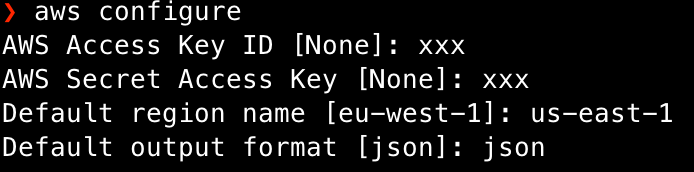

# AWS SDK: "Unable to locate credentials"

How often do you find yourself working with your carefully prepared code, with AWS SDK in place for calling all of your services, and…nothing, it seems that your credentials are missing, even if you have configured them correctly?


If you’ve incurred this problem at least once, you’re in the right place! We’ll see together how to mangle with typical use cases, with an eye on security concerns.

### The Credentials provider chain

First things first! To understand why you’ll receive these errors, you must know how AWS searches for valid credentials.

That is the **credentials provider chain**! Some locations in your computer can hold credentials, [as stated by AWS](https://docs.aws.amazon.com/sdk-for-java/v1/developer-guide/credentials.html).

When you initialize from the SDK a new service client without supplying credentials directly (supply credentials directly in code is a **bad practice**, by the way), the SDK attempts to find AWS credentials by searching them in this order:

1. **Environment variables:** `AWS_ACCESS_KEY_ID` and `AWS_SECRET_ACCESS_KEY`.
    
2. **Web Identity Token credentials:** from the environment or container.
    
3. **The default credential profiles file:** `~/.aws/credentials`, which is the **most common location,** or the **config file:** `~/.aws/config`, generated with the **CLI command** `aws configure`.
    
4. **Amazon ECS container credentials:** from the Amazon ECS if the environment variable `AWS_CONTAINER_CREDENTIALS_RELATIVE_URI` is set.
    
5. **Instance profile credentials:** used on EC2 instances and delivered through the Amazon EC2 metadata service.
    

If credentials are not set at least in one of the places or overlapping in a way that is not intended, then an error is likely to occur. Let’s begin with some well-known use cases.

### Unable to locate credentials: install the AWS CLI and run an aws configure!

It is **always better to install AWS CLI**, even if you don’t plan to use it; you’ll see that there are plenty of advantages to installing it.

For example, once installed, it is possible to run `aws configure`, which will set all the required files for you to start using environment credentials and stop using hardcoded ones.

Let’s see how it can be compiled:



### Missing credentials in config: when code order matters!

Let’s take for example the Javascript SDK, but the same case applies to all AWS SDK: if you have changed your credentials after some operations your Javascript client will not read the updated credentials unless you call an explicit **config update**, just like this:

```javascript
AWS.config.loadFromPath('./AwsConfig.json');
// OR for example in case of temporary new credentials
AWS.config.update({
      sessionToken: sessionToken.aws_session_token,
      accessKeyId: sessionToken.aws_access_key_id,
      secretAccessKey: sessionToken.aws_secret_access_key,
});
// THEN for example
var s3 = new AWS.S3();
```

So it’s important to call an explicit update of the AWS library before instantiating a client.

### Temporary credentials generated programmatically, out of synch!

It’s rare, but it may happen: sometimes, depending on the SDK version, especially for Javascript, for some services, the credentials are not working as expected and may seem out of synch with the AWS service.

In this case, there could be two potential fixes:

1. try to update the library. It is not so uncommon to see the error disappearing after an SDK update;
    
2. Your clock could be out of sync. Check if, for some reason, it is not showing the right time.
    

### Check environment variables when running terminal commands from code

Sometimes using libraries or tools for launching terminal commands and scripts can be a huge help. Let’s consider Node’s `require('child_process').exec`, a very interesting method for spawning child processes.

Still, when used in a **sandboxed application** (i.e., Electron ones), it runs **without** your user’s **environment variables**, thus making your credentials useless unless you set them explicitly in the environment option like this:

```javascript
const env = {
  AWS_ACCESS_KEY_ID: aws_access_key_id,
  AWS_SECRET_ACCESS_KEY: aws_secret_access_key,
  AWS_SESSION_TOKEN : aws_session_token
};
exec(<command>, { env: env });
```

Even if this is a **Node/Typescript example**, the same principle still applies for Python, Rust, Go, and so on. Check if the **command is issued with the proper environment set**, it will save you a lot of time and trouble!

### Privileged access comes with a price: watch out for sudo!

This particular error is nasty as you typically have your proper credentials in place.

That is, you run either a CLI command or invoke a terminal command (or script) from code, and credentials are missing!

This happens because **sudo changes your** `$HOME` directory from `~/USER` to `/root`, removing most bash variables like `AWS_CONFIG_FILE` from the environment. Make sure you do everything with AWS as root or as your user, don't mix.

### Sidenotes

* If you have the CLI installed: try running `aws configure list` to see what credentials are set
    
* If you are uncertain about a particular credentials error, run the command you want by CLI using the `--debug` option.
    

### Conclusions

Managing all credentials by hand and constantly keeping an eye on what is active and what is not can be very troublesome.

What about security?

> It is highly inconvenient to use **long-lived credentials** (i.e., IAM user) in both the environment variables and the credentials file, let alone forget to remove them once they are unnecessary.

Leaving credentials exposed like this allows for potential attacks on your AWS account or that of your client. You want to increase security is to use **short-lived credentials** whenever is possible to limit an attacker’s blast radius (they can be used for an hour at maximum).

[https://github.com/Noovolari/leapp](https://github.com/Noovolari/leapp)
[Leapp](https://leapp.cloud/) is an Open-Source tool that aims to manage the credentials provider chain for you.

It uses **short-lived credentials** instead of hard-coded ones; it also removes them from the chain when not needed anymore.

To sum up, we have seen different use cases to solve missing credentials errors when using AWS SDK or CLI commands. If you have any questions, by any means, feel free to [contact me](https://twitter.com/a_cava94) or [join our slack community](https://join.slack.com/t/noovolari/shared_invite/zt-opn8q98k-HDZfpJ2_2U3RdTnN~u_B~Q).

Until next time, see you all 🙂.
