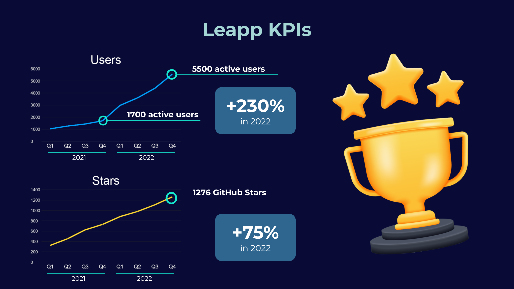
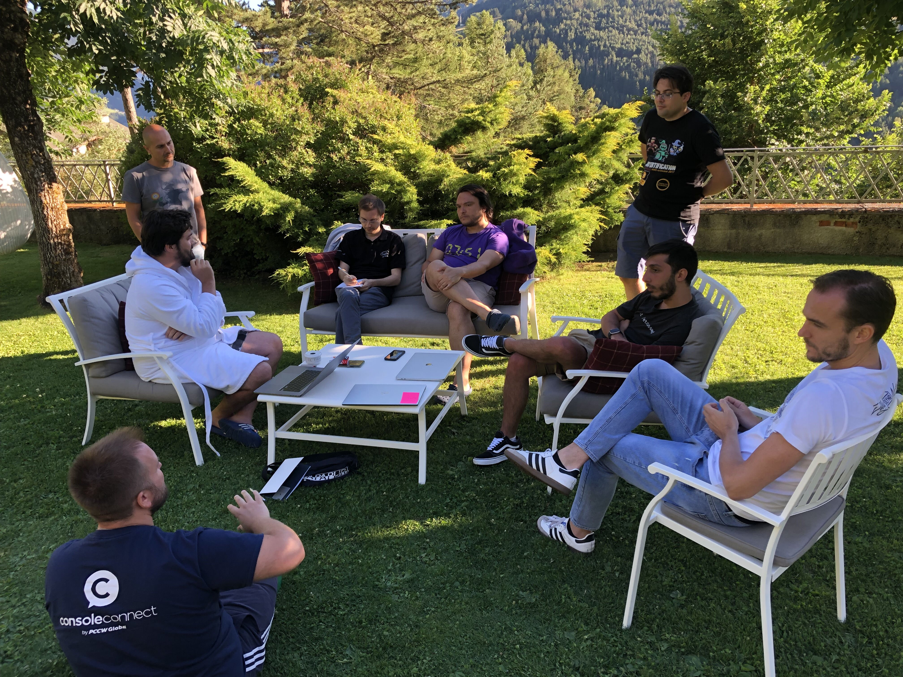
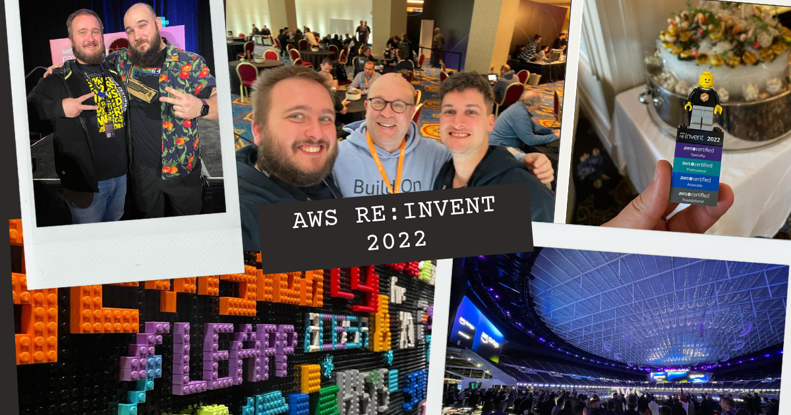

# One year in  Leapp

Hi, I'm Nicolò Marchesi, co-founder of [Noovolari](https://noovolari.com) and maintainer of [Leapp](https://leapp.cloud). Noovolari is dedicated to the open-source community and believes cooperation can spark innovation, so this year, we launched new features, met with a lot of enthusiasts, continued to refine our open-source core, and made substantial progress on our project and product to give our users and customers the most excellent experience possible.

This piece will go through some significant advancements we accomplished in 2022.

## Strengthening Leapp

During 2022, we had eight major releases: [v0.9](https://github.com/Noovolari/leapp/compare/v0.8.1...v0.9.0), [v0.10](https://github.com/Noovolari/leapp/compare/v0.9.0...v0.10.0), [v0.11](https://github.com/Noovolari/leapp/compare/v0.10.0...v0.11.0), [v0.12](https://github.com/Noovolari/leapp/compare/v0.11.1...v0.12.0), [v0.13](https://github.com/Noovolari/leapp/compare/v0.12.2...v0.13.0), [v0.14](https://github.com/Noovolari/leapp/compare/v0.13.4...v0.14.0), [v0.15](https://github.com/Noovolari/leapp/compare/v0.14.3...v0.15.0), [v0.16](https://github.com/Noovolari/leapp/compare/v0.15.2...v0.16.0), and [v0.17](https://github.com/Noovolari/leapp/compare/v0.16.2...v0.17.0).

Each release brought significant value to our users, including new features, performance gains, and quality-of-life changes. This resulted in a **more than threefold** increase in Leapp usage in only one year. We couldn’t be more proud of this.

### AWS switch role browser extension

And finally, the most anticipated feature of 2022 and the one that raised the most excitement at AWS re:Invent: [the ability to switch roles in the AWS console and be logged in with different roles simultaneously](https://docs.leapp.cloud/latest/built-in-features/multi-console/). This work spun off from a university thesis project that we could finally put into production and a foundational part of future interactions with Leapp and browsers.

### Command line interface

We took an opposed approach to other open-source tools and released the desktop application first, but everybody needed a way to stay in the terminal to avoid workflow interruption. The [Leapp command line interface](https://docs.leapp.cloud/latest/cli/) has the same capabilities as the desktop application but can be called from the terminal, scripted, and integrated with other tools.

### Plugin System

Our users and community always asked for a way to integrate into Leapp and do custom things not supported out of the box. During our time at the company retreat in Bormio (keep reading to know about it!), we could finally lay the foundations of our [Plugin System](https://docs.leapp.cloud/latest/plugins/plugins-introduction/) and release it a few months later. We already have [some nice plugins](https://www.leapp.cloud/plugins) developed by our awesome users!

### Better developer experience

At the start of the year, Leapp underwent a big change in its style and user experience. We introduced the [*Session*](https://docs.leapp.cloud/latest/sessions/) concept and designed the whole experience around it. We believe Leapp will be the new standard tool for Cloud access, and we want any user dealing with cloud access to take advantage of Leapp's capabilities.

### Segment filtering

We’ve added a new way to sort and filter Sessions given the user’s preferences; the key differentiation of segments is that they are dynamic to show all elements matching the filter without the need for manual sorting. Declare once and use forever.

### Dark theme

This was one of the most anticipated and requested features after our user experience was reshaped. Leapp is designed around a “fire and forget” concept, and we want users to spend the least time on its interface. It just feels nice to have a consistent experience across your desktop and less strain on our eyes.

### AWS console link

Getting to the AWS console has always been a messy experience (to be honest, for all clouds, not just AWS), and our community was eager to have an easy way to reach it. So we added an action to [automatically log into the AWS console](https://docs.leapp.cloud/latest/built-in-features/opening-web-console/) in Leapp’s sessions list, cutting some of the hassles and laying the foundation for Leapp’s role switcher.

### Support to AWS credential process

With the [credential process credential generation](https://docs.leapp.cloud/latest/security/credential-process/), no credentials persist in the AWS configuration file; instead, they are generated when needed and passed straight to the process requesting them. Leapp takes pride in focusing on the security side of credentials management, and we supported this straight away.

### Federated roles support for AWS GovCloud

Thanks [to the effort of Micheal Dizon](https://github.com/Noovolari/leapp/pull/270), we were able to support federated roles for the AWS GovCloud region. As you may be aware, we’re located in Italy and can’t apply for the GovCloud region, so it’s a bit of a mess for us to support AWS GovCloud. We’re actively searching for companies that can lend their support so we can better support this region; feel free to reach out to us to make Leapp even better!

### Support to AzureAD

In our journey to support all Cloud providers, we had a lot of requests for [Azure and Azure Active Directory](https://docs.leapp.cloud/latest/configuring-integration/configure-azure-integration/). This was a big addition as it supported an entirely new provider and introduced a few things that will help shape how we take care of federated roles for other providers.

### Added support to Auth0 and Keycloack

Following the open-source guidance, we derived our roadmap as enhancement, and issues were created. This was the case for Auth0 and Keycloack, as community members asked to support them in federated roles as Identity providers.

### Performance increase

During 2022 summer, we were aware of a few performance problems due to how Electron manages views, so we refactored Leapp’s sessions list and introduced views recycling to dramatically reduce CPU usage and memory footprint and improve startup performance.

## A constant focus on community

2022 has been an exciting year for our community; we saw fantastic engagement and contributions to Leapp’s repository, resulting in significant improvements to the application. The number of stars on our main repository reached 1.2k. We want to keep up the good work and improve, starting from this level of participation and collaboration, to drive innovation to the Cloud operations world and enhance the Leapp experience for users and customers.

### Rebranding

Together with the revamped developer experience, we [showcased the values guiding our stewardship to open-source and community](https://www.leapp.cloud/rebranding). We wanted to make our strategy and vision clear to everyone, especially the people in our community and users, of being part of a more comprehensive project.

### Company retreat in Bormio

After three years after the previous one, we organized a three-day FedEx event with our colleagues at beSharp. In the beautiful landscape of Bormio and its thermal waters, we hacked new Leapp features and potential new products for three days and nights. We had so much fun with a great team-building experience and takeouts that we are eager to release. For example, the plugin system concept was brought to life here, and there are many other things that we cannot wait to test.

### Launched TOPS

Finally, we [launched our community on Slack](https://join.slack.com/t/noovolari/shared_invite/zt-opn8q98k-HDZfpJ2_2U3RdTnN~u_B~Q). We wanted it to be more than just Leapp’s troubleshooting channel and make it a great place to discuss the latest trends and technologies in Cloud operations with other experts and peers. We've been eagerly awaiting this change, and we're thrilled about the prospect of better communication and teamwork. We are working to provide a great space where members of our community may exchange ideas, seek assistance, and test out new initiatives.

### AWS re:Invent

The goal of this year's AWS re:Invent was to talk with as many people as possible… and it was a blast! We received praise and excitement and had the chance to present Leapp at the AWS open-source booth with Tom Calloway and Tyler Lynch, who stole our place at the demo booth to give himself a demonstration… it was truly epic! And to continue with awesome AWS people, we’ve met with Ricardo Sueiras to talk about participating in AWS initiatives for open-source.

We had incredible meets with Michał Brygidyn, Damien Burks, and Ashish Rajan with his whole crew! And a great time with other AWS Community Builders at the CB’s event with Johannes Koch, Shira Shamban, and Mattia Bertorello.

And last but not least, it was amazing at the end of Darko Mesaros's talk, “Take these open-source tools on your AWS adventure”, when Darko asked the audience about other cool open-source tools, to hear a voice behind our back screaming, “Leapp!” ([LINK TO THE VIDEO](https://youtu.be/bEg-mIFZEmc?t=2588))

Overall it was an incredible experience, and we can’t wait another year to go for another round.

## What lies ahead

For 2023 we will focus on securing the funds to keep up with developing our project and delivering our company vision. We will focus on the business aspects and actively search for funds while speeding up the delivery of our team solution to gather feedback and focus on solving problems for businesses.

For this reason, we’re putting a lot of effort into releasing our Team version.

### Funding

Until now, we’ve been able to keep our resources to a bare minimum and continue our journey thanks to the efforts and investments of beSharp. However, during the last year, it has become clear that we need to search for funds. It’s certainly a difficult procedure and right now feels daunting, but it's also an opportunity to meet others who share our beliefs and are ready to help us on our path. We’re truly excited to pursue this trip further and see where it leads us; we know it will be worth it.

### Launch Leapp Team (closed-beta)

We’re finally about to release the closed beta of our collaborative access platform. We decided that the closed beta will be restricted to a select few companies; since our team is relatively small, we want, first and foremost, to be able to help them solve their access problems and then gather the most feedback. If you’re interested in this, [let us know](mailto:info@noovolari.com)!

### Leapp open-source

We are carefully balancing the improvements to the open-source project and delivering the new Team version, so fear not; we have great things coming for Leapp too. We long for the day we can finally dedicate full-time efforts to both.

Our roadmap is pretty flexible, mostly driven by the user’s request, but the support for other providers has been most anticipated, so expect new things on this side. In addition, we’re searching for a way to create a great local environment with other open-source tools, so stay tuned!

## Conclusion

It has been a fantastic year for Leapp, to sum it up. I appreciate the effort put forth by every team member in creating our successful project. I also want to thank the community for its important help and contributions. I can speak for everyone at Noovolari that we are eager to carry this momentum into 2023 and keep giving us all to deliver the finest IAM experience possible.
