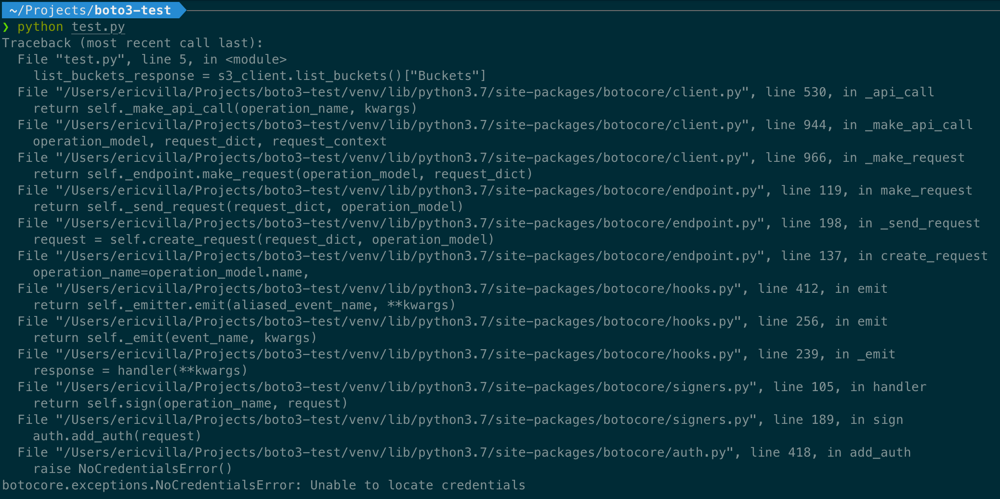
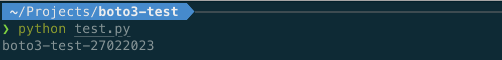
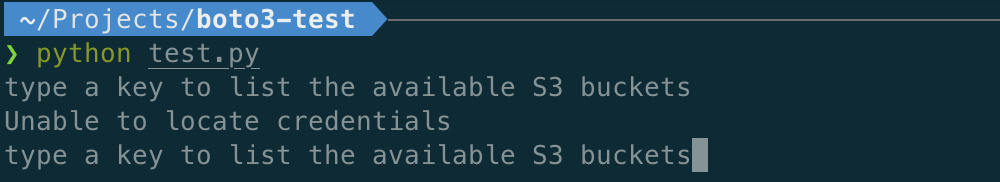
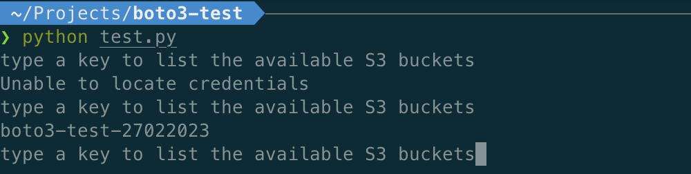

# Fixing botocore.exceptions.nocredentialserror: unable to locate credentials [SOLVED]

## *botocore.exceptions.NoCredentialsError: Unable to locate credentials*

If you saw this error while running a Python script or application, you stumbled upon one of the most common errors that arise when boto3 is unable to locate valid AWS credentials needed to sign an API call to a specific AWS service.

There are many StackOverflow questions about that:

[https://stackoverflow.com/questions/33297172/boto3-error-botocore-exceptions-nocredentialserror-unable-to-locate-credential](https://stackoverflow.com/questions/33297172/boto3-error-botocore-exceptions-nocredentialserror-unable-to-locate-credential)
This error is specific to Python; if you’re looking for a solution to the “Unable to find credentials,” we’ve already written a [blog post](https://blog.leapp.cloud/aws-sdk-unable-to-locate-credentials) about that.

Before calling an API, you need to create a client specific to the service you want to use.

The most traditional way to instantiate a service client consists in using one of the following abstractions provided by the boto3 SDK:

* boto3.**client**('s3')
    
* boto3.**resource**('s3')
    

Regardless of the type of abstraction, a new default boto3.session.Session is created unless another one is already instantiated. If you are wondering what a boto3.session.Session object is, I suggest referring to its documentation:

> A session stores configuration state and allows you to create service clients and resources.

## A simple example

To reproduce the error, let me use an example script that invokes the Amazon S3 API that returns the list of all buckets owned by the authenticated sender of the request.

```python
import boto3

s3_client = boto3.client("s3")

list_buckets_response = s3_client.list_buckets()["Buckets"]
bucket_names = ", ".join(list(map(lambda bucket: bucket["Name"], list_buckets_response)))

print(bucket_names)
```

As I previously said, when `boto3.client("s3")` instruction is executed, and a new default session object is created; this session object wraps AWS credentials info too. You can easily deduce that if boto3 is not able to locate credentials, the *botocore.exceptions.NoCredentialsError* error is thrown. In this scenario, executing the previous script will produce an output similar to the following:



## Where is boto3 looking for credentials?

boto3 searches for AWS credentials through a list of possible locations until it finds valid ones.

As described in the [documentation](https://boto3.amazonaws.com/v1/documentation/api/latest/guide/credentials.html):

1. Boto3 gives higher priority to credentials passed as parameters during client initialization.
    
2. If credentials are not provided this way, it looks for them inside environment variables and shared configuration files (i.e., ~/.aws/credentials and ~/.aws/config files).
    
3. If it’s still unable to get valid credentials, it tries to obtain them through the Instance Metadata Service on an Amazon EC2 instance with an IAM role configured.
    

Again, *botocore.exceptions.NoCredentialsError* is raised if boto3 is unable to find valid AWS credentials in any of the listed locations.

## Let's find a solution!

To solve the issue, I’ll generate a set of temporary credentials associated with a specific IAM User. Generating temporary credentials for an IAM User involves calling the STS get-session-token API. I let [Leapp](https://www.leapp.cloud) generate them automatically for me.

Once set up, boto3 should be able to obtain valid AWS credentials from the ~/.aws/credentials file. Let’s try running the Python script again.



As expected, boto3 found a valid set of temporary credentials in the *~/.aws/credentials* file. It used those credentials to sign the Amazon S3 API request and obtain the list of buckets owned by the authenticated sender of the request.

## Boto3 Session: The Icing on the Cake

What about long-running scripts? What if the script tries to access the Amazon S3 list bucket API, but the first set of credentials loaded by boto3 is expired? Well, it will not be able to forward the request.

The problem is that using only boto3.client or boto3.resource module-level functions, the first set of credentials is wrapped into a **default** boto3.session.Session object that will not be refreshed.

To keep credentials always aligned with those found in one of the Credentials Provider Chain locations, you can instantiate a boto3.session.Session objects directly and obtains new Amazon S3 clients from it as follows.

```python
import boto3

while True:
  input("type a key to list the available Amazon S3 buckets")

  s3_client = boto3.session.Session().client("s3")

  try:
    buckets = s3_client.list_buckets()["Buckets"]
    bucket_names = ", ".join(list(map(lambda bucket: bucket["Name"], buckets)))
    print(bucket_names)
  except Exception as e:
    print(e)
```

To emulate a long-running script, I introduced a while loop that starts by asking the user to type a key to run the n-th iteration. That way, we can control credentials availability by starting/stopping the Leapp Session before the n-th iteration is triggered.

At this point, let’s run the script by leaving the Leapp Session stopped; it returns the following output



As you can see, it was unable to locate credentials as, at the time the 1st iteration was triggered, credentials were not available in any of the Credentials Provider Chain locations.

And now, let’s start the Leapp Session.

At this point, a new set of temporary credentials is present in the ~/.aws/credentials file.

By triggering the 2nd iteration, we got the following output from the script:



During the 2nd iteration, boto3 was able to instantiate a new Session object from a valid set of AWS credentials located in the ~/.aws/credentials file. Therefore, it could sign and forward the request to the Amazon S3 bucket endpoint to obtain the list of buckets owned by the authenticated sender.

I can fine-tune the previous script to maintain a single instance of the Session object and re-instantiate it only if the credentials used to sign the request are expired.

So, my suggestion is to use the boto3.session.Session objects, as instantiating, is an elegant way to refresh credentials.

## **That’s all, Folks!**

I hope you found all the information you needed to understand and solve the *botocore.exceptions.NoCredentialsError*!

As a takeout, consider refactoring your existing code to adopt the boto3.session.Session object unless you are already using it. It could be a game-changer, especially in long-running scripts.

This article is part of this blog's [“IAM how to fix”](https://blog.leapp.cloud/series/how-to-fix) series.

Stay updated with your IAM expertise by [subscribing to our newsletter!](https://blog.leapp.cloud/newsletter)

Share your thoughts and feedback about this blog post in a comment or by reaching out to me through my [Twitter profile.](https://twitter.com/herr_villa)

If you liked the Leapp experience, give us a star!

%%[star-leapp]
