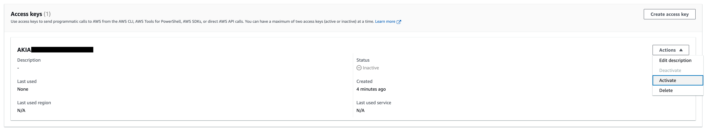
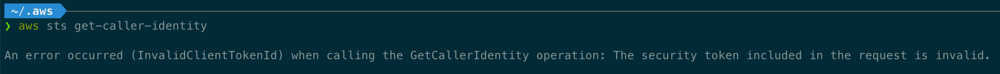
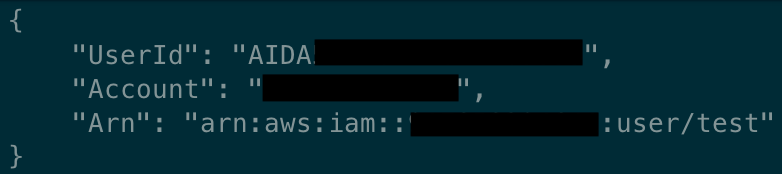
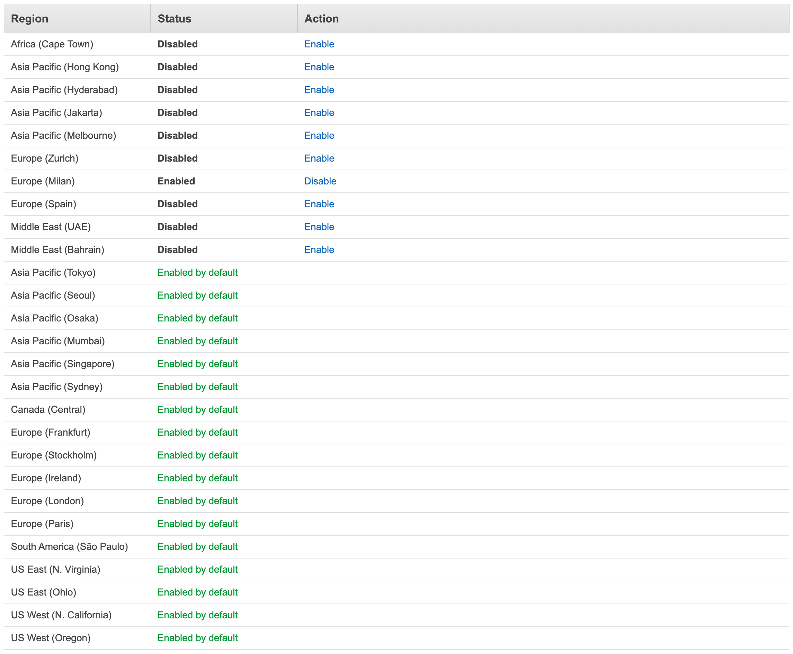
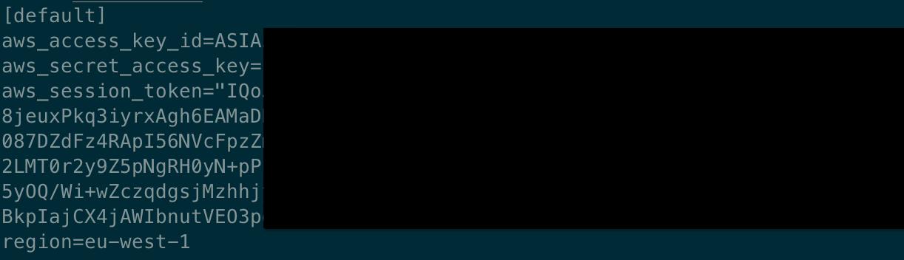

# How to fix aws InvalidClientTokenId: The security token included in the request is invalid.

> An error occurred (InvalidClientTokenId) when calling the GetCallerIdentity operation: The security token included in the request is invalid.

Have you ever seen this error? Don’t worry! Other people already got stuck in this situation, as you can see from [this](https://stackoverflow.com/questions/70276512/invalidclienttokenid-error-aws-when-trying-to-get-caller-identity) StackOverflow thread…

In this blog post, I want to list the main causes that generate this error and how to prevent and fix it.

## InvalidClientTokenId error common reasons

When using an IAM User, the common reasons for this error can be split into two categories:

* pre-requisites not satisfied;
    
* misconfigured shared config and credentials files.
    

For what concerns programmatic access, you can access AWS services as an IAM User using either long-term or temporary (short-term) credentials. Long-term credentials consist of two items: *access key id* and *secret access key*.

When it comes to temporary credentials, you’ll find a *session token* item in addition to the previous ones.

### Pre-requisites not satisfied

Even though your shared config and credentials files might be valid, some pre-requisites should always be satisfied:

* IAM User access keys must be *active*;
    
* the AWS Region you’re using must be *enabled*.
    

You can enable/disable the IAM User access keys from the AWS Console, as you can see from the following picture.

For example, if you try to access AWS from the CLI when IAM User access keys are disabled, you’ll get the error illustrated in the screenshot below.

Once re-activated, you should be able to get a response from the `aws sts get-caller-identity` command.

Since AWS regions introduced after 03/20/2019 are not enabled by default (as described [here](https://docs.aws.amazon.com/general/latest/gr/rande-manage.html)), you might be using a non-default one. If you want to enable it and solve this error, go to the AWS console, click on your account name in the upper right corner, select **Account,** and then scroll down until you find the **AWS Regions** section.

From there, you can manage your regions and enable/disable them. Remember that there are no costs associated with enabling a region, but you might be billed if you create resources in any of these regions.

### Misconfigured shared config and credentials files

To generate temporary credentials for an IAM User, the CLI provides the `aws sts get-session-token` command. If you’re manually configuring the credentials file or environment variables with the output of this command, it’s more likely that you misconfigured them.

Rember to always set `aws_session_token` in addition to `aws_access_key_id` and `aws_secret_access_key` in your ~/.aws/config file.

However, this is not the only possible misconfiguration.

Since we’re humans, copy-paste mistakes and typos are common and they can lead to an InvalidClientTokenId error as well if the `aws_session_token` does not exactly correspond to the one returned by `aws sts get-session-token`.

***Pro tip***: you can immediately distinguish temporary keys from long-term ones by checking if the prefix of the `aws_access_key_id` value is *ASIA*.

## Final thoughts

To prevent manual misconfiguration, we created an automation that became an open-source tool. It helps us in our daily work and I hope it can help you as well. It's called [Leapp](https://www.notion.so/How-to-fix-aws-InvalidClientTokenId-The-security-token-included-in-the-request-is-invalid-60dda84168514d3a8f6962f9ccaf9388).

This article is part of this blog's [**“IAM how to fix”**](https://blog.leapp.cloud/series/how-to-fix) series.

Stay updated with your IAM expertise by [**subscribing to our newsletter!**](https://blog.leapp.cloud/newsletter)

If you are interested in learning more about our project Leapp experience, give us a star ⭐

%%[star-leapp] 

Do you have any other case you want to share with us? Comment below!

See you in the cloud!
