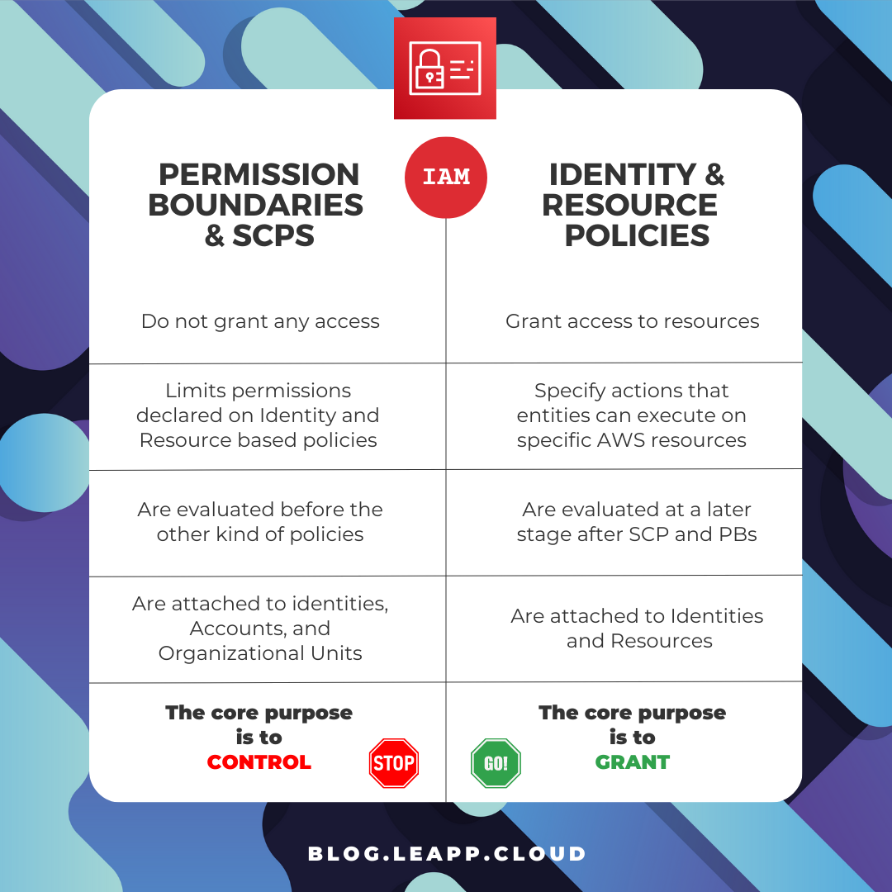
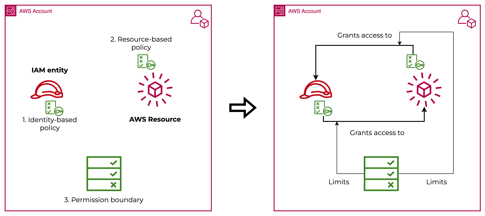
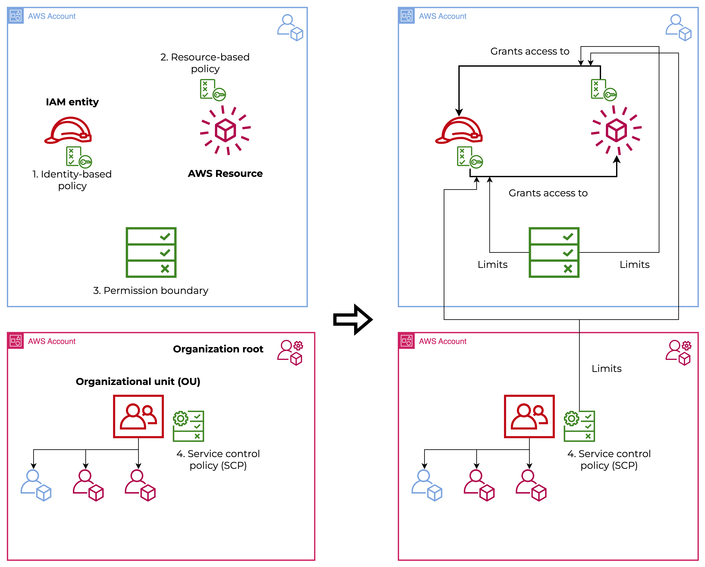
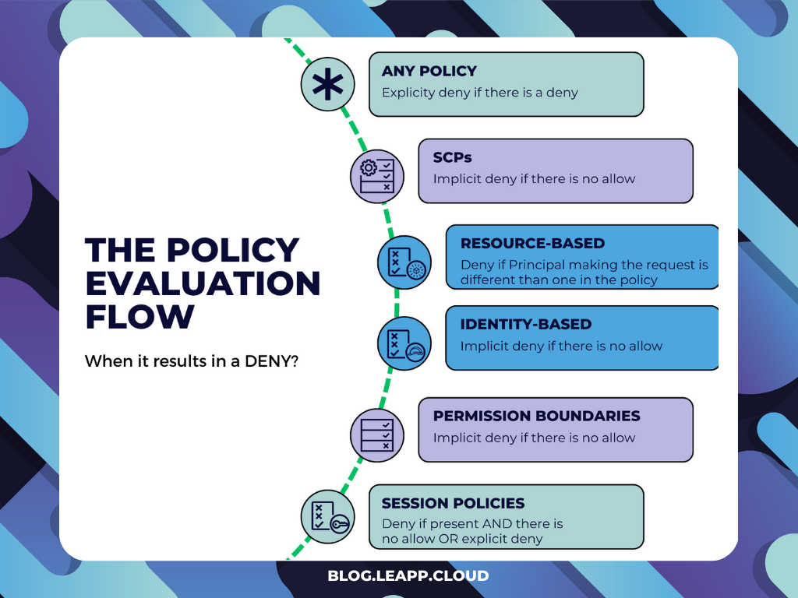
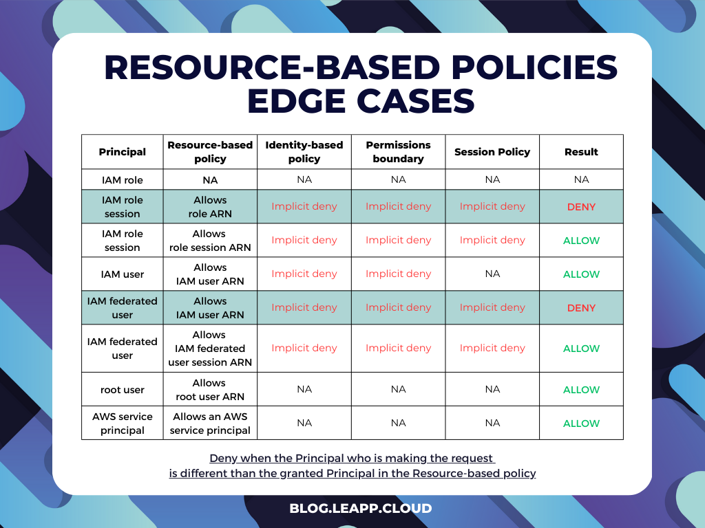
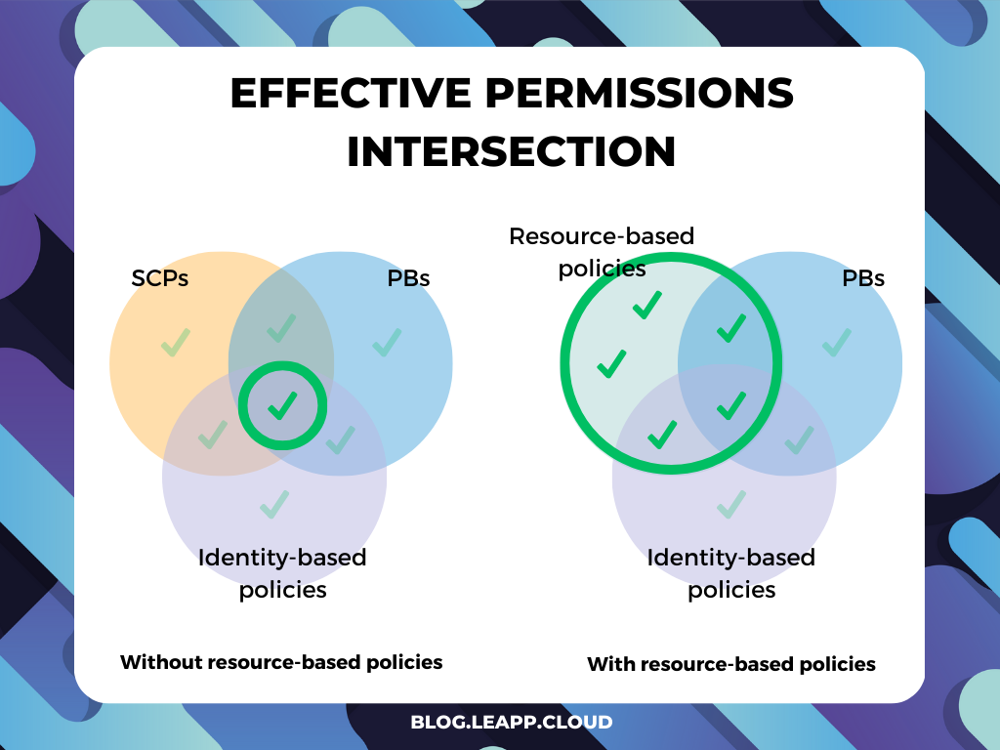
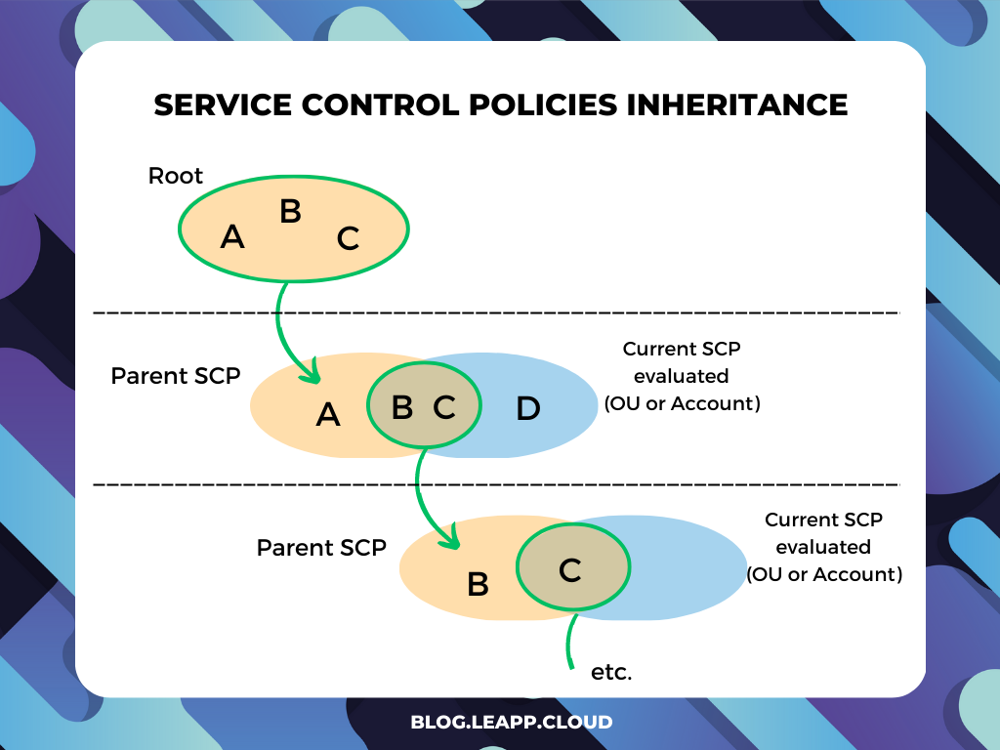
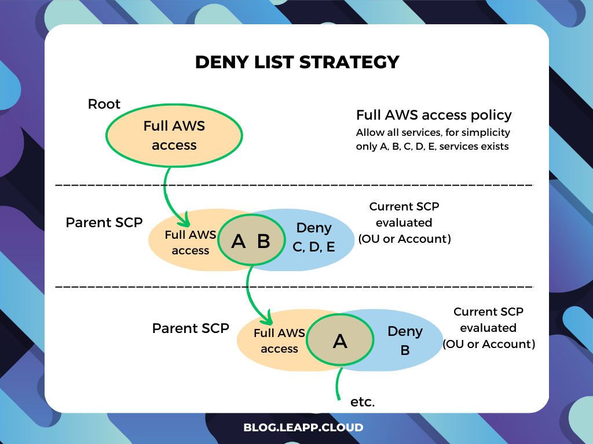

# How to master and secure access and permissions in an AWS Landing Zone

Today we proudly announce a special collaboration: starting from the well-expressed concept of the [Landing Zone](https://blog.besharp.it/thats-why-you-need-a-landing-zone-even-if-you-dont-know-it-yet/) on [beSharp's blog Proud2beCloud](https://blog.besharp.it/), we deepened one of the key aspects for an AWS Landing Zone's correct implementation: the use of IAM Policy and Service Control Policies (SCPs).

*Enjoy the read!*

### Introduction

Hello cloud fellows! Today we’ll build up on the cloud landing zone series to explore a fascinating but often ignored context… Service Control Policies! SCPs are powerful, but there are a few caveats and tricks to make them work efficiently with every different kind of **IAM policy**. In this blog post, we will see how the whole IAM ecosystem interacts and how we can effectively leverage the tools to deploy a strong IAM strategy in our Cloud Landing Zone.

There is a lot of ground to cover, so let’s start immediately!

> I don’t want to bother you with all the details about AWS Organizations so that we can keep our focus on permissions. If that’s not the case, refer to one of the thousands of articles on the web or check [THIS](https://blog.leapp.cloud/aws-multi-account-structure-with-aws-organization) one I wrote.

## Policies

So, let’s get the foundations covered (for the laziest of you, skip after the graph, there’s a neat bullet-point recap). Before jumping directly to the interactions, we need to understand what we have at our disposal in our IAM strategy and all the different kind of tools in IAM to make it work:

1. **Identity-based policies** are the most common type of policy. They are tied to IAM (Identity and Access Management) users, groups, and roles and specify what actions those entities can perform on certain AWS services.
    
2. **Resource-based policies**, on the other hand, are policies that are directly associated with an AWS resource, such as an S3 bucket or an EC2 instance. Resource-based policies specify who has access to the resource and what actions they can take. Not all AWS services support them (for a comprehensive list, check the [AWS services that work with IAM](https://docs.aws.amazon.com/IAM/latest/UserGuide/reference_aws-services-that-work-with-iam.html) page), and they are usually used for very specific scenarios.
    
3. **Permission boundaries (PBs)** are policies that define the maximum permissions that an IAM entity can have. These policies limit an entity's permissions, ensuring they cannot perform actions that exceed their authorized scope. Permission boundaries are also written in AWS policy language and can be attached to IAM entities.
    
4. **Service control policies (SCPs)** enforce restrictions on AWS accounts within an AWS organization. SCPs are hierarchical policies applied to the entire organization or specific organizational units. SCPs can be used to limit the actions that an AWS account can perform, preventing them from performing activities that are outside their authorized scope.
    
5. **Session policies** are applied to temporary credentials created by IAM roles. Session policies limit the permissions of a temporary credential set, ensuring that it cannot perform actions that exceed its authorized scope. However, they primarily work like PBs and SCPs: they do not grant permissions and are applied only for the duration of the token. For the sake of simplicity, we’ll introduce this only at the end, so for now, let’s not consider it.
    

## The caveat

As you may be starting to get, there is a fundamental difference between those policies, and it's laid out in the diagram by the action that connects the policy to the actual permissions.

> ⚠️ Permission boundaries and Service control policies do NOT grant ANY permission

An Identity can access a Resource only through Identity-based and Resource-based policies. Permission boundaries and SCPs can only **limit** the aforementioned permissions. That means we need an Identity-based or Resource-based policy that **explicitly allows** permission to let the policy evaluation engine.



In short, Identity-based and Resource-based policies define who can access resources and what actions they can perform. Permission boundaries and Service Control Policies limit the scope of those permissions, ensuring that entities cannot perform unauthorized actions.

## A visual representation of policy interaction

So let’s get a visual representation of our policies: start by seeing how it works in a single account, and then see how things change by adding AWS Organizations to the equation.

Yeah, I know the icons differ from the AWS framework but bear with me; I want to highlight the differences and that we’re working with fundamentally different policies.

### Single account (without Organizations)

As you can see, the three elements we can leverage are Identity-based, Resource-based policies, and Permission boundaries:



We can see that while the policies going in and out of the Identity and the Resource grants access, the Permission Boundaries limit that set of permission instead.

It’s impossible to grant additional permissions through the use of Permission Boundaries.

### Organization structure

When integrating the AWS Organization service, we gain the ability to use Service control policies to have better control over our environment:



The behavior is practically the same as Permission Boundaries, but we’ll see soon that it has a slight difference. So, to briefly recap:

1. **AWS Identity-based policies:**
    
    * Most common policy type in AWS.
        
    * Attached to IAM entities (users, groups, and roles)
        
    * Specify actions that entities can execute on specific AWS resources
        
    * *Goes from Identity to Resource*
        
2. **AWS Resource-based policies:**
    
    * Attached to an AWS resource (e.g., S3 bucket or EC2 instance)
        
    * Determine which users have access to the resource
        
    * Define what actions the authorized users can perform on the resource
        
    * Not all AWS services support them
        
    * Used in **very specific** scenarios
        
    * *Goes from Resource to Identity*
        
3. **Permission boundaries:**
    
    * Attached to IAM entities.
        
    * Defining maximum permissions for an IAM entity
        
    * **Limits** the entity's permissions to the authorized scope
        
4. **Service control policies (SCPs):**
    
    * Hierarchical policies for AWS accounts in an Organization
        
    * Used to restrict the actions of AWS accounts
        
    * **Limits** activities outside the scope of permissions.
        
5. **Session policies:**
    
    * Used with identity-based policies and permission boundaries
        
    * Applied to temporary credentials of IAM roles
        
    * Limits the permissions of temporary credentials
        
    * Ensures authorized scope is not exceeded
        

# The policy evaluation flow

Behind all these definitions, a policy evaluation engine goes through all the policies we have seen before and evaluates if the specific action performed has to be allowed or denied.

Here I condensed the logic to understand the decision flow better:

It’s interesting to note that Resource and Identity-based permissions are evaluated at the center of the evaluation flow. Around them, SCPs and PBs are evaluated, which we clustered in control policies.



Aside from Resource-based and Session policies, it turns out that it’s pretty straightforward; the trick here is to focus on the edge cases.

### With resource-based policies

Resource-based policies result in a deny when the Principal making the request is different than the Principal we’re granting access to through the Resource-based policy. I’ve highlighted the affected case in the schema proposed by AWS at this [link](https://docs.aws.amazon.com/IAM/latest/UserGuide/reference_policies_evaluation-logic.html).



### With session policies

Even in this case, it’s simpler than it looks. Session policies kick in only when they are present.

If you’re not using them in your request, you shouldn't care, but when the time comes that you’re leveraging them, you need to remember the following:

* there is no allow → implicit deny
    
* there is no explicit deny → implicit deny
    

## A side note on cross-account access

Until now, we’ve considered only access within the same account, but what would happen if we need to evaluate also cross-account access? It’s simpler than it looks: request is evaluated on policies and permission from the perspective of both the trusted and trusting account and allowed only if both are evaluated as an allow!

If you think about this, it’s more restrictive than single access. Since AWS permission starts with an implicit deny, you must explicitly set the permissions on both accounts before evaluating the request as an allow.

## Permission intersections

After understanding what is involved in deciding when a request is allowed, we can move on to how they interact.

This led to two practical scenarios, one with and one without Resource-based policies. The main point here is to understand that **the only case in which one’s effective permissions can exceed that of the whole intersection is when Resource-based policies are involved.**



When Resource-based policies are involved, if they evaluate as an allow, you’re taking the final decision before the policy evaluation flow would evaluate Identity-based, Permission Boundaries, and Session policies. This results in permissions granted that can exceed the ones explicitly allowed by those policies.

## About SCPs inheritance

The last thing to say is about Service Control Policies and the fact that they can be inherited.

Strangely, this doesn’t work as one should expect (but it’s for the better, trust me).

When one thinks about inheritance, usually in programming, but even in other fields, one thinks about getting the parent's configurations to the child. If we apply this to SCPs, Organizational Units, and accounts, one can define the SCPs at the root level and then inherit everything. Well, that’s NOT how it works.

Since DENY statements are evaluated first, in practice, **only DENY statements are inherited**.

If you deny a service in an SCP, there is no way to grant it in a lower-level OU or Account.

So, when an SCP is evaluated, there are actually only two SCPs that concur with the outcome:

1. The parent SCP — it’s the SCP evaluated of the next higher-level SCP; this needs to be navigated to the Root to the Organization, so it just needs to add the next layer, one step at a time
    
2. The current SCP — the SCP which is currently being evaluated
    



From this perspective, you can see that ALLOW statements are not inherited but need to be explicitly set in the SCP of the Account or Organization Unit. This is for security purposes, as we want to explicitly set the boundaries of accounts and organizational units to avoid implicit significant permissions.

### Deny strategy

With a deny strategy, actions are allowed by default through a FullAccess SCP managed directly by AWS. You attach that SCP to all Accounts and OU and you need to specify what services and actions are prohibited:



This is the default configuration of AWS Organizations so that account admins can delegate all services and actions until you create and attach an SCP that denies a specific service.

The benefit of this approach is that **deny statements require less maintenance** because you don't need to update them when AWS adds new services, and it’s supported out of the box. You can also restrict access to specific resources or define conditions for when SCPs are in effect.

This is a great way to start for smaller organizations that need to act fast and don’t have strict requirements over governance and security.

### Allow strategy

With an allow strategy, you must remove the AWS-managed FullAWSAccess SCP. Now all actions for all services are implicitly denied, and you need to create an SCP that explicitly permits only those services and actions you want to allow. This case is the same schema as the inheritance evaluation.

The benefit of this approach is that **you have more control over what is allowed**. Since everything is implicitly denied, this way is easier to scope down the actual boundaries of an account. Since deny permissions are inherited, you don’t have to specify it everywhere.

However, it requires more maintenance since you have to manually allow each service (and this includes new services). And it comes with some limitations on the allow statements: **Resource elements can only have a ”\*” entry,** and they **can't have a Condition.**

This approach's value shines when services may not be needed by a large portion of the organization but may still be required for specific use cases. In this scenario, it’s simpler to elevate permissions and satisfy security and governance concerns while allowing flexibility and exceptions.

## Just a few examples

So let’s see those SCPs in action; here, I put some examples so you can better picture what an SCP looks like in a real-world scenario.

### Pipeline only account

In this case, we’ve created an SCP to deny everything except changes that run through pipelines. The use case is to create an automation-only account where no manual action is allowed, but changes are always deployed through pipelines.

```json
{
  "Version": "2012-10-17",
  "Statement": [
    {
      "Sid": "DenyAllExceptPipelines",
      "Effect": "Deny",
      "NotAction": [
        "codepipeline:*",
        "codebuild:*",
        "codecommit:*",
        "codedeploy:*",
        "codestar:*",
        "cloudformation:*",
        "iam:*",
        "s3:*",
        "logs:*",
        "cloudwatch:*",
        "cloudtrail:*",
        "codestar:*",
        "codestar-notification:*",
        "codeartifact:*",
        "kms:*",
        "tag:*",
        "access-analyzer:*",
        "codestar-connections:*",
        "ssm:GetParameter*",
        "sts:*",
        "events:*"
      ],
      "Resource": "*",
      "Condition": {
        "StringNotLike": {
          "aws:PrincipalArn": [
            "arn:aws:iam::MY-ACCOUNT-ID:role/MY-ROLE"
          ]
        }
      }
    }
  ]
}
```

### Backup protection

In this SCP, we implemented a way to protect all backups made through AWS backup by deletion. Notice that both S3 and Backup vaults are protected and the service cannot be turned down.

```json
{
	"Version": "2012-10-17",
	"Statement": [
		{
			"Sid": "DenyS3BackupDelete",
			"Action": [
				"s3:DeleteObject",
				"s3:DeleteObjectVersion",
				"s3:DeleteObjectTagging",
				"s3:DeleteBucket"
			],
			"Resource": [
				"arn:aws:s3:::MY-S3-BACKUP*/*"
			],
			"Effect": "Deny"
		},
		{
			"Sid": "DenyBackupDelete",
			"Action": [
				"backup:DeleteBackupVault",
				"backup:DeleteBackupVaultAccessPolicy",
				"backup:PutBackupVaultAccessPolicy"
			],
			"Resource": [
				"arn:aws:backup:*:*:backup-vault:MY-BACKUP-VAULT"
			],
			"Effect": "Deny",
			"Condition": {
				"StringNotLike": {
					"aws:PrincipalARN": "arn:aws:iam::*:role/MY-EXECUTION-ROLE"
				}
			}
		},
		{
			"Sid": "DenyBackupTurnoffService",
			"Action": [
				"backup:UpdateRegionSettings"
			],
			"Resource": [
				"*"
			],
			"Effect": "Deny",
			"Condition": {
				"StringNotLike": {
					"aws:PrincipalARN": [
						"arn:aws:iam::*:role/MY-EXECUTION-ROLE"
					]
				}
			}
		}
	]
}
```

## Conclusion

Congratulations, you’ve managed to get to the end of the blog post! We’ve gone from the policy evaluation flow to the actual implementation of SCPs, passing through the understanding of all the details that concur in policy and boundary interaction.

From seeing the SCP examples, as with any governance tool, their implementation is extremely tied to how your organization is structured and works. So I truly believe this knowledge should be well internalized and widely understood within the organization.

Now you’re on your way to mastery; see you next time, and let me know how your cloud journey is going!

%%[star-leapp]
