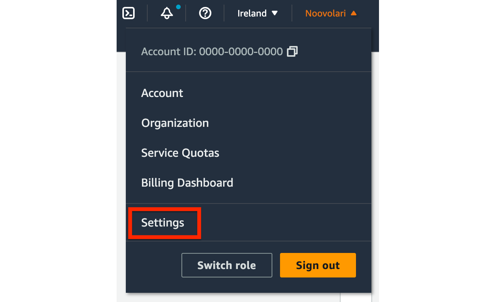
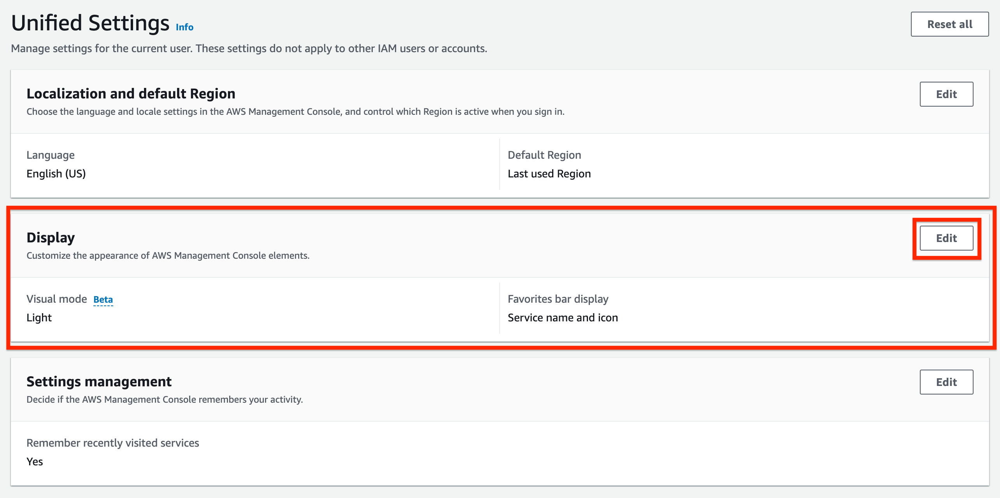
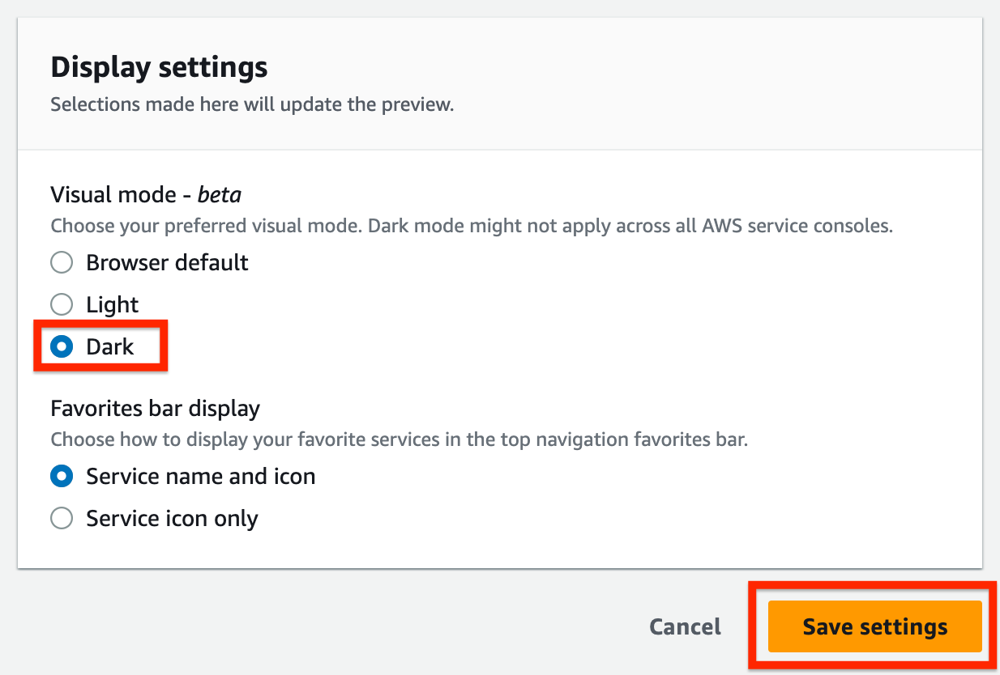
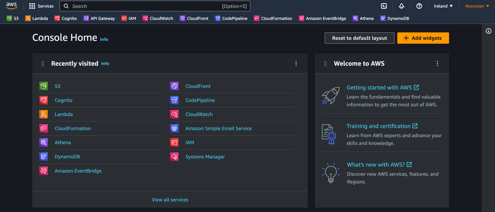
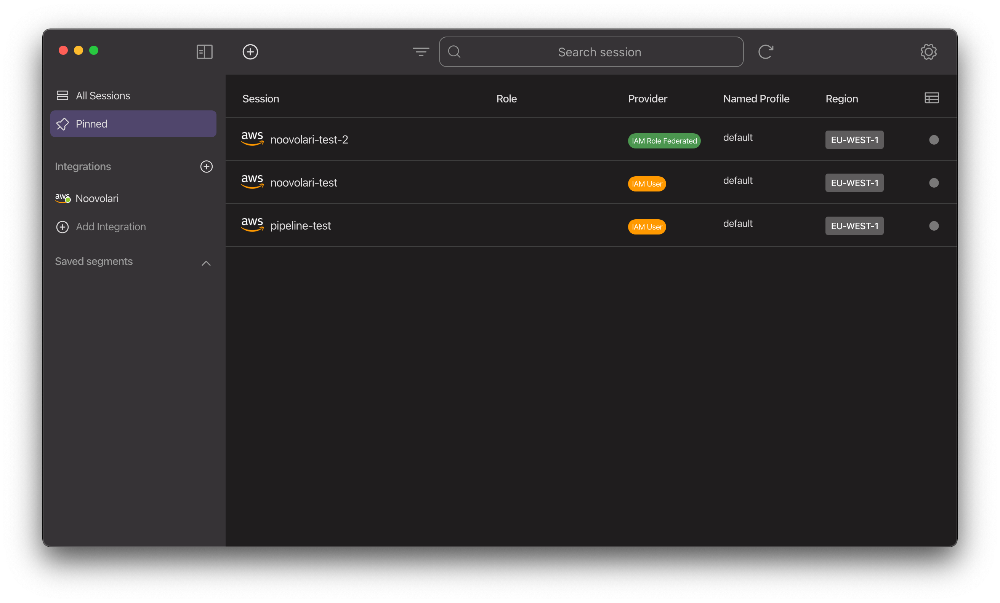

# How to enable dark mode in AWS console

Have you ever been blinded by how bright the AWS console is? Do you want to switch from light mode to dark mode?

Worry not! If you’re a dark mode enthusiast like myself, because you use it on your IDE and all your apps, you enjoy its benefits on productivity and health, or simply you like the aesthetics of it, **AWS recently released a new** **dark mode for the Management Console**. It is still a beta, but it works with almost all services.

Let me explain how to enable it in this quick article!

## How to enable dark mode in the AWS Management Console

1. First of all, access the AWS console, then **click your account name** in the **top right corner**. In the dropdown menu, click **Settings**.
    

1. The **Unified Settings** page will show up, and from there you will be able to see the following options. In the **Display** option, click **Edit.**
    

1. Now, select **Dark** in the Visual mode section. You can also see how it will look in the preview window on the side. Finally, click on **Save settings** to join the dark side of AWS!
    

And there you go, here’s how your Management Console home should look like. Easier on the eye, isn’t it? Remember that this is a beta feature; the most common services are already fully supporting it, but there are a couple with limited support or no dark mode yet.

## Pro Tips

As a dark mode fan, this feature was one of the first we thought about while our open-source tool [**Leapp**](https://leapp.cloud) was in development. Besides allowing to access and manage multiple AWS accounts in a click, Leapp was also built to **make the AWS console experience super-easy, quick, and smooth** for DevOps.

Feel free to give it a try! And drop a star to the GitHub repository if you like it!

%%[star-leapp] 

See you in the cloud!
