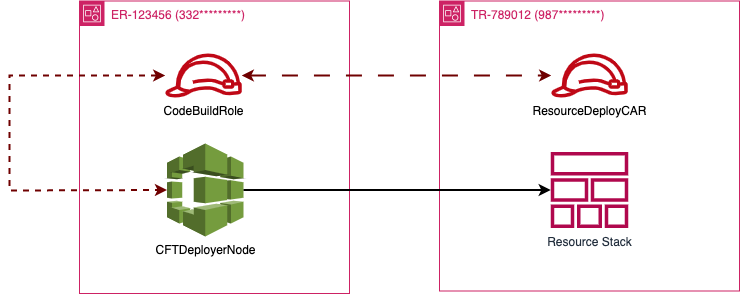

# Managing AWS IAM cross-account access at scale

## Introduction

Has your organization scaled to operate infrastructure across multiple AWS accounts? Are you having problems accessing resources, or resources accessing on another, across multiple accounts? If so, you’ve found the right article to help you solve these issues.

In this blog post, we’ll discuss managing cross-account IAM roles at scale. IAM is a powerful, centralized service that allows organizations and users to manage their resources and define permissions across AWS. IAM allows you to manage permissions at various levels and scale access across multiple accounts and organizations. Whether it's an SCP, a user, a group, or a role, this service gives the user or organization plenty of control over access rights to various other services and resources within AWS.

## Defining cross-account access

When multiple accounts exist within an organization, it can be quite challenging to define cross-account roles and policies. Depending on the use case, the complexity of the permissions and trust policies that are associated with each role may vary. Let’s define a simple use case and describe the access requirements each service that is utilized will need.

### BonTriage's cross-account dilemma

This made-up organization, called BonTriage, would like to deploy a list of cloud formation templates from their staging account, ER-123456, into their production account, TR-789012. These templates are responsible for creating several resources, such as S3 buckets and EC2 instances, and configuring autoscaling groups and other networking components. The engineers, unsure of how to do this, start to research and develop a strategy for getting these resources deployed into those respective accounts. During the research and design phase, they created an example architecture diagram.



The architecture diagram contains 2 IAM roles and one CloudBuild node. The CodeBuild node, CFTDeployerNode which is in the ER-123456 account, is responsible for deploying a CloudFormation stack into the TR-789012 account. To accomplish this, the CFTDeployerNode resource assumes the IAM role called “CodeBuildRole”. This role has the right to assume another IAM role called “ResourceDeployCAR” which contains the permissions to deploy the CloudFormation stack within the account. Sounds quite simple, right? Let’s dive a little deeper to see how this is happening.

The key component that you must understand about both roles is their respective trust policies. According to AWS, the trust policy of a role defines which principals can assume the role and under what conditions. Based on that definition, the “ResourceDeployCAR” roles must be modified. An example trust policy is highlighted below:

```json
{
  "Version": "2012-10-17",
  "Statement": [
    {
      "Sid": "AllowCodeBuildNodeToAssume",
      "Effect": "Allow",
      "Principal": {
        "AWS": "arn:aws:iam::332*********:role/CodeBuildRole"
      },
      "Action": "sts:AssumeRole"
    }
  ]
}
```

This trust policy allows the “CodeBuildRole” role to assume the “ResourceDeployCAR” role to deploy the stack set inside of the TR-789012 account. Without the principal of the role added to the trust policy, the role used for the CodeBuild resource would have not been able to assume the “ResourceDeployCAR” role in the other account.

For any cross-account roles or users that you create, you’ll want to ensure that your trust policy permits your other roles to assume them and their permissions sets. Policies of these roles and users are still incredibly relevant, as they ensure access to resources within the role-assumed account. In this case of the CFTDeployerNode, an example policy that would be attached to the “ResourceDeployCAR” role is highlighted below:

```json
{
  "Version": "2012-10-17",
  "Statement": [
    {
      "Sid": "AllowAllCloudformationActivitites",
      "Effect": "Allow",
      "Action": [
        "cloudformation:Describe*",
        "cloudformation:List*",
        "cloudformation:Get*"
      ],
      "Resource": "*"
    }
  ]
}
```

With the policy document outlined, the CodeBuild role should be able to create all of the resources via CloudFormation in the other account.

## Managing cross-account roles

By giving an example in the previous section, we were able to define a cross-account role that grants access to a CodeBuild resource from an account to deploy CloudFormation resources in a different account. The same pattern for IAM roles and users can be adopted and applied to several accounts across organizations in AWS. However, as the amount of cross-account roles increases, the amount of overhead for managing these roles increases as well.

To effectively manage cross-account roles, I would suggest leveraging Leapp. Owned by Noovolari, Leapp is an open-source cloud application that manages cloud credentials. As a multi-cloud credential management application, it has several key features that enable organizations and teams to easily manage IAM resources without accessing the console or entering CLI commands. Some of the key features of IAM resource management include role and user session management and credential generation and rotation.

Since we’ve given a slight overview of what Leapp is, let’s answer the question you’re probably asking: How does Leapp solve managing cross-account roles at scale? By using Leapp, one can create several profiles and link users and roles to those profiles! When you are interacting with AWS services using CLI commands and boto API calls, your machine must have a credentials file configured with all of the profiles you’d like to use. An example of what the credentials file would typically look like is highlighted below:

```plaintext
[default]
sso_session = my-sso
sso_account_id = 111*********
sso_role_name = readOnly
region = us-west-2
output = text

[profile user1]
sso_session = my-sso
sso_account_id = 444*********
sso_role_name = readOnly
region = us-east-1
output = json

[sso-session my-sso]
sso_region = us-east-1
sso_start_url = https://my-sso-portal.awsapps.com/start
sso_registration_scopes = sso:account:access
```

When you leverage Leapp to manage your profiles, you can quickly discern which role you’ve created a session for regardless of the IAM resource type. You can associate any kind of IAM resource with a profile and include MFA information and data in Leapp.


The image above is an example of an IAM Role and IAM User that have been created under two different profiles. The IAM User, ‘Damien’, exists under the named profile called ‘DJB Financial Corp’, whereas the DataCop role is associated with the named profile ‘DataCop’. As new roles are created, new profiles and their roles can be created/added to Leaap. If you have several roles that are associated with a profile, you can filter which role you’d like to use Leapp using the name of the profile. This feature alone makes it incredibly useful when organizations have not only created simple users, roles, and federated roles, but it can aid in managing complex cross-account roles.

If you wish to be more comfortable with working with a shell, Leapp has a CLI tool that would help you manage the profiles and IAM resources as well. If you’d like to learn more information on how to manage profiles with the CLI tool, you can read that information here: [Leapp CLI - Profiles](https://docs.leapp.cloud/latest/cli/scopes/profile/)

## Conclusion

Defining cross-account permissions and access can be incredibly difficult as your organization scales. Most of the time, an organization will have multiple accounts that need to share data and other components between them. When defining cross-account permissions for roles and users, you’ll want to ensure you are familiar with trust policies. These trust policies will ensure that your role or user grants the other IAM resource the right to assume it.

As the number of IAM cross-account resources grows, you’ll want to leverage a management platform like Leapp. This application has many features to help organizations manage their IAM resources by creating profiles. You can group a plethora of IAM resources into these profiles, and they do not have to be associated with a single account.

By following these strategies I’ve highlighted, you or your organization can effectively define and manage cross-account access and minimize overhead and other transitive issues.
