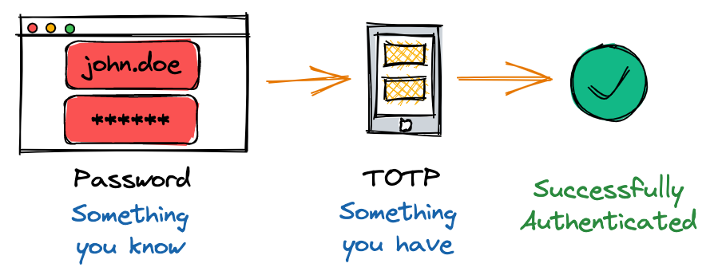
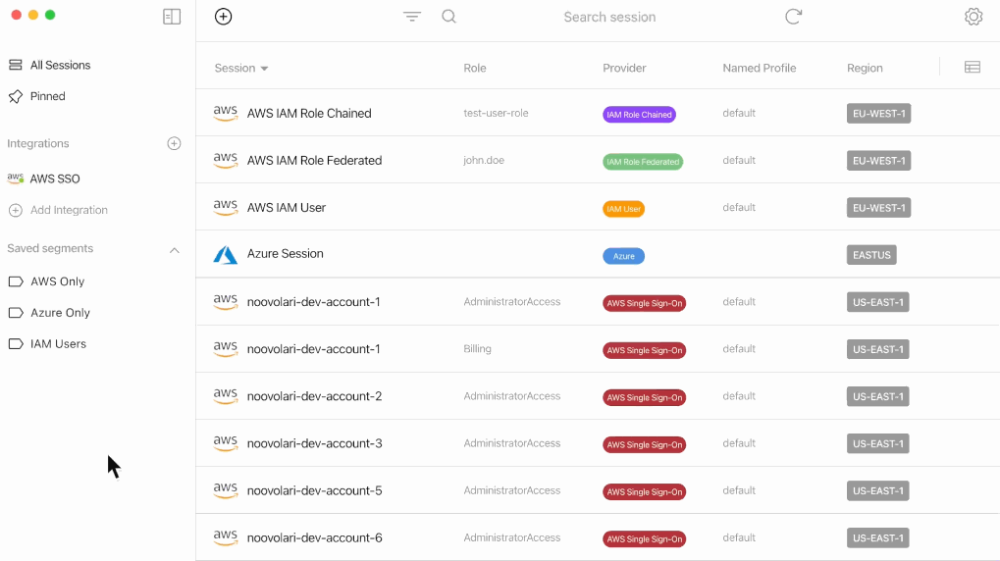
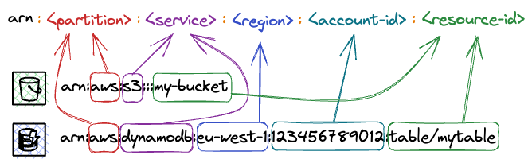
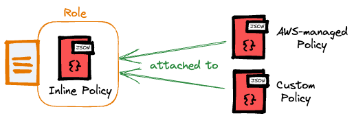
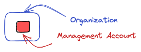
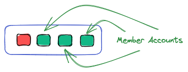
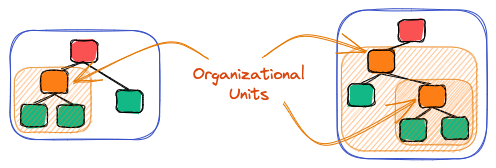
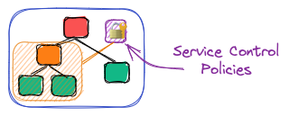
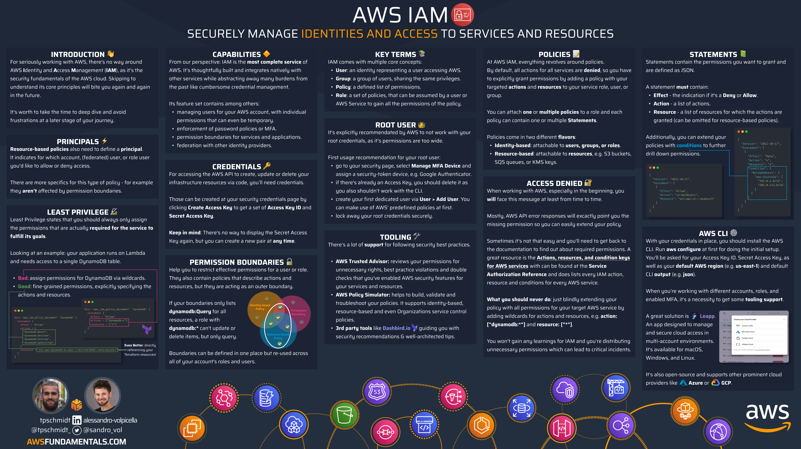

# AWS IAM Fundamentals: All You Need to Know Before Starting Out

Identity and Access Management (IAM) may be the most critical AWS service. It is used to control access to all AWS services. It enables organizations to create and manage AWS users and groups and assign them permissions.

In this article, we will explore the fundamentals of AWS IAM, including its key concepts, best practices, and how to work with IAM to manage an organization.

Whether you are new to AWS or an experienced developer, this article will provide you with the knowledge you need to get started with AWS IAM.

## Introduction to IAM

IAM is one of the services that is straightforward to start, but hard to master, as the power lies in the wide range of features.

### What is AWS IAM?

With AWS Identity and Access Management (IAM), you can securely manage access to AWS services and resources. You won't have to juggle multiple credentials anymore - instead, you can use roles and policies to grant precise permissions. These permissions can be assigned not only to users but also to resources, for ultimate control.

### Why is IAM Important?

AWS IAM plays a crucial role in ensuring the security of AWS, as it guarantees that only authorized individuals can access your resources. Acquiring a thorough understanding of it from the outset is essential to avoid creating environments with significant security vulnerabilities that are difficult to rectify later on.

### How does IAM internally work?

By default, all requests to all resources are denied. This means access has to be explicitly granted for everything.

When a request hits the AWS APIs, it goes through an internal authentication and authorization control that evaluates the requester's permissions for accessing an AWS resource by examining their attached permissions. These permissions are attached in the form of JSON documents.

In the following paragraphs, we will delve into the precise definition of those permissions and how they become associated with various identities.

## Critical Concepts for AWS IAM

We must grasp the fundamental principles of IAM. This encompasses comprehending users, groups, roles, policies, and permissions. Furthermore, we should familiarize ourselves with Access Keys and Multi-Factor Authentication.

Additionally, we'll delve into how these concepts serve as the adhesive that connects all of your AWS services.

### Users, Groups, and Roles

AWS IAM comes with the concept of users. They can be allocated to groups for the sake of simplifying user rights management. Each identity can be linked to one or multiple policies that indicate the permissions granted to that particular identity for specific resources.

On the contrary, roles are not linked to identities or users, but they can take on them and come with accompanying policies. Additionally, AWS services can also assume roles to ensure secure permission passing.

Roles are a powerful concept, as they allow you to grant temporary access to AWS resources without having to share long-term security credentials, such as access keys or passwords. This reduces the risk of unauthorized access and helps to improve security. Additionally, they help you to manage access to AWS resources based on job functions, rather than individual users. You'll grant permissions to a role and then allows users or services to assume the role to fulfill their duties.

### Policies and Permissions

IAM policies include statements that specify which actions are permitted or prohibited, which resources the actions apply to, and under what conditions the actions are allowed or denied. IAM assesses each policy statement to decide whether to allow or deny the requested action.

### Access Keys and MFA

AWS offers various ways to utilize its services, such as interactive access through the AWS management console and web browser, or programmatic access via the AWS API. The two main forms of credentials are console passwords and access keys.

* **Console passwords** - they allow the user to sign into an interactive session at the AWS management console. Users will be prompted for the unique 12-digit account identifier, their IAM user name, and their password. The account ID is required as IAM user names don’t have to be unique over all AWS accounts like S3 bucket names, but only per account.
    
* **Access keys** - These tools are designed to provide programmatic access to AWS through its API. You can directly submit calls to the AWS API to create, update, delete, or list resources if you have access keys. Access keys are made up of two parts: an Access Key ID and a Secret Access Key. To make using the AWS API more convenient, there are several tools available, such as [PowerShell](https://aws.amazon.com/powershell/) for Windows or [aws-shell](https://github.com/awslabs/aws-shell) for Linux and macOS.
    

In the end, every component operates through an API. Whether you're utilizing the AWS console interface, the AWS CLI, or the AWS SDK for any programming language, your actions will be translated into API calls.

For adding another layer of security to the authentication process, you can enable Multi-Factor Authentication, short MFA. MFA allows you to merge:

* "Something you know" refers to information that you possess, such as your username and password.
    
* "Something you own" is a device, either virtual or physical, that generates a single-use password.
    



When you have MFA enabled for your user, the way you access the API using your Access Key ID and Secret Access Key will also change. You must now obtain temporary credentials using your keys and the one-time security token generated by your MFA application. This can be a bit cumbersome if you try to do it manually, but tools like [Leapp](https://www.leapp.cloud/) drastically simplify the process for you.



### IAM Is the Glue between All AWS Services

No matter what you're constructing on AWS, it's crucial to thoroughly understand and utilize IAM as a key component. While IAM is frequently employed with a haphazard "just make it work" method, it's one of AWS's most comprehensive and well-established services, ensuring the safety of your infrastructure and data.

As a metaphor, it's like the glue that binds everything together. Conversely, it could also be the missing piece that causes everything to crumble.

## Identity vs Resource-Based Access

As you navigate AWS IAM, you'll encounter two policy types. These can be categorized as either identity-based or resource-based. In the following paragraphs, we'll explore the distinctions between the two and provide examples to aid in comprehension.

### Identifying Resources Uniquely: Amazon Resource Identifiers

To comprehensively examine the policies, it is essential to first grasp how AWS distinguishes resources within its vast ecosystem that caters to over a million clients.

This is established via Amazon Resource Identifiers, short ARN.



ARNs have multiple uses beyond IAM, such as in AWS CloudFormation templates and AWS service APIs. They provide a secure and consistent method for specifying and granting access to resources.

Let’s have a look at the two examples above:

* An Amazon S3 bucket: `arn:aws:s3:::my-bucket`
    
* An Amazon DynamoDB table: `arn:aws:dynamodb:eu-west-1:123456789012:table/mytable`
    

The ARN prefix, `arn:aws`, signifies that it belongs to the worldwide AWS system (note that AWS China, or AWS CN, is a distinct entity identified by the prefix `arn:aws-cn`). It is followed by the service abbreviation. In our case, `s3` for Amazon S3 and `dynamodb` for Amazon DynamoDB.

The region is specified by the next part (e.g. `eu-west-1`), and the account ID is specified by the fourth part (e.g. `123456789012`). You may notice that certain services, such as S3, are not restricted to a specific region, despite their resources being located in one region. In such instances, the region identifier is left unspecified.

The ARN includes the resource name or identifier to specifically identify the resource. For instance, in the ARN for an Amazon DynamoDB table, the table name (`mytable`) comes after the `table/` prefix. This enables you to distinguish the table and grant access to it through IAM policies.

### Identity-Based Access

On the one hand, AWS offers identity-based policies that authorize users, groups, or roles to access resources. They come in different types:

* **Managed Policies**: policies that can exist on their own (standalone) and can be attached to multiple identities within your AWS account. Managed policies in turn also divide into two further categories:
    
    * **AWS-managed policies**: policies that are created and managed by AWS.
        
    * **Customer-managed policies**: policies that you create based on your requirements.
        
* **Inline Policies**: policies with a strict one-to-one relationship to an identity.
    

Let's take a look at a policy example that permits starting and stopping EC2 instances in every region.

```json
{
  "Version": "2012-10-17",
  "Statement": [
    {
      "Effect": "Allow",
      "Action": [
        "ec2:StartInstances",
        "ec2:StopInstances"],
      "Resource": "arn:aws:ec2:*:123456789012:instance/*",
      "Condition": {
        "StringEquals": {
          "aws:PrincipalTag/groups": "developers"
        }
      }
    }
  ]
}
```

We have the option to link this policy to a user, group, or role to allocate those specific permissions.



By attaching the policy to a role, we have the flexibility to temporarily grant permissions to users, groups, or even AWS services.

### Resource-Based Access

On the other hand, resource-based policies are based on resources and are not linked to identities, but rather to specific AWS resources, such as an S3 bucket.

These policies provide designated principals with permissions for that particular resource. Resource-based policies are essentially inline policies since they cannot exist without their corresponding resource.

Let's go through two examples of resource-based policies:

1. **Amazon S3** - a bucket policy that allows you to grant permissions to resources in the bucket, such as objects and folders.
    

```json
{
  "Version":"2012-10-17",
  "Statement": [
    {
      "Sid": "PublicReadGetObject",
      "Effect": "Allow",
      "Principal": "*",
      "Action": ["s3:GetObject"],
      "Resource": ["arn:aws:s3:::my-bucket/*"]
    }
  ]
}
```

1. **AWS Key Management Service (KMS)** - Granting read permissions for KMS keys for a specific user while maintaining full-administrative permissions for the root user.
    

```json
{
  "Version": "2012-10-17",
  "Statement": [
    {
      "Sid": "Admin Permissions for Root",
      "Effect": "Allow",
      "Principal": {
        "AWS": "arn:aws:iam::123456789012:root"
      },
      "Action": "kms:*",
      "Resource": "*"
    },
    {
      "Sid": "Read Access for KMS Keys",
      "Effect": "Allow",
      "Principal": {
        "AWS": "arn:aws:iam::123456789012:user/example-user"
      },
      "Action": [
        "kms:Describe*",
        "kms:List*",
        "kms:Get*",
      ],
      "Resource": "*"
    }
  ]
}
```

Resource-based policies are not supported by most AWS services, but there are a few exceptions. Besides S3 buckets and KMS keys, there are also SNS topics or secrets in AWS Secrets Manager. AWS offers a [comprehensive catalog of all its services along with the corresponding IAM functionalities](https://docs.aws.amazon.com/IAM/latest/UserGuide/reference_aws-services-that-work-with-iam.html) they support, all well-maintained.

## Working with IAM to Manage an Organization

An AWS account comes with natural boundaries for security, access, and billing. Outside users do not have any access, and created infrastructure is solely allocated to your account and its users.

You might already understand why it's good practice to leverage those account boundaries by using multiple AWS accounts. This is not only helpful to strictly separate environments, but it can also be used to map down organizational structures to your AWS ecosystem.

AWS IAM and AWS Organizations make this possible.

### AWS Organizations Key Concepts

AWS Organizations allows you to effortlessly apply your IAM permissions across multiple accounts. To achieve this, you must first comprehend the various features that come with AWS Organizations.

* **The Management Account** - This is the original account that was utilized to establish the organization. It possesses complete access to every AWS resource and service.
    
    
    
* **An Organization** - Think of this as a receptacle for numerous AWS accounts. It enables you to oversee them all in a single, centralized location utilizing the capabilities of AWS Organizations.
    
    
    
* **Organizational Units** - Organizational units serve as an effective means for precise management. Each unit functions as a logical container, capable of accommodating accounts and additional organizational units.
    
    
    

These features assist in the mapping of applications, projects, and the hierarchical structure of your organization within your AWS ecosystem.

Furthermore, you can limit access rights from a central location for your entire company, specific organizational units, or single accounts through the implementation of service control policies, which we will explore in the following paragraph.

### Applying Service Control Policies

Service Control Policies (SCPs) allow you to restrict access to AWS resources and services. As mentioned before, they can be applied to an organization, organizational unit, or individual account.



They assist you in implementing precise permissions throughout your various accounts, enabling adherence to compliance regulations and the enforcement of rigorous security measures.

Using SCPs, you could enforce MFA usage across your entire organization, including all member accounts.

Our [deep-dive article](https://blog.awsfundamentals.com/aws-organizations-the-key-to-managing-your-cloud-infrastructure-effectively) provides a hands-on approach to learning more about AWS Organizations.

## IAM Best Practices

IAM provides a powerful set of tools for managing access to AWS resources, but it can be complex to configure and manage. By following best practices, you can ensure that your AWS environment is secure and well-managed.

### Least Privilege and Separation of Duties

If you give users or roles too many permissions, it could result in them accessing AWS resources they shouldn't have access to. It's crucial to adhere to the principle of least privilege and only grant permissions that are necessary for users to do their job.

This highlights the need for creating customized roles that grant permissions for specific or limited tasks. It's important to avoid broad permissions or roles that are applied to multiple tasks and grant excessive access.

### Multi-Factor Authentication

[Enabling MFA](https://blog.awsfundamentals.com/aws-mfa-keeping-your-account-secure-via-multi-factor-authentication) for your root user or any other IAM user is a straightforward process. You can also mandate the use of MFA across your entire account or AWS organization by implementing policies.

### Making Use of AWS Identity Center or Federation

In simpler terms, setting up users directly on AWS IAM is an outdated feature. AWS advises utilizing a specialized identity provider and solely utilizing roles to assign access to those identities.

As the name expects, an identity provider (IdP) is a service that solely focuses on managing identities. Those identities can be used across your AWS Organization by using federation.

The AWS Identity Center can act as an IdP, which means that there is no need for a third-party service to manage users and groups throughout the organization or to facilitate Single-Sign-On (SSO). Nonetheless, in larger-scale environments, it is recommended to choose a service that specializes in identity management.

### Avoiding Common IAM Mistakes

In addition to the detailed recommendations listed above, numerous other common IAM mistakes are often found in both small and large projects. Among them are:

1. **Not making use of IAM roles** - When utilizing AWS services for your workloads, it is crucial to utilize roles with customized permissions. AWS will handle the issuance of temporary credentials to prevent any concerns about database password leaks.
    
2. **Not rotating access keys regularly** - if you require long-term access keys, they have to be rotated regularly to reduce the risk of accidental leakage.
    
3. **Using your root for daily tasks** - You should only use your AWS root user to establish your account and organization. Once that's done, it's best to lock it away because its permissions are too broad.
    
4. **Not making use of SCPs** - if you're working with multiple accounts within an organization, it's important to establish guardrails across your organization via service control policies.
    
5. **Not making use of Permission Boundaries** - another advanced feature of IAM are [permission boundary policies](https://blog.leapp.cloud/how-to-master-and-secure-access-and-permissions-in-an-aws-landing-zone) that can be applied to roles. Those boundaries do not grant permissions on their own, but restrict the maximum permissions that can be delegated via a role.
    

This list is not comprehensive, but it provides a good starting point for best practices.

## Extending your AWS Fundamentals beyond IAM

It is important to learn the fundamentals of AWS IAM first because it is a critical component of the AWS ecosystem that serves as a central control point for managing access to AWS resources. However, to successfully become a DevOps engineer, you need to continue to learn about other core services like Lambda, DynamoDB, or ECS as they are the backbone of many successful organizations and projects.



The book [AWS Fundamentals](https://awsfundamentals.com/) is a great resource for learning the must-knows about the 16 most used and famous AWS services. It also includes an introduction to modern Infrastructure as Code, which is an important concept for DevOps engineers to understand.


In addition, the book includes infographics that visualize critical facts in a bite-sized manner, making it easier to understand and remember key concepts. By learning about IAM and other core AWS services, you can develop the skills and knowledge necessary to become a successful DevOps engineer in the AWS cloud.

## Conclusion

AWS IAM is a critical service that is used to manage access to AWS resources. It is essential to understand the key concepts of IAM, including users, groups, roles, policies, and permissions.

By following best practices, such as adhering to the principle of least privilege and enabling multi-factor authentication, businesses can ensure the security of their AWS environment. Additionally, AWS Organizations and Service Control Policies can be used to manage an organization's AWS ecosystem effectively.

Overall, understanding and utilizing AWS IAM is crucial for maintaining a secure and well-managed AWS environment.
