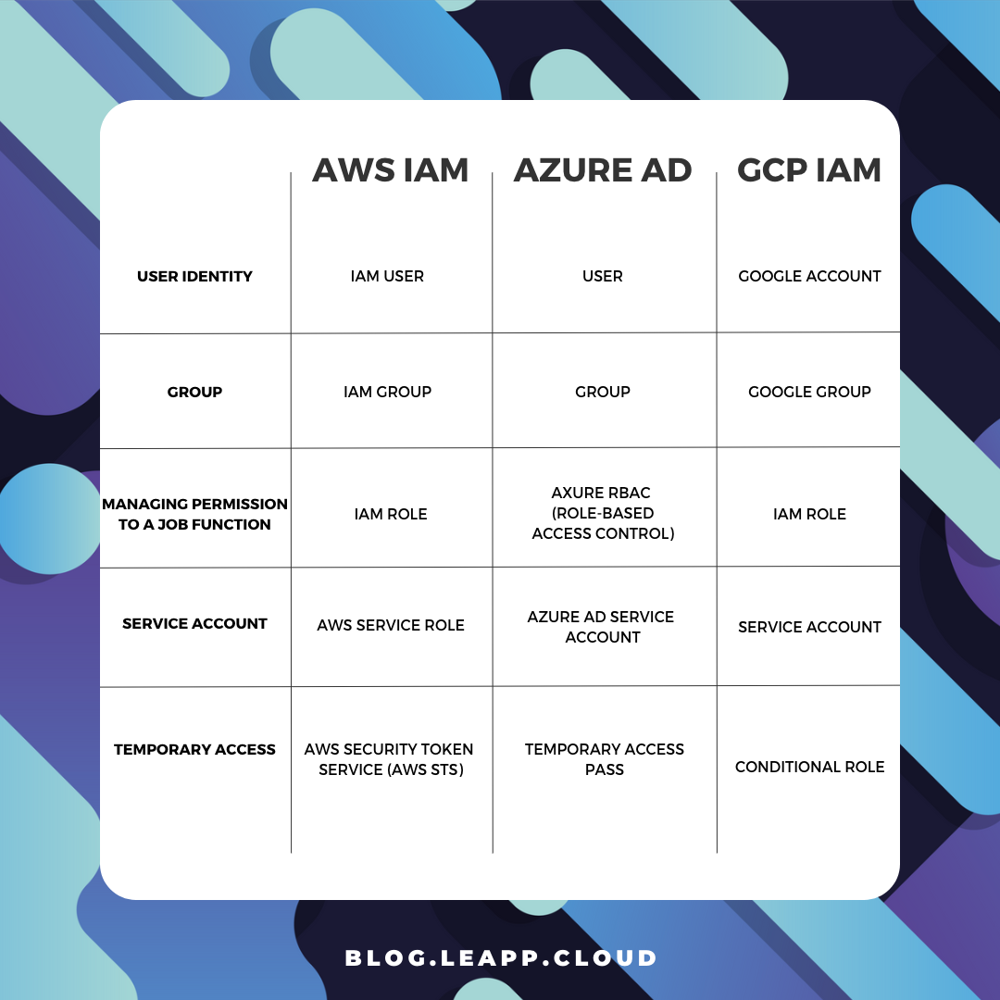

# Identity and Access Management in Multi-Cloud Environments

IAM (Identity and Access Management) is a crucial part of any cloud environment.

As organizations evolve, they may look at multi-cloud as a solution to consume cloud services in different cloud providers' technologies (such as AI/ML, data analytics, and more), to have the benefit of using different pricing models, or to decrease the risk of vendor lock-in.

Before we begin the discussion about IAM, we need to understand the following fundamental concepts:

* Identity – An account represents a persona (human) or service (non-interactive account)
    
* Authentication – The act where an identity proves himself against a system (such as providing username and password, certificate, API key, and more)
    
* Authorization – The act of validating granting an identity’s privileges to take actions on a system (such as view configuration, read database content, upload a file to object storage, and more)
    
* Access Management – The entire lifecycle of IAM – from account provisioning, granting access, and validating privileges until account or privilege revocation
    

## Identity and Access Management Terminology

## Authorization in the Cloud

Although all cloud providers have the same concept of identities, when we deep dive into the concept of authorization or access management to resources/services, we need to understand the differences between cloud providers.

### Authorization in AWS

AWS has two concepts for managing permissions to resources:

* IAM Role – Permissions assigned to an identity temporarily.
    
* IAM Policy – A document defines a set of permissions assigned to an IAM role.
    

Permissions in AWS can be assigned to:

* Identity – A policy attached to a user, group, or role.
    
* Resource – A policy attached to a resource (such as Amazon S3 bucket).
    

### Authorization in Azure

Permissions in Azure AD are controlled by roles.

A role defines the permissions an identity has over an Azure resource.

Within Azure AD, you control permissions using RBAC (Role-based access control).

Azure AD supports the following types of roles:

* Built-in roles – A pre-defined role according to job function (as you can read on the [link](https://learn.microsoft.com/en-us/azure/active-directory/roles/permissions-reference)).
    
* Custom roles – A role that we create ourselves to match the principle of least privilege.
    

### Authorization in Google Cloud

Permissions in Google Cloud IAM are controlled by IAM roles.

Google Cloud IAM supports the following types of IAM roles:

* Basic roles – The most permissive type of roles (Owner, Editor, and Viewer).
    
* Predefined roles – Roles managed by Google, which provides granular access to specific services (as you can read on the [link](https://cloud.google.com/iam/docs/understanding-roles#predefined)).
    
* Custom roles – User-specific roles, which provide the most granular access to resources.
    

### Authorization – Default behavior

As we can see below each cloud provider takes a different approach to default permissions:

* [AWS](https://docs.aws.amazon.com/IAM/latest/UserGuide/id_users.html#id_users_perms) – By default, new IAM users have no permission to access any resource in AWS.  
    To allow access to resources or take actions, manually assign the user an IAM role.
    
* [Azure](https://learn.microsoft.com/en-us/azure/active-directory/fundamentals/users-default-permissions) – By default, all Azure AD users are granted a set of default permissions (such as listing all users, reading all properties of users and groups, registering new applications, and more).
    
* [Google Cloud](https://cloud.google.com/iam/docs/service-account-types#default) – By default, a new service account is granted the Editor role on the project level.
    

## Identity Federation

When we are talking about identity federation, there are two concepts:

* Service Provider (SP) – Provide access to resources
    
* Identity Provider (IdP) – Authenticate the identities
    

Identities (user accounts, service accounts, groups, etc.) are managed by an Identity Provider (IdP).

An IdP can exist in the local data center (such as Microsoft Active Directory) or the public cloud (such as AWS IAM, Azure AD, Google Cloud IAM, etc.)

Federation is the act of creating trust between separate IdP’s.

Federation allows us to keep identity in one repository (i.e., Identity Provider).

Once we set up an identity federation, we can grant an identity privilege to consume resources in a remote repository.

Example: a worker with an account in Microsoft Active Directory, reading a file from object storage in Azure, once a federation trust was established between Microsoft Active Directory and Azure Active Directory.

When federating between the on-premise and cloud environments, we need to recall the use of different protocols.

On-premise environments are using legacy authentication protocols such as Kerberos or LDAP.

In the public cloud, the common authentication protocols are [SAML 2.0](https://en.wikipedia.org/wiki/SAML_2.0), [Open ID Connect (OIDC)](https://openid.net/connect/), and [OAuth 2.0](https://oauth.net/2/)

Each cloud provider has a list of supported external third-party identity providers to federate with, as you can read in the list below:

* [Integrating third-party SAML solution providers with AWS](https://docs.aws.amazon.com/IAM/latest/UserGuide/id_roles_providers_saml_3rd-party.html)
    
* [Azure AD Identity Provider Compatibility Docs](https://www.microsoft.com/en-us/download/details.aspx?id=56843)
    
* [Google Cloud IAM - Configure workforce identity federation](https://cloud.google.com/iam/docs/configuring-workforce-identity-federation)
    

## Single Sign-On

The concept behind SSO is to allow identities (usually end-users) access to resources in the cloud while having to sign (to an identity provider) once.

Over the past couple of years, the concept of SSO was extended and now it is possible to allow a single identity (who authenticated to a specific identity provider), access to resources over federated login to an external (mostly SAML) identity provider.

Each cloud provider has its own SSO service, supporting federation with external identity providers:

* [AWS IAM Identity Center](https://docs.aws.amazon.com/singlesignon/latest/userguide/what-is.html)
    
* [Azure Active Directory single sign-on](https://learn.microsoft.com/en-us/azure/active-directory/manage-apps/what-is-single-sign-on)
    
* [Google Cloud Workload identity federation](https://cloud.google.com/iam/docs/workload-identity-federation)
    

## Steps for creating a federation between cloud providers

The process below explains (at a high level) the steps require to set up identity federation between different cloud providers:

1. Choose an IdP (where identities will be created and authenticated to).
    
2. Create a SAML identity provider.
    
3. Configure roles for your third-party identity provider.
    
4. Assign roles to the target users.
    
5. Create trust between SP and IdP.
    
6. Test the ability to authenticate and identify (user) to a resource in a remote/external cloud provider.
    

### Additional References:

* [AWS IAM Identity Center and Azure AD as IdP](https://docs.aws.amazon.com/singlesignon/latest/userguide/azure-ad-idp.html)
    
* [How to set up IAM federation using Google Workspace](https://aws.amazon.com/blogs/security/how-to-set-up-federated-single-sign-on-to-aws-using-google-workspace/)
    
* [Azure AD SSO integration with AWS IAM Identity Center](https://learn.microsoft.com/en-us/azure/active-directory/saas-apps/aws-single-sign-on-tutorial)
    
* [Azure AD SSO integration with Google Cloud / G Suite Connector by Microsoft](https://learn.microsoft.com/en-us/azure/active-directory/saas-apps/google-apps-tutorial)
    
* [Federating Google Cloud with Azure Active Directory](https://cloud.google.com/architecture/identity/federating-gcp-with-azure-active-directory)
    
* [Configure Google workload identity federation with AWS or Azure](https://cloud.google.com/iam/docs/workload-identity-federation-with-other-clouds)
    

## Summary

In this blog post, we deeply explored identity and access management in the cloud, comparing different aspects of IAM in AWS, Azure, and GCP.

After we have reviewed how authentication and authorization work for each of the three cloud providers, we have explained how federation and SSO work in a multi-cloud environment.

Important to keep in mind:

When we are building systems in the cloud, whether they are publicly exposed or even internal, we need to follow some basic rules:

* All-access to resources/systems/applications must be authenticated
    
* Permissions must follow the principle of least privileged and business requirements
    
* All access must be audited (for future analysis, investigation purposes, etc.)
    

### About the Author

Eyal Estrin is a cloud and information security architect, the owner of the blog [Security & Cloud 24/7](https://security-24-7.com/), and the author of the book [Cloud Security Handbook](https://amzn.to/3xMI4Ak), with over 20 years in the IT industry.  
Eyal is an [AWS Community Builder](https://aws.amazon.com/developer/community/community-builders/) since 2020.  
You can connect with him on [Twitter](https://twitter.com/eyalestrin) and [LinkedIn](https://www.linkedin.com/in/eyalestrin/).
