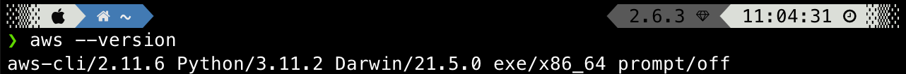
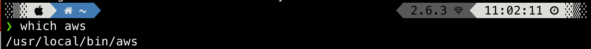
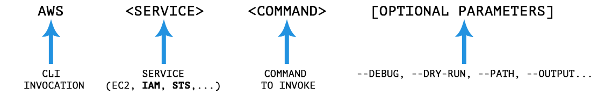

# AWS IAM CLI: a cheatsheet

[AWS CLI](https://aws.amazon.com/cli/) stands for Amazon Web Services Command Line Interface.

It is an open-source tool, and knowing how to use it to interact with AWS Services is crucial, especially for Developers. 

It allows to centralize control of all existing services from a single tool, and moreover, to make automated scripts.

[AWS Identity & Access Management](https://aws.amazon.com/iam/), IAM in short, provides fine-grained access control across AWS services. 

This article will show how to use the [AWS CLI](https://aws.amazon.com/cli/) to perform all the most common IAM operations.

<a name="prerequisites-and-tips"></a>
## Prerequisites and Tips

- If you haven't installed the AWS CLI yet, start by looking at [Installing the AWS CLI Guide from Amazon](https://docs.aws.amazon.com/cli/latest/userguide/cli-chap-install.html).
- [Download](https://jqlang.github.io/jq/) **jq,** a lightweight and flexible **JSON processor** for your terminal. 
Highly recommend  for **automated script with the AWS CLI.** Look at the [site](https://jqlang.github.io/jq/) for more information.
- Get the AWS CLI version: `$ aws --version`.
    

    
- Get the AWS CLI installation path: `$ which aws`.
    

    
- Configure the AWS CLI for the first time: follow our [previous article](https://blog.leapp.cloud/how-to-use-aws-named-profiles).
- `$ aws --cli-auto-prompt`: enable Auto Completion mode for the CLI, giving you suggestions as you write down your commands. Just remember to exit this mode when you need to run scripts!

<a name="aws-cli-versions"></a>
## AWS CLI: Versions

- **Version 2.x —** **Used primarily for production environments**.
- **Version 1.x —** Now available only for **backward compatibility**.

<a name="aws-cli-command-anatomy"></a>
## AWS CLI: command anatomy

Users can create commands in **single** or **multiple** lines. The `\` character splits a command into **multiple lines for better readability**.

In general, a command is structured in this way:



You have the **CLI invocation**, and then you **apply a command to a specific service**. You can also add many different **optional parameters**.

<a name="aws-iam-cli-table-of-content"></a>
## **AWS IAM CLI: table of content**

There are many different commands that you can exploit using the AWS CLI, but this article will focus only on those related to **IAM** and **STS** (AWS **S**ecurity **T**oken **S**ervice). 

Because commands can have many optional parameters, we recommend opening this [link](https://docs.aws.amazon.com/cli/latest/reference/) in your browser for further reference information.

Note: you can use the TOC feature to jump to your desired command.

<a name="aws-iam-cli-create-user"></a>
## AWS IAM CLI: **create user**

Create a new IAM user.

`aws iam create-user --user-name AlessandroArticle`

- `iam`: Service
- `create-user`: Command
- `--user-name`: Name of the user

Output:

```
{
    "User": {
        "Path": "/",
        "UserName": "AlessandroArticle",
        "UserId": "<user_id>",
        "Arn": "arn:aws:iam::<account_number>:user/AlessandroArticle",
        "CreateDate": "<creation_date>"
    }
}
```

<a name="aws-iam-cli-list-users"></a>
## AWS IAM CLI: **list users**

Lists all users in the credentials’ set account.

`aws iam list-users`

- `iam`: Service
- `list-users`: Command

Output:

```
{
    "Users": [
        {
            "Path": "/",
		        "UserName": "AlessandroArticle",
		        "UserId": "<user_id>",
		        "Arn": "arn:aws:iam::<account_number>:user/AlessandroArticle",
		        "CreateDate": "<creation_date>"
        }
		]
}

```

<a name="aws-iam-cli-update-user"></a>
## AWS IAM CLI: **update user**

Updates an IAM user. We can update the name of a user using the `update-user` command.

`aws iam update-user --user-name AlessandroArticle --new-user-name AlessandroArticleNew`

- `iam`: Service
- `update-user`: Command
- `—-user-name`: The old name
- `—-new-user-name`: The new name

<a name="aws-iam-cli-delete-user"></a>
## AWS IAM CLI: **delete user**

Deletes the specified IAM user. 

`aws iam delete-user —user-name AlessandroArticle`

- `iam`: Service
- `update-user`: Command
- `—-user-name`: The name of the user to remove

Note: you must delete the items attached to the user before attempting to delete a user, otherwise the command will fail (as per [AWS documentation](https://docs.aws.amazon.com/cli/latest/reference/iam/delete-user.html)):

- Password ( DeleteLoginProfile )
- Access keys ( DeleteAccessKey )
- Signing certificate ( DeleteSigningCertificate )
- SSH public key ( DeleteSSHPublicKey )
- Git credentials ( DeleteServiceSpecificCredential )
- Multi-factor authentication (MFA) device ( DeactivateMFADevice , DeleteVirtualMFADevice )
- Inline policies ( DeleteUserPolicy )
- Attached managed policies ( DetachUserPolicy )
- Group memberships ( RemoveUserFromGroup )

**Pro tips:**

**List userId and UserName**

```
aws iam list-users | jq -r ‘.Users[ ]|.UserId+” “+.UserName’
```

**Get single user**

```
aws iam get-user --user-name (username)
```

**Add user**

```
aws iam create-user --user-name (username)
```

**Delete user**

```
aws iam delete-user --user-name (username)
```

**List access keys for user**

```
aws iam list-access-keys --user-name (username) | jq -r .AccessKeyMetadata[ ].AccessKeyId
```

**Delete access key for user**

```
aws iam delete-access-key --user-name (username) --access-key-id (accessKeyID)
```

**Activate/deactivate access key for user**

```
aws iam update-access-key --status Active --user-name (username) --access-key-id (access key)
```

```
aws iam update-access-key --status Inactive --user-name (username) --access-key-id (access key)
```

**Generate new access key for user**

```
aws iam create-access-key --user-name (username) | jq -r ‘.AccessKey | .AccessKeyId+” “+.SecretAccessKey’
```

<a name="aws-iam-cli-create-iam-policy"></a>
## AWS IAM CLI: **create IAM policy**

Creates a new [IAM policy](https://docs.aws.amazon.com/IAM/latest/UserGuide/access_policies.html).

`aws iam create-policy --policy-name example-policy --policy-document file://example-policy.json`

- `iam`: Service
- `create-policy`: Command
- `--policy-name`: Name of the IAM policy
- `--policy-document`: Policy document in JSON format (useful because the policies are structured files)

An example policy document:

```
{
    "Version": "2012-10-17",
    "Statement": [
        {
		      "Effect": "Allow",
		      "Action": [
		        "s3:GetBucketLocation",
		        "s3:ListBucket",
		        "s3:ListBucketMultipartUploads"
		      ],
		      "Resource": [
		        "arn:aws:s3:::<my_bucket>"
		      ]
		    }
    ]
}
```

Output:

```idris
{
   "Policy": {
      "PolicyName":"example-policy",
      "PolicyId":"<policy_id>",
      "Arn":"arn:aws:iam::<account_number>:policy/example-policy",
      "Path":"/",
      "DefaultVersionId":"v1",
      "AttachmentCount":0,
      "PermissionsBoundaryUsageCount":0,
      "IsAttachable":true,
      "CreateDate":"<creation_date>",
      "UpdateDate":"<update_date>"
   }
}
```

<a name="aws-iam-cli-list-iam-policies"></a>
## AWS IAM CLI: **list IAM policies**

Lists IAM policies in the account.

`aws iam list-policies --scopes All`

- `iam`: Service
- `list-policies`: Command
- `--scopes`: Policies scope. Possible values: `All`, `AWS`, `Local`. **AWS** is for managed policies, while **Local** for custom policies.

Output

```
{
	"Policies": [
		{
		   "Policy": {
		      "PolicyName":"example-policy",
		      "PolicyId":"<policy_id>",
		      "Arn":"arn:aws:iam::<account_number>:policy/example-policy",
		      "Path":"/",
		      "DefaultVersionId":"v1",
		      "AttachmentCount":0,
		      "PermissionsBoundaryUsageCount":0,
		      "IsAttachable":true,
		      "CreateDate":"<creation_date>",
		      "UpdateDate":"<update_date>"
		   }
		}
	]
}

```

<a name="aws-iam-cli-update-iam-policy"></a>
## AWS IAM CLI: **update IAM policy**

Edit an IAM policy and set it as default.

```
aws iam create-policy-version \
 --policy-arn arn:aws:iam::123456789012:policy/my-policy \
 --policy-document file://NewPolicyVersion.json --set-as-default
```

- `iam`: Service
- `create-policy-version`: Command
- `--policy-arn`: ARN of the policy
- `--policy-document`: Updated policy file

<a name="aws-iam-cli-delete-iam-policy"></a>
## AWS IAM CLI: **delete IAM policy**

Delete a policy given the ARN.

`aws iam delete-policy --policy-arn arn**:**aws**:**iam**::**123456789012**:**policy/my-policy`

- `iam`: Service
- `delete-policy`: Command
- `--policy-arn`: ARN of the policy

<a name="aws-iam-cli-create-iam-role"></a>
## AWS IAM CLI: **create IAM role**

Creates a new IAM role. The arguments for this command are:

`aws iam create-role --role-name example-role --assume-role-policy-document file://assume-policy.json`

- `iam`: Service
- `create-role`: Command
- `--role-name`: Name of the IAM role
- `--assume-role-policy-document`: Trust relationship policy document that grants an entity permission to assume the role

In this example, we will create an IAM role that grants AWS Glue permission to assume the role (as [principal](https://blog.leapp.cloud/what-is-an-iam-principal)).

```
{
    "Version": "2012-10-17",
    "Statement": [
        {
        "Effect": "Allow",
        "Principal": {
        "Service": "glue.amazonaws.com"
        },
        "Action": "sts:AssumeRole"
        }
    ]
}

```

Output:

```
{
    "Role": {
        "Path": "/",
        "RoleName": "example-role",
        "RoleId": "<role_id>",
        "Arn": "arn:aws:iam::<account_number>:role/example-role",
        "CreateDate": "<creation_date>",
        "AssumeRolePolicyDocument": {
            "Version": "2012-10-17",
            "Statement": [
                {
                    "Effect": "Allow",
                    "Principal": {
                        "Service": "glue.amazonaws.com"
                    },
                    "Action": "sts:AssumeRole"
                }
            ]
        }
    }
}

```

<a name="aws-iam-cli-delete-a-role"></a>
## AWS IAM CLI: **delete a Role**

Deletes an IAM Role.

`aws iam delete-role --role-name Test-Role`

- `iam`: Service
- `delete-role`: Command
- `--role-name`: Name of the IAM Role to remove

<a name="aws-iam-cli-attach-policy-to-a-user"></a>
## AWS IAM CLI: **attach policy to a User**

To allow a User to do some actions, apply a policy to it.

`aws iam attach-user-policy --user-name AlessandroArticle --policy-arn arn:aws:iam::<policy_id>:policy/my-policy`

- `iam`: Service
- `attach-user-policy`: Command
- `--user-name`: Name of the IAM user
- `--policy-arn`: ARN of the IAM policy to attach

In this example, we will attach the IAM policy we created earlier to an example IAM.

<a name="aws-iam-cli-attach-policy-to-an-iam-role"></a>
## AWS IAM CLI: **attach policy to an IAM role**

We can also attach a policy to a IAM role.

`aws iam attach-role-policy --role-name example-role --policy-arn arn:aws:iam::<policy_id>:policy/my-policy`

- `iam`: Service
- `attach-role-policy`: Command
- `--role-name`: Name of the IAM role
- `--policy-arn`: ARN of the IAM policy you want to attach

<a name="aws-iam-cli-list-all-policies-attached-to-a-user"></a>
## AWS IAM CLI: **list all policies attached to a user**

We can list all policies attached to an IAM User.

`aws iam list-attached-user-policies --user-name AlessandroArticle`

- `iam`: Service
- `list-attached-user-policies`: Command
- `--user-name`: The User to whom the policies are attached to

Output

```idris
{
    "AttachedPolicies": [
        {
            "PolicyName": "my-policy",
            "PolicyArn": "arn:aws:iam::<account_number>:policy/learnaws-dynamo-policy"
        }
    ]
}
```

<a name="aws-iam-cli-list-all-policies-attached-to-a-role"></a>
## AWS IAM CLI: **list all policies attached to a role**

List all policies attached to an IAM Role.

`aws iam list-attached-role-policies --role-name example-role`

- `iam`: Service
- `list-attached-role-policies`: Command
- `--role-name`: The Role to whom the policies are attached to

Output

```idris
{
    "AttachedPolicies": [
        {
            "PolicyName": "my-policy",
            "PolicyArn": "arn:aws:iam::<account_number>:policy/example-policy"
        }
    ]
}
```

Output:

```bash
{
    "UserId": "AROAJQ3ISEWFFR6GXAW:<user_name>",
    "Account": "637004329899",
    "Arn": "arn:aws:sts::637004329899:assumed-role/<role-name>/<user_name>"
}
```

<a name="aws-iam-cli-jq-snippets"></a>
## AWS IAM CLI: **jq snippets**

Finally, thanks to the excellent [tutorial from BlueMatador](https://www.bluematador.com/learn/aws-cli-cheatsheet), here we present some fast snippets that integrate the ****jq**** tool to extrapolate useful info for different use-cases. Kudos to them 🙂.

**List groups**

```
aws iam list-groups | jq -r .Groups[ ].GroupName
```

**Add/Delete groups**

```
aws iam create-group --group-name (groupName)
```

**List policies and ARNs**

```
aws iam list-policies | jq -r ‘.Policies[ ]|.PolicyName+” “+.Arn’
```

```
aws iam list-policies --scope AWS | jq -r ‘.Policies[ ]|.PolicyName+” “+.Arn’
```

```
aws iam list-policies --scope Local | jq -r ‘.Policies[ ]|.PolicyName+” “+.Arn’
```

**List user/group/roles for a policy**

```
aws iam list-entities-for-policy --policy-arn arn:aws:iam:2308345:policy/example-ReadOnly
```

**List policies for a group**

```
aws iam list-attached-group-policies --group-name (groupname)
```

**Add policy to a group**

```
aws iam attach-group-policy --group-name (groupname) --policy-arn arn:aws:iam::aws:policy/exampleReadOnlyAccess
```

**Add user to a group**

```
aws iam add-user-to-group --group-name (groupname) --user-name (username)
```

**Remove user from a group**

```
aws iam remove-user-from-group --group-name (groupname) --user-name (username)
```

**List users in a group**

```
aws iam get-group --group-name (groupname)
```

**List groups for a user**

```
aws iam list-groups-for-user --user-name (username)
```

**Attach/detach policy to a group**

```
aws iam attach-group-policy --group-name (groupname) --policy-arn arn:aws:iam::aws:policy/DynamoDBFullAccess
```

```
aws iam detach-group-policy --group-name (groupname) --policy-arn arn:aws:iam::aws:policy/DynamoDBFullAccess
```

<!-- TOC --><a name="conclusions"></a>
## Conclusions

This article shows that AWS CLI is a powerful tool for automatic operations on AWS services. 

In particular, we have used IAM and STS services to explore all the different commands that we can leverage for Access Management and Identity governance.

We have demonstrated that AWS CLI commands can be chained with other terminal tools to push even further your automation scripts.

Finally, we have seen how **jq** can be a perfect companion for the CLI to obtain properties out of JSON-formatted files or command results.

If this article interested you, next week we will continue with a new cheatsheet correlated to STS and how it is tied closely to our open-source tool [Leapp](https://leapp.cloud/). Don’t miss it out!

Thank you everyone, for coming this far. We hope that you enjoyed this little “cheatsheet”. 

As always, if you have questions, clarifications, or just want to share your opinions, feel free to join our **[Top of the Ops community](https://join.slack.com/t/noovolari/shared_invite/zt-opn8q98k-HDZfpJ2_2U3RdTnN~u_B~Q)**.

Until next time, stay safe 🙂!
