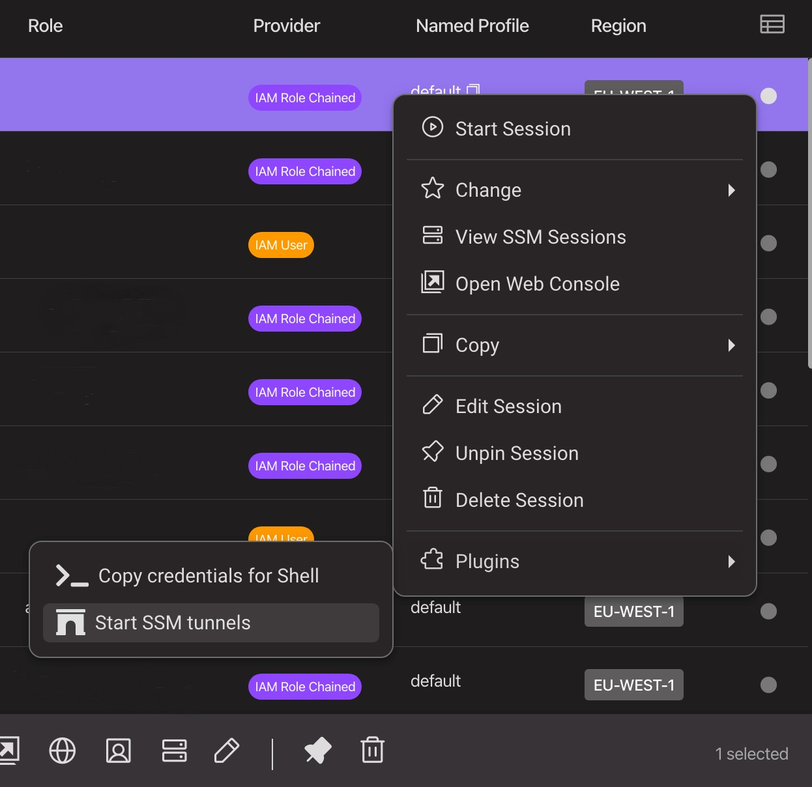

# No Gateway Needed: How to RDP to AWS Private Windows Instance

Under the AWS “Systems Manager” service umbrella, you can find many managed services and features; sometimes, there are hidden gems, like Distributor (to install software packages automatically) or Session Manager.

Session Manager lets you connect to different types of EC2 instances using a browser or the AWS CLI, like a cross-platform SSH connection, but managed by AWS without needing a public IP address.

When you use Linux instances, AWS SSM Session Manager helps to ssh into private EC2 instances, but what about Windows instances?

If you start Session Manager, you’ll get only a PowerShell prompt, and, as much as we love command lines, sometimes we are more familiar with a GUI.

## Why a bastion host or a remote desktop gateway is not a good idea

When you use a private instance, you want to restrict its connectivity from the internet as much as possible.

If you use a bastion host for port forwarding or a remote desktop gateway server, issues can arise in the future because you will need to maintain a service exposed on the Internet.

## AWS Fleet Manager RDP: the missing feature

If you want to use RDP without giving additional connectivity to the internet, you can use AWS Fleet Manager, so you will have a web client to use the GUI. Sooner or later, you will discover a missing feature: **you cannot copy files from and to your instance.** Luckily for you, we have already investigated a solution!

### AWS System Manager Port Forwarding to the rescue

Lucky for us, System Manager has a very useful Managed Document we can use to achieve our goal: `AWS-StartPortForwardingSession`

This document allows us to create a tunnel from our PC to an EC2 instance, even if it is in a private subnet. The only requirement is to have the SSM Agent installed and to have connectivity to the SSM service API; you can also deploy a private endpoint if there is no internet connectivity.

From our local environment, we can launch:

```bash
aws ssm start-session \
--target instance-id \
--document-name AWS-StartPortForwardingSession \
--parameters '{"portNumber":["3389"], "localPortNumber":["56789"]}'
```

Then we can connect to `[`[`localhost:56789`](http://localhost:56789)`](<`[`http://localhost:56789`](http://localhost:56789)`>)` using our favorite RDP client, and we can use all the features of the RDP protocol, such as clipboard sharing, copying files, drive mapping, remote audio, and so on. Systems Manager will do the magic of forwarding everything inside a secure channel.

We also have another trick up our sleeves: another SSM Document (`AWS-StartPortForwardingSessionToRemoteHost`) can allow us to do remote port forwarding to access other private services, such as an RDS database.

```bash
aws ssm start-session \
    --target instance-id \
    --document-name AWS-StartPortForwardingSessionToRemoteHost \
    --parameters '{"host":["mydb.example.us-east-2.rds.amazonaws.com"],"portNumber":["3306"], "localPortNumber":["3306"]}'
```

With this command, we are using the private instance to forward traffic to an RDS Instance (ensure that traffic is allowed by the security group; otherwise, the connection will fail).

## Leapp to the rescue!

I love using the command line, but I’m not tidy enough to make scripts and aliases to organize all my connections (and if I make an alias, I often forget my alias name).

Luckily, Christian made a plugin that has become my all-time favorite: **LEAPP-SSM-TUNNELS-PLUGIN**

This plugin uses only AWS-StartPortForwardingSessionToRemoteHost Document, but we can use “[`localhost`](http://localhost)” as the remote host, so it will behave like AWS-StartPortForwardingSession

You can download it from [Leapp Plugins](https://www.leapp.cloud/plugins) and once activated, you need to configure it using a JSON file (ssm-conf.json in the Leapp configuration directory). You can find the documentation in the official repository:

[https://github.com/christian-calabrese/leapp-ssm-tunnels-plugin](https://github.com/christian-calabrese/leapp-ssm-tunnels-plugin)
Here’s an example of forwarding port 3389 to an instance named “test-instance”

```json
[
  {
    "sessionName": "leapp-account1-demo-session",
    "configs": [
      {
        "targetTagKey": "Name",
        "targetTagValue": "test-instance",
        "host": "localhost",
        "portNumber": "3389",
        "localPortNumber": "5678"
      }
    ] 
  }
]
```

You can add as many entries for Leapp sessions and configs as you want. Remember to change the localPortNumber parameter to avoid conflicts.

Here’s an example with three instances in two different AWS accounts:

```json
[
  {
    "sessionName": "leapp-account1-demo-session",
    "configs": [
      {
        "targetTagKey": "Name",
        "targetTagValue": "test-instance",
        "host": "localhost",
        "portNumber": "3389",
        "localPortNumber": "5678"
      },
      {
        "targetTagKey": "Name",
        "targetTagValue": "anothertest-instance",
        "host": "localhost",
        "portNumber": "3389",
        "localPortNumber": "8901"
      }
    ] 
  },
 {
    "sessionName": "leapp-account2-demo-session",
    "configs": [
      {
        "targetTagKey": "Name",
        "targetTagValue": "test-instance-another-account",
        "host": "localhost",
        "portNumber": "3389",
        "localPortNumber": "1234"
      }
]
```

Once you configure the plugin, you can use the context menu on an account to start all the remote port forwarding sessions. Leapp will take care of the authentication and SSM Document interaction.



That’s it! No command lines to search through the shell history and no aliases to remember.

## A new service: **EC2 Instance Connect Endpoint**

While writing this article, a new announcement was made at the re:Inforce event in Los Angeles: you can deploy an endpoint in your VPC to avoid bastion hosts entirely.

This is a good addition, and it works fine, but there are some things that you have to take into consideration:

* You have to configure your security groups to allow connections
    
* It only works for RDP or SSH
    
* You have to pay for the endpoint
    

There’s also an additional problem: this service is not organization-wide and cross-account at the time of writing. I would have preferred a more comprehensive solution with large organizations in mind.

On the other hand, it’s a fully managed service, and it’s brand new, so expect new features to be added!

# Conclusions

Connecting to private EC2 instances has always been time-consuming because you must maintain additional infrastructure components.

Now with SSM, Leapp, or EC2 Instance Connect, there are easier ways; which solution to use is up to your taste.

Do you use other methods to manage private instances? Let us know in the comments.

A special thank you to Christian Calabrese for the Leapp plugin: I owe you a beer! :)

%%[star-leapp]
