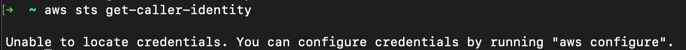

# AWS STS CLI: a cheatsheet

The AWS CLI is a very useful tool for every developer that wants to work and interact with AWS.

It allows developers to automate the process of managing AWS services and resources using scripts, customizing workflows and integrating with other tools.

With the AWS CLI you can also request temporary, limited-privilege credentials for users using [AWS Security Token Service](https://docs.aws.amazon.com/STS/latest/APIReference/welcome.html) or STS, in short.

Knowing how to programmatically use STS via the AWS CLI can be a very useful skill for any DevOps, and this article will provide an overall view of the most common commands.

## Prerequisites and Tips

* If you haven't installed the AWS CLI yet, start by looking at [Installing the AWS CLI Guide from Amazon](https://docs.aws.amazon.com/cli/latest/userguide/cli-chap-install.html).
    
* Configure the AWS CLI yourself by following [this guide](https://docs.aws.amazon.com/cli/latest/userguide/getting-started-quickstart.html), or just let [Leapp](https://www.leapp.cloud/) manage your configuration instead.
    
* **Tip**: enable Auto Completion mode for the CLI with `$ aws --cli-auto-prompt`. This will give you suggestions as you write down your commands. Just remember to exit this mode when you need to run scripts!
    

## AWS CLI filtering flags

AWS CLI commands can accept the following flags: `--query`, `--filter`, `--output`. You can use them or a combination of them to extract, filter and format the JSON output of each command so that it is easily readable and can be passed to other commands.

* `--filter` is used for server-side filtering and can improve HTTP response times for large data sets.
    
* `--query` is used for client-side filtering and can be used to do some more powerful filtering.
    
* `--output` is used to format the output, so that it can be transformed into plain text, YAML, etc.
    

## AWS STS CLI: STS assume role

Assuming a role lets you obtain temporary short-lived credentials for that role.

`aws sts assume-role --role-arn arn:aws:iam::<account_number>:role/my-role --role-session-name test --region eu-central-1`

**Flags**:

* `--role-arn`: the ARN of the role to assume
    
* `--role-session-name`: optional name for the Session
    
* `--region`: the Region in which you want to work in
    

**Output**:

```tsx
{
    "Credentials": {
        "AccessKeyId": "<AccessKeyId>",
        "SecretAccessKey": "<SecretAccessKey>",
        "SessionToken": "<SessionToken>",
        "Expiration": "<ExpirationDate>"
    },
    "AssumedRoleUser": {
        "AssumedRoleId": "<IdOfTheAssumedRole>",
        "Arn": "<ARNofTheAssumedRole>"
    }
}
```

**Tips:** you can leverage `printf` to inject credentials directly into **environment variables** without leaking them in the script. Here’s how to do it:

```bash
export $(printf "AWS_ACCESS_KEY_ID=%s AWS_SECRET_ACCESS_KEY=%s AWS_SESSION_TOKEN=%s" \\
$(aws sts assume-role \\
--role-arn arn:aws:iam::123456789012:role/MyAssumedRole \\
--role-session-name MySessionName \\
--query "Credentials.[AccessKeyId,SecretAccessKey,SessionToken]" \\
--output text))
```

## AWS STS CLI: STS assume role with SAML

You can obtain temporary credentials based on a SAML Authentication, using the SAML response.

`aws sts assume-role-with-saml --role-arn arn:aws:iam::<account_number>:role/<iam_role> --principal-arn arn:aws:iam::<account_number>:saml-provider/<SAML-provider> --saml-assertion` [`file://samlresponse.txt`](file://samlresponse.txt)

**Flags**:

* `--role-arn`: the ARN of the role to assume
    
* `--principal-arn`: the ARN of the SAML Provider configured in AWS IAM
    
* `--saml-assertion`: the SAML assertion contained in a text file
    
* `--duration-seconds`: *(optional)* the duration, in seconds, of the role session. The default value is **3600 seconds**. Valid values are from **900 seconds** (15 minutes) up to the maximum session duration setting for the role (from 1 to 12 hours).
    

**Outputs**:

```tsx
{
    "Issuer": "<https://integ.example.com/idp/shibboleth></Issuer",
    "AssumedRoleUser": {
        "Arn": "arn:aws:sts::123456789012:assumed-role/TestSaml",
        "AssumedRoleId": "123456EXAMPLE789:TestSaml"
    },
    "Credentials": {
        "AccessKeyId": "<AccessKeyId>",
        "SecretAccessKey": "<SecretAccessKey>",
        "SessionToken": "<SessionToken>",
        "Expiration": "<ExpirationDate>"
    },
    "Audience": "<https://signin.aws.amazon.com/saml>",
    "SubjectType": "transient",
    "PackedPolicySize": "6",
    "NameQualifier": "<NameQualifier>",
    "Subject": "SamlExample"
}
```

**Tips:** here’s an [example](https://repost.aws/knowledge-center/aws-cli-call-store-saml-credentials) from AWS using `awk` to store the result of this command in the credential file `./aws/credentials`:

```bash
awk -F:  '
	          BEGIN { RS = "[,{}]" ; print "[PROFILENAME]"}
	          /:/{ gsub(/"/, "", $2) }
	          /AccessKeyId/{ print "aws_access_key_id = " $2 }
	          /SecretAccessKey/{ print "aws_secret_access_key = " $2 }
	          /SessionToken/{ print "aws_session_token = " $2 }
' >> ~/.aws/credentials
```

## AWS STS CLI: STS assume role with Web Identity

You can obtain temporary credentials for users who have been authenticated in a mobile or web application with a web identity provider.

`aws sts assume-role-with-web-identity --role-arn arn:aws:iam::123456789012:role/FederatedWebIdentityRole --role-session-name ExampleSession --web-identity-token <token>`

**Flags**:

* `--role-arn`: the ARN of the role to assume
    
* `--role-session-name`: the session name
    
* `--web-identity-token`: the **web identity token** obtained from [JWT bearer tokens](https://www.rfc-editor.org/rfc/rfc7519) issued by [OIDC](https://openid.net/connect/)\-compatible identity providers (IdPs)
    

You must have a valid OAuth 2.0 access token, an OpenID Connect token, and an IAM role that trusts the IdP.

**Output**:

```tsx
{
    "SubjectFromWebIdentityToken": "amzn1.account..."
    "Audience": "client.1234567890@apps.example.com",
    "AssumedRoleUser": {
        "Arn": "arn:aws:sts::123456789012:assumed-role/FederatedWebIdentityRole/ExampleSession",
        "AssumedRoleId": "...:ExampleSession"
    }
    "Credentials": {
        "AccessKeyId": "<AccessKeyId>",
        "SecretAccessKey": "<SecretAccessKey>",
        "SessionToken": "<SessionToken>",
        "Expiration": "<ExpirationDate>"
    },
    "Provider": "www.amazon.com"
}
```

## AWS STS CLI: STS get session token

You can obtain temporary credentials for an AWS account or IAM user. The credentials consist of an access key ID, a secret access key, and a security token. Can be used with MFA-enabled IAM users.

`aws sts get-session-token`

**Flags**:

* `--duration-seconds`: *(optional)* the duration, in seconds, of the role session. The default value is **3600 seconds**.
    
* `--serial-number`: *(optional)* the ID of the MFA device, either a serial number for a hardware device or an ARN for a virtual device
    
* `--token-code`: *(optional)* the value provided by the MFA device
    

**Output**:

```tsx
{
   "Credentials": {
        "AccessKeyId": "<AccessKeyId>",
        "SecretAccessKey": "<SecretAccessKey>",
        "SessionToken": "<SessionToken>",
        "Expiration": "<ExpirationDate>"
   }
}
```

## AWS STS CLI: STS get federation token

You can obtain temporary security credentials for a user. Can be used to get temporary security credentials on behalf of distributed applications inside a corporate network.

`aws sts get-federation-token --name Bob`

**Flags**:

* `--name`: the name of the federated user. The name is used as an identifier for the temporary security credentials (such as **Bob**)
    

**Output**:

```tsx
{
  "Credentials": {
        "AccessKeyId": "<AccessKeyId>",
        "SecretAccessKey": "<SecretAccessKey>",
        "SessionToken": "<SessionToken>",
        "Expiration": "<ExpirationDate>"
  },
  "FederatedUser": {
    "Arn": "arn:aws:sts::123456789012:federated-user/Bob",
    "FederatedUserId": "123456789012:Bob"
  },
  "PackedPolicySize": 6
}
```

**Tips**:

If you want to **compare all AWS STS methods of generating temporary credentials**, [this table](https://docs.aws.amazon.com/IAM/latest/UserGuide/id_credentials_temp_request.html#stsapi_comparison) from the AWS documentation can be very useful.

## AWS STS CLI: STS get caller identity

You can use this command to see who the credentials set belongs to.

`aws sts get-caller-identity`

**Flags**:

* `--profile`: *(optional)* the named profile, specified in the `.aws/credentials` file, for the credentials set you want.
    

**Output**:

```tsx
{
    "UserId": "<UserId>",
    "Account": "123456789012",
    "Arn": "arn:aws:sts::123456789012:assumed-role/..."
}
```

If this command returns `"Unable to locate credentials"`, make sure you have a \[default\] named profile in the `.aws/credentials` file! Otherwise, use the `--profile` flag.



**Tips**:

You can use this command to quickly find your account ID.

`aws sts get-caller-identity --query Account --output text`

## Conclusions

This article continued exploring how the AWS CLI can be used to automate operations on AWS services, in particular with STS.

We explored all the different commands that we have at our disposal and how to generate temporary credentials for accessing our AWS resources.

We also introduced and explained some useful flags to give some extra spice to our output format and filter out all the unwanted information.

Thank you for sticking with us until the end of this short cheat sheet, hopefully, you learned something new!

As always, if you have any questions, need clarification, or just want to share your opinion, feel free to join our [**Top of the Ops community**](https://join.slack.com/t/noovolari/shared_invite/zt-opn8q98k-HDZfpJ2_2U3RdTnN~u_B~Q).

See you in the Cloud!
