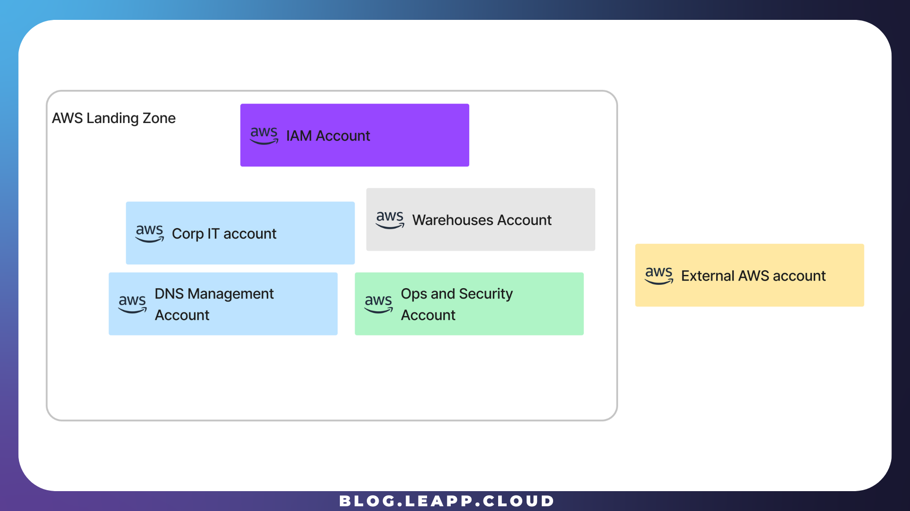
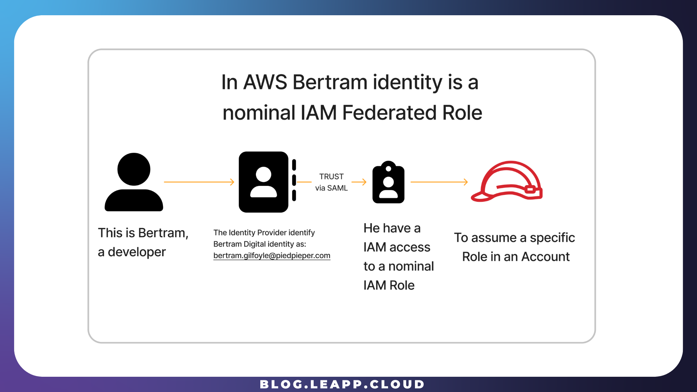
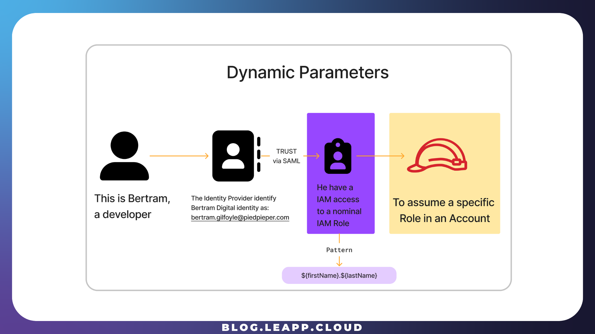
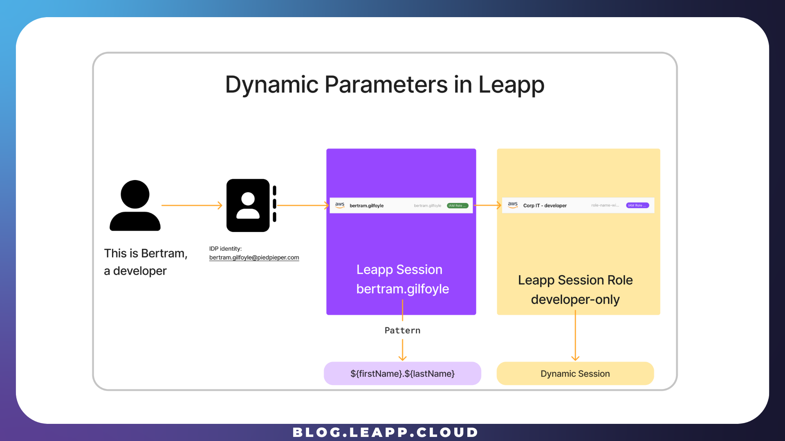
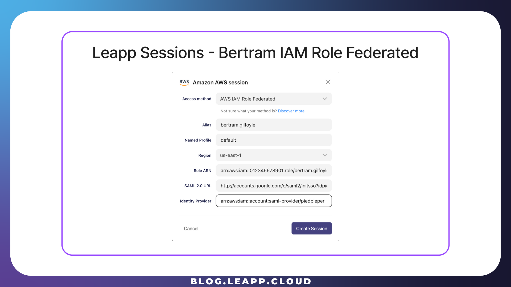
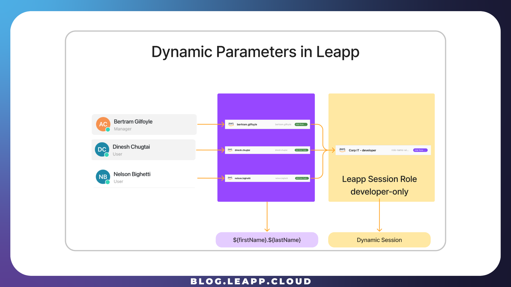
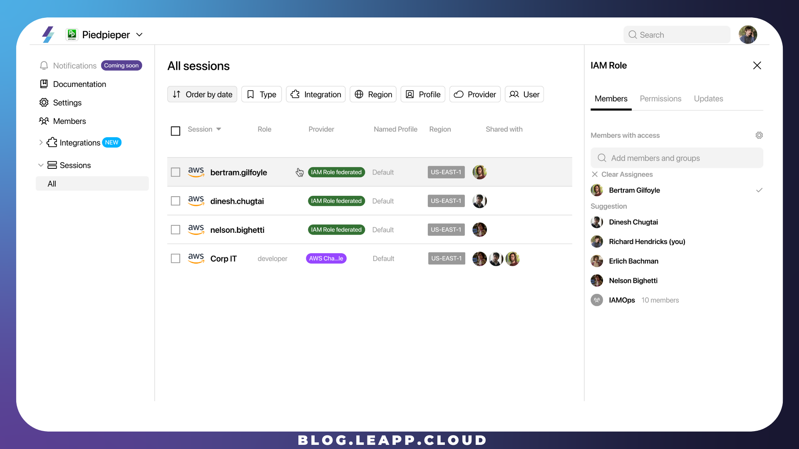
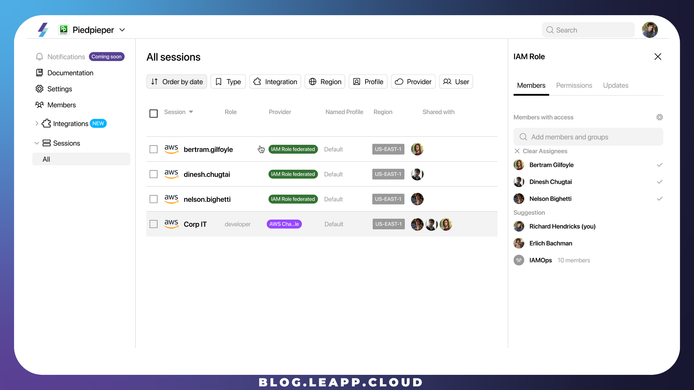
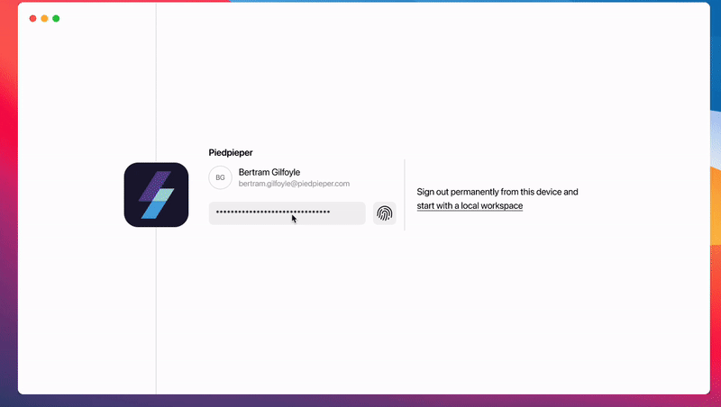

# How to manage IAM Role Federated at scale

## A real-case scenario in managing cloud access at scale: the PiedPiper company

PiedPiper company is a startup working on the AWS Cloud ecosystem. Like many others, it has adopted a **Landing Zone** approach in collecting and governing different AWS Accounts, each with a specific purpose.



PiedPiper has different developers, and each **must operate in one or more accounts.** Let’s see how PiedPiper leveraged some best practices to do so.

Let’s meet **Bertram**!

Bertram, like many other developers in PiedPiper, must at first identify himself in the cloud he has to operate. From many options, PiedPiper opted for the SAML 2.0 AWS IAM Federated Access approach



SAML 2.0 Federated Access is the way PiedPiper company identifies Bertram in its Cloud Identity Provider, and in general, [**Identity federation**](https://aws.amazon.com/identity/federation/) **is a system of trust between two parties for the purpose of authenticating users and conveying the information needed to authorize their access to resources**.

In this system, the **identity provider (IdP)** is responsible for user **authentication**, and a service provider (AWS) **controls resource access**.

A Federated Access through SAML 2.0 translates into an AWS IAM Role, which we call an **IAM Role Hatbox**


## The IAM Roles Hatbox account

PiedPiper has adopted the Leapp suggested way to **control and grant permissions** to **operate** in different accounts while completely isolating the **access** account and **defining a one-on-one relationship between the IdP Identity of the developer and its identity on AWS.**

The **trust relationship policy in AWS guarantees this trust:**

```json
{
    "Version": "2012-10-17",
    "Statement": [
        {
            "Effect": "Allow",
            "Principal": {
                "Federated": "arn:aws:iam::12345678910:saml-provider/Gsuite_PiedPiper"
            },
            "Action": "sts:AssumeRoleWithSAML",
            "Condition": {
                "StringEquals": {
                    "SAML:aud": "<https://signin.aws.amazon.com/saml>"
                }
            }
        }
    ]
}
```

To do that, PiedPiper created a **single AWS account with the sole purpose of managing User access.**

This **AWS account** (Aka: **IAM Account**) contains **only IAM Roles** that we call **Hatbox IAM Roles, which can only do** [**cross-account access**](https://docs.aws.amazon.com/IAM/latest/UserGuide/tutorial_cross-account-with-roles.html), as shown in the picture.

A Hatbox **IAM Roles is similar** to a **Hatbox,** in which every **hat** represents a **different role** a developer can assume in an AWS Account, using the [**STS assume-role operation**](https://docs.aws.amazon.com/STS/latest/APIReference/API_AssumeRole.html) in AWS.

Every developer, Bertram included, has a **nominal (name.surname)** IAM Role whose policy only grants the **assuming role to** **one or more specific AWS accounts** each developer has to operate into.



Every IAM Hatbox Role will have a policy like the one for Bertram:

```json
{
  "Version": "2012-10-17",
  "Statement": [
    {
      "Effect": "Allow",
      "Action": "sts:AssumeRole",
      "Resource": "arn:aws:iam::98765432101:role/developer-only"
    }
  ]
}
```

This strategy can be adopted for one or **more** AWS Accounts, Internal or **External** to an AWS Organization. One of the immediate advantages is that it is simpler to isolate a developer's scope in the Cloud environment.

<div data-node-type="callout">
<div data-node-type="callout-emoji">🔥</div>
<div data-node-type="callout-text">We firmly believe in doing so because it isolates the Access account and the Operations Accounts, differentiating <strong>where a <em>developer</em> CAN ACCESS</strong> from <strong>what a <em>developer</em> CAN OPERATE.</strong></div>
</div>

## Managing IAM Roles at scale with the Leapp Team

PiedPiper uses the Leapp Team to manage its Developers’ accounts, and to do so, let’s see how Richards can access one account it must operate into.

At first, PiedPiper has created two **Leapp Team Sessions:**

* The Nominal **Hatbox Session** *(where* ***Bertram*** *CAN ACCESS)*
    
* The **IAM Role Chained session** that Bertram must assume. (*what* ***Bertram*** *CAN OPERATE.)*
    



To take advantage of Leapp Team's dynamic session feature, PiedPiper created an IAM Federated Role Session with the alias **bertram.gilfoyle**.



## The dynamic parameter feature

PiedPiper uses the dynamic feature to simplify sharing the Chained IAM Role with different developers. By using a **name.surname pattern,** it is possible to separate the final Role from every developer in the AWS Organization.

The company needs to create distinct **hatbox IAM Roles**, and the Leapp Team can effortlessly convert the final Role into an operational one by replacing the pattern with the actual **name and surname of each developer**. This streamlined process emphasizes simplicity.



A **single dynamic IAM Role Chained Session** can be shared **among as many developers** as possible. The advantage here is clear: a company has the flexibility to manage and segregate account access in both directions; it can sever the entire account access to **every developer** by **removing the chained role,** or it can add/remove access to single developers using the **Hatbox** strategy.

By following what we described before, PiedPiper created a new IAM Role Chained Session, specifying the default dynamic pattern as the Assumer.


PiedPiper now only needs to **share these two sessions** with Bertram to make him able to work in the destination account.

## What is done for one it is done for many.

Bertram is **only one of many different developers** in the PiedPieper company, and what we have seen for him can be easily extended for everyone in the company by following the same rules as shown before.

## What about Bertram?

Bertram can now operate in the destination account by logging into the Leapp Desktop App using his **team credentials,** and what happens is that a new Assumable Role Session is available to him; Leapp Team has converted the dynamic pattern to a valid IAM Role that identifies Bertram explicitly.



Bertram has one **AWS** **IAM Federated Role**, which is personal and **shared only with him**. The AWS Chained Session is, instead, shared with all the developers in the company; this way, PiedPiper **has complete control over sharing/unsharing** with Bertram and his colleagues.



Finally, Bertram can **use these Leapp Sessions to access the correct AWS Account he needs to work into**.



\* The operations applied in the Leapp Team **must reflect configurations already defined in AWS**, e.g., **having the correct assume role policies** and the **correct Hatbox IAM Roles defined in the IAM Account**. Leapp Team **helps you define a proper method, while in the future, we will also provide an automatic procedure to synchronize your Company’s dashboard with your AWS Organization.**
