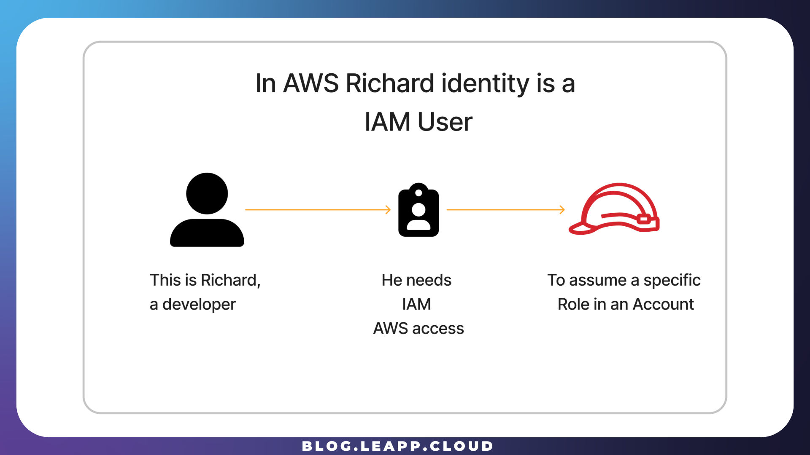
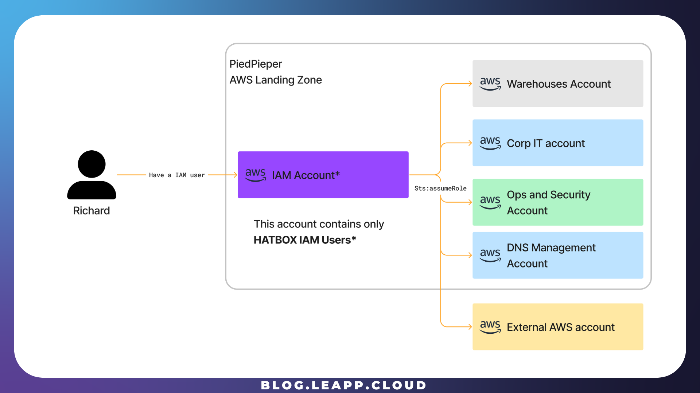
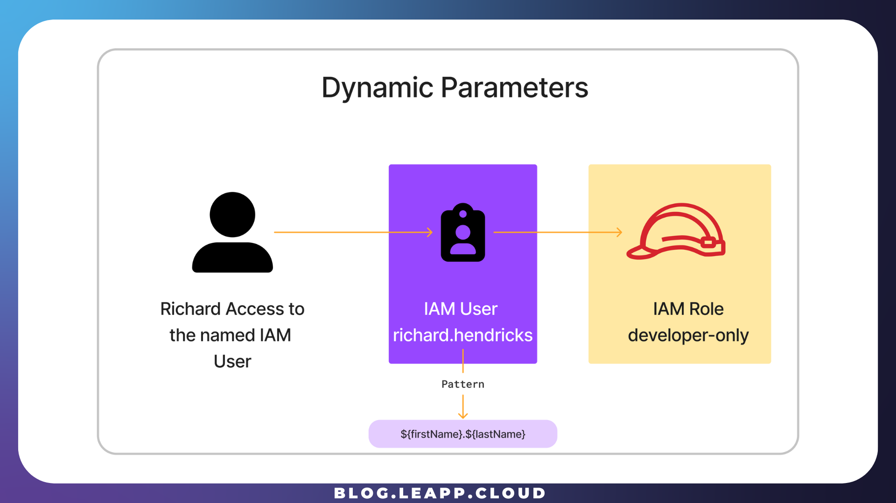
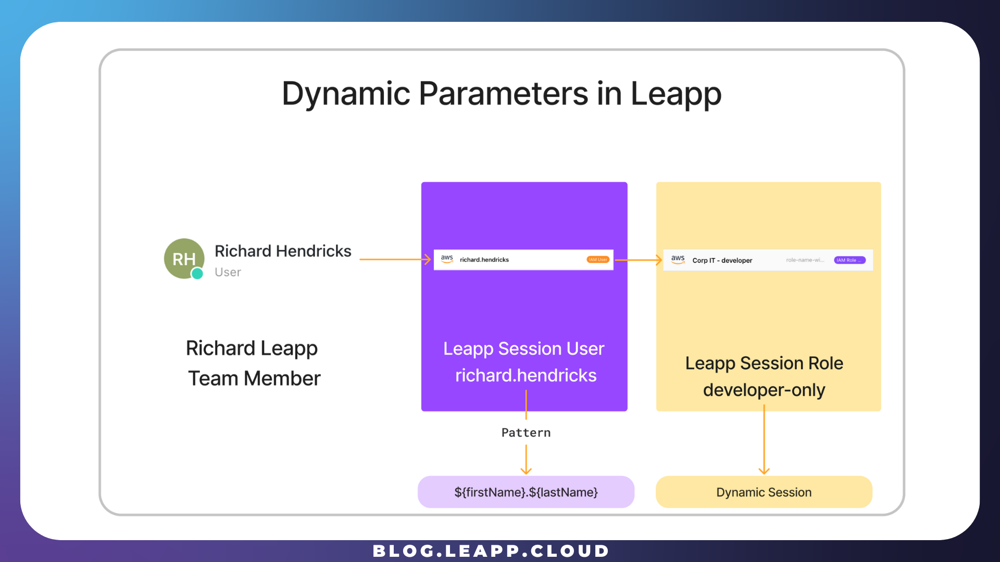
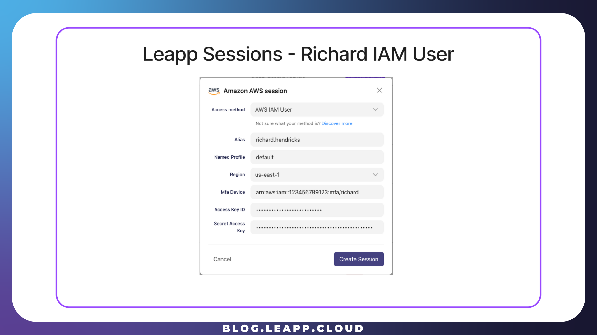
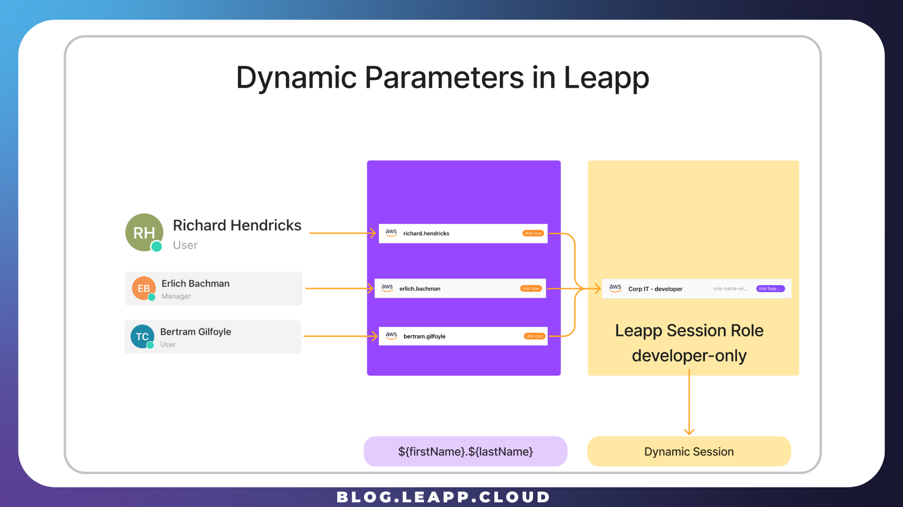
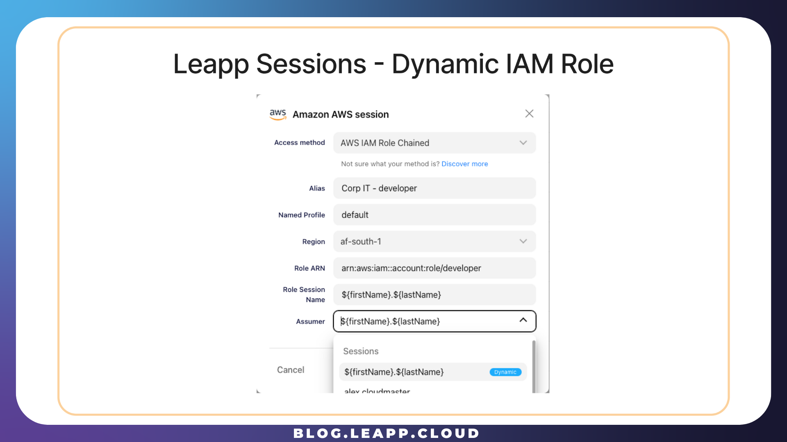
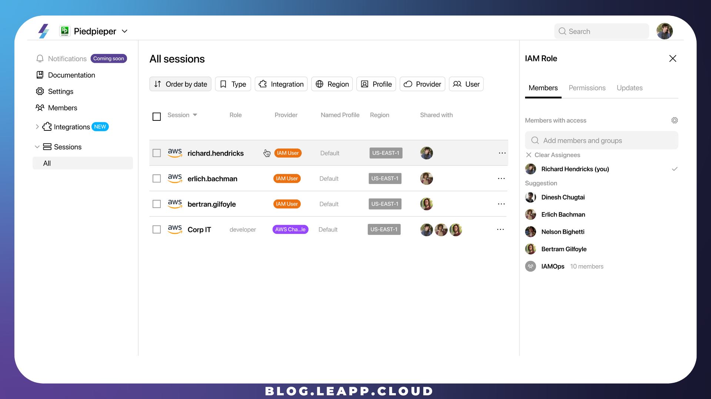
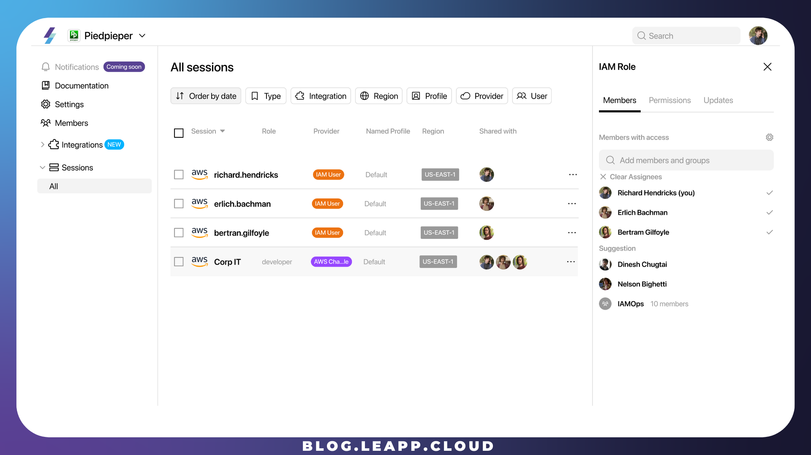
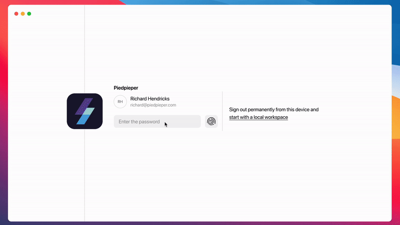

# How to manage IAM Users at scale

## A real-case scenario in managing cloud access at scale: the PiedPiper company

PiedPiper company is a startup working on the AWS Cloud ecosystem. Like many others, it has adopted a **Landing Zone** approach in collecting and governing different AWS Accounts, each with a specific purpose.


PiedPiper has different developers, and each **must operate in one or more accounts.** Let’s see how PiedPiper leveraged some best practices to do so.

Let’s meet **Richard**!

Richard, like many other developers in PiedPiper, must at first identify himself in the cloud he has to operate. From many options, PiedPiper opted for the AWS IAM User approach.



An AWS IAM User is the way PiedPiper company identifies Richard in its Cloud environment, and this particular IAM User is called an **IAM User Hatbox.**

## The IAM Users Hatbox account

PiedPiper has adopted the Leapp suggested way to control and grant permissions to **operate** in different accounts while completely isolating the **access** account. To do that, PiedPiper created a **single AWS account with the sole purpose of managing User access.**

This **AWS account** (Aka: **IAM Account**) contains **only IAM Users** that we call **Hatbox IAM Users, which can only do** [**cross-account access**](https://docs.aws.amazon.com/IAM/latest/UserGuide/tutorial_cross-account-with-roles.html), as shown in the picture.



A Hatbox **IAM USER is similar** to a **Hatbox,** in which every **hat** represents a **different role** a developer can assume in an AWS Account, using the [**STS assume-role operation**](https://docs.aws.amazon.com/STS/latest/APIReference/API_AssumeRole.html) in AWS.

Every developer, Richard included, has a **nominal (name.surname)** IAM user whose policy only grants **assuming role to** **one or more specific AWS accounts** each developer has to operate into.



Every IAM Hatbox user will have a policy like the one for Richard:

```jsx
{
  "Version": "2012-10-17",
  "Statement": [
    {
      "Effect": "Allow",
      "Action": "sts:AssumeRole",
      "Resource": "arn:aws:iam::98765432101:role/developer-only"
    }
  ]
}
```

This strategy can be adopted for one or **more** AWS Accounts, Internal or **External** to an AWS Organization. One of the immediate advantages is that it is simpler to isolate a developer's scope in the Cloud environment.

<div data-node-type="callout">
<div data-node-type="callout-emoji">🔥</div>
<div data-node-type="callout-text">We firmly believe in doing so because it isolates the Access account and the Operations Accounts, differentiating <strong>where a <em>developer</em> CAN ACCESS</strong> from <strong>what a <em>developer</em> CAN OPERATE.</strong></div>
</div>

## Managing IAM User at scale with Leapp Team

PiedPiper uses the Leapp Team to manage its Developers’ accounts, and to do so, let’s see how Richards can access one account it must operate into.

At first, PiedPiper has created two **Leapp Team Sessions:**

* The Nominal **Hatbox Session** *(where* ***Richard*** *CAN ACCESS)*
    
* The **IAM Role Chained session** that Richard must assume. (*what* ***Richard*** *CAN OPERATE.)*
    



To take advantage of Leapp Team's dynamic session feature, PiedPiper created an IAM User Session with the alias **richard.henricks**.



## The dynamic parameter feature

PiedPiper uses the dynamic feature to simplify sharing the Chained IAM Role with different developers. By using a **name.surname pattern,** it is possible to separate the final Role from every developer in the AWS Organization.

The company needs to create distinct **hatbox IAM users**, and the Leapp Team can effortlessly convert the final Role into an operational one by replacing the pattern with the actual **name and surname of each developer**. This streamlined process emphasizes simplicity.



A **single dynamic IAM Role Chained Session** can be shared **among as many developers** as needed. The advantage here is clear: a company has the flexibility to manage and segregate account access in both directions; it can sever the entire account access to **every developer** by **removing the chained role** or add/remove access to single developers using the **Hatbox** strategy.

By following what we described before, PiedPiper created a new IAM Role Chained Session, specifying the default dynamic pattern as the Assumer.



PiedPiper now only needs to **share these two sessions** with Richard to make him able to work in the destination account.

## What is done for one it is done for many.

Richard is **only one of many different developers** in PiedPiper company, and what we have seen for him can be easily extended to everyone in the company by following the same rules as shown before.

## What about Richard?

Richard can now operate in the destination account by logging into the Leapp Desktop App using his **team credentials,** and what happens is that a new Assumable Role Session is available to him; the Leapp Team has converted the dynamic pattern to a valid IAM Role that identifies Richard explicitly.



Richard has one **IAM User**, which is personal and **shared only with him**. The AWS Chained Session is, instead, shared with all the developers in the company; this way, PiedPiper **has complete control over sharing/unsharing** with Richard and his colleagues.



Finally, Richard can **use these Sessions to access the correct AWS Account he needs to work into**.



\* The operations applied in the Leapp Team **must reflect configurations already defined in AWS**, e.g., **having the correct assume role policies** and the **correct Hatbox IAM Users defined in the IAM Account**. Leapp Team **helps you define a proper method, while in the future, we will also provide an automatic procedure to synchronize your Company’s dashboard with your AWS Organization.**
