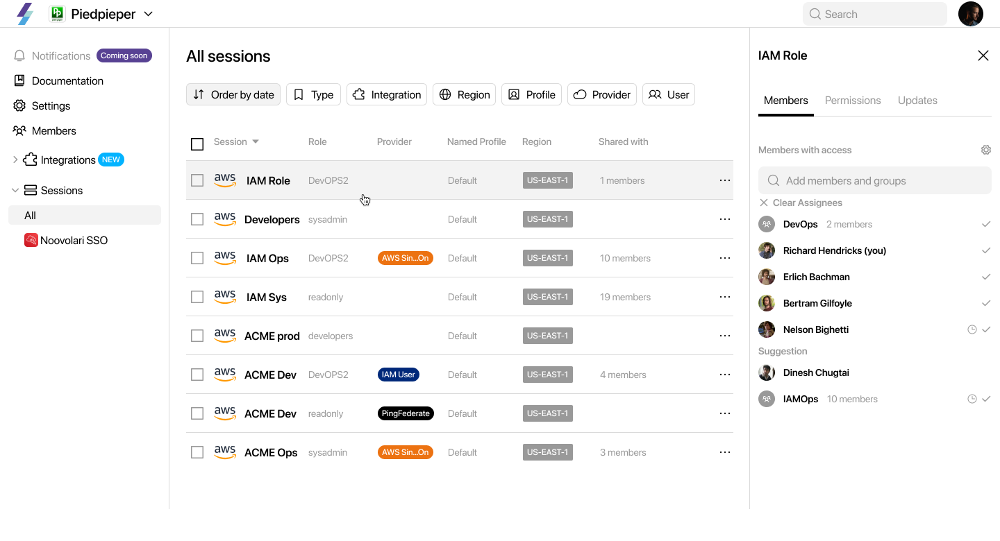
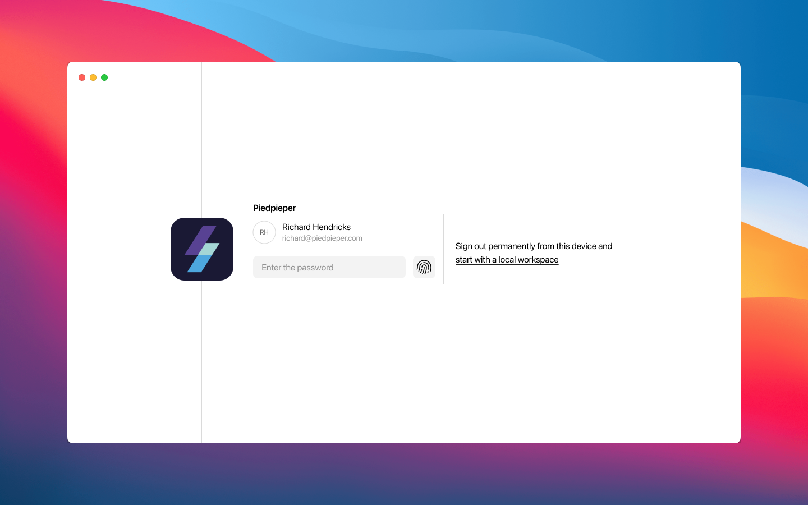
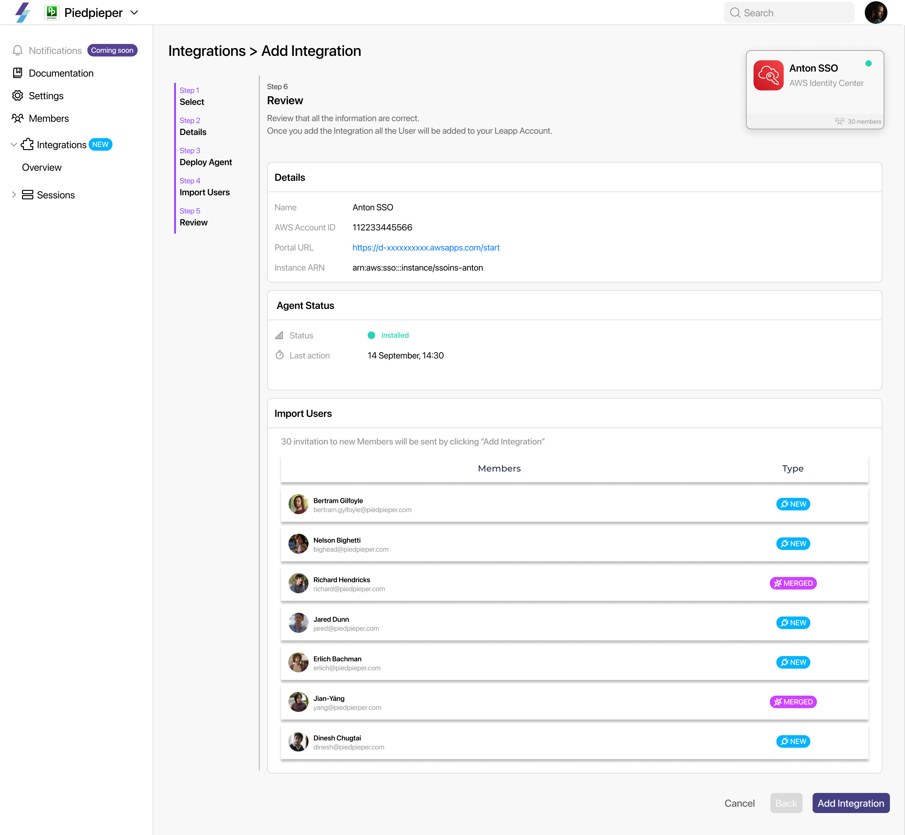
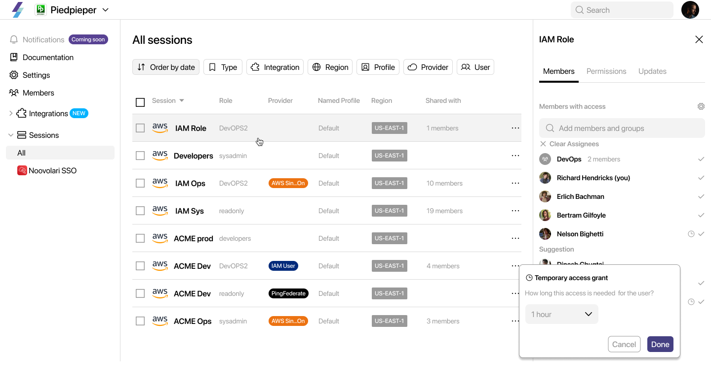
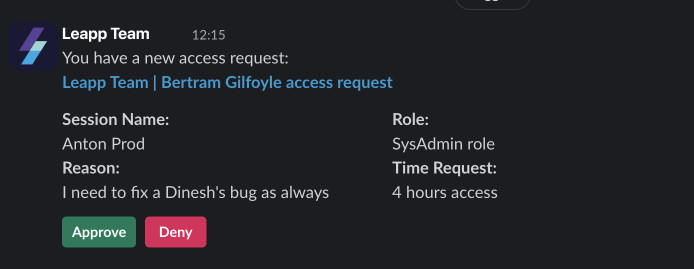
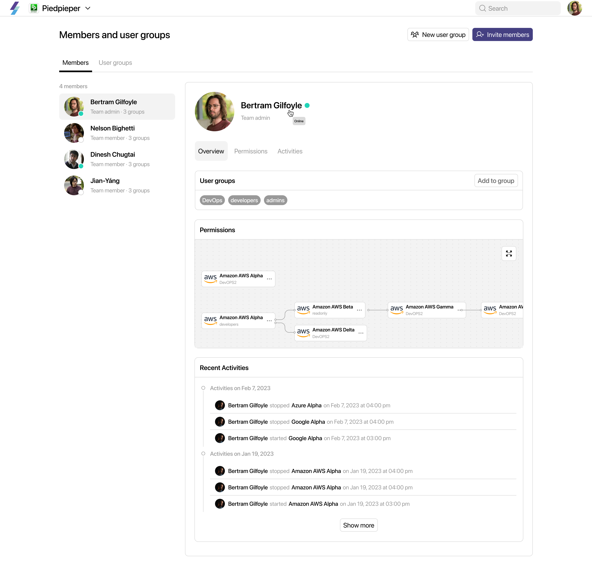

# Introducing Leapp Team

## **From the CEO's Desk**

We understand how challenging it can be to manage access in the constantly evolving world of cloud computing. It can take up so much time and effort, and we know how crucial it is to ensure that teams have smooth, secure, and efficient access.

**Leapp isn't just a product; it represents our vision to simplify cloud access for everyone.** We know how important collaboration is in today's fast-paced digital world. But we also know that tools must be efficient and secure to collaborate. That's why we've created Leapp, and we are **now launching Leapp Team** - a platform that will revolutionize how teams interact with cloud environments, making the process smoother, more secure, and inherently collaborative.

## Decentralization in Cloud Computing: Unlocking Efficiency and Empowerment

In our journey through the cloud computing landscape, we've encountered a common pattern: the reliance on a delegation model. Traditionally, a select few hold the reins of cloud access, embodying a centralized approach that, while stable, often stifles the very essence of creativity and agility in a team.

Though rooted in a desire for control and oversight, this approach inadvertently creates bottlenecks. It places immense pressure on a few **'gatekeepers'** and leaves team members in a constant wait for access permissions - a scenario far from ideal in today's fast-paced work environments.

But we asked ourselves, "What if there's a better way?", “What if we embrace the spirit of collaboration and empowerment that thrives in the open-source community instead of centralizing?” This thought led us to a groundbreaking idea: decentralization.

Decentralization in cloud access isn't just a strategy; **it's a shift towards a more democratic, empowering work culture.** It's about giving every team member the keys to their part of the Cloud kingdom within a secure and structured environment. This approach creates a dynamic, responsive atmosphere where everyone has timely access to what they need, fostering a sense of ownership and responsibility.

**The beauty of decentralization lies in its ability to streamline operations and enhance security.** This is our response to the limitations of the delegation model in cloud computing, and we have seen that by embracing this model, organizations can unlock greater efficiency, agility, and innovation in their cloud operations.

## Reimagining Cloud Access: A User-Centric Approach

At Noovolari, we're driven by a simple yet profound belief: technology should empower, not hinder. We've been trying to find harmony in the intricate usage of cloud computing, where security and ease of use often seem at odds. We aim to create an environment that safeguards your work without adding complexity.

We've all been tangled in the web of cloud access management, feeling more like we're battling a maze rather than harnessing a tool. We understand how this frustration can overshadow the true potential of cloud computing. But more importantly, we see a path forward, a way to transform this experience into something empowering and fluid.

Leapp is the embodiment of this vision. **It's where we put the user - you, the developers, the innovators - at the heart of everything.** Our interfaces and workflows are crafted not just for functionality but for intuitiveness and ease. **With Leapp, we're ensuring that your time is spent on what truly adds value to your work,** surrounded by security that feels as natural as it is robust.

We firmly believe that access management is a pivotal element of user-centric design. It's why we've reimagined access controls to be more intuitive, reducing the mental load and turning what used to be a barrier into a gateway. Accessing the resources you need is now quick, smooth, and hassle-free, removing the friction that often clouds the day.

## **Enhancing Functionality Through Integrations**

While current solutions have set a standard in cloud access management, their approach often leans towards centralized control and one-size-fits-all frameworks that may not align with the unique needs of every organization. Teams can be constrained by inflexible workflows and a lack of adaptability, particularly in dynamic environments where quick access adjustments are crucial.

In Leapp Team, integrations mean more than just linking systems; they enhance how these systems work together. By integrating with platforms like AWS Identity Center, we're not just accessing their services but combining them with Leapp's unique capabilities. This approach doesn't only connect systems; it enhances them, creating a seamless and powerful experience.

### **Temporary Access for Dynamic Security**

**In our ongoing development of Leapp Team, a key focus is on implementing temporary access within AWS Identity Center.** This feature, critical for dynamic security, is also designed with the principle of least privilege in mind. It ensures that access rights are granted on a need-to-use basis and for the minimum time necessary, significantly enhancing security.

The temporary access feature will allow administrators to assign access permissions for a specific duration, aligning perfectly with situations where access requirements are transient. This approach minimizes security risks by limiting long-term access and adheres to the best practices of least privilege, ensuring that users have access only when absolutely necessary and for no longer than needed.

This feature will provide a robust mechanism to manage permissions more securely and effectively, embodying our commitment to creating a safer, more agile cloud environment.

### **Building Decentralized Access Requests and Approvals**

Another core enhancement we are developing for AWS Identity Center is decentralized access through requests and approvals. Moving away from traditional centralized management, this feature will allow for a more agile and distributed approach to access management. Our goal is to empower individual team members to manage access requests and approvals autonomously, enhancing the process's speed, flexibility, and responsiveness. This enhancement is designed to seamlessly integrate with AWS Identity Center's existing security framework, offering a more dynamic approach to access management.

### **Working on Enhanced Visibility into AWS Environments**

We are also in the process of integrating visibility schemas into AWS Identity Center via Leapp Team. This feature, once completed, will provide a detailed and user-friendly view of access points within AWS environments. The aim is to make navigating the complex world of permissions and access rights simpler and more intuitive, thereby improving management efficiency and aiding in maintaining compliance with security standards.

# **Conclusion: Elevating Current Solutions with Advanced Capabilities**

By integrating these advanced features into Integrations, Leapp Team is setting new standards in cloud access management. Decentralized access, temporary permissions, and enhanced visibility are not just features – they represent a holistic approach to managing cloud environments. With Leapp Team, users can now enjoy a more secure, flexible, and user-friendly experience tailored to meet the needs of modern, dynamic cloud teams.
