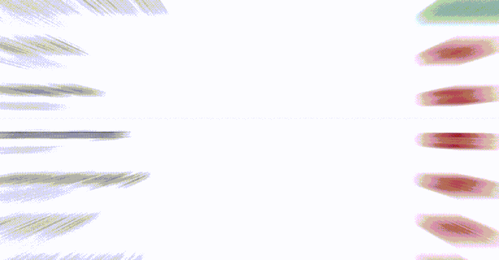
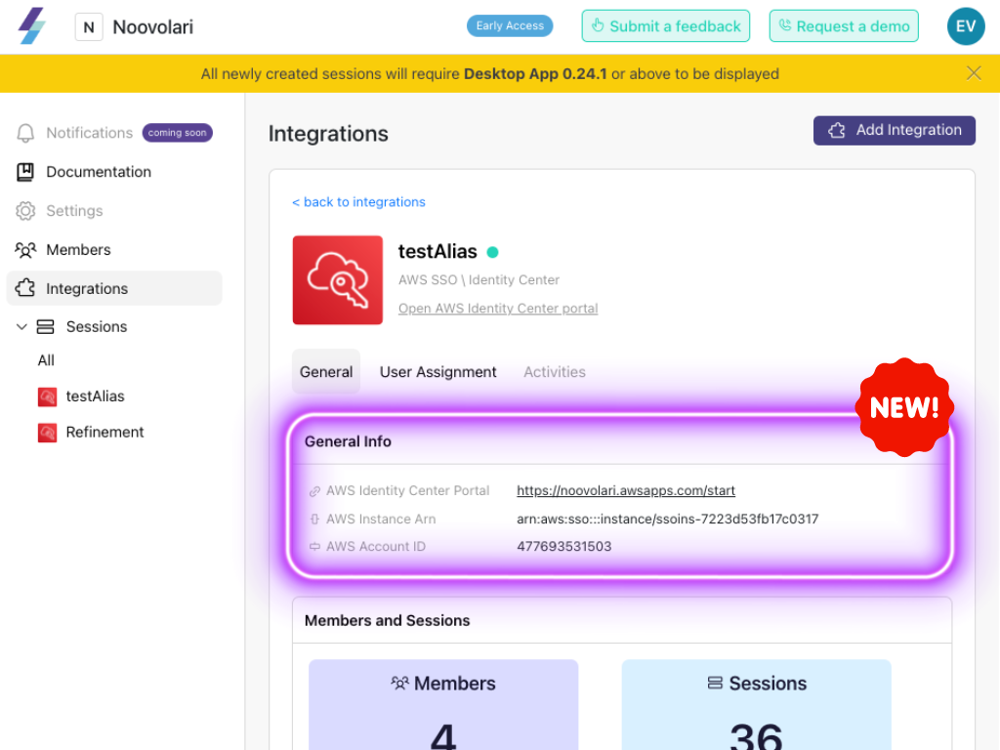
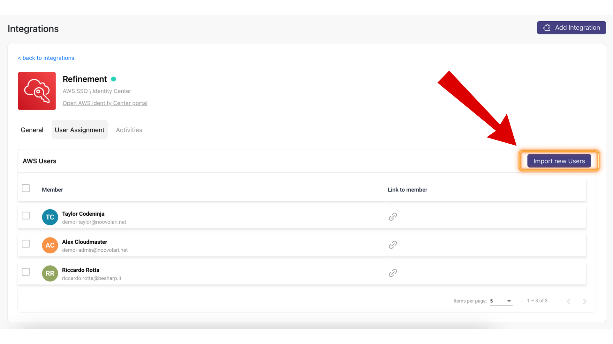
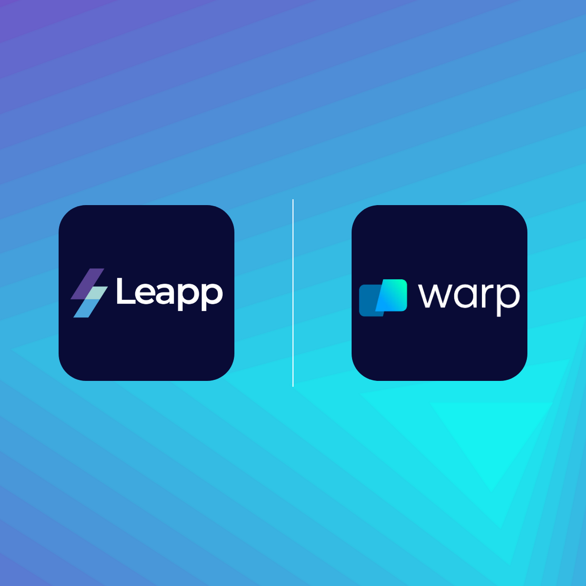

# Welcome Sessions folding

No more digging through heaps of sessions.

Now, your sessions are neatly tucked away in their **dedicated account folders.** Finding sessions is now as simple as finding your favorite socks! Just browse through the account folders, and voila!

---

# Fresh out of the oven!

## **Integration detail is more comprehensive.**

We added a general info section in the integration detail to provide a more comprehensive overview.

Now, at a glance, you can access essential information about the integration, including:

* AWS Identity Center Portal
    
* AWS Instance Arn
    
* AWS Account ID
    

## Import and deletion of AWS Identity Center Users

Now, you can add additional Leapp Members directly from your AWS Identity Center Users.

## Welcome Warp!

We've **added a new terminal to Leapp**, specially tailored for all MacOS enthusiasts! This feature comes from one of our community rockstars. Thanks, [Blyzer](https://github.com/Noovolari/leapp/pull/510)!

[Warp](https://www.warp.dev/) is a modern, Rust-based terminal with AI built in so you and your team can build great software, faster.

---

# 🐞 Bug Fixing

* 🌎 In the Leapp Team, now it is possible to enable **multi-region for the integration setup.** Thanks, Alex!
    
* ⚙️ Thanks Eric! In the Leapp Team, we fixed a bug that prevented retrieving users from an integration when using an alias in the portal URL of the AWS IAM Identity Center.
    
* 🙋‍♂️ In the Leapp Team, there was a bug with Leapp groups. Now, all the relevant Sessions are automatically shared by adding a new Member to a group. Thanks, Riky!
    

---

But wait, there's more.

This Release note will be a bi-weekly update on the Noovolari news. [Stay updated here](https://blog.leapp.cloud/series/release-notes)

We'll see you very soon,

Your friends at Noovolari

\---

P.S. We're actively looking for funding; contact us at info@noovolari.com for inquiries
