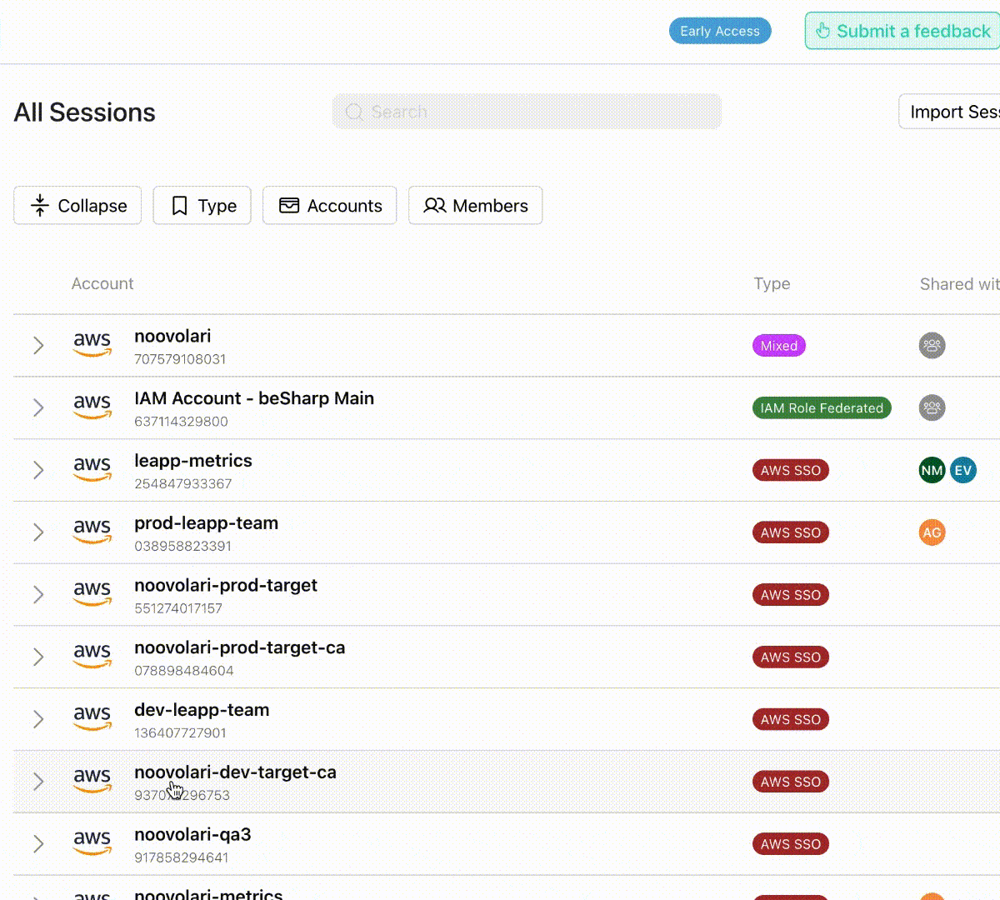

# Welcome Import Sessions

### **📥** Import multiple Leapp Sessions at the same time!



One of our loved customers requests a way to **import multiple Leapp sessions simultaneously.**

To accommodate this need, we're offering a YAML format for the import functionality. This format provides distinct advantages tailored to different preferences and needs, ensuring a seamless and efficient import process.

Here is an example of a YAML file

```yaml
sessions:
  - session-1:
      type: "awsIamUserSession"
      awsAccount:
        accountId: "<account-id>"
        accountName: "<account-name>"
      iamUserName: "john.doe"
      accessKey: "<access-key>"
      secretKey: "<secret-key>"
      mfaDevice: "<mfa-device>"
  - session-2:
      type: "awsIamRoleFederatedSession"
      awsAccount:
        accountId: "<account-id>"
        accountName: "<account-name>"
      roleArn: "arn:aws:iam::account:role/developer"
      idpArn: "<idp-arn>"
      samlUrl: "<saml-url>"
  - session-3:
      type: "awsIamRoleChainedSession"
      awsAccount:
        accountId: "<account-id>"
        accountName: "<account-name>"
      roleArn: "<role-arn>"
      assumerSession:
        $ref: "session-1"
```

---

# **🔎** Filter Sessions

We added a filter section on the session page to provide a better user experience.


Now you can filter on the "All Sessions" page by the following search criteria:

* **Member**: User with whom a Session is shared (from the list of all available Leapp Members).
    
* **Sessions Type:** Type of Session present in All Sessions (AWS IAM User, AWS IAM Role Federated, AWS IAM Role Chained, AWS Single Sign-On, etc.)
    
* **Account Name:** Filter only for certain accounts (from the list of available accounts)
    

In addition, there is a "**Collapse All/Expand All**" button that allows you to view all the accounts in detail with just one click and organize the view more neatly.

---

# **Create new Sessions in a more orderly way** 🧹

We decided to clean up the form to create a new Leapp Session:

Now, an Alias for each Session is no longer needed.

Also, we improved the way a user can select the Assumer Session for an AWS Role Chained

This feature lets you streamline your workflow by creating sessions without useless parameters!

---

# 🐞 Bug Fixing

* ⚙️ When you used to import a Leapp Team session on the Desktop App, the default region was always AF-South-1. Thanks to Ricky, now the **default region is based on the region set by the user in the settings.**
    
* 🔗 **Restored Dynamic Assumer functionality for IAM chained sessions.** Thanks, Eric for resolving this bug!
    

---

But wait, there's more.

This Release note will be a bi-weekly update on the Noovolari news. [Stay updated here](https://blog.leapp.cloud/series/release-notes)

We'll see you very soon,

Your friends at Noovolari

\---

P.S. We're actively looking for funding; contact us at info@noovolari.com for inquiries
